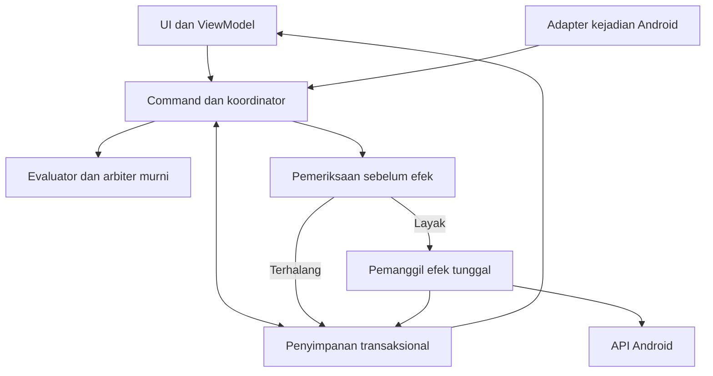
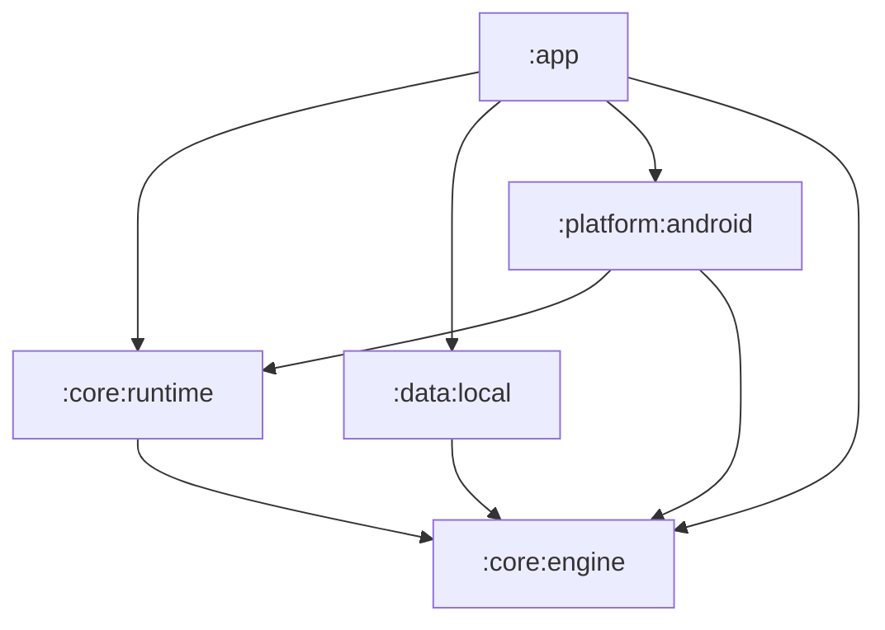

# Krono

## Architecture

| Atribut | Keterangan |
| --- | --- |
| Dokumen | `ARCHITECTURE.md` |
| Versi | 0.1 |
| Tanggal | 22 Oktober 2026, Asia/Jakarta |
| Acuan | PRD v0.1, Android Capabilities v0.1, dan Rule Engine v0.1 |
| Tahap | Rancangan arsitektur sebelum implementasi |
| Status keputusan | Seluruh pilihan teknis baru merupakan usulan v0.1 |
| Status implementasi | Belum ada proyek aplikasi yang dibangun atau pengujian perangkat dari tahap dokumentasi ini |
| Cakupan | Stack, batas modul, aliran data, koordinasi efek, penyimpanan, background, pemulihan, dan verifikasi |

> Krono diusulkan sebagai aplikasi Android native dengan pemrosesan aturan dan penyimpanan lokal. Mesin menentukan keputusan dari snapshot; integrasi Android menentukan apakah sumber dan aksi tersedia. Kemampuan background tetap mengikuti batas platform dan bukti perangkat.

## 1. Tujuan dan cara membaca dokumen

Dokumen ini menjelaskan bagaimana kebutuhan produk dan kontrak mesin aturan diwujudkan menjadi komponen aplikasi. Fokusnya adalah kepemilikan tanggung jawab: siapa membaca sumber, menyimpan perubahan, memilih cabang, mengizinkan efek, dan menjelaskan hasil.

Arsitektur harus mendukung lokasi → wallpaper dan TWS pilihan → volume media, termasuk IF/ELSE IF/ELSE dasar, beberapa aksi berurutan, simulasi, serta riwayat. Kontrak perilakunya tetap mengikuti `RULE_ENGINE.md`. Dokumen ini tidak mengganti makna UNKNOWN, konflik, episode, atau pemulihan dengan perilaku bawaan sebuah library.

Tabel keputusan berikut adalah rekomendasi konkret untuk memulai proyek. Status usulan berarti belum menjadi persetujuan final pemilik produk, bukan berarti semua pilihan dibiarkan tanpa arah. Fakta platform diberi sumber resmi; penetapan struktur Krono adalah keputusan rancangan sendiri.

Skema tabel lengkap berada pada tahap `DATABASE.md`. Spesifikasi visual berada pada `DESIGN.md`. Dokumen ini menetapkan batas yang perlu dipatuhi keduanya, tanpa membuat implementasi aplikasi.

### 1.1 Istilah yang digunakan

| Istilah | Arti dalam arsitektur Krono |
| --- | --- |
| Evaluator murni | Fungsi yang menghitung keputusan dari masukan eksplisit, tanpa membaca Android, database, atau waktu tersembunyi. |
| Port | Kontrak Kotlin yang dibutuhkan komponen lain, misalnya membaca aturan atau meminta pemeriksaan sumber. |
| Adapter | Implementasi port untuk teknologi tertentu, misalnya Room atau Bluetooth Android. |
| Runtime | Koordinator pekerjaan selama satu proses Krono hidup; dapat dibuat kembali setelah proses berakhir. |
| Inbox / outbox | Catatan masukan yang perlu diproses / permintaan kerja yang perlu diserahkan ke komponen lain. Keduanya disimpan sebelum pengiriman lanjutan. |
| Journal | Catatan fase dan hasil upaya efek perangkat, digunakan untuk mencegah pengulangan buta. |
| Rekonsiliasi | Membandingkan konfigurasi yang diinginkan dengan keadaan yang dapat diperiksa, lalu memperbaiki pemantauan sesuai akses. |

## 2. Keputusan arsitektur yang direkomendasikan

| ID | Usulan v0.1 | Alasan dan konsekuensi |
| --- | --- | --- |
| AR-01 | Android native menggunakan Kotlin. | Integrasi geofence, Bluetooth, wallpaper, audio, dan lifecycle merupakan inti produk. |
| AR-02 | Jetpack Compose, Material 3, satu activity, dan Navigation 3. | Cocok untuk layar Aturan, Editor, Riwayat, dan Pengaturan dengan state yang jelas. |
| AR-03 | Satu aplikasi dengan lima modul Gradle. | Memisahkan tanggung jawab penting sambil menjaga jumlah modul awal tetap terbatas. |
| AR-04 | Evaluator dan model inti dalam Kotlin/JVM tanpa dependensi Android. | Logika cabang, deduplikasi, dan konflik dapat diperiksa secara deterministik. |
| AR-05 | Koordinator eksekusi terpisah dari ViewModel dan receiver. | Umur layar dan pengiriman ulang pekerjaan tidak menentukan kebenaran mesin. |
| AR-06 | Room 3 menjadi penyimpanan utama konfigurasi dan kontrol eksekusi. | Keputusan yang saling terkait memerlukan transaksi, pemeriksaan versi, dan kunci unik. |
| AR-07 | DataStore hanya untuk preferensi yang tidak menentukan izin melakukan efek. | Tema atau penyaring daftar tidak perlu berbagi transaksi dengan journal. |
| AR-08 | Satu proses aplikasi dan satu jalur pemanggilan efek. | Mengurangi perlombaan antarpemanggil; journal tetap menjadi sumber deduplikasi yang tahan pengiriman ulang. |
| AR-09 | Pemantauan berbasis kejadian, dengan WorkManager untuk pekerjaan yang sesuai. | Tidak menggunakan loop pembacaan GPS/TWS terus-menerus sebagai fondasi MVP. |
| AR-10 | Aset wallpaper diimpor menjadi salinan privat milik Krono. | Ketahanan aksi tidak bergantung pada URI sementara atau gambar cloud yang belum selesai dibaca. |
| AR-11 | Hilt untuk penyusunan dependensi Android; inti menerima dependensi melalui constructor biasa. | Implementasi perangkat dapat diganti dengan fake saat pengujian. |
| AR-12 | Tidak memerlukan akun atau backend pada MVP. | Aturan, evaluasi, dan hasil disimpan lokal; layanan lokasi tetap dapat memiliki ketergantungan jaringan. |
| AR-13 | Kelayakan audio Android 17 diperiksa pada konteks sebenarnya. | Jalur volume background tidak dinyatakan tersedia hanya karena worker atau FGS ada. |
| AR-14 | Penghapusan riwayat dipisahkan dari penghapusan kontrol deduplikasi. | Membersihkan tampilan log tidak boleh membuat efek lama berjalan lagi. |

Panduan Android saat ini menyarankan pemisahan UI dan data, repository, aliran data satu arah, serta Compose. Lapisan domain dapat ditambahkan ketika kompleksitas membutuhkannya. Krono memakai inti mesin khusus karena keputusan aturan perlu dapat diuji terpisah dari perangkat. Pembagian lima modul adalah usulan Krono sendiri. [R01][R02]

## 3. Stack dan acuan versi

### 3.1 Baseline teknologi

| Bagian | Pilihan awal | Pemakaian |
| --- | --- | --- |
| Bahasa | Kotlin | Model, logika, coroutine, dan integrasi Android. |
| UI | Jetpack Compose + Material 3 | Komponen tampilan dan tema. |
| Navigasi | Navigation 3 | Back stack dan tujuan layar berbasis Compose. |
| State layar | ViewModel + StateFlow | State yang diturunkan dari repository dan command pengguna. |
| Asinkron | Kotlin Coroutines + Flow | Pengamatan data, koordinasi, dan operasi suspend yang dibatasi. |
| Database | Room 3 | Konfigurasi, pengamatan relevan, inbox, kesempatan, rencana, journal, serta riwayat. |
| Preferensi | Preferences DataStore | Tema, penyaring, dan preferensi tampilan. |
| Dependency injection | Hilt | Penyusunan instance dan integrasi entry point Android. |
| Penjadwalan | WorkManager | Drain pekerjaan, rekonsiliasi registrasi, dan pemeliharaan yang toleran keterlambatan. |
| Lokasi | Google Play services GeofencingClient | Pemantauan area; pengamatan posisi tambahan dilakukan terbatas bila tersedia. |
| Bluetooth | API publik profil Android | Perangkat pilihan dan perubahan koneksi yang didukung. |
| Wallpaper | WallpaperManager | Pemasangan gambar ke sasaran yang lolos pemeriksaan. |
| Volume | AudioManager | Pengaturan volume media dalam konteks yang memenuhi syarat. |
| Pemilih gambar | Activity Result API dan pemilih sistem | Akses ke gambar yang dipilih pengguna. |
| Build | Gradle Kotlin DSL + version catalog | Dependensi dan konfigurasi yang dapat ditelusuri. |

Navigation 3 sudah memiliki rilis stable dan direkomendasikan dalam panduan arsitektur terbaru. Karena proyek baru belum memiliki navigasi lama, baseline menggunakan Navigation 3. Contoh dependensi alpha pada suatu halaman tidak otomatis menjadi pilihan Krono. [R01][R05]

### 3.2 Snapshot versi yang diperiksa

Angka berikut diperiksa pada **22 Oktober 2026** melalui sumber resmi. Ini baseline usulan untuk persiapan proyek, belum merupakan hasil Gradle Sync atau build gabungan yang berhasil.

| Komponen | Acuan awal | Status dan catatan |
| --- | --- | --- |
| Minimum Android | `minSdk 29`, Android 10 | Keputusan cakupan produk usulan; belum didukung data penggunaan calon pengguna. Bukan batas minimum semua API yang dipilih. |
| SDK aplikasi | `compileSdk 37` dan `targetSdk 37` | Baseline Android 17. Pembatasan target dan runtime diuji, bukan dihindari dengan menurunkan target. |
| Android Gradle Plugin | `9.4.0` | Acuan stable pada dokumentasi build saat pemeriksaan. [R22][R23] |
| Gradle Wrapper | `9.6.0` | Pasangan minimum/default yang didokumentasikan untuk AGP 9.4. [R22] |
| JDK untuk build | `17` | Acuan AGP 9.4; toolchain JVM modul diselaraskan. [R22] |
| Compose BOM | `2026.09.00` | Acuan stable yang tercantum pada panduan BOM. [R04] |
| Navigation 3 | `1.2.0` | Stable; `1.3.0-alpha03` tidak dipilih untuk baseline. [R05] |
| Room 3 | `3.0.3` | Stable; kelompok artefak `androidx.room3`. [R06] |
| DataStore | `1.3.0` | Stable pada halaman rilis saat pemeriksaan. [R09] |
| WorkManager | `2.12.0` | Stable pada halaman rilis saat pemeriksaan. [R11] |
| Kotlin, Compose Compiler, KSP, Hilt, Activity, dan Lifecycle | Versi kompatibel dikunci saat bootstrap proyek | Harus melewati pemeriksaan kombinasi toolchain; tidak diklaim sudah terselesaikan di tahap dokumen. |

Minimum Android 10 dipilih untuk membatasi matriks awal dan memusatkan pembuktian pada model akses lokasi modern. Jika calon pengguna memerlukan Android 8 atau 9, keputusan ini ditinjau melalui catatan perubahan arsitektur dan pengujian tambahan.

Room 3 memiliki namespace dan API driver yang berbeda dari Room 2. Baseline menggunakan Room 3 untuk proyek baru, dengan `SQLiteDriver` yang sesuai. Kandidat Android awal adalah `AndroidSQLiteDriver`. Jangan mencampurkan import `androidx.room` dari tutorial Room 2 ke implementasi Room 3. Bentuk transaksi konkret mengikuti API Room 3 yang dipakai. Dependensi transitif Room 2 milik library lain dapat tetap ada; yang dihindari adalah mencampurkan kedua API dalam implementasi store Krono. [R06][R07]

### 3.3 Kebijakan pembaruan dan penguncian build

Versi stable yang lebih baru boleh dievaluasi saat implementasi dimulai. Pembaruan tidak dilakukan otomatis hanya karena nomor lebih tinggi. Periksa perubahan API, kompatibilitas plugin, migrasi database, dan perilaku pada perangkat yang didukung.

AGP 9 menyediakan Kotlin bawaan untuk modul Android. Konfigurasi baseline mengikuti mekanisme tersebut dan tidak menambahkan plugin `org.jetbrains.kotlin.android` secara ganda. Modul Kotlin/JVM tetap memakai plugin JVM yang kompatibel. KSP, plugin serialization jika diperlukan, dan Compose Compiler harus diselaraskan dengan compiler yang benar-benar digunakan. [R24]

Compose BOM membantu menyelaraskan library Compose, tetapi tidak mengunci seluruh library Android atau compiler. Navigation, Room, WorkManager, dan Hilt mempunyai penguncian sendiri. [R04]

Saat bootstrap, catat semua versi di version catalog, gunakan Gradle Wrapper, simpan schema database, dan hindari versi dinamis seperti `+`. Jalankan build sebelum menganggap tabel di atas sebagai kombinasi siap pakai. Pedoman kompatibilitas AGP menjadi rujukan ketika kombinasi perlu disesuaikan. [R23]

## 4. Gambaran sistem dan aliran utama

Diagram ini menunjukkan hubungan tanggung jawab saat berjalan. Arah dependensi kode ditetapkan terpisah pada bagian 5.

Ada tiga aliran utama:

1. **Konfigurasi:** UI mengirim command, aturan divalidasi, perubahan dan kebutuhan pemantauan disimpan, lalu registrasi sumber direkonsiliasi.
2. **Otomasi:** adapter menerima pengamatan, perubahan logis disimpan, evaluator memilih cabang, arbiter memilih rencana, lalu satu pemanggil efek memeriksa dan menjalankan aksi.
3. **Pengamatan hasil:** journal serta riwayat diperbarui, repository menerbitkan state, dan UI menampilkan hasil tanpa memicu evaluasi baru.

Pembaruan layar tidak mengambil jalur otomasi. Membuka daftar, mengoleksi ulang Flow, atau kembali dari Editor tidak dianggap sebagai peristiwa sumber maupun command aktivasi.

## 5. Pembagian modul Gradle

### 5.1 Lima modul awal

| Modul | Jenis | Tanggung jawab |
| --- | --- | --- |
| `:app` | Aplikasi Android | Activity, Compose, ViewModel, navigasi, tema, composition root, dan konfigurasi distribusi. |
| `:core:engine` | Kotlin/JVM | Model aturan, validasi, nilai TRUE/FALSE/UNKNOWN, pemilihan cabang, reducer episode, arbiter, hasil, dan kontrak port. |
| `:core:runtime` | Kotlin/JVM | Command aplikasi, koordinator, kelanjutan tiket, persiapan rencana, protokol journal, dan pemulihan. |
| `:data:local` | Library Android | Room, DataStore, implementasi repository/store, file aset, migrasi, serta proyeksi riwayat. |
| `:platform:android` | Library Android | Receiver, worker, adapter lokasi/Bluetooth, pemeriksaan kemampuan, executor wallpaper/audio, dan kandidat sesi audio. |

Pemisahan modul mengikuti perbedaan dependensi dan kebutuhan uji. Layar Rules, Editor, History, dan Settings masih berupa paket dalam `:app`. Modul per layar dapat ditambahkan ketika ukuran kode atau kepemilikan tim membutuhkannya.

### 5.2 Arah dependensi kode

`:platform:android` boleh mengenal facade runtime agar receiver dan worker dapat menyerahkan masukan. `:core:runtime` hanya mengenal port dari inti, sehingga tidak bergantung balik pada modul platform. Implementasi data dan platform dipertemukan oleh composition root di `:app`.

Batas yang harus dijaga:

- `:core:engine` dan `:core:runtime` tidak mengimpor `android.*`, Compose, Room, WorkManager, atau Hilt.
- `:data:local` tidak bergantung pada ViewModel atau komponen UI.
- `:platform:android` tidak mengakses DAO langsung; aksesnya melalui port.
- Composable dan ViewModel tidak memanggil setter audio atau wallpaper.
- Receiver dan worker tidak membuat engine kedua atau memanggil aksi lewat jalur pribadi.
- Tidak ada komponen `android:process` terpisah dalam baseline MVP.

Now in Android menjadi contoh resmi untuk pola lapisan dan penyusunan dependensi. Jumlah modul dan kebutuhan backend contoh tersebut tidak disalin menjadi persyaratan Krono. [R03]

## 6. Organisasi paket dan kontrak komponen

### 6.1 Paket yang disarankan

Nama paket aplikasi final dapat ditentukan saat repositori dibuat. Struktur tanggung jawab awal sebagai berikut.

| Modul | Paket / kelompok | Isi utama |
| --- | --- | --- |
| `:app` | `feature.rules`, `feature.editor` | Daftar aturan, prioritas, draf, dan penyuntingan. |
| `:app` | `feature.history`, `feature.settings` | Riwayat, detail hasil, kesiapan, preferensi, dan bantuan. |
| `:app` | `ui.components`, `ui.theme`, `navigation`, `di` | Komponen bersama, token visual, rute, dan penyusunan dependensi. |
| `:core:engine` | `model`, `validation`, `evaluation`, `episode`, `arbitration`, `ports` | Kontrak dan fungsi deterministik. |
| `:core:runtime` | `command`, `ingress`, `coordinator`, `execution`, `recovery`, `simulation` | Pengelolaan workflow aplikasi. |
| `:data:local` | `database`, `repository`, `preferences`, `assets`, `history` | Implementasi penyimpanan. |
| `:platform:android` | `location`, `bluetooth`, `capability`, `effect`, `entrypoint`, `scheduler` | Integrasi OS dan Play services. |

### 6.2 Port dan pemilik implementasinya

Nama berikut adalah usulan kontrak, bukan class yang sudah tersedia.

| Kontrak | Tanggung jawab | Implementasi produksi |
| --- | --- | --- |
| `RuleRepository` | Menyediakan aturan serta perubahan daftar untuk pembaca. | `:data:local` |
| `AutomationStore` | Menyediakan operasi atomik untuk command, inbox, kesempatan, keputusan batch, token, dan journal. | `:data:local` |
| `HistoryRepository` | Membaca proyeksi hasil dan menghapus riwayat sesuai kebijakan. | `:data:local` |
| `PreferenceRepository` | Menyimpan preferensi tampilan. | `:data:local` |
| `AssetRepository` | Menyediakan identitas, kesiapan, referensi, dan akses baca aset yang dikelola Krono. | `:data:local` |
| `SourceProbePort` | Meminta pemeriksaan sumber terbatas dengan alasan dan deadline. | `:platform:android` |
| `MonitoringPort` | Menyelaraskan registrasi sumber dengan konfigurasi yang diinginkan. | `:platform:android` |
| `CapabilityPort` | Memeriksa akses, sumber, sasaran, dan kelayakan konteks eksekusi sekarang. | `:platform:android` |
| `EffectPort` | Mengajukan satu upaya efek yang sudah memperoleh izin runtime, lalu mengembalikan bukti. | `:platform:android` |
| `SchedulerPort` | Meminta pekerjaan lanjutan memakai ID yang dapat diambil kembali dari store. | `:platform:android` |
| `ClockPort` dan pembuat identitas | Menyediakan waktu monoton, waktu kalender, dan identitas di batas runtime. | Binding produksi di Android, fake pada pengujian. |

`AutomationStore` tidak dirancang sebagai kumpulan method CRUD bebas yang memaksa runtime merangkai transaksi sendiri. Kontraknya menyatakan operasi bisnis atomik, misalnya menyimpan keputusan batch beserta seluruh reservasinya, atau mengubah aksi dari PREPARED menjadi REQUESTING dengan syarat versi masih cocok.

Evaluator menerima waktu dan snapshot sebagai nilai. Ia tidak memanggil `ClockPort` atau probe di tengah pemilihan cabang. Referensi Android seperti `Context`, `Intent`, `Uri`, dan proxy profil tidak masuk ke model evaluasi.

### 6.3 Penyusunan dependensi dan umur instance

Composition root di `:app` menyediakan database, repository, runtime tunggal, scheduler, serta adapter. Hilt membantu penyusunan instance Android dan integrasi ViewModel/WorkManager. Kode inti tetap dapat dibuat langsung dalam pengujian. [R20][R21]

Integrasi worker memakai factory dan konfigurasi WorkManager yang sesuai dengan Hilt. Tetapkan satu mekanisme inisialisasi yang benar, termasuk penyesuaian initializer default bila konfigurasi kustom digunakan. Dua jalur pembuatan worker tidak boleh menghasilkan graph dependensi yang berbeda. [R21]

| Umur | Komponen | Ketentuan |
| --- | --- | --- |
| Proses | Database, repository, runtime, normalizer, gerbang efek | Satu instance logis per proses. Tidak dianggap bertahan setelah proses mati. |
| Tujuan navigasi | ViewModel Editor atau detail riwayat | Terikat tujuan layar; tidak menjadi pemilik pemantauan. |
| Entry point aktif | Worker, receiver, activity terlihat, atau sesi yang sah | Membawa batas waktu dan konteks kerja yang benar-benar sedang berlaku. |
| Upaya aksi | Izin pemanggilan, resource aset, proxy sementara, hasil pengamatan | Ditutup ketika upaya selesai; tidak disimpan sebagai objek Android di database. |

## 7. Arsitektur UI dan navigasi

### 7.1 Aliran data satu arah

Setiap layar menerima state dan mengirim tindakan pengguna. ViewModel mengubah tindakan menjadi command atau pembaruan draf, lalu mengamati repository. Pola ViewModel, UDF, dan koleksi state yang sadar lifecycle mengikuti rekomendasi Android. [R01]

Usulan `RuleCardState` memisahkan:

- Keinginan pengguna: aktif atau dijeda.
- Kesiapan: siap, memerlukan akses, menunggu sumber, atau belum didukung.
- Pekerjaan: tidak ada, menunggu, atau sedang berjalan.
- Hasil terakhir: berhasil, sebagian berhasil, terhalang, gagal, belum terverifikasi, atau dilewati.

Satu boolean `isActive` tidak cukup untuk menggambarkan empat hal tersebut. Aturan dapat tetap diinginkan aktif ketika aksesnya dicabut, sambil jelas terlihat belum siap.

Composable mengoleksi state dengan `collectAsStateWithLifecycle`. Pesan penyelesaian command diturunkan menjadi state yang dapat diakui, sehingga rotasi layar tidak mengirim aktivasi atau uji aksi kembali.

### 7.2 Tujuan navigasi

| Tujuan | Masukan navigasi | Sumber isi |
| --- | --- | --- |
| Aturan | Penyaring opsional | Repository aturan dan proyeksi kesiapan. |
| Editor | `draftId` atau `ruleId` | Draf terpisah dari revisi aturan aktif. |
| Riwayat | Penyaring opsional | Proyeksi riwayat yang dibatasi jumlahnya. |
| Detail eksekusi | `executionId` | Snapshot historis dan hasil per aksi. |
| Pengaturan / kesiapan | Fitur terkait opsional | Preferensi dan pemeriksaan kemampuan. |

Navigation 3 menyimpan back stack tujuan. Integrasi ViewModel mengikuti scope `NavEntry` yang didokumentasikan; dependensi API diambil dari versi stable yang dipilih. [R05][R21]

Simpan ID dan state tampilan kecil dalam mekanisme pemulihan layar. Jangan membawa bitmap, daftar log besar, atau seluruh state engine dalam argument navigasi atau `SavedStateHandle`.

### 7.3 Draf, command, dan akses sistem

Draf boleh disimpan walaupun belum lengkap, tetapi tidak masuk daftar aturan yang dievaluasi. Mengetik, mengganti gambar pratinjau, dan mengurutkan cabang draf tidak menghasilkan efek.

Simpan revisi aktif melalui satu command ber-ID unik. Setelah validasi dan commit, revisi lama dibatalkan untuk pekerjaan yang belum dimulai, lalu pemeriksaan awal revisi baru mengikuti kontrak aktivasi. UI menjelaskan bahwa aksi yang cocok dapat langsung berjalan.

Dialog izin, pemilih gambar, dan pembukaan Settings dilakukan dari UI melalui Activity Result API. ViewModel dapat menyimpan permintaan yang menunggu interaksi, tetapi tidak meluncurkan dialog dari worker. Pemulihan layar membaca hasil command; tidak mengirim ulang tindakan hanya karena state dikoleksi kembali.

Pemberian izin memperbarui kesiapan. Ia hanya melanjutkan tiket yang masih valid sesuai kontrak mesin, tanpa membuka kembali kesempatan yang sudah selesai atau kedaluwarsa.

## 8. Kepemilikan data dan sumber kebenaran

| Data | Pemilik / media | Ketentuan |
| --- | --- | --- |
| Aturan, revisi, cabang, dan urutan aksi | Room | Satu revisi yang konsisten, tanpa gabungan setengah data lama dan baru. |
| Aktif/jeda, generasi pembatalan, dan jeda global bila ditambahkan | Room | Perubahan dapat membatalkan pekerjaan dalam transaksi yang sama. |
| Urutan prioritas dan versinya | Room | Satu daftar unik yang konsisten untuk setiap keputusan. |
| Area serta identitas perangkat pilihan | Room | Menggunakan ID internal dan versi konfigurasi. |
| Kebutuhan pemantauan dan hasil registrasi | Room | Keinginan aplikasi dibedakan dari registrasi yang telah dikonfirmasi. |
| Inbox, pengamatan, episode, dan kesempatan | Room | Dasar normalisasi dan deduplikasi lintas pengiriman. |
| Rencana, token sasaran, dan journal | Room | Dasar izin memanggil efek dan pemulihan. |
| Riwayat yang dilihat pengguna | Proyeksi Room | Dapat dihapus tanpa menghapus aturan atau membuka efek lama. |
| Tema dan penyaring tampilan | DataStore | Tidak dipakai sebagai gerbang eksekusi. |
| Gambar siap pakai | File privat non-cache + metadata Room | Aset stabil; thumbnail dapat memakai cache. |
| Keadaan OS sekarang | Probe/adapter Android | Database hanya menyimpan pengamatan beserta umur dan kualitasnya. |
| WIU, activity terlihat, dan umur sesi audio | Konteks runtime | Tidak dianggap sebagai hak yang dapat dipulihkan dari flag database. |

DataStore sesuai untuk data kecil seperti preferensi. Relasi, pembaruan kompleks, dan kontrol eksekusi ditempatkan pada Room. Tidak ada transaksi bersama antara Room, DataStore, file gambar, WorkManager, dan Android. Setiap batas itu membutuhkan protokol yang jelas. [R08]

Flow menjadi jalur pengamatan, bukan antrean efek yang tahan proses mati. `SharedFlow`, channel, mutex, dan cache membantu koordinasi dalam proses; keputusan yang harus tahan pengiriman ulang tetap disimpan.

## 9. Batas transaksi dan konsistensi

### 9.1 Operasi atomik yang diperlukan

Nama tabel dan API transaksi final diturunkan ke `DATABASE.md`. Kebutuhan atomiknya sudah ditetapkan di sini.

| ID | Operasi | Isi yang harus konsisten dalam satu transaksi Room |
| --- | --- | --- |
| TX-01 | Menyimpan dan mengaktifkan revisi | Command ID, revisi lengkap, status aktif, generasi yang berlaku, pembatalan pekerjaan lama, serta permintaan pemeriksaan/registrasi. |
| TX-02 | Menjeda atau menghapus aturan | Command ID, generasi pembatalan, penutupan tiket, pembatalan langkah belum mulai, dan perubahan kebutuhan pemantauan. |
| TX-03 | Mengubah prioritas | Daftar unik beserta versi baru dan penutupan rencana terkait yang belum dimulai. |
| TX-04 | Menerima perubahan sumber | Pengamatan yang diterima, versi sumber, episode, kejadian logis, dan inbox evaluasi terkait. |
| TX-05 | Menyimpan keputusan batch | Snapshot versi yang dipakai, kesempatan, konsumsi episode, hasil konflik, rencana, token sasaran, dan permintaan pengiriman. |
| TX-06 | Mengizinkan satu efek | Pemeriksaan revisi/generasi/deadline/token, klaim kunci efek, serta perubahan fase menjadi REQUESTING. |
| TX-07 | Menyelesaikan upaya | Bukti hasil, fase FINISHED, pembatalan langkah berikutnya jika perlu, dan ringkasan yang konsisten. |
| TX-08 | Memulai runtime baru | Identitas runtime baru, penyelesaian konservatif pekerjaan runtime lama, serta penandaan sumber yang perlu rekonsiliasi. |

TX-06 memakai pemeriksaan versi dan perubahan bersyarat. Jika syarat tidak cocok atau kunci sudah diklaim, tidak ada izin untuk memanggil setter. Jumlah baris yang berubah atau hasil operasi ekuivalen harus diperiksa, bukan diabaikan.

### 9.2 Evaluasi di luar transaksi panjang

Ambil snapshot beserta revisi/generasi/versi sumber dan prioritasnya, lalu hitung keputusan murni di luar transaksi tulis. Saat menyimpan keputusan, store memeriksa bahwa versi yang menentukan keputusan masih berlaku.

Jika versi berubah sebelum commit, buang keputusan yang belum tersimpan dan evaluasi ulang dengan data terbaru dalam batas tiket. Tidak boleh ada efek dari keputusan yang gagal commit. Konflik internal sesaat boleh menyebabkan perhitungan ulang; hal ini berbeda dari mengulang efek perangkat.

Jangan menahan transaksi saat meminta lokasi, menunggu proxy Bluetooth, membaca gambar besar, memanggil setter, atau menunggu hasil Android. Operasi tersebut dapat lambat dan tidak dapat menjadi bagian dari transaksi database.

### 9.3 Outbox dan batas pengiriman

Perubahan yang membutuhkan registrasi atau penjadwalan menyimpan permintaan pengiriman dalam transaksi bisnis yang sama. Setelah commit, dispatcher meminta adapter/WorkManager menjalankannya, lalu mencatat status pengiriman.

Jika proses mati antara commit dan enqueue, permintaan masih dapat ditemukan saat entry point sah berikutnya tersedia. Ini menghindari kehilangan niat kerja karena hanya mengandalkan variabel memori. Namun, outbox tidak menjamin aplikasi segera dibangunkan ketika belum ada entry point yang diizinkan Android.

Pekerjaan efek lama tetap mengikuti kebijakan runtime pada bagian 17. Menemukan outbox setelah proses mati tidak memberi izin untuk memutar ulang efek. Permintaan pemulihan registrasi dapat dilanjutkan; permintaan efek perlu dinilai menurut journal dan asal waktunya.

## 10. Koordinator runtime dan satu jalur efek

### 10.1 Pembuatan runtime

Runtime dibuat secara lazy dari entry point yang sah: UI, receiver, worker, atau layanan yang memang dipakai. Inisialisasi memakai satu gerbang penyelesaian agar dua entry point yang datang bersamaan tidak membuat dua pemanggil efek.

Sebelum memproses masukan baru, runtime menyelesaikan TX-08. Setiap proses mempunyai `runtimeEpoch` baru. Deadline monoton dan izin pemanggilan efek terikat pada epoch tersebut. Perubahan konfigurasi layar tidak membuat epoch baru.

### 10.2 Pekerjaan singkat koordinator dan pekerjaan efek

Koordinator menyerialkan keputusan yang mengubah kontrol mesin. Ia tidak menunggu operasi OS yang lambat di dalam satu loop yang menghalangi seluruh penerimaan masukan.

Gunakan satu slot pemanggilan efek Krono untuk MVP. Setelah izin tersimpan, invoker menjalankan satu upaya dan mengembalikan hasil ke koordinator. Selama itu, masukan baru, jeda, serta revisi masih dapat disimpan dan membatalkan langkah berikutnya.

Channel dapat membangunkan koordinator, tetapi inbox Room tetap menjadi catatan pekerjaan. Hindari menjadikan isi channel satu-satunya bukti bahwa pekerjaan belum selesai.

### 10.3 Batch, kelanjutan tiket, dan niat terbaru

Satu batch awal mengikat satu kejadian logis, snapshot yang konsisten, dan seluruh aturan aktif yang relevan dengan urutan prioritas yang sama. Jangan membuat satu worker bebas per aturan lalu mengandalkan siapa yang lebih cepat untuk menentukan pemenang.

Tiket WAITING_DATA atau WAITING_CAPABILITY dapat dilanjutkan sebelum deadline dengan cause key yang sama. Catat putaran evaluasinya menggunakan snapshot baru, tanpa mengubah keputusan historis yang sudah tersimpan. Hanya tiket dari batch asal yang sama boleh dikelompokkan dalam satu putaran kelanjutan, memakai urutan prioritas yang masih berlaku untuk batch itu. Tiket dari kejadian berbeda tetap dipisahkan. Kesempatan CLOSED tidak ikut dibuka kembali.

Kelanjutan yang menghasilkan rencana baru memperoleh urutan niat saat rencana itu sah, sambil tetap merujuk kesempatan asal. Dengan demikian, token sasaran merepresentasikan rencana sah terbaru, bukan hanya waktu awal suatu laporan. Perubahan prioritas mengakhiri tiket/rencana lama yang terkait sesuai TX-03; tidak menerapkan urutan baru secara diam-diam pada keputusan lama.

Rencana cabang mengambil seluruh gabungan sasarannya. Satu cabang wallpaper kedua layar mengambil `wallpaper.system` dan `wallpaper.lock`. Rencana multiaksi yang kalah pada satu sasaran dilewati seluruhnya. Kandidat yang terhalang sebelum arbitrase tidak mereservasi sasaran.

Kegagalan pemenang tidak mempromosikan rencana yang sudah kalah. Kejadian baru yang sah atau kelanjutan tiket yang memang masih menunggu adalah jalur berbeda dari menghidupkan kembali hasil konflik yang sudah selesai.

### 10.4 Pembatalan dan batas perlombaan

Sebelum setiap aksi, runtime memeriksa aturan aktif, revisi, generasi, deadline, token seluruh sasaran yang diperlukan, cabang/episode terkini, dan kemampuan sekarang.

Izin terakhir dicatat melalui TX-06, kemudian API dipanggil satu kali di luar transaksi. Tetap ada celah waktu antara pemeriksaan terakhir dan efek OS. Jeda atau perubahan manual yang datang setelah permintaan mulai diproses tidak selalu dapat membatalkan panggilan tersebut.

Karena itu, token database tidak diperlakukan sebagai pengunci yang ditegakkan Android. Serialisasi membatasi pemanggil Krono, tetapi tidak memberi isolasi mutlak terhadap pengguna, aplikasi lain, atau panggilan yang sudah berjalan.

## 11. Adapter sumber dan kualitas pengamatan

### 11.1 Bentuk pengamatan bersama

Adapter menerjemahkan data platform menjadi nilai domain: identitas sumber, versi konfigurasi, keadaan, waktu pengamatan bila tersedia, waktu penerimaan, kualitas, cakupan, dan alasan UNKNOWN.

Waktu penerimaan tidak menggantikan umur sumber. Nomor urut lokal hanya mengurutkan masukan yang diterima Krono, bukan membuktikan urutan fisik di luar aplikasi.

Reducer episode menghitung perubahan logis dari pengamatan yang layak. Pembaruan pengamatan dan episode disimpan bersama melalui TX-04. Pengiriman berulang yang menggambarkan episode sama tidak membentuk kesempatan efek baru.

### 11.2 Baseline lokasi

Baseline menggunakan geofence Google Play services. Layanan mendukung area berbentuk pusat/radius dan memiliki batas registrasi. Pemberitahuan dapat terlambat, sehingga pemrosesan tidak diasumsikan berlangsung tepat di batas geografis. Jalur tanpa Google Play services belum menjadi dukungan MVP yang terbukti. [R14]

Aliran adapter:

1. Validasi intent, hasil geofence, ID registrasi, versi area, dan kesalahan provider.
2. Ambil lokasi pemicu jika tersedia melalui `GeofencingEvent`. [R15]
3. Nilai umur, koordinat, akurasi, dan konteks pengamatan.
4. Jika memadai, klasifikasikan seluruh area yang dibutuhkan keputusan dari satu pengamatan bersama.
5. Jika belum memadai, minta satu pembaruan terbatas bila akses dan konteks memungkinkan.
6. Jika tetap belum layak sebelum deadline, hasil yang belum diketahui tetap UNKNOWN.

Usulan klasifikasi awal untuk area lingkaran:

| Data dari satu pengamatan layak | Hasil |
| --- | --- |
| `d + a <= r` | TRUE, pengamatan memenuhi kriteria berada di dalam. |
| `d - a > r` | FALSE, pengamatan memenuhi kriteria berada di luar. |
| Selain itu | UNKNOWN, berada pada rentang ketidakpastian batas. |

`d` adalah jarak posisi yang dilaporkan ke pusat, `a` adalah radius akurasi yang dilaporkan, dan `r` adalah radius area. Rumus ini merupakan **heuristik usulan Krono**, bukan jaminan batas error GPS atau algoritma internal geofence. Dokumentasi Location menjelaskan akurasi horizontal sebagai estimasi pada tingkat keyakinan 68%, sehingga lingkarannya bukan kepastian mutlak. Efektivitas heuristik ini perlu dibuktikan melalui PoC lokasi. [R27]

Koordinat tidak valid, umur tidak dapat dipercaya, ketepatan buruk, atau akses yang hilang menghasilkan UNKNOWN. Laporan EXIT A tidak mengisi semua area lain sebagai FALSE. Area tumpang tindih dapat sama-sama TRUE; urutan cabang tetap menentukan pilihan.

A → UNKNOWN → A mempertahankan episode yang sama. Perubahan sah A → B dapat menghasilkan cabang baru. Bila pembaruan hanya menambah ketepatan tetapi cabang dan episode tetap, jangan memasang wallpaper ulang.

Pengambilan titik saat pengguna menyusun area dilakukan ketika UI terlihat. Provider peta untuk pemilihan titik jauh belum dikunci; ia harus dapat ditambahkan di batas pemilih area tanpa mengubah kontrak mesin. MVP tidak mensyaratkan backend peta milik Krono.

### 11.3 Baseline Bluetooth dan TWS

Pengguna memilih perangkat dari identitas yang tersedia melalui akses Bluetooth yang sesuai. Nama perangkat dipakai sebagai label, bukan kunci tunggal. Gunakan ID internal Krono dengan pemetaan privat ke identitas platform.

Baseline pembuktian pertama adalah TWS Classic melalui profil audio yang relevan. Laporan beberapa profil untuk perangkat sama harus direkonsiliasi menjadi satu keadaan dan episode. Perubahan profil panggilan saja tidak otomatis menjadi koneksi TWS baru.

Keadaan stabil terhubung tidak diberi TTL lima detik. Namun, menjelang aksi yang tertunda, adapter dapat memeriksa profil kembali memakai batas umur probe dari `RULE_ENGINE.md`. Kegagalan mengambil proxy atau hilangnya akses menghasilkan UNKNOWN, bukan DISCONNECTED.

LE Audio memerlukan adapter dan pengujian tersendiri untuk kedua earbud, identitas grup, serta perpindahan transport. Jangan menyatukan perangkat hanya karena namanya sama. Jika pemetaan tidak dapat dipertanggungjawabkan melalui API publik yang tersedia, konfigurasi itu belum dinyatakan didukung.

Koneksi perangkat dan rute audio aktif adalah pengamatan berbeda. Aksi MVP tetap Atur volume media, dengan sasaran `audio.media`. Tidak ada janji volume independen tiap TWS.

### 11.4 Jeda cakupan dan urutan ambigu

Ketika proses atau akses sumber terputus, simpan bahwa cakupan pengamatan memiliki jeda. Snapshot yang dibaca setelah pulih dapat mengembalikan kesiapan, tetapi tidak selalu membuktikan kapan transisi terjadi.

Jangan mengarang urutan DISCONNECTED → CONNECTED hanya dari satu pembacaan CONNECTED setelah jeda. Begitu pula posisi A setelah pemulihan tidak membuktikan pengguna baru saja masuk A. Kejadian baru memerlukan bukti transisi yang layak menurut adapter; kasus ambigu direkonsiliasi tanpa memalsukan edge.

Kebijakan ini dapat membuat sebagian kejadian selama jeda tidak menghasilkan aksi. Batas tersebut harus dicatat dalam hasil PoC dan pengalaman pemulihan, bukan ditutupi dengan menjalankan semua aturan aktif.

## 12. Registrasi pemantauan

`MonitoringReconciler` membaca konfigurasi aktif dan membentuk kebutuhan pemantauan bersama. Satu area atau perangkat yang dipakai beberapa aturan tidak perlu didaftarkan ulang untuk setiap aturan.

| Bagian | Keputusan awal |
| --- | --- |
| Identitas registrasi | Stabil dan mengikat ID area/perangkat serta versi konfigurasi. |
| Kebutuhan pemantauan | Disimpan sebagai desired state sebelum memanggil platform. |
| Registrasi teramati | Diperbarui setelah respons; kegagalan disertai alasan dan waktu pemeriksaan. |
| Registrasi lama | Dihapus atau diganti bila tidak lagi dibutuhkan. Callback versi lama disaring. |
| Kapasitas geofence | Validasi jumlah area aktif unik terhadap kapasitas layanan; jangan diam-diam memantau sebagian aturan. |
| Pemulihan | Rekonsiliasi pada pembukaan aplikasi, boot setelah data tersedia, pembaruan aplikasi, atau perubahan akses yang relevan. |
| Percobaan ulang registrasi | Boleh memakai backoff untuk kegagalan sementara, terpisah dari kebijakan pengulangan efek. |

Jika aktivasi baru akan melebihi kapasitas, tolak aktivasi tersebut dengan alasan yang jelas dan pertahankan aturan yang sudah terlayani. Jangan mengganti registrasi aktif secara acak.

Area yang diedit membawa versi baru. Aturan yang bergantung pada perubahan area harus mendapat revisi/pembatalan pekerjaan terkait secara konsisten. Callback lama tidak dinilai terhadap geometri baru tanpa informasi versi.

Registrasi geofence memakai PendingIntent sesuai kontrak provider. Kebutuhan mutable pada versi Android terkait tidak menjadi alasan membuat intent tanpa target komponen yang eksplisit. Detail akses, batas kapasitas, dan pemulihan mengikuti `ANDROID_CAPABILITIES.md` serta referensi geofence. [R14]

Pemulihan registrasi tidak menjalankan pemeriksaan aktivasi baru untuk seluruh aturan dan tidak mengembalikan sesi audio secara otomatis.

## 13. Jalur eksekusi aksi dan journal

### 13.1 Protokol pemanggilan

Executor menerima rencana yang sudah disimpan, bukan konfigurasi bebas dari UI atau intent. Untuk setiap aksi, jalurnya sebagai berikut.

1. Muat rencana beserta identitas aturan, generasi, kesempatan, episode, dan sasaran.
2. Periksa deadline, token, sumber, cabang, aset, serta kelayakan konteks sekarang.
3. Jika kondisi berubah, akhiri langkah yang belum dimulai dengan alasan yang sesuai.
4. Lakukan pemeriksaan baca sebelum efek bila adapter dapat memberikan bukti yang layak.
5. Jika target sudah sesuai dan dapat dibuktikan, simpan NO_CHANGE_NEEDED tanpa setter.
6. Bila perubahan diperlukan, simpan REQUESTING melalui klaim bersyarat TX-06.
7. Setelah commit berhasil, panggil adapter satu kali melalui invoker tunggal.
8. Catat OBSERVING ketika permintaan kembali dan bukti sedang diperiksa.
9. Simpan hasil dan bukti, kemudian tentukan apakah aksi berikutnya boleh berjalan.

Fase PREPARED belum memberi izin melakukan efek. Jalur tanpa pemanggilan, misalnya pembatalan atau NO_CHANGE_NEEDED, dapat diselesaikan langsung. Untuk jalur yang menulis ke Android, REQUESTING wajib tersimpan sebelum setter dipanggil.

Jika penulisan journal gagal, jangan melanjutkan efek baru. Jika hasil tidak dapat disimpan setelah setter sudah dipanggil, pertahankan ketidakpastian pemulihannya; jangan memanggil setter lagi untuk mencoba mendapatkan catatan yang lebih rapi.

### 13.2 Hasil dan bukti per adapter

| Adapter | Pemeriksaan awal | Bukti yang dicatat | Batas kesimpulan |
| --- | --- | --- | --- |
| Volume media | Konteks audio, kebijakan volume tetap, rentang stream, perangkat/sumber terkait, dan nilai sekarang. | Nilai sebelum, target integer, konteks pemanggilan, exception bila ada, serta pembacaan sesudah. | Pembacaan stream bukan pengukuran suara fisik atau bukti kontrol eksklusif satu TWS. |
| Wallpaper | Dukungan pemasangan, izin/kebijakan, sasaran layar, dan aset yang dapat dibaca. | Sasaran, asset ID, respons API pemasangan, serta kegagalan yang tersedia. | Respons pemasangan bukan bukti visual manusia atas seluruh perilaku launcher/vendor. |

Pemetaan persentase volume memakai minimum dan maksimum perangkat sebagaimana ditetapkan `ANDROID_CAPABILITIES.md`. Tidak mengasumsikan jumlah tingkat yang sama untuk semua HP.

Tidak adanya exception tidak cukup untuk APPLIED. Jika bukti hasil tidak tersedia atau konteks berubah sehingga hasil tidak dapat dipastikan, gunakan UNVERIFIED sesuai kontrak mesin. Penolakan yang diketahui dapat menjadi FAILED atau BLOCKED dengan alasan spesifik.

Cache “wallpaper terakhir yang pernah diminta Krono” tidak cukup untuk NO_CHANGE_NEEDED karena pengguna mungkin telah menggantinya. Jangan membaca wallpaper lama melalui jalur yang tidak tersedia hanya untuk memperkuat cache tersebut.

### 13.3 Urutan dan penghentian rangkaian

Sebelum cabang ikut arbitrase, seluruh aksi cabang diperiksa kesiapannya. Setelah menang, aksi tetap dijalankan satu per satu sesuai editor, dengan pemeriksaan ulang setiap langkah.

Jika satu langkah bukan APPLIED atau NO_CHANGE_NEEDED, hentikan langkah berikutnya. Hasil sebelumnya dipertahankan dan ringkasan mengikuti `RULE_ENGINE.md`, termasuk kemungkinan Sebagian berhasil.

Pembatalan coroutine atau timeout tidak membuktikan panggilan OS sudah berhenti. Bila setter masih berjalan, jangan melepas slot pemanggilan seolah-olah aman untuk memulai setter lain. Catat ketidakpastian dan hentikan kelanjutan; pelepasan mengikuti selesainya pemanggilan atau berakhirnya runtime. Respons internal OS tetap memiliki batas yang tidak dapat dikunci oleh Krono.

## 14. Receiver, worker, dan umur pekerjaan

### 14.1 Pembagian entry point

| Entry point | Pekerjaan yang sesuai | Peran terhadap efek |
| --- | --- | --- |
| Activity terlihat | Konfigurasi, permintaan akses, uji aksi, dan interaksi melanjutkan yang sah. | Mengirim command ke runtime; tidak memanggil setter langsung. |
| Receiver geofence/Bluetooth | Validasi, pencatatan masukan singkat, dan permintaan pengiriman. | Tidak memproses gambar besar atau mengambil hak audio hanya dari penerimaan broadcast. |
| Drain worker | Mengambil pekerjaan yang masih valid dari store dan membantu runtime menyelesaikannya. | Tetap melewati token, journal, deadline, dan kemampuan. |
| Monitoring worker | Rekonsiliasi registrasi serta kegagalan sementara yang boleh diulang. | Tidak menjalankan ulang semua aksi aktif. |
| Maintenance worker | Retensi riwayat, pembersihan aset yatim, dan pekerjaan toleran waktu. | Tidak mengubah pengaturan perangkat. |
| Kandidat layanan sesi audio | Menopang sesi yang sesuai tipe dan diprakarsai pengguna bila jalurnya terbukti. | Memberikan konteks yang harus diperiksa, bukan akses tanpa batas. |

Receiver harus singkat. `goAsync()` tetap dibatasi umur broadcast, sehingga digunakan untuk pekerjaan penerimaan yang terbatas dan selalu diselesaikan. Pekerjaan panjang diserahkan ke mekanisme yang sesuai. [R13]

### 14.2 Pengiriman dan bangun ulang

Masukan yang sudah tersimpan membangunkan koordinator yang mempunyai jendela kerja aktif. Jika belum ada jendela yang sesuai, dispatcher menjadwalkan pekerjaan satu kali melalui WorkManager.

Untuk MVP, worker membawa ID catatan atau ID permintaan pengiriman. Muatan rencana lengkap, bitmap, dan snapshot otoritatif tidak disalin menjadi sumber kebenaran kedua dalam input worker.

Gunakan unique work dengan penamaan yang stabil untuk pengiriman yang sama. Jangan mengganti worker yang sedang menjalankan efek hanya karena event baru datang. Event baru disimpan, lalu invoker dan token menentukan langkah lama yang masih boleh berjalan. Unique work membantu penjadwalan, sedangkan deduplikasi bisnis tetap memakai store Krono. [R12]

Batas antara commit inbox dan penjadwalan tidak atomik. Outbox pada bagian 9 menyediakan pemulihan saat ada kesempatan menjalankan aplikasi berikutnya. Jangan menjanjikan bangun seketika dari catatan database saja.

### 14.3 Jendela kerja dan penjadwalan terlambat

Coroutine dalam application scope tidak membuat proses Android terus hidup. Drain runtime harus ditopang entry point aktif yang sesuai, misalnya worker yang sedang berjalan atau sesi yang sah. Kelayakan aksi diperiksa terpisah.

WorkManager merupakan fasilitas pekerjaan persisten, bukan sumber event TWS/lokasi dan bukan jaminan latensi rendah. Gunakan pekerjaan periodik untuk pemeliharaan yang toleran waktu. Pemicu inti tetap berasal dari adapter kejadian. [R10]

Jika worker baru dimulai setelah deadline, tutup kesempatan sebagai EXPIRED tanpa efek. Jika prosesnya sudah berganti, terapkan pemulihan runtime sebelum menilai pekerjaan lama.

Hasil bisnis FAILED atau BLOCKED tidak otomatis diterjemahkan menjadi `Result.retry()`. Retry pengiriman hanya boleh mengulang pengambilan atau penyelesaian administrasi yang aman. Ia tidak memberikan percobaan setter kedua untuk kunci efek yang sama.

### 14.4 Parameter waktu

Gunakan satu konfigurasi runtime yang merujuk nilai usulan `RULE_ENGINE.md`, bukan angka berbeda pada setiap worker.

| Parameter penting | Usulan awal yang dipertahankan |
| --- | --- |
| Menunggu event Bluetooth | 30.000 ms |
| Menunggu event lokasi | 120.000 ms |
| Pemeriksaan awal aktivasi | 60.000 ms |
| Command pengguna / uji | 15.000 ms |
| Acuan umur pengamatan lokasi | 120.000 ms |
| Acuan umur probe Bluetooth sebelum aksi tertunda | 5.000 ms |
| Pembaruan sumber otomatis per tiket | Maksimum 1 |
| Pengulangan otomatis efek | 0 |

Nilai ini merupakan parameter eksperimen, bukan batas Android atau janji waktu respons. Deadline memakai jam monoton dalam runtime yang sama. Implementasi Android menggunakan `SystemClock.elapsedRealtime()`, yang tetap menghitung waktu selama deep sleep; fake clock menyediakan basis ekuivalen pada pengujian. Pada `now >= deadline`, kesempatan sudah kedaluwarsa. Kebijakan runtime baru tetap konservatif meskipun perangkat mungkin belum reboot. [R28]

Penerimaan callback, penjadwalan ulang, dan pembaruan izin tidak memperpanjang deadline. Batas operasi probe dan pengamatan hasil harus berada dalam sisa jendela yang sesuai; menunggu hasil tidak berubah menjadi loop menjaga pengaturan.

## 15. Kelayakan audio Android 17

### 15.1 Fakta platform yang memengaruhi arsitektur

Android 17 membatasi operasi audio background. Activity terlihat atau FGS yang memenuhi syarat diperlukan; untuk aplikasi target API 37, konteks background juga membutuhkan kemampuan while-in-use. Setter tertentu dapat diabaikan tanpa exception ketika syarat tidak terpenuhi. Rincian dan pengecualian stream alarm berada pada dokumentasi resmi, bukan jalur umum volume media Krono. [R16]

Kemampuan memulai FGS dari background dan kelayakan melakukan audio adalah pemeriksaan berbeda. Tipe layanan juga harus sesuai fungsi yang benar-benar dikerjakan. [R17][R18]

### 15.2 Pemisahan kemampuan dalam kode

Usulan `AudioExecutionContext` memuat pengamatan konteks yang sedang berlaku: UI terlihat, instance layanan aktif, asal mulai sesi yang diketahui, tipe, runtime/target API, serta alasan kelayakan atau ketidakpastian.

Objek itu tidak menjadi bukti hak OS yang sempurna. Implementasi harus memakai lifecycle sebenarnya dan hasil pembuktian platform. Flag database seperti `audioSessionEnabled=true` hanya menyatakan keinginan pengguna, bukan bukti bahwa sesi sekarang memiliki WIU.

| Keadaan | Keputusan arsitektur |
| --- | --- |
| Pengguna menguji aksi ketika UI terlihat | Periksa konteks dan jalankan melalui jalur efek tunggal. |
| Event TWS diterima, jalur audio sah sedang tersedia | Evaluasi dan periksa ulang sesaat sebelum efek. |
| Event TWS diterima, konteks mungkin dipulihkan sebelum deadline | WAITING_CAPABILITY bila sesuai; tidak memanggil setter berulang. |
| Jalur tidak didukung atau tiket sudah kedaluwarsa | Tutup dengan alasan yang jelas; tidak menghidupkan kembali efek setelah pengguna datang jauh kemudian. |
| Proses/layanan lama berakhir | Kelayakan sesi lama tidak dipulihkan dari database. |
| Izin notifikasi ditolak | Nilai kemampuan notifikasi secara terpisah dari Bluetooth, audio, dan syarat FGS. |

### 15.3 Kandidat sesi dan batas dukungan

Kandidat PoC adalah sesi otomasi audio yang dimulai dari interaksi pengguna ketika UI terlihat, mempunyai cara menghentikan yang jelas, dan memakai tipe layanan yang memang sesuai. `connectedDevice` tetap kandidat yang perlu dibuktikan kecocokannya untuk pekerjaan Krono. Jangan memakai `mediaPlayback` hanya karena aksi menyentuh volume. [R17]

Selama PoC belum membuktikan jalur tersebut, jangan mendeklarasikan bahwa TWS → volume otomatis background tersedia penuh pada Android 17. Menyusun aturan dan menguji aksi foreground tetap merupakan kemampuan yang berbeda.

Apabila membutuhkan pengguna membuka aplikasi atau melanjutkan sesi, UI menyatakannya sebagai tindakan yang diperlukan sekarang. Membuka Krono saja tidak secara tersirat membuat command uji/aktivasi baru atau memutar ulang tiket selesai. Pengguna dapat memilih command baru yang membaca keadaan terkini.

## 16. Pipeline aset wallpaper

### 16.1 Impor menjadi salinan privat

Pemilih sistem memberi akses ke item yang dipilih, termasuk item dari provider cloud yang tersedia. Baseline Krono mengimpor isi item yang dipilih menjadi file privat yang siap dibaca, sehingga URI yang baru diterima belum berarti aset siap. [R19]

Aliran impor:

1. Pengguna memilih gambar melalui UI.
2. Importer membuat identitas aset dan file sementara yang dikelola Krono.
3. Salin data di luar thread UI dengan batas ukuran/dimensi yang dapat dikonfigurasi.
4. Pastikan format dapat dibaca, validasi orientasi/dimensi, dan siapkan thumbnail terpisah.
5. Selesaikan file menjadi nama final secara aman pada penyimpanan aplikasi.
6. Commit metadata READY setelah file final benar-benar tersedia.
7. Draf/aturan menggunakan `assetId`; executor tidak membawa URI sementara dari layar.

Jika sumber cloud gagal dibaca, impor gagal dengan alasan dan aset tidak READY. Jangan mengaktifkan cabang yang bergantung pada gambar setengah diunduh.

### 16.2 Konsistensi file dan database

File dan database bukan satu transaksi. Gunakan status impor serta identitas file yang dapat direkonsiliasi:

- File sementara tanpa impor aktif boleh dibersihkan.
- File final yang belum terhubung metadata diperiksa sebagai aset yatim.
- Metadata READY dengan file hilang membuat aset tidak tersedia dan cabang terhalang.
- Aset yang masih direferensikan aturan, draf, atau upaya berjalan tidak boleh dihapus.
- Pembersihan memeriksa ulang referensi sebelum penghapusan dan memperhitungkan pembacaan yang sedang berlangsung.

File sumber siap pakai disimpan sebagai data privat non-cache. Thumbnail dapat dibuat ulang dalam cache. Kebijakan batas ukuran, referensi, dan penghapusan rinci ditetapkan di `DATABASE.md`.

### 16.3 Sasaran dan pengolahan

Pemilihan sasaran memakai hasil pemeriksaan perangkat. Wallpaper kedua layar mengambil dua kunci sasaran dalam satu rencana; dukungan atau respons satu API tidak dijadikan klaim transaksi visual yang dapat di-rollback.

Crop dan pratinjau harus menggambarkan pilihan pengguna, dengan pemrosesan gambar terbatas agar tidak memuat bitmap besar ke memori tanpa kebutuhan. PoC memeriksa orientasi, konsumsi memori, dan hasil visual pada sasaran yang didukung.

Tidak ada pembacaan atau penyimpanan otomatis wallpaper lama milik aplikasi lain. Perilaku keluar area tetap mempertahankan hasil terakhir kecuali pengguna membuat cabang dengan gambar cadangan pilihannya sendiri.

## 17. Pemulihan dan gangguan

### 17.1 Kebijakan runtime baru

Saat proses baru dimulai, lakukan pemulihan sebelum memproses pekerjaan baru yang membutuhkan efek.

| Catatan yang ditemukan | Respons |
| --- | --- |
| Aksi FINISHED | Pertahankan hasil, tidak dipanggil ulang. |
| REQUESTING / OBSERVING tanpa hasil akhir | Selesaikan sebagai hasil belum diketahui sesuai bukti; probe baca saja boleh membantu. |
| PREPARED dari runtime lama | Batalkan rencana lama; tidak diputar ulang. |
| Tiket menunggu dari runtime lama | Akhiri tiket, tanpa membandingkan deadline monoton lama sebagai masih berlaku. |
| Inbox efek lama yang belum membentuk rencana | Tidak diubah menjadi izin efek baru hanya karena ditemukan kembali; rekonsiliasi sumber secara konservatif. |
| Aturan yang diinginkan aktif | Pertahankan konfigurasinya dan pulihkan kebutuhan pemantauan. |
| Permintaan registrasi tertunda | Rekonsiliasi sesuai desired state terbaru. |
| Sesi audio yang pernah diinginkan | Tampilkan keinginan dan kebutuhan melanjutkan; tidak menganggap konteks lama masih sah. |

Catatan REQUESTING mungkin ditemukan walaupun API belum sempat dipanggil. Kebijakan konservatif tetap menghindari pengulangan otomatis karena database tidak dapat membuktikan batas terjadinya efek secara atomik dengan Android.

Nilai perangkat yang sekarang sama dengan target dapat dicatat sebagai keadaan yang cocok saat pemulihan. Hal itu tidak membuktikan siapa yang mengubahnya. Nilai yang berbeda juga tidak menjadi alasan menimpa perubahan pengguna.

### 17.2 Gangguan platform dan pengguna

| Gangguan | Perilaku yang dirancang |
| --- | --- |
| UI ditutup atau layar berganti | Konfigurasi tidak hilang; pemantauan mengikuti registrasi dan konteks platform, bukan ViewModel. |
| Sistem mengakhiri proses | Runtime baru menjalankan kebijakan konservatif di atas. |
| Perangkat restart | Pulihkan registrasi setelah data pengguna dan akses tersedia; jangan memutar semua aksi. |
| Aplikasi diperbarui | Periksa migrasi, kebutuhan registrasi, dan aset sebelum mengizinkan efek baru. |
| Izin dicabut | Jadikan data/kemampuan terkait tidak tersedia, hentikan penggunaan akses, dan jangan memilih ELSE dari ketidaktahuan. |
| Force Stop | Hormati berhenti dari pengguna; rekonsiliasi ketika aplikasi kembali memperoleh kesempatan yang sah. |
| Data dibersihkan / aplikasi dihapus | Data lokal diperlakukan hilang; tidak ada klaim pemulihan tanpa mekanisme cadangan. |
| Database tidak dapat dibuka | Hentikan efek baru dan tampilkan masalah; jangan otomatis menghapus database demi membuat engine kembali berjalan. |
| Ruang penyimpanan habis | Impor atau pencatatan gagal dengan jelas; jangan melakukan efek baru tanpa journal. |

Matriks perilaku versi Android, Force Stop, notifikasi, dan batas vendor mengikuti `ANDROID_CAPABILITIES.md`. Dokumen arsitektur tidak menjanjikan layanan yang selalu hidup atau kemampuan melewati pilihan berhenti pengguna.

### 17.3 Migrasi

Simpan schema database dalam version control dan uji jalur migrasi yang didukung. [R06] Migrasi harus mempertahankan arti revisi, kunci efek, hasil yang belum pasti, serta hubungan aset.

Jangan menggunakan destructive migration sebagai jalur produksi normal. Jika perubahan semantik membuat pekerjaan tertunda tidak kompatibel, tutup pekerjaan tersebut dengan alasan migrasi yang dapat dijelaskan; konfigurasi pengguna tetap dipertahankan bila dapat dibaca dengan benar.

Versi schema database, versi format aturan, dan versi aplikasi adalah tiga hal berbeda. Pemetaan ketiganya dirinci pada `DATABASE.md` dan rencana implementasi.

## 18. Simulasi dan uji aksi

### 18.1 Simulasi logika

Simulasi memakai evaluator, reducer yang relevan, dan arbiter yang sama, dengan snapshot, clock, serta kemampuan buatan yang eksplisit.

Gunakan composition root simulasi yang tidak memasang adapter Android, MonitoringPort produksi, scheduler produksi, atau store yang mengubah aturan aktif. Recording executor hanya menghasilkan daftar tindakan yang akan diminta. Simulasi tidak membuat registrasi, setter, atau episode produksi.

Hasil menjelaskan cabang yang dipilih, hambatan, serta konflik yang benar-benar tercakup pada masukan simulasi. Simulasi satu aturan tidak mengklaim seluruh konflik daftar aktif sudah diperiksa.

### 18.2 Uji aksi nyata

Uji aksi merupakan command eksplisit yang memilih aksi dan parameternya. Pengguna diberi penjelasan bahwa pengaturan HP dapat berubah.

Command ID disimpan untuk mencegah ketukan ganda atau pengiriman ulang menghasilkan upaya tambahan. Uji tetap memakai pemeriksaan kemampuan, token niat terbaru, journal, serta invoker yang sama dengan otomasi.

Uji aksi langsung tidak perlu memalsukan lokasi atau koneksi sebagai TRUE. Ia menguji aksi yang dipilih, bukan membuktikan pemicu background. Untuk Coba lagi pada aturan, runtime membaca keadaan sekarang dan memilih cabang lagi; tidak memutar byte rencana lama.

## 19. Riwayat, diagnosis, dan penghapusan

### 19.1 Proyeksi untuk pengguna

Riwayat dibangun dari keputusan dan hasil yang sudah disimpan. Tampilkan nama aturan pada saat eksekusi, waktu, asal pemeriksaan, cabang, ringkasan, hasil per aksi, serta alasan yang diketahui.

Jangan hanya menyimpan satu teks log yang harus diparsing ulang untuk menampilkan detail. Data hasil terstruktur memudahkan filter dan menjaga konsistensi antara ringkasan dengan rincian.

Istilah teknis seperti cause key, token, dan runtime epoch tersedia untuk diagnosis bila diperlukan, tetapi bukan label utama pada alur pengguna.

### 19.2 Catatan kontrol dan retensi

Pisahkan setidaknya dua tanggung jawab:

| Jenis data | Tujuan | Dampak penghapusan riwayat |
| --- | --- | --- |
| Riwayat presentasi | Menjelaskan kejadian kepada pengguna. | Dapat dihapus sesuai pilihan pengguna dan retensi. |
| Kontrol mesin minimum | Menjaga generasi, konsumsi episode, kunci efek, fase belum pasti, dan penyelesaian pengiriman. | Tidak ikut dibuang dengan cara yang membuka peluang efek lama. |

Kontrol minimum tidak harus menyimpan seluruh nama, teks, atau detail sumber historis. DATABASE.md menetapkan pemisahan, masa simpan, watermark, dan kondisi aman untuk pemadatan.

Retensi worker tidak boleh menghapus journal aktif atau kunci yang masih diperlukan pengiriman tertunda. Hapus tampilan log tidak sama dengan mengosongkan database engine.

### 19.3 Diagnosis yang dapat digunakan

Gunakan kode alasan terstruktur, misalnya SOURCE_UNKNOWN, CAPABILITY_UNAVAILABLE, CONFLICT_LOST, PRIORITY_CHANGED, DEADLINE_EXPIRED, dan RECOVERY_UNCERTAIN. Pemetaan kode ke kalimat pengguna berada pada desain, sehingga detail implementasi tidak bocor ke pesan biasa.

Catat durasi tahapan untuk membedakan keterlambatan provider, penjadwalan, probe, dan efek. Waktu kalender digunakan untuk riwayat; durasi dan deadline mengikuti jam monoton pada epoch yang valid.

Ketersediaan logcat atau alat diagnosis pengembang tidak menjadi API bisnis untuk memutuskan kemampuan. Bukti perangkat mencatat konteks uji sesuai matriks pada Android Capabilities.

## 20. Privasi dan batas keamanan

### 20.1 Data dan akses

Koordinat area, identitas perangkat, serta gambar merupakan data yang disimpan privat oleh Krono. Evaluasi tidak membutuhkan pengiriman ke server Krono. Hal tersebut tidak berarti provider lokasi atau pemilih cloud selalu bekerja tanpa jaringan.

Izin diminta sesuai fitur yang dipakai. Aturan TWS tidak memaksa izin lokasi, dan penolakan notifikasi tidak otomatis memblokir seluruh mesin. Tidak ada penambahan aksesibilitas, mikrofon, root, atau akses semua file untuk mempertahankan proses.

Log normal memakai nama area/perangkat pilihan dan ID internal. Hindari koordinat lengkap, alamat perangkat lengkap, isi gambar, serta URI mentah pada log produksi. Jika data sensitif benar-benar diperlukan dalam diagnosis, cakupan dan penghapusannya harus jelas.

### 20.2 Batas masukan

Komponen internal tidak diekspor tanpa kebutuhan. Receiver yang berinteraksi dengan sistem/provider mengikuti persyaratan API dan memvalidasi action, sumber yang dipantau, versi registrasi, serta muatan.

Validasi isi intent bukan bukti kriptografis asal pengirim. Gunakan batas ekspor, permission, dan PendingIntent yang sesuai kontrak platform. Jangan menyediakan intent publik yang dapat langsung mengirim rencana efek atau memalsukan command pengguna.

Aset hanya diakses melalui identitas yang dikelola store. Jangan membentuk path file dari nama aturan atau teks intent tanpa validasi.

### 20.3 Backup dan pemulihan perangkat lain

Usulan MVP adalah tidak mencadangkan otomatis database, aset, preferensi, dan kontrol eksekusi melalui backup sistem. Konfigurasi lokasi/perangkat serta journal tidak boleh dipindahkan lalu dianggap siap melakukan efek di perangkat baru.

Implementasi perlu menyatakan kebijakan backup secara eksplisit, termasuk aturan ekstraksi/transfer yang relevan dengan versi Android. Dokumentasi menjelaskan bahwa `allowBackup=false` saja tidak menjamin penonaktifan transfer antarperangkat pada seluruh vendor. Konfigurasi dan hasilnya perlu diuji. [R25]

Jika ekspor atau backup opt-in ditambahkan kemudian, desainnya memisahkan konfigurasi yang dapat diimpor dari kontrol runtime yang tidak boleh diputar ulang. Fitur tersebut belum menjadi bagian MVP.

## 21. Build, pengujian, dan pembuktian arsitektur

Bagian ini menetapkan batas pemeriksaan arsitektur. Kasus terperinci tetap menjadi tugas `TESTING.md`, dan urutan pengerjaannya berada pada `IMPLEMENTATION_PLAN.md`.

### 21.1 Pemeriksaan per modul

| Bagian | Pemeriksaan yang diperlukan |
| --- | --- |
| `:core:engine` | Unit test deterministik untuk cabang, UNKNOWN, episode, arbitrase, dan agregasi hasil. |
| `:core:runtime` | Fake store/clock/adapter untuk command ganda, perubahan versi, deadline, kelanjutan tiket, dan pemulihan. |
| `:data:local` | Transaksi nyata, kunci unik, klaim bersyarat, migrasi, pemadatan, serta konsistensi metadata/file. |
| `:platform:android` | Adapter dengan API nyata, lifecycle, penolakan akses, event profil, serta respons setter. |
| `:app` | State layar, penyimpanan draf, navigasi, akses kontekstual, dan ketukan command berulang. |
| Integrasi | Proses mati di batas journal, worker ganda, revisi saat menunggu, dan masukan yang datang ketika efek sedang berjalan. |

Fake membuktikan keputusan pada model masukan yang diberikan. Ia tidak membuktikan Android menerima event atau mengizinkan audio background.

### 21.2 Batas build dan integrasi

Saat repositori dibuat, pemeriksaan minimum meliputi:

1. Modul inti dapat dikompilasi dan diuji tanpa SDK Android.
2. Grafik dependensi tidak memiliki siklus atau import Android pada inti.
3. Kombinasi AGP/Kotlin/Compose Compiler/KSP/Hilt/Room benar-benar melewati sync dan build.
4. Semua setter produksi hanya dapat dicapai melalui EffectPort dan invoker otoritatif.
5. Entry point receiver/worker memakai runtime dan store yang sama dalam proses utama.
6. Database menggunakan schema tersimpan dan jalur migrasi yang diperiksa.
7. Simulasi tidak dapat memperoleh adapter efek atau registrasi produksi.
8. API dan perilaku yang bergantung versi diuji pada minimum Android usulan serta Android 17 target 37.

Tidak ada klaim bahwa pemeriksaan tersebut telah dijalankan pada tahap dokumentasi ini.

### 21.3 Bukti perangkat sebelum klaim dukungan

Prioritas PoC tetap mengikuti Android Capabilities: uji aksi foreground, jalur audio Android 17, TWS Classic, geofence A/B, penggabungan workflow, lalu perluasan LE Audio dan vendor.

Setiap hasil mencatat perangkat/build Android, target SDK, profil aksesori, akses, lifecycle, kondisi layar, dan tingkat bukti. Hasil dengan pembatasan sistem dinonaktifkan tidak dihitung sebagai dukungan konfigurasi normal.

Repository `android/platform-samples` dapat membantu menemukan pola API. Now in Android membantu pola aplikasi. Keduanya bukan bukti bahwa workflow otomasi Krono sudah berhasil. Catat commit contoh yang benar-benar diadopsi saat implementasi. [R26][R03]

## 22. Keputusan yang dipertegas dan yang masih perlu PoC

### 22.1 Penutupan pertanyaan rancangan sebagai usulan

| Pertanyaan dari dokumen sebelumnya | Jawaban arsitektur v0.1 |
| --- | --- |
| Pemisahan mesin dan Android | Dua modul inti Kotlin/JVM, dengan adapter dalam modul platform. |
| Penyimpanan transaksi dan efek | Room 3, AutomationStore atomik, inbox/outbox, dan journal sebelum setter. |
| URI persisten atau salinan gambar | Salinan privat menjadi baseline; URI pemilih hanya jalur impor. |
| Minimum/target Android awal | Min 29 dan compile/target 37 sebagai usulan cakupan. |
| Satu atau banyak proses | Satu proses dan satu pemanggil efek untuk MVP. |
| Prioritas dan worker ganda | Arbitrase terpusat, keputusan tersimpan, token per sasaran, serta klaim kunci efek. |
| Penghapusan log | Proyeksi riwayat terpisah dari kontrol minimum deduplikasi. |
| Pemulihan proses | Pulihkan pemantauan; rencana efek lama diselesaikan secara konservatif. |

Jawaban di atas membuat implementasi dapat direncanakan. Statusnya tetap usulan, bukan laporan keberhasilan perangkat atau persetujuan final pemilik produk.

### 22.2 Ketidakpastian yang tetap terbuka

| ID | Topik | Bukti atau keputusan lanjutan |
| --- | --- | --- |
| ARC-OPEN-01 | Tipe dan kecocokan sesi audio Android 17 | PoC tipe layanan, WIU, umur sesi, penghentian, dan pemulihan. |
| ARC-OPEN-02 | TWS Classic dan LE Audio | Matriks profil, dua earbud, koneksi vs rute, serta identitas yang dapat dibaca. |
| ARC-OPEN-03 | Kualitas lokasi | Uji heuristik batas, umur sumber, area tumpang tindih, dan keterlambatan provider. |
| ARC-OPEN-04 | Nilai waktu usulan | Pengukuran latensi dan kegagalan untuk menilai parameter tanpa mengubah semantik diam-diam. |
| ARC-OPEN-05 | Cakupan minimum Android | Kebutuhan pengguna dan biaya matriks uji; min 29 belum menjadi keputusan distribusi final. |
| ARC-OPEN-06 | Provider peta dan perangkat tanpa Play services | Pilihan pengalaman editor, biaya/dependensi provider, dan jalur alternatif bila ditambahkan. |
| ARC-OPEN-07 | Kombinasi build lengkap | Sync/build dengan versi compiler, KSP, Hilt, driver SQLite, dan library yang dikunci. |
| ARC-OPEN-08 | Bukti hasil dan perubahan manual | Kemampuan baca/observer publik per adapter dan batas atribusi. |
| ARC-OPEN-09 | Retensi dan pemadatan kontrol | Rancangan DATABASE.md yang menjaga deduplikasi sambil membatasi data. |
| ARC-OPEN-10 | Istilah status dan hasil | DESIGN.md untuk membedakan aktif, siap, menunggu, dan belum terverifikasi. |

Jika baseline seperti Room 3 atau minSdk perlu berubah setelah pembuktian, catat keputusan, alasan, alternatif, dampak, dan tanggal dalam riwayat arsitektur. Jangan mengubah kode dan dokumentasi dengan dua asumsi berbeda.

## 23. Traceability dan skenario penerimaan arsitektur

### 23.1 Keterkaitan kebutuhan

| Acuan | Komponen yang bertanggung jawab |
| --- | --- |
| FR-01 sampai FR-05 | UI draf/aturan, command, RuleRepository, validator, dan evaluator. |
| FR-06, FR-07, FR-13 | Adapter sumber, kualitas snapshot, reducer episode, dan registrasi. |
| FR-08 sampai FR-10 | AssetRepository, capability, invoker, dan journal per aksi. |
| FR-11, FR-12 | Validasi konfigurasi dan proyeksi kesiapan yang terpisah dari keinginan aktif. |
| FR-14, FR-15 | Composition root simulasi dan command uji aksi nyata. |
| FR-16, FR-21, FR-25 | HistoryRepository, proyeksi hasil, serta pemadatan yang menjaga kontrol mesin. |
| FR-17, FR-18 | Normalizer, transaksi kesempatan, arbiter, konsumsi episode, dan token sasaran. |
| FR-19, FR-20 | Pembatalan rencana, penghormatan perubahan manual, dan pemulihan pemantauan. |
| FR-22 sampai FR-24 | Pengaturan, contoh/draf, serta proyeksi daftar dan filter. |
| FR-26 | Perluasan pemantauan menetap bila didukung dan dipilih dalam ruang lingkup. |
| INV-01 sampai INV-04 | Evaluator murni, snapshot eksplisit, dan urutan cabang/aksi. |
| INV-05 sampai INV-08 | Arbiter batch, token, episode, generasi, dan command atomik. |
| INV-09 sampai INV-12 | Capability, journal, pemulihan konservatif, dan isolasi simulasi. |

### 23.2 Skenario yang perlu dibuktikan

Semua skenario berikut berstatus **Belum dijalankan**. Ini kriteria pemeriksaan arsitektur, bukan hasil pengujian aplikasi.

| ID | Skenario | Hasil yang harus dapat dibuktikan |
| --- | --- | --- |
| ARCH-T01 | Inti dijalankan di JVM tanpa Android. | Cabang, UNKNOWN, konflik, dan hasil dapat dihitung dari fixture. |
| ARCH-T02 | Layar daftar dibuka ulang dan Flow dikoleksi lagi. | Tidak ada kesempatan efek baru. |
| ARCH-T03 | Aktivasi command ID sama diterima dua kali. | Satu perubahan generasi dan pemeriksaan awal logis. |
| ARCH-T04 | Pengamatan sumber dan pemeriksaan awal bertemu pada episode sama. | Tidak ada dua rencana efek dari perbedaan cause key. |
| ARCH-T05 | Dua worker menyerahkan kunci efek yang sama. | Hanya satu klaim REQUESTING dan paling banyak satu upaya setter oleh runtime tersebut. |
| ARCH-T06 | Aturan direvisi sebelum keputusan batch di-commit. | Keputusan lama gagal commit dan tidak menghasilkan efek. |
| ARCH-T07 | Prioritas berubah setelah rencana tersimpan. | Rencana terkait yang belum mulai diakhiri; aturan tidak dipicu ulang seluruhnya. |
| ARCH-T08 | Kandidat tinggi terhalang, kandidat rendah siap. | Kandidat terhalang tidak mengambil sasaran sebelum arbitrase. |
| ARCH-T09 | Cabang volume + wallpaper kalah pada wallpaper. | Seluruh cabang dilewati, bukan menjalankan volume saja. |
| ARCH-T10 | Event baru datang ketika setter lama masih berjalan. | Masukan dapat disimpan, langkah lama berikutnya diperiksa ulang, dan setter tidak diparalelkan oleh Krono. |
| ARCH-T11 | Jeda terjadi setelah aksi pertama dan sebelum aksi kedua. | Efek pertama dicatat; aksi kedua tidak dimulai jika generasi sudah berubah. |
| ARCH-T12 | Proses mati setelah REQUESTING. | Pemulihan tidak memanggil setter yang sama secara buta. |
| ARCH-T13 | Proses mati ketika rencana masih PREPARED. | Rencana runtime lama dibatalkan; pemantauan direkonsiliasi. |
| ARCH-T14 | Worker terlambat atau jam kalender berubah. | Deadline monoton tetap berlaku, tanpa perpanjangan dari retry. |
| ARCH-T15 | Izin kembali setelah tiket CLOSED. | Kesiapan pulih tanpa membuka efek lama. |
| ARCH-T16 | Kelanjutan tiket valid mendapat data baru. | Cause key/deadline tetap, snapshot baru tercatat, dan deduplikasi episode tetap berlaku. |
| ARCH-T17 | Geofence EXIT A tidak memberi penilaian B yang layak. | B tetap UNKNOWN; ELSE tidak dipilih dari asumsi. |
| ARCH-T18 | Dua profil TWS melaporkan episode sama. | Satu episode dan satu kesempatan efek logis. |
| ARCH-T19 | Pengguna mengubah volume setelah hasil selesai. | Tidak ada loop mengembalikan nilai aturan. |
| ARCH-T20 | Setter volume Android 17 diam-diam tidak berdampak. | Tidak otomatis dicatat APPLIED hanya karena tidak ada exception. |
| ARCH-T21 | File gambar gagal diimpor atau hilang. | Aset tidak READY dan efek terkait terhalang dengan alasan. |
| ARCH-T22 | Riwayat dihapus lalu worker lama dikirim lagi. | Tampilan bersih, tetapi kontrol deduplikasi mencegah efek lama. |
| ARCH-T23 | Simulasi dijalankan. | Tidak ada registrasi, setter, atau mutasi kesempatan produksi. |
| ARCH-T24 | Database gagal mencatat REQUESTING. | Tidak ada setter baru dari upaya tersebut. |
| ARCH-T25 | Boot memulihkan aturan aktif. | Registrasi dipulihkan sesuai akses tanpa menganggap sesi audio lama hidup kembali. |
| ARCH-T26 | Pengguna menolak izin notifikasi. | Kemampuan dinilai per fitur dan syarat FGS tetap diperiksa secara benar. |

Skenario mesin terperinci RE-T01 sampai RE-T40 tetap berlaku. Matriks V-01 sampai V-25 di Android Capabilities tetap diperlukan untuk pembuktian perangkat.

## 24. Masukan untuk dokumen berikutnya

### 24.1 DATABASE.md sebagai tahap nomor 5

Dokumen database perlu merinci hal berikut.

- Entitas dan relasi aturan, revisi, draf, cabang, aksi, area, perangkat, serta aset.
- Penyimpanan desired/observed monitoring state, inbox, outbox, dan command ID.
- Kunci unik kesempatan, konsumsi episode, kunci efek, token sasaran, serta versi prioritas.
- Bentuk snapshot, putaran evaluasi, fase journal, hasil, dan tingkat bukti.
- Implementasi TX-01 sampai TX-08 memakai API Room 3 yang dipilih.
- Indeks, batas pertumbuhan, penghapusan riwayat, pemadatan kontrol, dan aset yatim.
- Perbedaan versi schema, versi konfigurasi aturan, dan versi aplikasi.
- Migrasi, kegagalan penyimpanan, backup, serta pemulihan tanpa replay efek lama.

### 24.2 Dokumen sesudah database

| Dokumen | Masukan dari arsitektur |
| --- | --- |
| DESIGN.md | State UI terpisah, draf vs aktivasi, hasil per aksi, akses kontekstual, simulasi vs uji nyata, dan kebutuhan sesi audio. |
| TESTING.md | Batas uji lima modul, ARCH-T, RE-T, matriks V, serta fault injection pada journal. |
| IMPLEMENTATION_PLAN.md | Bootstrap toolchain, pembuktian audio lebih awal, urutan integrasi, migrasi, dan kriteria selesai tiap tahap. |
| README.md | Ringkasan stack dan dukungan yang benar-benar terbukti, cara build, serta tautan dokumen. |

Tahap ini hanya menghasilkan ARCHITECTURE.md. Dokumen berikutnya tidak dianggap sudah dibuat atau implementasinya sudah tersedia.

## 25. Dasar dan referensi resmi

### 25.1 Dokumen proyek

- `PRD.md` v0.1, sumber kebutuhan dan ruang lingkup produk.
- `ANDROID_CAPABILITIES.md` v0.1, sumber batas platform dan matriks pembuktian.
- `RULE_ENGINE.md` v0.1, sumber kontrak perilaku serta invariant mesin.
- `DESIGN(1).md` dan tiga referensi HTML/screenshot yang sebelumnya diberikan, sebagai arah visual awal, tanpa menjadikan setiap fitur pada mockup kemampuan MVP.

Jika ada perbedaan, kebutuhan produk, fakta platform, dan kontrak mesin harus ditinjau bersama. Contoh repository tidak boleh diam-diam mengganti semantik Krono.

### 25.2 Referensi eksternal

Sumber di bawah diperiksa pada **22 Oktober 2026**. Versi dan kebijakan dapat berubah; verifikasi kembali saat bootstrap atau memperbarui dependensi. Dokumen resmi dipakai untuk fakta teknis, sementara pembagian modul dan protokol aplikasi merupakan usulan Krono.

| ID | Sumber resmi | Pemakaian |
| --- | --- | --- |
| R01 | [Recommendations for Android architecture](https://developer.android.com/topic/architecture/recommendations) | Lapisan, UDF, Compose, ViewModel, lifecycle, dan Navigation 3. |
| R02 | [Data layer](https://developer.android.com/topic/architecture/data-layer) | Batas repository dan sumber data. |
| R03 | [android/nowinandroid](https://github.com/android/nowinandroid) | Referensi aplikasi Kotlin/Compose dan penyusunan dependensi. |
| R04 | [Compose Bill of Materials](https://developer.android.com/develop/ui/compose/bom) | Acuan BOM stable dan batas cakupannya. |
| R05 | [Navigation 3 release notes](https://developer.android.com/jetpack/androidx/releases/navigation3) | Status stable dan versi navigasi. |
| R06 | [Room 3 release notes](https://developer.android.com/jetpack/androidx/releases/room3) | Versi, namespace, driver, dan ekspor schema. |
| R07 | [Room 2 release notes](https://developer.android.com/jetpack/androidx/releases/room) | Pembanding agar tutorial Room 2 tidak dicampurkan ke baseline Room 3. |
| R08 | [DataStore guide](https://developer.android.com/topic/libraries/architecture/datastore) | Pemisahan preferensi kecil dari data relasional/transaksional mesin. |
| R09 | [DataStore release notes](https://developer.android.com/jetpack/androidx/releases/datastore) | Acuan versi stable. |
| R10 | [Task scheduling with WorkManager](https://developer.android.com/develop/background-work/background-tasks/persistent) | Pekerjaan persisten dan penjadwalan yang sesuai. |
| R11 | [WorkManager release notes](https://developer.android.com/jetpack/androidx/releases/work) | Acuan versi stable. |
| R12 | [Managing work](https://developer.android.com/develop/background-work/background-tasks/persistent/how-to/manage-work) | Unique work dan pengelolaan pengiriman. |
| R13 | [Broadcasts overview](https://developer.android.com/develop/background-work/background-tasks/broadcasts) | Batas pekerjaan receiver dan goAsync. |
| R14 | [Create and monitor geofences](https://developer.android.com/develop/sensors-and-location/location/geofencing) | Registrasi, area, keterlambatan, dan pemulihan geofence. |
| R15 | [GeofencingEvent API reference](https://developers.google.com/android/reference/com/google/android/gms/location/GeofencingEvent) | Pembacaan laporan dan lokasi pemicu yang tersedia. |
| R16 | [Android 17: Background audio hardening](https://developer.android.com/about/versions/17/changes/bg-audio) | Lifecycle audio, WIU, dan kemungkinan kegagalan tanpa exception. |
| R17 | [Foreground service types](https://developer.android.com/develop/background-work/services/fgs/service-types) | Kesesuaian tipe dan prasyarat layanan. |
| R18 | [Restrictions on starting a foreground service from the background](https://developer.android.com/develop/background-work/services/fgs/restrictions-bg-start) | Pemisahan izin memulai layanan dari kemampuan melakukan operasi. |
| R19 | [Photo picker](https://developer.android.com/training/data-storage/shared/photo-picker) | Akses gambar pilihan dan provider cloud. |
| R20 | [Dependency injection with Hilt](https://developer.android.com/training/dependency-injection/hilt-android) | Composition root dan scope Android. |
| R21 | [Use Hilt with other Jetpack libraries](https://developer.android.com/training/dependency-injection/hilt-jetpack) | Integrasi ViewModel, Navigation 3, dan WorkManager. |
| R22 | [AGP 9.4 release notes](https://developer.android.com/build/releases/agp-9-4-0-release-notes) | Kesesuaian API 37, Gradle, dan JDK. |
| R23 | [About Android Gradle plugin](https://developer.android.com/build/releases/about-agp) | Baseline build dan kebijakan versi. |
| R24 | [Migrate to built-in Kotlin](https://developer.android.com/build/migrate-to-built-in-kotlin) | Kotlin bawaan AGP dan penyesuaian plugin. |
| R25 | [Back up user data with Auto Backup](https://developer.android.com/identity/data/autobackup) | Kebijakan backup/transfer dan batas allowBackup. |
| R26 | [android/platform-samples](https://github.com/android/platform-samples) | Referensi contoh integrasi API platform. |
| R27 | [Location API reference](https://developer.android.com/reference/android/location/Location) | Arti akurasi horizontal yang dilaporkan oleh platform. |
| R28 | [SystemClock API reference](https://developer.android.com/reference/android/os/SystemClock) | Basis waktu monoton yang tetap berjalan selama deep sleep. |

## 26. Riwayat dokumen

| Versi | Tanggal | Perubahan |
| --- | --- | --- |
| 0.1 | 22 Oktober 2026 | Rancangan awal stack, lima modul, kontrak port, transaksi, koordinasi efek, adapter sumber, background, aset, pemulihan, serta kriteria pembuktian. |

