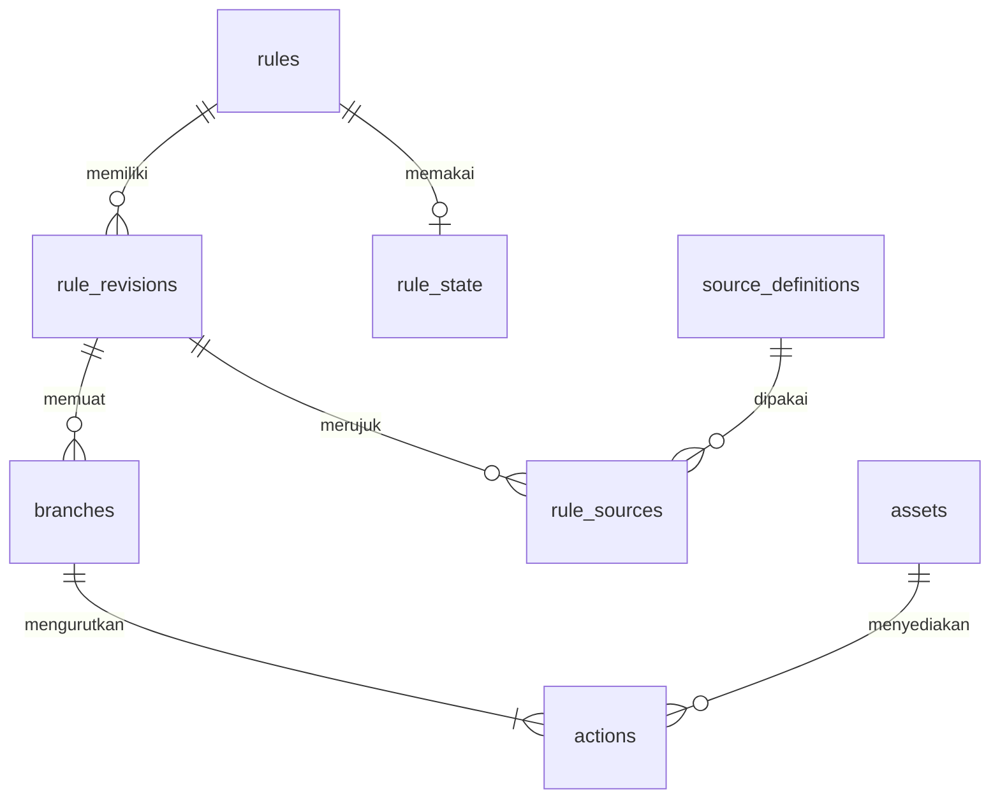
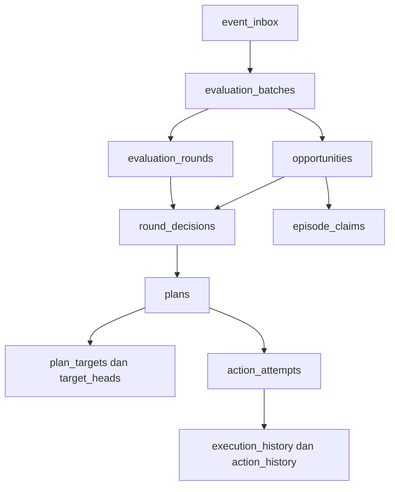

# Krono

## Database

| Atribut | Keterangan |
| --- | --- |
| Dokumen | `DATABASE.md` |
| Versi dokumen | 0.1 |
| Tanggal | 22 Oktober 2026, Asia/Jakarta |
| Acuan | PRD, Android Capabilities, Rule Engine, dan Architecture v0.1 |
| Tahap | Rancangan penyimpanan sebelum implementasi |
| Status keputusan | Seluruh rincian skema baru merupakan usulan v0.1 |
| Status implementasi | Belum ada database aplikasi, entity Room, migrasi produksi, atau pengujian perangkat yang dibangun dari tahap ini |
| Cakupan | Model data, relasi, integritas, transaksi, journal, aset, retensi, dan pemulihan |

> Database menyimpan konfigurasi pengguna dan alasan sebuah aksi boleh dicoba. Database tidak dapat menjadikan perubahan pengaturan Android bagian dari satu transaksi yang sama.

## 1. Tujuan dan batas dokumen

Dokumen ini merinci penyimpanan untuk dua contoh inti Krono: lokasi → wallpaper dan TWS pilihan → volume media. Rancangan mendukung draf, revisi aturan, IF/ELSE IF/ELSE, aksi berurutan, konflik, riwayat, serta pemulihan konservatif.

Perilaku mesin tetap mengikuti `RULE_ENGINE.md`. Struktur modul dan jalur efek tetap mengikuti `ARCHITECTURE.md`. Skema tidak boleh membuat UNKNOWN menjadi FALSE, membuka kembali kesempatan CLOSED, atau mengulang setter karena sebuah worker dikirim ulang.

Dokumen memuat **kontrak skema logis** yang dapat diturunkan menjadi entity, DAO, dan migrasi. Contoh SQL memperjelas operasi penting. File ini belum menjadi schema Room hasil kompilasi dan tidak mengklaim seluruh constraint sudah ditegakkan oleh kode.

Tabel internal dikelompokkan menurut fungsi agar implementasi dapat dicicil. Sebagian besar tabel operasional menyimpan identitas dan status kecil, bukan isi gambar atau rekaman lokasi terus-menerus.

### 1.1 Istilah dasar

| Istilah | Arti sederhana |
| --- | --- |
| Primary key / PK | Identitas unik satu baris. |
| Foreign key / FK | Hubungan yang memastikan rujukan ke tabel lain valid. |
| Unique / UQ | Kombinasi nilai yang tidak boleh mempunyai duplikat. |
| Transaksi | Sekumpulan perubahan database yang berhasil bersama atau dibatalkan bersama. |
| Revisi | Versi isi aturan yang sudah disimpan; isi revisi lama tidak ditimpa. |
| Generasi | Nomor pembatalan pekerjaan, berubah saat aktivasi, jeda, revisi, atau penghapusan terkait. |
| Kesempatan | Satu alasan logis untuk mengevaluasi sebuah aturan. |
| Episode | Satu rentang keadaan logis, misalnya satu koneksi TWS yang diketahui. |
| Tombstone | Identitas minimum yang dipertahankan setelah isi tidak lagi diperlukan, agar masukan lama tidak dianggap baru. |
| Pemadatan | Mengurangi payload lama sambil mempertahankan informasi kontrol yang masih dibutuhkan. |

## 2. Teknologi dan pembagian penyimpanan

### 2.1 Baseline sesuai arsitektur

| Bagian | Usulan |
| --- | --- |
| Database utama | Satu file privat `krono.db` melalui Room 3. |
| Acuan library | `androidx.room3` stable `3.0.3`, diperiksa 22 Oktober 2026. [D01] |
| Modul pemilik | `:data:local`; akses melalui repository dan AutomationStore. |
| Driver awal | `AndroidSQLiteDriver`, mengikuti kandidat pada Architecture. |
| Versi schema awal | `1` sebagai nomor awal rencana; belum ada schema produksi yang diterbitkan. |
| Proses | Satu proses aplikasi utama. |
| Preferensi tampilan | Preferences DataStore, sesuai Architecture. |
| Gambar wallpaper | File privat non-cache; metadata dan referensinya di Room. |
| Simulasi | Snapshot/fake terpisah; tidak menulis kesempatan atau journal produksi. |

Room 3 memakai namespace dan API driver sendiri. Referensi Room 2 perlu diterjemahkan terhadap API Room 3, termasuk API transaksi. KSP dan ekspor schema mengikuti rilis yang dipilih. [D01]

Baseline mode journal MVP adalah `RoomDatabase.JournalMode.TRUNCATE`. Beban tulis awal berbasis kejadian dan memakai satu jalur koordinasi. WAL dapat dievaluasi setelah pengukuran serta pemeriksaan versi SQLite/patch driver. Mode yang dipakai harus eksplisit, tidak bergantung pada tebakan atas mode otomatis. [D02]

Dokumentasi SQLite saat ini mencatat perbaikan WAL-reset pada versi/patch tertentu. Hal tersebut perlu diperiksa sebelum mengaktifkan WAL pada driver sistem yang versinya mengikuti perangkat. Pemilihan TRUNCATE adalah keputusan awal Krono, bukan aturan bahwa semua aplikasi harus menghindari WAL. [D03]

### 2.2 Data yang masuk ke setiap media

| Media | Isi |
| --- | --- |
| Room | Aturan, revisi, sumber, draf, registrasi, pengamatan yang diperlukan, kesempatan, rencana, journal, outbox, dan riwayat. |
| DataStore | Tema, penyaring daftar, penyaring riwayat, dan preferensi tampilan lain. |
| File privat | Gambar yang sudah diimpor, file impor sementara, dan thumbnail yang dapat dibuat ulang. |
| Memori | Proxy Bluetooth, objek Android, bitmap sementara, dan konteks lifecycle yang sedang berlaku. |

Status aktif/jeda, generasi, prioritas, dan kontrol efek tidak ditempatkan pada DataStore karena perlu konsisten dengan journal dalam transaksi Room. Pemisahan penggunaan Room/DataStore mengikuti karakter datanya. [D04]

## 3. Konvensi skema dan identitas

### 3.1 Tipe, null, dan waktu

Dictionary berikut menggunakan singkatan agar tabel mudah dibaca.

| Notasi | Penyimpanan | Ketentuan |
| --- | --- | --- |
| `ID` / `TEXT` | TEXT | ID opaque atau teks; PK teks tetap dinyatakan NOT NULL. |
| `INT` | INTEGER | Bilangan bulat; dipetakan ke Long bila berupa counter atau milidetik. |
| `BOOL` | INTEGER | Nilai aplikasi hanya 0 atau 1. |
| `REAL` | REAL | Koordinat atau radius yang sudah divalidasi. |
| `JSON` | TEXT | Payload berversi yang divalidasi serializer aplikasi. |
| `UTC` | INTEGER | Waktu Unix dalam milidetik untuk tampilan dan audit. |
| `ELAPSED` | INTEGER | Waktu monoton milidetik, terikat runtime epoch yang dicatat. |
| `?` | NULL diperbolehkan | Kolom tanpa tanda ini wajib mempunyai nilai. |

Status disimpan sebagai kode teks stabil, bukan ordinal enum Kotlin. Mengubah urutan enum tidak boleh mengubah arti data lama.

Jam produksi memakai basis elapsed realtime yang ditetapkan Architecture. Pergantian zona waktu tidak mengubah deadline. Saat runtime berganti, pekerjaan lama mengikuti kebijakan pemulihan, bukan diasumsikan masih valid karena angka elapsed tampak cocok.

### 3.2 Pengenal dan versi

| Nilai | Aturan |
| --- | --- |
| `rule_id`, `branch_id`, `action_id`, `source_id`, `asset_id` | ID stabil; nama tampilan boleh berubah dan boleh sama. |
| `revision` | Meningkat saat konfigurasi aturan disimpan sebagai revisi baru. |
| `source_revision` | Versi definisi area/perangkat; rujukan aturan mengikat versi tertentu. |
| `activation_generation` | Meningkat untuk membatalkan pekerjaan lama sesuai kontrak engine. |
| `row_version` | Counter CAS untuk perubahan baris mutable yang membutuhkannya. |
| `runtime_epoch` | ID baru untuk setiap proses; tidak dipakai ulang. |
| `event_seq` | Urutan kejadian logis yang diterima Krono. |
| `batch_seq` | Urutan batch; berbeda dari urutan niat sasaran. |
| `intent_seq` | Urutan rencana/niat sasaran yang sah saat disimpan. |
| `priority_revision` | Versi daftar prioritas yang disimpan. |

Counter dialokasikan dalam transaksi yang sama dengan pemakaiannya. Jangan menggunakan `MAX(...)+1` dari beberapa coroutine tanpa transaksi tulis. Celah nomor akibat pembatalan tidak masalah; penggunaan ulang identitas lama tidak diperbolehkan.

### 3.3 Tingkat penegakan invariant

- **DB:** PK, NOT NULL, unique index, dan FK yang dideklarasikan dalam schema Room.
- **APP:** hubungan lintas baris, rentang nilai, status transisi, dan semantik yang diperiksa validator serta AutomationStore dalam transaksi.
- **FILE:** keberadaan, keterbacaan, dan konsistensi file yang diperiksa protokol aset.

Jangan menganggap anotasi Room otomatis membuat semua aturan bisnis. Constraint tambahan yang dipakai implementasi harus konsisten dengan schema yang diekspor dan migrasinya.

SQLite memperlakukan NULL pada constraint tertentu berbeda dari identitas non-null. Kunci deduplikasi wajib memakai nilai yang lengkap. Kolom nullable khusus uji aksi dilindungi kunci unik tersendiri pada bagian 12. [D05]

## 4. Peta entitas dan relasi

### 4.1 Konfigurasi aturan



Diagram menunjukkan relasi logis. FK revisi menggunakan pasangan ID dan nomor revisi, bukan nama aturan.

### 4.2 Alur catatan operasional



Riwayat merupakan proyeksi. Penghapusannya tidak menghapus graph kontrol yang masih diperlukan.

### 4.3 Daftar tabel

| Kelompok | Tabel |
| --- | --- |
| Aturan | `rules`, `rule_state`, `rule_revisions`, `rule_priority`, `branches`, `actions`, `rule_sources` |
| Sumber | `source_definitions` |
| Draf | `rule_drafts`, `draft_asset_refs` |
| Aset | `assets`, `asset_read_leases` |
| Runtime | `runtime_sessions`, `engine_meta` |
| Pengamatan | `monitoring_state`, `source_state`, `rule_episode_state` |
| Masukan | `command_receipts`, `event_inbox`, `event_sources` |
| Evaluasi | `evaluation_batches`, `evaluation_rounds`, `opportunities`, `round_decisions`, `episode_claims` |
| Eksekusi | `plans`, `plan_targets`, `target_heads`, `action_attempts` |
| Pengiriman | `outbox` |
| Riwayat | `execution_history`, `action_history` |

## 5. Konfigurasi aturan

### 5.1 `rules`

Identitas induk dan tombstone aturan. Nama disimpan pada revisi agar isi historis tidak tertimpa.

| Kolom | Tipe | Isi |
| --- | --- | --- |
| `rule_id` | ID | PK. |
| `created_at_utc_ms` | UTC | Waktu pembuatan identitas. |
| `deleted_at_utc_ms` | UTC? | NULL selama belum dihapus. |

Penghapusan pengguna menandai aturan dihapus dan menonaktifkan state. ID tidak dipakai untuk aturan baru. Baris minimum dapat dipertahankan setelah payload revisi dipadatkan.

### 5.2 `rule_revisions`

| Kolom | Tipe | Isi |
| --- | --- | --- |
| `rule_id` | ID | FK → rules. |
| `revision` | INT | Nomor revisi, mulai 1. |
| `name` | TEXT | Nama pada revisi ini. |
| `mode` | TEXT | SIMPLE atau BRANCHED. |
| `trigger_family` | TEXT | LOCATION atau BLUETOOTH. |
| `trigger_kind` | TEXT | Kode pemicu MVP yang dikenali engine. |
| `rule_format_version` | INT | Versi format konfigurasi, awal 1. |
| `semantics_version` | TEXT | Acuan perilaku engine, awal `0.1`. |
| `created_at_utc_ms` | UTC | Waktu revisi disimpan. |

**DB:** PK gabungan `(rule_id, revision)`; FK ke rules memakai RESTRICT.

**APP:** revisi lengkap dibangun dalam satu transaksi dan immutable setelah commit. Nama, mode, trigger, cabang, aksi, dan rujukan sumber harus konsisten. Mengubah isi menghasilkan revisi baru.

### 5.3 `rule_state`

| Kolom | Tipe | Isi |
| --- | --- | --- |
| `rule_id` | ID | PK dan FK → rules. |
| `current_revision` | INT? | Revisi yang dipakai; NULL hanya pada tombstone tanpa konfigurasi aktif. |
| `desired_active` | BOOL | Keinginan aktif dari pengguna. |
| `activation_generation` | INT | Generasi pembatalan yang berlaku. |
| `row_version` | INT | Versi perubahan state. |
| `history_clear_through_seq` | INT | Batas event historis aturan yang tidak boleh diproyeksikan ulang. |
| `updated_at_utc_ms` | UTC | Waktu perubahan terakhir. |

**DB:** FK gabungan `(rule_id, current_revision)` → rule_revisions, RESTRICT. Pemisahan pointer ini menghindari siklus FK antara pembuatan identitas dan revisi.

**APP:** aturan dihapus tidak boleh desired_active. Aktivasi memerlukan current_revision valid. Status siap, sedang berjalan, dan hasil terakhir diturunkan dari data terkait, bukan dijadikan arti lain desired_active.

### 5.4 `rule_priority`

| Kolom | Tipe | Isi |
| --- | --- | --- |
| `rule_id` | ID | PK, FK → rules. |
| `position` | INT | Posisi unik pada daftar, mulai 0. |

**DB:** UQ position. **APP:** posisi final berurutan, tanpa duplikasi ID; versi daftar berada di engine_meta.

Daftar memuat aturan tersimpan yang belum dihapus, termasuk yang dijeda; draf berdiri di luar daftar. Aturan baru ditambahkan di posisi terakhir sebagai usulan awal. Perubahan anggota daftar juga memperbarui versi dan pembatalan pekerjaan terkait secara konsisten. Duplikasi aturan menghasilkan rule/branch/action ID baru dan tidak otomatis aktif; aset boleh digunakan bersama melalui referensi.

Saat mengubah urutan, gunakan tahap posisi sementara di luar rentang yang sedang dipakai dalam satu transaksi, kemudian posisi final. Jangan melakukan pertukaran dua nilai UNIQUE satu per satu dan menganggap constraint ditunda otomatis.

### 5.5 `branches`

| Kolom | Tipe | Isi |
| --- | --- | --- |
| `rule_id`, `revision` | ID, INT | FK gabungan → rule_revisions. |
| `branch_id` | ID | Identitas stabil cabang. |
| `position` | INT | Urutan dalam revisi. |
| `branch_kind` | TEXT | ALWAYS, IF, ELSE_IF, atau ELSE. |
| `predicate_kind` | TEXT | ALWAYS, NONE, LOCATION_IN_AREA, BLUETOOTH_IS_CONNECTED, atau BLUETOOTH_IS_DISCONNECTED. |
| `predicate_source_id` | ID? | Sumber kondisi; NULL untuk ALWAYS/NONE. |
| `predicate_source_revision` | INT? | Versi sumber kondisi. |

**DB:** PK `(rule_id, revision, branch_id)`; UQ `(rule_id, revision, position)`. Pasangan sumber, bila diisi, merujuk anggota rule_sources pada revisi yang sama.

**APP:** SIMPLE mempunyai satu cabang ALWAYS di belakang gate trigger. BRANCHED memakai urutan IF/ELSE_IF dan paling banyak satu ELSE terakhir. ELSE memakai predicate NONE. MVP memakai satu predikat per cabang; AND/OR belum dapat diaktifkan.

### 5.6 `actions`

| Kolom | Tipe | Isi |
| --- | --- | --- |
| `rule_id`, `revision` | ID, INT | Identitas revisi. |
| `branch_id` | ID | Cabang pemilik. |
| `action_id` | ID | Identitas stabil aksi. |
| `position` | INT | Urutan aksi dalam cabang. |
| `action_kind` | TEXT | SET_WALLPAPER atau SET_MEDIA_VOLUME. |
| `asset_id` | ID? | FK → assets untuk wallpaper. |
| `wallpaper_target` | TEXT? | SYSTEM, LOCK, atau BOTH. |
| `volume_percent` | INT? | 0–100 untuk volume media. |

**DB:** PK `(rule_id, revision, action_id)`; FK gabungan ke cabang; UQ `(rule_id, revision, branch_id, position)`; FK aset RESTRICT.

**APP:** tiap cabang yang dapat dipilih memiliki sedikitnya satu aksi. Wallpaper wajib mempunyai aset dan sasaran; volume wajib mempunyai persentase. Field yang tidak sesuai jenis aksi harus NULL.

Isi file tidak disimpan sebagai BLOB. Aksi kedua layar mengambil dua resource saat perencanaan; tidak dibuat resource baru bernama wallpaper.both.

### 5.7 `rule_sources`

| Kolom | Tipe | Isi |
| --- | --- | --- |
| `rule_id`, `revision` | ID, INT | FK → rule_revisions. |
| `source_id`, `source_revision` | ID, INT | FK → source_definitions. |

**DB:** PK gabungan keempat kolom. Parent sumber menggunakan PK pasangan yang persis sama.

**APP:** semua anggota satu revisi berasal dari satu keluarga trigger yang sesuai. Ruang lingkup sumber mencakup seluruh area/perangkat yang dibutuhkan gate dan predikat, sehingga snapshot tidak diam-diam mengabaikan cabang.

## 6. Definisi area dan perangkat

### 6.1 `source_definitions`

| Kolom | Tipe | Isi |
| --- | --- | --- |
| `source_id` | ID | Identitas stabil area atau perangkat pilihan. |
| `source_revision` | INT | Versi definisi. |
| `source_kind` | TEXT | GEO_AREA atau BT_DEVICE. |
| `label` | TEXT | Nama area atau perangkat pilihan. |
| `latitude`, `longitude` | REAL? | Pusat area. |
| `radius_m` | REAL? | Radius positif dalam meter. |
| `device_identity` | TEXT? | Identitas platform privat yang diperlukan untuk menemukan perangkat. |
| `transport_policy` | TEXT? | Kebijakan transport yang didukung adapter, awal CLASSIC_ONLY. |
| `created_at_utc_ms` | UTC | Waktu definisi dibuat. |

**DB:** PK `(source_id, source_revision)`.

**APP:** GEO_AREA hanya mengisi koordinat/radius; BT_DEVICE hanya mengisi identitas/kebijakan perangkat. Validasi koordinat, nilai finite, radius, dan dukungan transport dilakukan sebelum aktivasi. Identitas perangkat tidak menggunakan label sebagai pengganti.

Mengedit area bersama menghasilkan source_revision baru dan revisi aturan terkait secara atomik menurut command aplikasi. Definisi yang sudah dirujuk revisi tidak ditimpa. Kegagalan pembaruan tidak meninggalkan aturan membaca setengah geometri lama dan baru.

Koordinat di tabel ini adalah area yang dipilih pengguna. Rancangan tidak membuat tabel jejak perjalanan GPS berkelanjutan.

## 7. Draf editor

### 7.1 `rule_drafts`

| Kolom | Tipe | Isi |
| --- | --- | --- |
| `draft_id` | ID | PK. |
| `target_rule_id` | ID? | FK opsional → rules; NULL untuk aturan baru. |
| `base_revision` | INT? | Revisi saat editor dibuka. |
| `draft_format_version` | INT | Versi format draf. |
| `draft_json` | JSON | Isi yang dapat belum lengkap. |
| `row_version` | INT | Pencegah penyimpanan draf lama menimpa perubahan baru. |
| `updated_at_utc_ms` | UTC | Waktu terakhir disimpan. |

FK target memakai RESTRICT. Penghapusan aturan dapat menghapus atau melepaskan draf terkait melalui command yang jelas; tidak ada cascade dari aturan yang memotong data editor secara tersirat.

Draf tidak menghasilkan pemantauan atau kesempatan efek. Menyimpan draf dan memublikasikan revisi adalah operasi berbeda. Saat revisi aktif sudah berubah dari base_revision, editor harus menangani konflik sebelum menyimpan revisi.

### 7.2 `draft_asset_refs`

| Kolom | Tipe | Isi |
| --- | --- | --- |
| `draft_id` | ID | FK → rule_drafts, CASCADE. |
| `asset_id` | ID | FK → assets, RESTRICT. |

**DB:** PK gabungan. **APP:** daftar referensi diperbarui bersama draft_json. Aset yang sudah dipilih draf tetap terlindungi dari pembersihan, termasuk ketika impor belum READY.

Draf rusak atau versi format tidak dikenali tidak otomatis dijadikan aturan kosong yang aktif. Pertahankan data untuk penanganan yang dapat dijelaskan.

## 8. Aset dan pembacaan gambar

### 8.1 `assets`

| Kolom | Tipe | Isi |
| --- | --- | --- |
| `asset_id` | ID | PK. |
| `state` | TEXT | IMPORTING, READY, FAILED, atau DELETING. |
| `relative_path` | TEXT? | Path relatif privat; unik jika sudah diisi. |
| `mime_type` | TEXT? | Format yang sudah diperiksa. |
| `byte_count` | INT? | Ukuran hasil impor. |
| `width_px`, `height_px` | INT? | Dimensi hasil validasi. |
| `sha256` | TEXT? | Hash isi untuk integritas/diagnosis, bukan identitas pengguna. |
| `error_code` | TEXT? | Alasan kegagalan impor. |
| `row_version` | INT | CAS perubahan state. |
| `created_at_utc_ms`, `updated_at_utc_ms` | UTC | Waktu siklus aset. |

**DB:** UQ relative_path. **FILE:** READY memerlukan file final yang sudah tersedia dan dapat dibaca. **APP:** ukuran/dimensi harus valid dan memenuhi batas konfigurasi.

Hash tidak otomatis menjadi unique key global. Dua impor isi sama boleh tetap memiliki ID berbeda sampai kebijakan berbagi aset benar-benar diimplementasikan.

### 8.2 `asset_read_leases`

| Kolom | Tipe | Isi |
| --- | --- | --- |
| `lease_id` | ID | PK. |
| `asset_id` | ID | FK → assets, RESTRICT. |
| `runtime_epoch` | ID | FK → runtime_sessions. |
| `owner_key` | TEXT | Pemilik pembacaan/impor yang sedang berlangsung. |
| `created_elapsed_ms` | ELAPSED | Awal penggunaan dalam epoch ini. |

Lease adalah catatan penggunaan internal. Ia tidak memberikan hak background atau hak OS tambahan.

Pengambilan lease memeriksa aset belum DELETING dalam transaksi yang sama. Pembersih menandai DELETING hanya setelah semua referensi dan lease kosong. Referensi baru tidak boleh ditambahkan ke aset DELETING. Lease runtime yang sudah berakhir dilepas saat pemulihan sebelum garbage collection.

## 9. Runtime dan metadata global

### 9.1 `runtime_sessions`

| Kolom | Tipe | Isi |
| --- | --- | --- |
| `runtime_epoch` | ID | PK, satu per proses. |
| `started_at_utc_ms` | UTC | Waktu mulai untuk audit. |
| `ended_at_utc_ms` | UTC? | Diisi ketika sesi dinyatakan berakhir. |
| `recovery_complete` | BOOL | Gerbang sebelum efek runtime baru diizinkan. |

Tidak ada efek baru sebelum recovery_complete benar. Marker ini bukan bukti proses akan tetap hidup.

### 9.2 `engine_meta`

Satu baris dengan `singleton_id = 1`.

| Kolom | Tipe | Isi |
| --- | --- | --- |
| `singleton_id` | INT | PK. |
| `current_runtime_epoch` | ID? | FK → runtime_sessions; NULL sebelum inisialisasi pertama. |
| `next_event_seq` | INT | Counter kejadian logis berikutnya. |
| `next_batch_seq` | INT | Counter batch berikutnya. |
| `next_intent_seq` | INT | Counter niat sasaran berikutnya. |
| `priority_revision` | INT | Versi urutan prioritas. |
| `monitoring_revision` | INT | Versi kebutuhan pemantauan. |
| `control_version` | INT | Versi commit kontrol untuk pemeriksaan snapshot yang relevan. |
| `history_clear_through_seq` | INT | Watermark penghapusan riwayat global. |
| `row_version` | INT | CAS metadata global. |

Counter next_event_seq, next_batch_seq, dan next_intent_seq mulai 1. Watermark riwayat serta versi global awal mulai 0. row_version baru mulai 0; revisi konfigurasi mulai 1. Counter hanya meningkat. Gunakan ruang Long dan tangani batas sebelum overflow, tanpa memutar kembali nomor menjadi nol.

Mutasi yang memengaruhi kelayakan sumber, aturan, antrean, atau token menaikkan control_version dalam transaksi yang sama. Snapshot tetap membawa versi sumber/aturan yang menentukan keputusan. Perubahan preferensi tampilan dan penghapusan proyeksi riwayat tidak perlu menggagalkan keputusan engine.

## 10. Pemantauan, pengamatan, dan episode

### 10.1 `monitoring_state`

| Kolom | Tipe | Isi |
| --- | --- | --- |
| `source_id`, `source_revision` | ID, INT | PK gabungan, FK → source_definitions. |
| `desired_enabled` | BOOL | Apakah sumber perlu dipantau. |
| `desired_version` | INT | Versi kebutuhan yang harus dipenuhi adapter. |
| `registration_key` | TEXT | UQ, identitas registrasi yang dikenal Krono. |
| `observed_version` | INT? | Versi yang terakhir dikonfirmasi. |
| `registration_state` | TEXT | PENDING, REGISTERED, UNREGISTERED, UNKNOWN, atau FAILED. |
| `last_error_code` | TEXT? | Alasan gangguan yang diketahui. |
| `checked_at_utc_ms` | UTC? | Pemeriksaan terakhir. |
| `row_version` | INT | CAS rekonsiliasi. |

REGISTERED yang tersimpan tidak dianggap bukti registrasi pasti bertahan melewati seluruh gangguan. Boot, pembaruan, atau kegagalan provider dapat membuatnya perlu rekonsiliasi.

Callback mengikat registration_key dan versi. Definisi lama baru dapat dibersihkan setelah tidak dibutuhkan dan proses unregister/penyaringan callback lama telah ditangani.

### 10.2 `source_state`

| Kolom | Tipe | Isi |
| --- | --- | --- |
| `source_id`, `source_revision` | ID, INT | PK gabungan, FK → source_definitions. |
| `state_version` | INT | Versi pengamatan yang diterima. |
| `facts_json` | JSON | Fakta domain: TRUE/FALSE/UNKNOWN atau keadaan profil yang dinormalisasi. |
| `quality_code` | TEXT | Kualitas dan alasan ketidakpastian. |
| `observation_group_id` | ID? | Pengamatan bersama untuk penilaian beberapa area. |
| `observed_elapsed_ms` | ELAPSED? | Waktu sumber bila dapat dipertanggungjawabkan. |
| `received_elapsed_ms` | ELAPSED | Waktu diterima Krono. |
| `runtime_epoch` | ID | FK → runtime_sessions. |
| `coverage_version` | INT | Versi cakupan; berubah ketika ada jeda pengamatan. |
| `source_episode_key` | TEXT? | Episode sumber yang diketahui. |
| `source_episode_counter` | INT | Counter episode sumber yang tidak direset secara diam-diam. |

facts_json menyimpan penilaian dan provenance yang diperlukan. Raw koordinat sensor tidak menjadi isi wajib riwayat. Umur sumber dan umur penerimaan tidak boleh tertukar.

Akses hilang atau proxy gagal tidak menulis fakta DISCONNECTED/FALSE tanpa bukti. Keadaan Bluetooth stabil juga tidak otomatis kedaluwarsa setiap lima detik hanya karena tidak ada callback.

### 10.3 `rule_episode_state`

| Kolom | Tipe | Isi |
| --- | --- | --- |
| `rule_id`, `revision`, `activation_generation` | ID, INT, INT | PK gabungan; revisi merujuk rule_revisions. |
| `last_known_branch_id` | ID? | Cabang yang terakhir dapat ditentukan secara layak. |
| `branch_episode_key` | TEXT? | Episode cabang yang sedang dipertahankan. |
| `branch_episode_counter` | INT | Counter episode untuk konteks aturan ini. |
| `source_episode_key` | TEXT? | Episode sumber yang mendasari keputusan, terutama Bluetooth. |
| `continuity_state` | TEXT | KNOWN atau GAP. |
| `row_version` | INT | CAS reducer episode. |

Tabel ini menyimpan keadaan reducer, sedangkan episode_claims menyimpan episode yang sudah dikonsumsi. Keduanya memiliki tujuan berbeda.

Untuk lokasi, A → UNKNOWN → A mempertahankan episode. A → B → A yang diketahui dapat membentuk episode berbeda. NO_MATCH yang benar-benar diketahui dapat menutup episode; UNKNOWN tidak dipakai sebagai bukti keluar.

Pembaruan reducer aturan disimpan pada commit evaluasi TX-05 bersama pemeriksaan versi sumber dan konsumsi episode. Dengan demikian, pemeriksaan awal dan laporan sumber yang berdekatan tidak membuat dua episode hanya karena keduanya mempunyai cause key berbeda.


## 11. Command dan masukan logis

### 11.1 `command_receipts`

| Kolom | Tipe | Isi |
| --- | --- | --- |
| `command_id` | ID | PK, dibuat untuk satu tindakan eksplisit. |
| `command_kind` | TEXT | Jenis command aplikasi yang dikenali. |
| `request_hash` | TEXT | Hash representasi kanonik permintaan. |
| `subject_key` | TEXT | Aturan/draf atau sasaran logis command. |
| `status` | TEXT | ACCEPTED, COMMITTED, atau REJECTED. |
| `result_json` | JSON? | Ringkasan hasil atau identitas hasil tersimpan. |
| `created_at_utc_ms` | UTC | Waktu penerimaan untuk audit. |

Command ID sama dengan request_hash sama mengembalikan hasil yang sudah diketahui. ID sama dengan isi berbeda ditolak sebagai konflik, bukan dianggap command baru.

Resi dan mutasi bisnis disimpan dalam transaksi yang sama. Jangan meninggalkan ACCEPTED seolah mutasi sudah selesai jika transaksi gagal. Setelah payload hasil dipadatkan, identitas command, hash, jenis, dan status minimum tetap dapat menolak pengiriman ulang.

### 11.2 `event_inbox`

| Kolom | Tipe | Isi |
| --- | --- | --- |
| `event_id` | ID | PK kejadian logis. |
| `event_seq` | INT | UQ, urutan penerimaan logis. |
| `event_key` | TEXT | UQ, identitas kanonik kejadian yang sudah dinormalisasi. |
| `event_kind` | TEXT | Jenis pemicu/command yang relevan. |
| `cause_key` | TEXT | Sebab yang akan dipakai kesempatan. |
| `origin_command_id` | ID? | FK → command_receipts bila berasal dari command. |
| `runtime_epoch` | ID | FK → runtime_sessions. |
| `received_elapsed_ms` | ELAPSED | Awal penghitungan jendela kesempatan. |
| `received_at_utc_ms` | UTC | Waktu penerimaan untuk tampilan. |
| `payload_version` | INT | Versi bentuk event_payload_json. |
| `event_payload_json` | JSON? | Fakta kejadian dan rujukan episode; dapat dipadatkan setelah aman. |
| `processing_state` | TEXT | NEW, BATCHED, CLOSED, atau CANCELLED. |
| `row_version` | INT | CAS pemrosesan. |

Inbox menyimpan kejadian logis, bukan setiap callback mentah. Duplikasi profil dan laporan area dinormalisasi terlebih dahulu menggunakan pengamatan yang layak.

Pembaruan sumber yang hanya memperbaiki kualitas atau kemampuan tidak otomatis membuat sebab baru. Ia dapat memperbarui state dan membuat outbox kelanjutan tiket. Tiket lama tetap memakai cause_key asal.

### 11.3 `event_sources`

| Kolom | Tipe | Isi |
| --- | --- | --- |
| `event_id` | ID | FK → event_inbox. |
| `source_id`, `source_revision` | ID, INT | FK → source_definitions. |

**DB:** PK gabungan ketiga kolom. Satu kejadian lokasi dapat merujuk beberapa area terkait yang dilaporkan secara koheren. Event uji aksi langsung tidak memerlukan sumber buatan.

Raw callback yang urutannya tidak jelas tidak diberi event_key baru hanya supaya bisa dijadwalkan. Rekonsiliasi harus menjaga episode; urutan lokal bukan bukti urutan fisik.

## 12. Batch, putaran evaluasi, dan kesempatan

### 12.1 `evaluation_batches`

| Kolom | Tipe | Isi |
| --- | --- | --- |
| `batch_id` | ID | PK. |
| `batch_seq` | INT | UQ. |
| `event_id` | ID | UQ dan FK → event_inbox. |
| `priority_revision` | INT | Versi urutan prioritas yang dibekukan. |
| `runtime_epoch` | ID | FK → runtime_sessions. |
| `state` | TEXT | OPEN atau CLOSED. |
| `created_elapsed_ms` | ELAPSED | Awal pembentukan batch. |

Satu event logis membentuk paling banyak satu batch awal. Semua aturan relevan diambil secara konsisten dan diwakili opportunities beserta priority_position.

Batch tetap OPEN selama masih ada kesempatan yang menunggu/berjalan. Putaran kelanjutan tidak mengganti event_id atau priority_revision. Perubahan prioritas membatalkan pekerjaan terkait sesuai aturan arsitektur.

### 12.2 `evaluation_rounds`

| Kolom | Tipe | Isi |
| --- | --- | --- |
| `round_id` | ID | PK. |
| `batch_id` | ID | FK → evaluation_batches. |
| `round_number` | INT | Nomor putaran dalam batch, mulai 1. |
| `runtime_epoch` | ID | FK → runtime_sessions. |
| `snapshot_version` | INT | Versi format snapshot. |
| `snapshot_json` | JSON? | Snapshot sumber, kualitas, versi, capability, dan input clock. |
| `snapshot_hash` | TEXT | Hash representasi snapshot kanonik. |
| `captured_elapsed_ms` | ELAPSED | Waktu snapshot dalam epoch ini. |

**DB:** UQ `(batch_id, round_number)`.

Putaran menyimpan masukan immutable yang dipakai satu perhitungan. Perubahan data menghasilkan putaran baru, bukan menyunting snapshot lama. Setelah tidak diperlukan untuk kontrol, payload dapat dipadatkan; hash/identitas bukan pengganti data yang masih dibutuhkan rencana aktif.

Capability dalam snapshot adalah catatan pemeriksaan saat itu. Nilai READY tersimpan tidak memberikan hak audio pada pemanggilan berikutnya.

### 12.3 `opportunities`

| Kolom | Tipe | Isi |
| --- | --- | --- |
| `opportunity_id` | ID | PK. |
| `opportunity_key` | TEXT | UQ non-null untuk lookup lintas jenis pemilik. |
| `owner_kind` | TEXT | RULE atau ACTION_TEST. |
| `batch_id` | ID | FK → evaluation_batches. |
| `priority_position` | INT | Urutan anggota batch. |
| `rule_id` | ID? | Pemilik RULE. |
| `rule_revision` | INT? | Revisi RULE. |
| `activation_generation` | INT? | Generasi RULE. |
| `test_command_id` | ID? | UQ dan FK → command_receipts, hanya ACTION_TEST. |
| `cause_key` | TEXT | Sebab asal, tidak berubah pada kelanjutan. |
| `runtime_epoch` | ID | FK → runtime_sessions. |
| `created_elapsed_ms` | ELAPSED | Pembuatan kesempatan. |
| `deadline_elapsed_ms` | ELAPSED | Deadline tetap dari waktu penerimaan sebab. |
| `state` | TEXT | OPEN, WAITING_DATA, WAITING_CAPABILITY, PLANNED, EXECUTING, atau CLOSED. |
| `final_result` | TEXT? | SUCCESS, PARTIAL, UNVERIFIED, FAILED, BLOCKED, atau SKIPPED. |
| `reason_code` | TEXT? | Alasan status saat ini/penutupan. |
| `history_projection_state` | TEXT | NONE, WRITTEN, atau SUPPRESSED; diperbarui atomik bersama proyeksi. |
| `row_version` | INT | CAS perubahan kesempatan. |

**DB:** UQ `(rule_id, rule_revision, activation_generation, cause_key)` untuk identitas RULE; UQ `(batch_id, priority_position)`. FK pasangan rule/revision memakai RESTRICT.

**APP:** RULE wajib mengisi seluruh field aturan dan membiarkan test_command_id NULL. ACTION_TEST wajib mengisi test_command_id dan membiarkan field aturan NULL. UQ test_command_id melindungi test walaupun kolom aturan nullable.

opportunity_key dibentuk dari encoding kanonik berversi dengan namespace pemilik. Jangan menyambung teks bebas memakai delimiter yang dapat ambigu. Kunci kanonik dan kolom terstruktur harus diperiksa cocok.

Coba lagi untuk aturan tetap owner RULE, dengan command dan cause baru serta pembacaan kondisi sekarang. Uji aksi langsung owner ACTION_TEST, tanpa memalsukan gate lokasi/TWS.

### 12.4 `round_decisions`

| Kolom | Tipe | Isi |
| --- | --- | --- |
| `round_id` | ID | FK → evaluation_rounds. |
| `opportunity_id` | ID | FK → opportunities. |
| `selected_branch_id` | ID? | NULL bila tidak ada cabang atau uji aksi langsung. |
| `decision_code` | TEXT | Hasil putaran, misalnya WAITING_DATA, NO_MATCH, BLOCKED, READY, atau CONFLICT_LOST. |
| `reason_code` | TEXT? | Alasan yang diketahui. |
| `decision_json` | JSON? | Predikat penentu, capability, dan penjelasan konflik terstruktur. |

**DB:** PK `(round_id, opportunity_id)`. **APP:** keduanya harus berasal dari batch yang sama. Cabang RULE harus berasal dari revisi kesempatan.

Satu keputusan tersimpan tidak berubah menjadi pemenang hanya karena kandidat lain gagal. Kelanjutan hanya berlaku untuk kesempatan yang memang masih menunggu.

### 12.5 `episode_claims`

| Kolom | Tipe | Isi |
| --- | --- | --- |
| `rule_id`, `rule_revision`, `activation_generation` | ID, INT, INT | Konteks aturan. |
| `branch_id` | ID | Cabang yang episode-nya dikonsumsi. |
| `episode_key` | TEXT | Episode cabang yang diketahui. |
| `first_opportunity_id` | ID? | FK → opportunities, SET NULL saat pemadatan aman. |
| `claim_outcome` | TEXT | PLANNED, CONFLICT_LOST, atau CLOSED. |

**DB:** PK `(rule_id, rule_revision, activation_generation, branch_id, episode_key)`; FK revisi/cabang RESTRICT.

Kunci ini mengikat pemeriksaan awal dan laporan sumber untuk episode sama, meskipun cause_key berbeda. Klaim rencana yang kalah konflik atau selesai tidak dilepas untuk mencoba lagi dari callback duplikat.

Kandidat WAITING_DATA/WAITING_CAPABILITY yang belum menghasilkan keputusan rencana tidak mengunci resource. Klaim episode mengikuti commit keputusan yang memang mengonsumsi kesempatan.

Command USER_RETRY yang sah dapat melewati gate konsumsi episode sesuai Rule Engine. Ia tidak menghapus klaim lama; kunci efeknya berbeda karena cause command baru. Pengiriman ulang command yang sama tetap dideduplikasi.

## 13. Rencana, sasaran, dan upaya efek

### 13.1 `plans`

| Kolom | Tipe | Isi |
| --- | --- | --- |
| `plan_id` | ID | PK. |
| `opportunity_id` | ID | UQ, FK → opportunities. |
| `decision_round_id` | ID | Bagian FK keputusan pemenang. |
| `intent_seq` | INT | UQ, urutan niat sah saat rencana disimpan. |
| `runtime_epoch` | ID | FK → runtime_sessions. |
| `state` | TEXT | QUEUED, RUNNING, atau TERMINAL. |
| `context_json` | JSON? | Identitas snapshot/episode dan alasan perencanaan. |
| `created_elapsed_ms` | ELAPSED | Waktu commit rencana. |
| `row_version` | INT | CAS status rencana. |

FK `(decision_round_id, opportunity_id)` merujuk round_decisions. Hanya keputusan yang layak dan menang dapat membuat rencana.

Satu kesempatan memiliki paling banyak satu rencana. Setelah rencana berakhir, retry otomatis tidak membuat plan kedua. Command baru membuat kesempatan baru.

Rincian aksi disalin ke action_attempts saat rencana dibuat. Salinan ini immutable sebagai permintaan efek, sehingga perubahan editor berikutnya tidak mengubah parameter upaya yang sudah dicatat.

### 13.2 `plan_targets`

| Kolom | Tipe | Isi |
| --- | --- | --- |
| `plan_id` | ID | FK → plans. |
| `resource_key` | TEXT | audio.media, wallpaper.system, atau wallpaper.lock. |
| `intent_seq` | INT | Token yang diharapkan, sama dengan intent_seq rencana. |

**DB:** PK `(plan_id, resource_key)`. **APP:** seluruh union resource cabang tersimpan bersama rencana. Dua aksi dalam satu cabang boleh memakai resource sama; baris target cukup satu untuk resource itu.

### 13.3 `target_heads`

| Kolom | Tipe | Isi |
| --- | --- | --- |
| `resource_key` | TEXT | PK, dalam konteks profil Android aplikasi ini. |
| `intent_seq` | INT | Niat/barrier terbaru untuk resource. |
| `current_plan_id` | ID? | FK → plans; NULL dapat menandai barrier tanpa rencana. |
| `runtime_epoch` | ID | FK → runtime_sessions. |
| `row_version` | INT | CAS pemilik resource. |

Sebelum setter, semua target yang diperlukan rencana harus masih menunjuk plan/token yang cocok. Rencana baru yang sah dapat menggantikan rencana antre lama.

Pengamatan perubahan manual yang dapat dipertanggungjawabkan dapat memajukan barrier dan membatalkan rencana lama, tanpa membuat aksi penegakan nilai. Atribusi perubahan tetap mengikuti batas adapter.

Saat plan terminal dipadatkan, pointer boleh dilepas menjadi NULL dengan intent_seq tetap atau meningkat. Jangan menurunkan counter, mengosongkan seluruh head, lalu membiarkan pekerjaan lama mengklaimnya kembali.

### 13.4 `action_attempts`

Satu baris mewakili satu langkah rencana dengan maksimum satu upaya setter pada kebijakan v0.1.

| Kolom | Tipe | Isi |
| --- | --- | --- |
| `attempt_id` | ID | PK. |
| `plan_id` | ID | FK → plans. |
| `step_index` | INT | Urutan langkah, mulai 0. |
| `action_id` | ID | Identitas aksi definisi atau aksi uji. |
| `effect_key` | TEXT | UQ non-null, identitas efek kanonik. |
| `action_kind` | TEXT | Jenis aksi yang dikenali. |
| `action_params_json` | JSON? | Parameter immutable; boleh NULL setelah pemadatan terminal yang aman. |
| `asset_id` | ID? | FK → assets untuk menahan file yang masih diperlukan. |
| `runtime_epoch` | ID | FK → runtime_sessions. |
| `phase` | TEXT | PREPARED, REQUESTING, OBSERVING, atau FINISHED. |
| `result_code` | TEXT? | APPLIED, NO_CHANGE_NEEDED, FAILED, BLOCKED, UNVERIFIED, SKIPPED, CANCELLED, EXPIRED, atau SUPERSEDED. |
| `reason_code` | TEXT? | Penjelasan terstruktur. |
| `prepared_elapsed_ms` | ELAPSED | Waktu langkah disiapkan. |
| `requesting_elapsed_ms` | ELAPSED? | Waktu izin terakhir disimpan sebelum setter. |
| `finished_at_utc_ms` | UTC? | Waktu hasil dicatat. |
| `evidence_json` | JSON? | Bukti adapter, termasuk sebelum/sesudah dan tingkat kepastian yang tersedia. |
| `payload_retained` | BOOL | Apakah parameter/bukti rinci masih tersedia. |
| `row_version` | INT | CAS fase dan hasil. |

**DB:** UQ `(plan_id, step_index)` dan effect_key.

Untuk RULE, effect_key mengikat rule ID, revisi, generasi, cause, branch ID, dan action ID. Untuk ACTION_TEST, namespace kunci mengikat command ID dan action ID. Encoding wajib deterministik dan berversi.

Parameter nonterminal harus tersedia dan sesuai jenis aksi. asset_id wajib cocok dengan parameter wallpaper selama file masih diperlukan. Pemadatan hanya menghapus payload terminal, tidak mengubah hasil/fase untuk memberi izin setter baru.

REQUESTING disimpan sebelum pemanggilan OS. REQUESTING tanpa hasil setelah proses mati menjadi ketidakpastian, walaupun panggilan mungkin belum sempat dilakukan. Tidak ada transisi FINISHED → PREPARED.

NO_CHANGE_NEEDED dapat menyelesaikan PREPARED tanpa setter apabila bukti baca memang cukup. Langkah yang tidak pernah dicoba juga dapat diselesaikan tanpa REQUESTING dengan alasan SKIPPED/CANCELLED yang sesuai.

## 14. Pengiriman pekerjaan

### 14.1 `outbox`

| Kolom | Tipe | Isi |
| --- | --- | --- |
| `outbox_id` | ID | PK. |
| `delivery_key` | TEXT | UQ untuk satu permintaan pengiriman. |
| `work_kind` | TEXT | DISPATCH_BATCH, RESUME_TICKETS, RECONCILE_MONITORING, atau MAINTENANCE. |
| `reference_id` | ID? | ID batch/permintaan yang harus diambil dari store. |
| `expected_runtime_epoch` | ID? | Wajib untuk pekerjaan yang dapat berujung efek; FK → runtime_sessions. |
| `expected_monitoring_revision` | INT? | Versi desired state untuk rekonsiliasi. |
| `state` | TEXT | PENDING, ENQUEUED, ACKED, atau CANCELLED. |
| `external_work_id` | TEXT? | Identitas penjadwalan, untuk diagnosis. |
| `dispatch_count` | INT | Jumlah upaya pengiriman administrasi. |
| `next_dispatch_at_utc_ms` | UTC? | Acuan backoff pengiriman yang toleran waktu. |
| `last_error_code` | TEXT? | Kegagalan pengiriman. |
| `created_at_utc_ms` | UTC | Waktu permintaan dibuat. |

reference_id adalah referensi bertipe menurut work_kind. Validasi port memeriksa targetnya; tidak ada satu FK polimorfik yang dianggap otomatis menjamin semua jenis.

Commit bisnis dan pembuatan outbox terjadi bersama. Enqueue WorkManager terjadi sesudah commit. Jika enqueue berhasil tetapi ACK lokal belum tercatat, pengiriman berikutnya memakai delivery_key/nama kerja stabil dan tetap membaca kontrol yang sama.

dispatch_count bukan jumlah upaya setter. Retry pengiriman tidak menaikkan jatah efek. Worker yang membawa referensi hilang/stale mengembalikan hasil aman tanpa menciptakan ulang event, kesempatan, atau plan dari input worker.

## 15. Riwayat yang ditampilkan

### 15.1 `execution_history`

| Kolom | Tipe | Isi |
| --- | --- | --- |
| `history_id` | ID | PK, stabil untuk satu eksekusi yang diproyeksikan. |
| `opportunity_key` | TEXT | UQ, penghubung logis tanpa FK kontrol. |
| `origin_event_seq` | INT | Event asal untuk pemeriksaan watermark. |
| `rule_id_snapshot` | ID? | ID historis untuk tautan opsional; tanpa FK ke aturan hidup. |
| `rule_revision_snapshot` | INT? | Revisi saat evaluasi. |
| `rule_name_snapshot` | TEXT | Nama saat itu atau label uji aksi. |
| `origin_kind` | TEXT | Asal sumber, aktivasi, retry, atau uji. |
| `branch_label_snapshot` | TEXT? | Cabang yang dipilih, bila ada. |
| `source_labels_json` | JSON | Label sumber yang diperlukan penjelasan. |
| `summary_result` | TEXT | Hasil agregat setelah kesempatan CLOSED. |
| `reason_code` | TEXT? | Alasan ringkasan. |
| `started_at_utc_ms`, `finished_at_utc_ms` | UTC | Waktu presentasi. |

Riwayat tidak bergantung pada nama aturan yang sekarang. Menghapus aturan tidak menghapus snapshot historis kecuali pengguna memilihnya.

Proyeksi final dibangun setelah kesempatan CLOSED menurut algoritma agregasi Rule Engine. UI pekerjaan berjalan membaca kesempatan/rencana aktif secara terpisah agar belum selesai tidak ditampilkan sebagai Berhasil.

### 15.2 `action_history`

| Kolom | Tipe | Isi |
| --- | --- | --- |
| `history_id` | ID | FK → execution_history, CASCADE. |
| `step_index` | INT | Urutan aksi pada eksekusi. |
| `action_id_snapshot` | ID | Identitas historis aksi. |
| `action_kind` | TEXT | Jenis aksi. |
| `target_summary_json` | JSON | Sasaran/parameter yang diperlukan penjelasan, tanpa isi gambar/URI mentah. |
| `result_code` | TEXT | Hasil aksi atau alasan tidak dicoba. |
| `reason_code` | TEXT? | Penyebab yang diketahui. |
| `evidence_level` | TEXT | Jenis bukti adapter, misalnya API_RESPONSE, OBSERVED_POSTCONDITION, atau UNKNOWN. |
| `evidence_summary_json` | JSON? | Rincian bukti yang sudah diminimalkan. |

**DB:** PK `(history_id, step_index)`. Tidak ada FK asset_id yang menahan gambar hanya karena namanya tampil pada log lama.

Cabang yang kalah konflik atau terhalang sebelum plan dapat mempunyai rincian aksi sebagai tidak dicoba. Hal itu tidak berarti setter pernah dipanggil atau baris REQUESTING pernah dibuat.

## 16. Integritas, kunci unik, dan indeks

### 16.1 Kunci kontrol yang wajib

| ID | Tabel / kombinasi | Tujuan |
| --- | --- | --- |
| DB-U01 | command_receipts.command_id | Satu tindakan eksplisit tidak dimutasi dua kali. |
| DB-U02 | event_inbox.event_key | Kejadian logis yang sama tidak menjadi dua event. |
| DB-U03 | evaluation_batches.event_id | Satu batch awal per event logis. |
| DB-U04 | opportunities.(rule_id, rule_revision, activation_generation, cause_key) | Satu kesempatan RULE per sebab dan versi. |
| DB-U05 | opportunities.test_command_id dan opportunity_key | Perlindungan kesempatan test dengan field aturan NULL. |
| DB-U06 | episode_claims.(rule_id, rule_revision, activation_generation, branch_id, episode_key) | Pemeriksaan awal dan laporan episode tidak menggandakan efek. |
| DB-U07 | plans.opportunity_id | Satu plan per kesempatan. |
| DB-U08 | action_attempts.effect_key | Pengiriman ulang tidak memperoleh upaya setter baru. |
| DB-U09 | action_attempts.(plan_id, step_index) | Urutan langkah tidak mempunyai dua pemilik. |
| DB-U10 | outbox.delivery_key | Pengiriman administrasi mempunyai identitas stabil. |

Unique constraint tidak menggantikan pemeriksaan state. Baris dengan effect_key yang ada dapat berstatus hasil belum pasti; kondisi itu tidak diperlakukan sebagai izin mencoba lagi.

Jangan memakai INSERT OR REPLACE untuk resi command, kesempatan, episode claim, plan, atau journal. Algoritma REPLACE SQLite dapat menghapus baris lama sebelum memasukkan penggantinya, sehingga tidak sesuai dengan protokol ini. [D06]

### 16.2 Kebijakan FK dan penghapusan

| Relasi | Kebijakan |
| --- | --- |
| Konfigurasi/revisi/sumber yang masih dirujuk | RESTRICT; pembersih melepas referensi secara eksplisit setelah aman. |
| Aksi/draf/lease yang masih memakai aset | RESTRICT pada aset. |
| draft_asset_refs → rule_drafts | CASCADE hanya untuk tabel penghubung draf. |
| action_history → execution_history | CASCADE untuk isi presentasi. |
| episode_claims.first_opportunity_id | SET NULL saat kesempatan sudah boleh dipadatkan; kunci klaim tetap ada. |
| Histori → aturan/aset/control | Snapshot tanpa FK yang mempertahankan payload hidup. |

Parent FK gabungan harus mempunyai PK/UQ dengan kolom dan urutan yang sesuai. Aktifkan dan verifikasi foreign key enforcement pada koneksi/driver yang dipakai. Migrasi diuji dengan pemeriksaan integritas yang relevan. [D07]

### 16.3 Indeks akses yang disarankan

PK/UQ di dictionary tidak perlu dibuat ulang dengan nama lain. Tambahkan indeks di bawah sesuai rencana query.

| Nama usulan | Tabel / kolom | Query yang dilayani |
| --- | --- | --- |
| ix_rule_sources_source | rule_sources(source_id, source_revision, rule_id) | Aturan yang terdampak perubahan sumber. |
| ix_actions_asset | actions(asset_id) | Referensi aset dari konfigurasi. |
| ix_drafts_target | rule_drafts(target_rule_id) | Draf untuk aturan. |
| ix_draft_refs_asset | draft_asset_refs(asset_id) | Perlindungan aset draf. |
| ix_asset_leases_asset | asset_read_leases(asset_id, runtime_epoch) | Pembacaan aktif sebelum GC. |
| ix_monitoring_desired | monitoring_state(desired_enabled, registration_state) | Rekonsiliasi yang tertunda. |
| ix_event_sources_source | event_sources(source_id, source_revision, event_id) | Penelusuran event terkait sumber. |
| ix_inbox_pending | event_inbox(processing_state, runtime_epoch, event_seq) | Drain masukan valid berurutan. |
| ix_opportunity_wait | opportunities(state, runtime_epoch, deadline_elapsed_ms) | Kelanjutan atau kedaluwarsa tiket. |
| ix_opportunity_rule | opportunities(rule_id, rule_revision, activation_generation, state) | Pembatalan versi/generasi lama. |
| ix_attempt_phase | action_attempts(runtime_epoch, phase) | Pemulihan journal. |
| ix_attempt_asset | action_attempts(asset_id) | Referensi gambar dari upaya. |
| ix_targets_resource | plan_targets(resource_key, plan_id) | Rencana yang terdampak niat baru. |
| ix_heads_plan | target_heads(current_plan_id) | Pelepasan pointer saat pemadatan. |
| ix_outbox_pending | outbox(state, next_dispatch_at_utc_ms) | Pengiriman yang perlu dilanjutkan. |
| ix_history_time | execution_history(finished_at_utc_ms, history_id) | Pagination urutan waktu. |
| ix_history_rule | execution_history(rule_id_snapshot, finished_at_utc_ms, history_id) | Riwayat aturan tertentu. |

Indeks child FK lain yang belum tercakup prefix PK/UQ ditambahkan saat schema Room diturunkan. Periksa query plan pada data representatif sebelum menambah indeks besar atau menyimpan payload yang sama berulang kali.

Pagination memakai pasangan waktu dan ID sebagai urutan stabil. Jangan mengandalkan waktu kalender saja karena beberapa hasil dapat memiliki timestamp sama atau jam perangkat berubah.


## 17. Transaksi aplikasi TX-01 sampai TX-08

### 17.1 Mekanisme transaksi Room 3

Implementasi AutomationStore memakai transaksi tulis Room 3 untuk operasi atomik. Rilis Room 3 mendokumentasikan `withWriteTransaction` sebagai pengganti jalur transaksi tulis lama; API referensinya menjelaskan transaksi IMMEDIATE. Jangan menyalin `beginTransaction()` Room lama sebagai kontrak produksi baru. [D01][D08]

Seluruh fungsi berikut hanya mengerjakan database. Pembacaan gambar besar, probe Android, enqueue worker, dan setter dilakukan di luar transaksi.

### 17.2 Urutan per transaksi

| Transaksi | Langkah atomik yang diperlukan |
| --- | --- |
| TX-01, simpan/aktifkan revisi | Periksa command receipt dan versi dasar; buat rules bila baru; masukkan revisi/cabang/aksi/sumber; naikkan generasi jika diperlukan; ubah rule_state; akhiri pekerjaan lama yang belum dimulai; perbarui prioritas bila ada anggota baru dan desired monitoring; buat event pemeriksaan awal bila hasil penyimpanan aktif, termasuk revisi aktif; buat outbox; simpan hasil command. |
| TX-02, jeda/hapus | Periksa command; nonaktifkan dan naikkan generasi; tandai penghapusan jika diminta; tutup tiket dan langkah belum mulai; pertahankan upaya yang sedang berjalan untuk dicatat; bila dihapus, perbarui anggota/posisi/versi prioritas beserta pembatalan terkait; perbarui kebutuhan registrasi dan outbox; simpan hasil command. |
| TX-03, prioritas | Periksa command; pindahkan posisi melalui rentang sementara; tulis urutan final dan priority_revision baru; akhiri pekerjaan terkait yang belum dimulai dengan PRIORITY_CHANGED; jangan membuat event aktivasi semua aturan. |
| TX-04, pengamatan masuk | Periksa versi registrasi dan state sumber; simpan fakta/coverage/episode sumber yang diterima; buat event/inbox hanya bila ada sebab logis baru; atau buat permintaan kelanjutan tiket untuk pembaruan data; simpan outbox terkait. |
| TX-05, keputusan | Periksa read set sumber/aturan/prioritas; buat batch/anggota awal bila belum ada; simpan round dan keputusan; perbarui reducer episode aturan; klaim episode yang dikonsumsi; simpan hasil konflik; buat seluruh plan/target/attempt pemenang; majukan target_heads dan batalkan rencana lama yang tersisih; buat outbox. |
| TX-06, izin efek | Periksa epoch, recovery, versi/generasi, deadline, cabang/episode, tahap sebelumnya, token seluruh resource, dan kunci efek; pastikan pemeriksaan capability/probe yang relevan masih layak; ubah satu PREPARED menjadi REQUESTING secara bersyarat; commit sebelum mengembalikan izin internal. |
| TX-07, penyelesaian | Catat bukti dan hasil upaya yang benar; akhiri langkah sesudah hasil nonsukses; perbarui plan/kesempatan; setelah CLOSED hitung agregat; periksa watermark dan marker proyeksi; tulis riwayat jika diizinkan dalam transaksi yang sama. |
| TX-08, runtime baru | Buat epoch baru; fence seluruh pekerjaan epoch lama; selesaikan PREPARED/tiket lama secara konservatif dan REQUESTING/OBSERVING sebagai belum pasti; batalkan pengiriman efek lama; lepaskan lease lama; tandai sumber/registrasi perlu rekonsiliasi; aktifkan recovery_complete setelah konsisten. |

### 17.3 Pemeriksaan sebelum commit

Evaluasi murni dilakukan dari snapshot yang disalin. Commit TX-05 memeriksa revisi aturan, generasi, versi prioritas, versi sumber/coverage, serta row_version reducer yang menentukan keputusan.

Jika read set berubah, rollback keputusan yang belum committed lalu evaluasi ulang dalam sisa deadline. Tidak ada efek sebelum keputusan pemenang tersimpan.

Jika benturan kunci episode/kesempatan mengubah kandidat yang seharusnya ikut arbitrase, hitung ulang keputusan yang belum di-commit. Jangan hanya mengabaikan insert duplikat sambil mempertahankan hasil konflik yang dihitung dari kandidat keliru.

Kegagalan transaksi tidak membatalkan efek Android yang sudah terjadi pada tahap lain. TX-07 yang gagal setelah setter tidak diatasi dengan menjalankan setter lagi.

### 17.4 Kesempatan, kelanjutan, dan deadline

Deadline kesempatan dihitung dari penerimaan sebab, bukan waktu worker akhirnya berjalan. Nilai kebijakan mengikuti Rule Engine: Bluetooth 30 detik, lokasi 120 detik, pemeriksaan awal 60 detik, dan command pengguna 15 detik, seluruhnya masih usulan eksperimen.

Kelanjutan menambah evaluation_round dalam batch asal dan memakai kesempatan yang sama. cause_key serta deadline tidak diubah. Kesempatan CLOSED cukup mengembalikan status tersimpan.

Snapshot baru tidak mengubah arti sebab lama. Jika sumber sudah berpindah ke cabang/episode lain, rencana lama tidak dijalankan dengan mengganti parameter secara diam-diam.

## 18. Contoh query penting

Contoh menggunakan parameter terikat. Nama kolom mengikuti dictionary. Query ini menjelaskan bagian protokol, bukan pengganti seluruh pemeriksaan AutomationStore atau kode aplikasi siap pakai.

### 18.1 Klaim REQUESTING dengan guard tersimpan

Query berikut dipanggil **di dalam TX-06**, setelah pemeriksaan read set, cabang/episode, urutan langkah, dan capability. Sukses memerlukan jumlah baris berubah tepat satu.

```sql
UPDATE action_attempts
SET phase = 'REQUESTING',
    requesting_elapsed_ms = :now_elapsed_ms,
    row_version = row_version + 1
WHERE attempt_id = :attempt_id
  AND phase = 'PREPARED'
  AND runtime_epoch = :runtime_epoch
  AND row_version = :expected_attempt_version
  AND EXISTS (
      SELECT 1
      FROM plans AS p
      JOIN opportunities AS o
        ON o.opportunity_id = p.opportunity_id
      JOIN evaluation_batches AS b
        ON b.batch_id = o.batch_id
      JOIN engine_meta AS m
        ON m.singleton_id = 1
      JOIN runtime_sessions AS r
        ON r.runtime_epoch = m.current_runtime_epoch
      WHERE p.plan_id = action_attempts.plan_id
        AND p.state IN ('QUEUED', 'RUNNING')
        AND o.state IN ('PLANNED', 'EXECUTING')
        AND p.runtime_epoch = :runtime_epoch
        AND o.runtime_epoch = :runtime_epoch
        AND m.current_runtime_epoch = :runtime_epoch
        AND m.control_version = :expected_control_version
        AND r.recovery_complete = 1
        AND o.deadline_elapsed_ms > :now_elapsed_ms
        AND (
            o.owner_kind = 'ACTION_TEST'
            OR b.priority_revision = m.priority_revision
        )
        AND (
            (
                o.owner_kind = 'RULE'
                AND EXISTS (
                    SELECT 1
                    FROM rule_state AS rs
                    JOIN rules AS rule
                      ON rule.rule_id = rs.rule_id
                    WHERE rs.rule_id = o.rule_id
                      AND rs.current_revision = o.rule_revision
                      AND rs.activation_generation = o.activation_generation
                      AND rs.desired_active = 1
                      AND rule.deleted_at_utc_ms IS NULL
                )
            )
            OR (
                o.owner_kind = 'ACTION_TEST'
                AND EXISTS (
                    SELECT 1
                    FROM command_receipts AS cr
                    WHERE cr.command_id = o.test_command_id
                      AND cr.command_kind = 'USER_TEST_ACTION'
                      AND cr.status = 'COMMITTED'
                )
            )
        )
        AND EXISTS (
            SELECT 1 FROM plan_targets AS pt
            WHERE pt.plan_id = p.plan_id
        )
        AND NOT EXISTS (
            SELECT 1
            FROM plan_targets AS pt
            LEFT JOIN target_heads AS th
              ON th.resource_key = pt.resource_key
            WHERE pt.plan_id = p.plan_id
              AND (
                  th.resource_key IS NULL
                  OR th.current_plan_id IS NULL
                  OR th.current_plan_id <> p.plan_id
                  OR pt.intent_seq <> p.intent_seq
                  OR th.intent_seq <> pt.intent_seq
                  OR th.runtime_epoch <> :runtime_epoch
              )
        )
  );
```

Hasil nol berarti tidak ada izin setter, termasuk karena upaya sudah REQUESTING/FINISHED, generasi berubah, waktu habis, atau token hilang. Jangan mengubahnya menjadi insert baru.

Setelah commit berhasil, invoker tunggal menerima izin internal untuk attempt_id tersebut. Bila commit gagal, izin tidak diterbitkan. Tetap ada celah waktu antara commit dan API Android; protokol tidak mengklaim transaksi gabungan database dan OS.

### 18.2 Membersihkan seluruh riwayat

Jalankan dua statement berikut dalam satu transaksi penghapusan riwayat.

```sql
UPDATE engine_meta
SET history_clear_through_seq = next_event_seq - 1,
    row_version = row_version + 1
WHERE singleton_id = 1;

DELETE FROM execution_history
WHERE origin_event_seq <= (
    SELECT history_clear_through_seq
    FROM engine_meta
    WHERE singleton_id = 1
);
```

action_history terhapus melalui cascade. Kesempatan, klaim episode, plan, journal, serta konfigurasi tidak ikut terhapus.

TX-07 memeriksa watermark sebelum memproyeksikan hasil. Eksekusi yang berasal dari event sebelum/saat pembersihan tidak muncul kembali hanya karena selesai setelah tombol hapus ditekan. Proses berjalan tetap dapat dilihat dari state pekerjaan aktif. Ini usulan perilaku produk yang perlu dijelaskan dalam DESIGN.md.

Untuk menghapus riwayat satu aturan, majukan rule_state.history_clear_through_seq dengan batas saat itu dan hapus proyeksi aturan terkait dalam transaksi yang sama.

### 18.3 Pagination riwayat

Halaman lanjutan memakai cursor waktu dan ID.

```sql
SELECT history_id, rule_name_snapshot, summary_result,
       reason_code, finished_at_utc_ms
FROM execution_history
WHERE finished_at_utc_ms < :cursor_time
   OR (
       finished_at_utc_ms = :cursor_time
       AND history_id < :cursor_id
   )
ORDER BY finished_at_utc_ms DESC, history_id DESC
LIMIT :page_size;
```

Query halaman pertama tidak memakai kondisi cursor. Parameter page_size dibatasi aplikasi. Filter aturan/hasil ditambahkan secara terikat dan diperiksa query plan-nya.

## 19. Journal dan pemulihan

### 19.1 Arti fase yang disimpan

| Fase | Bukti yang tersedia | Respons jika runtime berakhir |
| --- | --- | --- |
| PREPARED | Rencana/parameter tersimpan, setter belum diberi izin. | Batalkan upaya lama yang belum dimulai. |
| REQUESTING | Izin disimpan sebelum API; efek mungkin sudah terjadi. | Jangan ulang; hasil belum diketahui. |
| OBSERVING | API sudah kembali dan bukti sedang dikumpulkan. | Jangan ulang; catat bukti yang ada dan ketidakpastian. |
| FINISHED | Hasil terminal sudah tersimpan. | Pertahankan, tidak dibuka kembali. |

Tidak ada transaksi yang dapat membuktikan sekaligus bahwa journal committed dan Android sudah mengubah wallpaper/volume. Karena itu, kunci unik dan satu invoker membatasi upaya Krono, bukan menjanjikan efek tepat satu kali secara mutlak.

### 19.2 Read-only recovery dan hasil terlambat

Pemulihan boleh membaca keadaan perangkat jika konteks mengizinkan. Jika nilai sama dengan target, catat “keadaan saat pemeriksaan cocok”, tanpa menaikkan atribusi menjadi pasti bahwa pemanggilan lama berhasil.

Jika keadaan berbeda, jangan langsung mengembalikan nilai target karena pengguna atau aplikasi lain mungkin sudah mengubahnya.

Penyelesaian yang datang untuk attempt/epoch yang tidak lagi berlaku tidak boleh mengganti keputusan baru. Hasil sudah FINISHED tidak diturunkan ke PREPARED untuk menerima callback lagi.

### 19.3 Inbox dan outbox dari runtime lama

Pekerjaan efek dari epoch lama diakhiri sesuai Architecture. Menemukan referensi PENDING bukan izin memutar ulang rencana. Worker stale yang tidak menemukan target setelah pemadatan mengakhiri pengiriman secara aman.

Rekonsiliasi registrasi boleh dibuat kembali dari desired state terbaru. Kegiatan ini berbeda dari menjalankan ulang seluruh aksi aktif atau memulihkan WIU sesi audio dari flag database.

## 20. Retensi, penghapusan, dan pemadatan

### 20.1 Kebijakan awal

Nilai retensi berikut merupakan usulan produk, belum hasil pengukuran ukuran data.

| Data | Usulan masa simpan / kondisi |
| --- | --- |
| Riwayat presentasi | 30 hari atau 10.000 eksekusi terbaru, mana yang membatasi lebih dahulu. Preferensi dan penjelasannya ditentukan pada desain. |
| Draf | Dipertahankan sampai pengguna menghapus/menyelesaikannya; impor sementara dapat dibersihkan ketika tidak ada pemilik. |
| Revisi yang sedang dipakai | Dipertahankan selama current_revision atau pekerjaan valid masih merujuknya. |
| Episode claim generasi aktif | Dipertahankan selama masih dapat dirujuk masukan/kelanjutan pada versi dan generasi itu. |
| Command receipt minimum | Dipertahankan selama instalasi ini untuk mencegah command lama menjadi baru setelah payload hasil dipangkas. |
| Upaya nonterminal / hasil belum pasti yang masih diperlukan | Tidak dibuang oleh retensi riwayat. Pemulihan harus menyelesaikan kontrolnya terlebih dahulu. |
| Payload terminal operasional | Boleh dipadatkan setelah seluruh syarat aman dipenuhi. |
| Aset | Selama masih mempunyai referensi konfigurasi/draf/upaya yang perlu file, atau lease aktif. |

Retensi riwayat tidak menggunakan waktu kalender sebagai gerbang izin efek. Perubahan jam perangkat dapat memengaruhi umur tampilan log; generasi, fase, dan deadline efek tetap mengikuti kontrolnya sendiri.

### 20.2 Proyeksi tidak dibangkitkan ulang

Tambahkan marker proyeksi pada opportunities: NONE, WRITTEN, atau SUPPRESSED. TX-07 mengubah marker dan menulis/menahan riwayat dalam transaksi yang sama.

Jika marker WRITTEN tetapi baris histori sudah dihapus oleh pengguna atau retensi, worker duplikat tidak membuatnya kembali. Jika watermark melarang proyeksi, marker menjadi SUPPRESSED.

Marker bukan alasan mempertahankan seluruh payload eksekusi selamanya. Setelah kontrolnya memenuhi syarat pemadatan, marker minimum dapat ikut terwakili oleh tombstone atau fencing yang lebih tinggi.

### 20.3 Syarat aman pemadatan kontrol

Pemadatan dilakukan oleh operasi khusus AutomationStore, tidak oleh DAO riwayat. Periksa semua syarat yang relevan berikut.

1. Kesempatan dan seluruh plan/attempt terkait sudah terminal; tidak ada invoker aktif untuk record itu.
2. Tidak ada tiket valid, lease file, atau pengiriman yang masih memerlukan payload.
3. Riwayat sudah diproyeksikan atau ditekan secara sah; ringkasan tidak bergantung pada payload yang akan dibuang.
4. Token sasaran yang masih menunjuk plan dilepas ke barrier tanpa menurunkan urutan.
5. Pekerjaan terlambat hanya membawa ID referensi dan tidak boleh membuat ulang record yang hilang.
6. Klaim episode untuk versi/generasi yang masih dapat menerima sebab sama tetap dilindungi.
7. Bila menghapus kontrol generasi lama, rule_state/tombstone sudah mempunyai generasi lebih baru yang menolak seluruh pekerjaan lama tersebut.
8. Runtime lama sudah difence oleh epoch baru; tidak ada pemakaian ulang epoch/ID.
9. Command ID minimum tetap ada ketika hasil rinci dihapus.

Untuk generasi yang masih aktif, pendekatan awal boleh mempertahankan kunci kontrol kecil lebih lama daripada payload. Jangan menghapus semua effect key/episode claim hanya karena umurnya melewati 30 hari.

Tidak ada aturan “record hilang berarti buat kesempatan baru” pada jalur worker. Masukan sumber baru tetap harus melewati normalisasi dan bukti episode, bukan dipercaya karena menyerupai payload lama.

Pembersihan relasi dilakukan dari leaf setelah kondisi terminal diperiksa. episode_claims yang masih dibutuhkan dapat mempertahankan kunci walaupun first_opportunity_id menjadi NULL. Payload parameter/evidence terminal boleh dibuang dengan payload_retained false; fase dan hasil tidak direset.

### 20.4 Revisi, definisi sumber, dan tombstone aturan

Revisi lama boleh dihapus setelah bukan current_revision, tidak dirujuk workflow yang perlu dibaca, dan klaim generasinya sudah dapat dipadatkan dengan aman. Riwayat presentasi tetap tersedia melalui snapshot tanpa FK.

Definisi sumber boleh dihapus ketika tidak dirujuk aturan/draf operasional, pemantauan, atau event yang masih diperlukan. Registrasi yang belum terselesaikan harus direkonsiliasi atau difence agar callback lama tidak berubah menjadi kejadian baru.

Saat seluruh isi aturan dihapus, identitas minimum rules/rule_state dapat tetap menahan rule ID yang retired dan generasi terakhir. Nama, gambar, dan koordinat lama tidak perlu dipertahankan hanya untuk tombstone setelah seluruh referensinya aman dilepas.

### 20.5 Garbage collection file

1. Dalam transaksi, cari aset tanpa referensi actions, draft_asset_refs, action_attempts yang masih menahan file, atau asset_read_leases.
2. Klaim aset menjadi DELETING memakai row_version.
3. Commit sebelum menghapus file.
4. Hapus file di luar transaksi.
5. Hapus metadata setelah keberhasilan; jika proses mati, lanjutkan pembersihan DELETING berikutnya.
6. Jika penghapusan gagal sementara, catat alasan dan ulangi administrasi pembersihan secara terbatas.

Penambahan referensi dan pembacaan baru wajib menolak DELETING. Keberadaan file yatim atau metadata tidak lengkap direkonsiliasi saat pemeliharaan. Jangan memilih file berdasarkan nama aturan atau menghapus seluruh folder aset hanya karena satu aturan dihapus.

## 21. Migrasi, backup, dan kegagalan penyimpanan

### 21.1 Tiga versi yang berbeda

| Versi | Mengubah apa | Contoh |
| --- | --- | --- |
| Schema database | Bentuk tabel/indeks/FK. | Database 1 → 2 menambah kolom atau indeks. |
| Format payload | Bentuk JSON aturan, draf, snapshot, atau parameter. | formatVersion 1 → 2. |
| Semantik engine | Makna perilaku yang dapat memengaruhi hasil. | Perubahan kebijakan konflik atau retry. |

Nomor versi aplikasi tidak otomatis menjadi ketiga nilai di atas. Payload format lebih baru yang tidak dikenali tidak dijalankan memakai asumsi format lama.

### 21.2 Migrasi Room 3

Ekspor schema JSON menggunakan plugin Room 3 dan simpan dalam version control. Migrasi diuji dari versi yang benar-benar pernah dirilis. Karena saat ini belum ada schema produksi, contoh 1 → 2 hanya ilustrasi alur, bukan migrasi yang sudah tersedia. [D01]

Gunakan MigrationTestHelper dari artefak testing Room 3 sesuai versi yang dikunci. Tutorial umum migrasi Room membantu pola pemeriksaan, sedangkan nama package/plugin mengikuti Room 3. [D09][D10]

Migrasi tidak menghapus database sebagai jalan pintas produksi. Pertahankan command receipt, generasi, hasil belum pasti, dan konsumsi episode. Jika pekerjaan tertunda tidak kompatibel dengan perubahan semantik, tutup dengan alasan migrasi yang jelas, tanpa menjalankan setter dari migration callback.

Jalankan pemeriksaan foreign key dan integritas database yang sesuai, selain validasi schema Room. Hasil pemeriksaan integritas struktur tetap tidak membuktikan semantik aturan benar. [D11]

### 21.3 Backup dan restore

Kebijakan mengikuti Architecture: database, aset, dan kontrol runtime tidak masuk backup otomatis MVP. Aturan backup/transfer harus eksplisit dan diuji terhadap versi/vendor yang didukung. Jangan menganggap allowBackup false saja mengendalikan seluruh transfer perangkat. [D12]

Jika ekspor opt-in ditambahkan kelak, ekspor konfigurasi dan aset yang dipilih. Epoch, journal REQUESTING, token, kesempatan, serta command kontrol tidak diimpor sebagai pekerjaan siap jalan. Impor menghasilkan identitas/generasi yang ditentukan protokol impor dan memerlukan aktivasi yang jelas.

Menyalin file database yang sedang terbuka bukan protokol backup. Jika mode WAL ditambahkan kelak, konsistensi file journal terkait juga harus ditangani melalui mekanisme backup/snapshot yang benar. [D03]

### 21.4 Kegagalan dan respons

| Gangguan | Respons penyimpanan |
| --- | --- |
| Transaksi gagal sebelum REQUESTING committed | Tidak menerbitkan izin setter. |
| Proses mati setelah REQUESTING | Hasil belum pasti, tanpa pengulangan otomatis. |
| Ruang habis saat impor | Aset tidak READY; file sementara direkonsiliasi. |
| Ruang habis saat menyimpan hasil | Jangan ulang setter; journal yang belum selesai menjadi bahan pemulihan. |
| File READY hilang | Tandai tidak tersedia dan hentikan cabang terkait sebelum efek bila diketahui. |
| Database korup/tidak dapat dibuka | Hentikan efek baru dan sediakan status masalah; jangan reset data diam-diam. |
| Koneksi sedang sibuk | Tunggu/ulang operasi database secara terbatas dalam deadline yang sama; jangan memperpanjang kesempatan efek. |
| Data aplikasi dibersihkan | Instalasi diperlakukan baru; tidak ada pemulihan lokal yang dijanjikan. |


## 22. Format payload dan contoh pemetaan

### 22.1 Relasional sebagai sumber konfigurasi

Konfigurasi aktif dibaca dari rule_revisions, rule_sources, branches, dan actions dalam snapshot baca yang konsisten. JSON RuleDefinition untuk evaluator dibentuk oleh mapper. Tidak ada kolom JSON aturan aktif kedua yang boleh menyimpang dari baris relasional.

draft_json menyimpan bentuk editor yang belum lengkap. snapshot_json dan parameter upaya adalah salinan immutable untuk keputusan tertentu, bukan konfigurasi aktif alternatif.

Setiap kelompok JSON mempunyai versi format yang eksplisit, baik pada kolom pemilik maupun envelope payload, dan mapper memeriksa kecocokannya. UNKNOWN diserialisasi sebagai kode keadaan dan alasan; tidak diubah menjadi false atau dihilangkan karena field nullable.

Gunakan serializer yang deterministik untuk kunci/hash, encoding UTF-8, aturan urutan key yang tetap, dan penanganan angka yang tidak bergantung locale. Versi canonicalizer dikunci. Hindari float pada kunci identitas; nama tampilan tidak menjadi komponen key.

### 22.2 Contoh aturan TWS

Contoh ini memakai identitas fiktif dari Rule Engine. Data contoh tidak otomatis menjadi seed yang mengaktifkan aturan pada HP pengguna.

| Tabel | Contoh isi penting |
| --- | --- |
| rules | rule_id = example-tws. |
| rule_revisions | revision 1, mode SIMPLE, trigger_family BLUETOOTH, trigger_kind BLUETOOTH_CONNECTED. |
| rule_state | current_revision 1, desired_active 1, activation_generation 3. |
| rule_priority | position 0 pada daftar contoh. |
| source_definitions | source_id device-selected, source_revision 1, source_kind BT_DEVICE. |
| rule_sources | example-tws / revisi 1 merujuk device-selected / versi 1. |
| branches | branch_id default, position 0, branch_kind ALWAYS, predicate_kind ALWAYS. |
| actions | action_id set-media-volume, position 0, SET_MEDIA_VOLUME, volume_percent 20. |

Parameter yang disalin ke upaya:

```json
{
  "payloadVersion": 1,
  "kind": "SET_MEDIA_VOLUME",
  "percent": 20
}
```

Representasi komponen effect key:

```json
{
  "keyFormatVersion": 1,
  "ownerKind": "RULE",
  "ruleId": "example-tws",
  "ruleRevision": 1,
  "activationGeneration": 3,
  "causeKey": "bt:device-selected:episode-7",
  "branchId": "default",
  "actionId": "set-media-volume"
}
```

Objek kedua di-encode kanonik menjadi effect_key. Bentuk causeKey hanya ilustrasi; adapter/engine menentukan episode yang benar-benar terbukti. Dua JSON dengan whitespace berbeda tidak menjadi dua kesempatan jika komponen identitasnya sama.

### 22.3 Kecocokan dengan DTO Rule Engine

| Bentuk pada Rule Engine | Bentuk penyimpanan |
| --- | --- |
| schemaVersion | rule_format_version dan mapper format aturan. |
| ruleId / ruleRevision | rule_id / revision. |
| trigger.areaIds atau trigger.deviceId | rule_sources dengan source_revision yang diikat revisi. |
| branches dan elseBranch | Baris branches berurutan; ELSE dibentuk kembali ke field DTO yang sesuai. |
| condition.kind | predicate_kind; predikat sumber mengikat pasangan source ID/revisi. |
| action.percent | volume_percent. |
| action.screens SYSTEM / LOCK / keduanya | wallpaper_target SYSTEM / LOCK / BOTH. |
| action.assetId | asset_id. |

Pemetaan adalah proses eksplisit. Bentuk kolom database tidak mengubah kontrak DTO menjadi format lain tanpa migrasi/versi mapper.

## 23. Skenario penerimaan penyimpanan

Tabel ini merupakan rencana verifikasi implementasi. Seluruh baris **belum dijalankan sebagai pengujian aplikasi Room/perangkat**. Pemeriksaan struktur dokumen atau SQL pada host tidak menggantikan matriks ini.

| ID | Skenario | Hasil yang harus dibuktikan |
| --- | --- | --- |
| DB-T01 | Dua command dengan ID dan isi sama. | Mutasi bisnis terjadi sekali dan hasil lama dikembalikan. |
| DB-T02 | Command ID sama, hash isi berbeda. | Ditolak tanpa mengganti resi atau konfigurasi. |
| DB-T03 | Revisi baru gagal di tengah penulisan cabang/aksi. | Seluruh revisi batal, pointer aktif tidak bergeser sebagian. |
| DB-T04 | Cabang merujuk sumber dari revisi lain. | FK/validator menolak hubungan yang tidak konsisten. |
| DB-T05 | Draf belum lengkap disimpan lalu aplikasi dibuka ulang. | Draf dapat dipulihkan tanpa ikut menjadi aturan aktif. |
| DB-T06 | Callback duplikat untuk episode sama. | Event/kesempatan/konsumsi episode tidak menghasilkan efek tambahan. |
| DB-T07 | Initial check dan source event memiliki cause berbeda untuk episode sama. | episode_claims menahan rencana efek ganda. |
| DB-T08 | Dua ACTION_TEST dengan command ID sama dan field aturan NULL. | Unique test_command_id tetap menolak duplikasi. |
| DB-T09 | Dua worker mencoba effect_key sama. | Hanya satu perubahan PREPARED → REQUESTING yang berhasil. |
| DB-T10 | now sama dengan deadline. | Klaim ditolak dan kesempatan berakhir tanpa setter baru. |
| DB-T11 | Satu target wallpaper BOTH hilang atau menunjuk plan lain. | Seluruh rencana yang belum mulai tidak mendapat izin. |
| DB-T12 | target head ada tetapi current_plan_id NULL. | Guard menolak token, tanpa lolos karena semantik NULL SQL. |
| DB-T13 | Generasi/revisi berubah saat pekerjaan menunggu. | Klaim dari versi lama ditolak. |
| DB-T14 | Kualitas snapshot menjadi UNKNOWN sebelum langkah berikutnya. | TX-06 tidak memberi izin dari data lama. |
| DB-T15 | Proses mati setelah REQUESTING. | Pemulihan menandai belum pasti dan tidak mengulang setter. |
| DB-T16 | Proses mati ketika PREPARED atau menunggu. | Epoch baru membatalkan pekerjaan lama dan memulihkan pemantauan saja. |
| DB-T17 | Pemenang konflik gagal setelah keputusan committed. | Keputusan kalah tetap tersimpan, tanpa promosi tersirat. |
| DB-T18 | Urutan prioritas ditukar. | Posisi final unik, versi meningkat, dan rencana terkait dibatalkan. |
| DB-T19 | Hapus riwayat ketika aksi masih berjalan. | Hasil lama tidak diproyeksikan ulang melewati watermark. |
| DB-T20 | Retensi menghapus history yang sudah WRITTEN. | Worker duplikat tidak membangkitkan proyeksi yang sudah dihapus. |
| DB-T21 | Rule dihapus tetapi riwayat dipertahankan. | Nama/hasil historis tetap dapat dibaca melalui snapshot. |
| DB-T22 | Dua aturan dan satu draf memakai gambar sama. | Menghapus satu referensi tidak menghapus file bersama. |
| DB-T23 | GC dan pembacaan aset terjadi bersamaan. | Lease/referensi dan DELETING mencegah file dipakai lalu dihapus secara keliru. |
| DB-T24 | Migrasi mempertahankan REQUESTING yang belum pasti. | Tidak berubah menjadi upaya baru atau terhapus oleh destructive fallback. |
| DB-T25 | Record lama sudah dipadatkan lalu worker lama datang. | Referensi hilang/stale selesai aman tanpa membuat ulang pekerjaan. |
| DB-T26 | Salah satu aksi APPLIED, aksi berikutnya FAILED/UNVERIFIED. | Agregasi mengikuti Rule Engine dan tidak menyamarkan perubahan parsial. |
| DB-T27 | Penulisan journal atau commit klaim gagal. | Invoker tidak menerima izin setter baru. |
| DB-T28 | Tampilan aktif difilter atau riwayat dipaginasi. | Query stabil tanpa menciptakan command/event efek. |

Seluruh RE-T01 sampai RE-T40 dan ARCH-T01 sampai ARCH-T26 tetap berlaku. Matriks perangkat V-01 sampai V-25 tetap diperlukan untuk kemampuan Android.

## 24. Keputusan lanjutan dan tahap berikutnya

### 24.1 Hal yang masih perlu dikunci saat implementasi

| ID | Topik | Kebutuhan lanjutan |
| --- | --- | --- |
| DB-OPEN-01 | Entity/DAO Room 3 dan driver | Build schema versi 1, cocokkan anotasi/FK/indeks, dan uji transaksi nyata. |
| DB-OPEN-02 | Ukuran payload dan batas impor gambar | Tentukan dari pengukuran memori, ukuran file, dan kebutuhan kualitas wallpaper. |
| DB-OPEN-03 | Angka retensi 30 hari / 10.000 hasil | Validasi kebutuhan produk dan ukuran data; pisahkan dari kontrol deduplikasi. |
| DB-OPEN-04 | Pemadatan lebih lanjut untuk instalasi lama | Ukur pertumbuhan resi/tombstone dan buktikan fencing sebelum menambah watermark penghapusan yang lebih agresif. |
| DB-OPEN-05 | Transport LE Audio | Perluas definisi identitas hanya setelah model grup/profil dibuktikan. |
| DB-OPEN-06 | WAL atau perubahan driver | Evaluasi kinerja, versi/patch SQLite, dan hasil uji sebelum mengganti baseline journal. |

Dictionary menutup bentuk data awal, tetapi kode entity dan migrasi final tetap harus membuktikan bahwa kontrak ini benar-benar ditegakkan. Tidak ada pekerjaan implementasi yang dianggap selesai hanya karena kolomnya sudah didokumentasikan.

### 24.2 Masukan untuk DESIGN.md, tahap nomor 6

Desain perlu menerjemahkan data ini menjadi pengalaman yang mudah dimengerti:

- Draf dan aturan aktif memiliki tindakan simpan/aktivasi yang jelas.
- Keinginan aktif, kesiapan, pekerjaan berjalan, dan hasil terakhir dipisahkan.
- Ringkasan riwayat dapat ditelusuri ke hasil setiap aksi serta tingkat bukti.
- Penghapusan riwayat menjelaskan cakupannya, termasuk hasil pekerjaan lama yang selesai kemudian.
- Kegagalan impor gambar atau akses sumber ditampilkan dekat pilihan yang bermasalah.
- Uji aksi nyata dibedakan dari simulasi dan dari pembuktian pemicu background.
- Prioritas dan hasil konflik ditampilkan sesuai urutan yang tersimpan.

Tahap ini menghasilkan DATABASE.md. DESIGN.md, TESTING.md, IMPLEMENTATION_PLAN.md, dan README.md tetap dikerjakan satu per satu sesuai urutan yang sudah direncanakan.

## 25. Dasar dan referensi resmi

### 25.1 Dokumen proyek

- PRD v0.1 untuk kebutuhan FR-01 sampai FR-26.
- Android Capabilities v0.1 untuk batas platform dan matriks V.
- Rule Engine v0.1 untuk invariant, identitas, episode, deadline, journal, dan hasil.
- Architecture v0.1 untuk lima modul, kepemilikan data, TX-01 sampai TX-08, serta pemulihan.

Repositori AndroidX resmi menjadi acuan sumber kode library. Saat implementasi, catat versi artefak dan tag/commit yang benar-benar diadopsi. Cabang pengembangan tidak dianggap identik dengan rilis stable yang dipakai proyek. [D13]

### 25.2 Sumber eksternal

Diperiksa pada **22 Oktober 2026**. Referensi menjelaskan kemampuan teknologi; bentuk 32 tabel dan protokol penyimpanan Krono merupakan usulan rancangan sendiri.

| ID | Sumber resmi | Pemakaian |
| --- | --- | --- |
| D01 | [Room 3 release notes](https://developer.android.com/jetpack/androidx/releases/room3) | Stable 3.0.3, namespace, driver, transaksi, dan ekspor schema. |
| D02 | [Room 3 JournalMode](https://developer.android.com/reference/androidx/room3/RoomDatabase.JournalMode) | Mode TRUNCATE dan WRITE_AHEAD_LOGGING. |
| D03 | [SQLite Write-Ahead Logging](https://www.sqlite.org/wal.html) | Karakter WAL, konsistensi file, dan catatan patch WAL-reset. |
| D04 | [DataStore](https://developer.android.com/topic/libraries/architecture/datastore) | Penyimpanan preferensi kecil dan batas terhadap data relasional. |
| D05 | [SQLite CREATE TABLE](https://www.sqlite.org/lang_createtable.html) | PK, NULL, unique, dan constraint. |
| D06 | [SQLite ON CONFLICT](https://www.sqlite.org/lang_conflict.html) | Dampak REPLACE dan alasan tidak memakainya pada journal. |
| D07 | [SQLite Foreign Key Support](https://www.sqlite.org/foreignkeys.html) | FK gabungan, indeks, dan perilaku penghapusan. |
| D08 | [Room 3 transaction APIs](https://developer.android.com/reference/androidx/room3/RoomDatabaseKt) | withWriteTransaction dan transaksi tulis IMMEDIATE. |
| D09 | [Room 3 MigrationTestHelper](https://developer.android.com/reference/androidx/room3/testing/MigrationTestHelper) | Pembentukan dan validasi database hasil migrasi. |
| D10 | [Migrate your Room database](https://developer.android.com/training/data-storage/room/migrating-db-versions) | Pola migrasi dan pemeriksaan data; package mengikuti Room 3. |
| D11 | [SQLite PRAGMA](https://www.sqlite.org/pragma.html) | foreign_key_check dan pemeriksaan integritas. |
| D12 | [Auto Backup](https://developer.android.com/identity/data/autobackup) | Kebijakan backup dan variasi transfer perangkat. |
| D13 | [androidx/androidx](https://github.com/androidx/androidx) | Repositori resmi Android Jetpack untuk penelusuran implementasi. |

## 26. Riwayat dokumen

| Versi | Tanggal | Perubahan |
| --- | --- | --- |
| 0.1 | 22 Oktober 2026 | Rancangan penyimpanan awal, 32 tabel, relasi, kunci unik, transaksi, SQL penting, proyeksi riwayat, aset, migrasi, serta kriteria verifikasi. |


