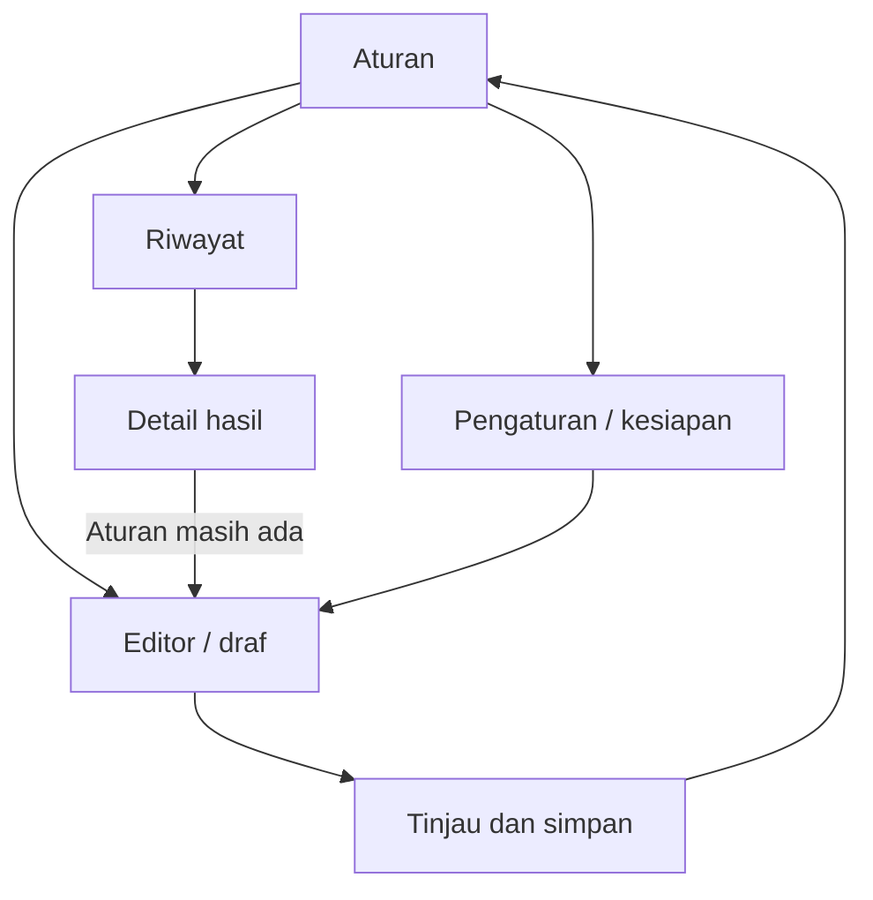

# Krono

## Design

| Atribut | Keterangan |
| --- | --- |
| Dokumen | `DESIGN.md` |
| Versi | 0.1 |
| Tanggal | 22 Oktober 2026, Asia/Jakarta |
| Acuan | PRD, Android Capabilities, Rule Engine, Architecture, dan Database v0.1 |
| Referensi visual | DESIGN(1).md serta tiga pasangan HTML/screenshot dari pemilik produk |
| Tahap | Spesifikasi UI dan UX sebelum implementasi |
| Status | Seluruh keputusan visual/interaksi baru merupakan usulan v0.1 |
| Bukti saat ini | Referensi sudah ditelaah; belum ada aplikasi native atau uji kegunaan/perangkat dari tahap ini |
| Keluaran | Arah visual, token, layar, komponen, alur, microcopy, dan kriteria pemeriksaan |

> Krono membantu pengguna memahami apa yang memicu aturan, aksi yang diminta, dan hasil yang benar-benar diketahui. Tampilan mengikuti kontrak mesin dan kemampuan perangkat.

## 1. Tujuan dan batas desain

Desain MVP berfokus pada lokasi → wallpaper dan TWS pilihan → volume media. Editor mendukung aturan sederhana dan IF/ELSE IF/ELSE dasar dengan beberapa aksi berurutan.

Pengguna harus dapat membuat aturan tanpa memahami istilah database atau lifecycle Android. Istilah teknis tetap tersedia ketika membantu menjelaskan logika, sedangkan pesan utama memakai bahasa Indonesia yang langsung.

Prinsip rancangan:

- Urutan cabang dan aksi terlihat sama dengan urutan yang dipakai mesin.
- Satu tindakan utama diberi penekanan pada setiap tahap.
- Keinginan aktif, kesiapan, pekerjaan berjalan, dan hasil terakhir ditampilkan terpisah.
- Warna dilengkapi judul, ikon, dan teks keadaan.
- Mengetik di editor hanya mengubah draf.
- Simulasi dan perubahan nyata pada HP memiliki tindakan yang berbeda.
- Status sukses memerlukan hasil yang sesuai kontrak, bukan sekadar animasi selesai.

### 1.1 Bahasa antarmuka

| Konsep | Label utama | Label teknis pendamping |
| --- | --- | --- |
| Trigger | Ketika | WHEN |
| Condition | Jika | IF |
| Cabang berikutnya | Jika tidak, jika | ELSE IF |
| Cabang akhir opsional | Jika semua kondisi sebelumnya tidak cocok | ELSE |
| Action | Lakukan | THEN |
| Rule | Aturan | Tidak perlu label tambahan. |
| Logs | Riwayat | Detail teknis dapat memakai nama kode hasil. |
| Dry run | Simulasikan | Tanpa mengubah pengaturan HP. |
| Live test | Uji aksi | Mengubah pengaturan HP. |

Label WHEN/IF/THEN menggunakan monospace sebagai penanda pendek. Penjelasan, instruksi, dan pesan kesalahan tetap memakai font tubuh yang mudah dibaca.

## 2. Evaluasi referensi dan keputusan arah visual

### 2.1 Bagian yang dipertahankan

| Referensi | Hal yang diadopsi |
| --- | --- |
| screen(1).png / code(1).html | Daftar kartu aturan, ringkasan cabang, switch, navigasi dua tujuan, dan tombol tambah. |
| screen(2).png / code(2).html | Editor vertikal, pemisahan pemicu/kondisi/aksi, pratinjau wallpaper, dan penambahan cabang. |
| screen.png / code.html | Riwayat ringkas, filter hasil, waktu, dan detail hasil yang dapat dibuka. |
| DESIGN(1).md | Permukaan charcoal, keluarga violet/cyan/hijau, Inter, dan JetBrains Mono. |

### 2.2 Penyesuaian yang diperlukan

| Temuan pada referensi | Keputusan v0.1 |
| --- | --- |
| Nilai warna pada frontmatter dan uraian tidak seluruhnya sama. | Tabel token dokumen ini menjadi acuan; baseline mengikuti palette frontmatter dan konfigurasi HTML. |
| Teks metadata 10–11px dan beberapa kontrol sekitar 40dp. | Teks penting diperbesar dan target sentuh minimal 48dp. |
| WHEN hanya masuk kawasan besar, sedangkan IF memakai subarea A/B. | Pemicu memantau perubahan seluruh area yang dipakai cabang agar perpindahan internal A → B tetap relevan. |
| Match/Fallback ditampilkan pada editor contoh. | Editor biasa menampilkan konfigurasi. Penanda kecocokan hanya muncul dalam hasil simulasi/pemeriksaan yang memiliki asal jelas. |
| Badge “3 active” dapat terlihat seperti semua aturan siap. | Ringkasan menyebut jumlah diaktifkan serta jumlah yang perlu perhatian. |
| Riwayat hanya Success/Failed. | Tambahkan sebagian berhasil, terhalang, belum terverifikasi, dan dilewati. |
| Mockup memuat DND, Wi-Fi, jadwal, Battery Saver, navigasi aplikasi, dan cloud. | Pilihan MVP hanya lokasi/Bluetooth serta wallpaper/volume media. |
| Ada istilah Event Listener dan kode internal pada alur utama. | Ganti dengan penjelasan sumber yang dipantau. |
| HTML menggambar status bar dan memiliki ukuran layar minimum tetap. | UI native memakai system bar dan ruang jendela sebenarnya. |
| Contoh menyembunyikan scroll/zoom dan mengandalkan gestur. | Konten dapat digulir, membesar, dan dioperasikan melalui aksesibilitas. |

Perubahan tersebut mempertahankan karakter referensi sambil menyelaraskannya dengan lima dokumen produk/teknis sebelumnya. DESIGN(1).md tetap menjadi bahan masukan; dokumen baru ini merinci usulan desain MVP.

## 3. Struktur navigasi dan alur

### 3.1 Tujuan utama

Navigasi utama memiliki dua tujuan: **Aturan** dan **Riwayat**. Pengaturan dibuka dari ikon berlabel aksesibel pada app bar. Editor menjadi alur fokus dengan tombol kembali dan tindakan tinjau.

| ID layar | Nama | Tujuan |
| --- | --- | --- |
| SCR-01 | Aturan | Melihat aturan, kesiapan, prioritas, dan draf. |
| SCR-02 | Editor | Menyusun atau mengubah draf. |
| SCR-03 | Pemilih area | Memilih/membuat area yang dipantau. |
| SCR-04 | Pemilih TWS | Memilih identitas perangkat. |
| SCR-05 | Pengaturan aksi | Memilih gambar/sasaran atau volume. |
| SCR-06 | Tinjau aturan | Membaca perilaku dan menyimpan revisi/aktivasi. |
| SCR-07 | Hasil simulasi | Memeriksa keputusan dari masukan contoh. |
| SCR-08 | Uji aksi | Menjalankan satu aksi yang dipilih secara eksplisit. |
| SCR-09 | Riwayat | Melihat eksekusi yang sudah selesai. |
| SCR-10 | Detail hasil | Memeriksa cabang, aksi, dan bukti hasil. |
| SCR-11 | Kesiapan | Melihat hambatan serta tindakan yang relevan. |
| SCR-12 | Pengaturan | Mengelola riwayat, bantuan, dan preferensi MVP. |

Pemilih dan pengaturan aksi dapat berupa sheet pada ruang yang cukup, atau layar penuh ketika isi/keyboard membutuhkannya. ID layar menyatakan tanggung jawab, bukan kewajiban membuat dua belas activity.

### 3.2 Hubungan alur

Kembali dari pemilih mempertahankan posisi dan isi editor. Kembali dari detail hasil mempertahankan filter serta posisi riwayat. Membuka ulang halaman tidak membuat command menjalankan aturan baru.

## 4. Warna dan token visual

### 4.1 Palette baseline

Tema MVP adalah **Krono Dark**. Nilai berikut merupakan token usulan, dengan warna dasar dari referensi. Tema terang/dinamis memerlukan palette lengkap dan pemeriksaan tersendiri sebelum ditawarkan.

| Token | Hex | Pemakaian |
| --- | --- | --- |
| background / surface | #101319 | Kanvas utama. |
| surfaceLowest | #0B0E14 | Area inset dan pratinjau tertentu. |
| surfaceLow | #191C22 | Baris hasil atau permukaan sekunder. |
| surfaceContainer | #1D2026 | Kartu aturan dan blok editor. |
| surfaceHigh | #272A31 | Kontrol tonal dan permukaan lebih tinggi. |
| surfaceHighest | #32353C | Lapisan dialog/sheet sesuai konteks. |
| onSurface | #E1E2EB | Teks utama. |
| onSurfaceVariant | #CBC3D7 | Teks pendukung. |
| outline | #958EA0 | Batas kontrol yang perlu terbaca dan ikon sekunder. |
| outlineVariant | #494454 | Pemisah dekoratif; bukan satu-satunya batas kontrol penting. |
| primary | #D0BCFF | CTA utama, fokus, dan penanda logika. |
| onPrimary | #3C0091 | Teks di atas primary. |
| primaryContainer | #A078FF | Pilihan aktif/tonal tertentu. |
| onPrimaryContainer | #340080 | Teks di atas primaryContainer. |
| secondary | #4CD7F6 | Penanda sumber/pemicu. |
| tertiary | #4EDEA3 | Penanda aksi dan hasil positif yang memang diketahui. |
| error | #FFB4AB | Kesalahan pada permukaan gelap. |
| errorContainer | #93000A | Area pesan error yang perlu penekanan. |
| onErrorContainer | #FFDAD6 | Teks pada errorContainer. |
| warning | #F2C66D | Terhalang, sebagian berhasil, atau perlu perhatian. |
| warningContainer | #3A2D12 | Dasar pesan peringatan. |

Cyan menunjukkan kategori pemicu; hijau pada judul Lakukan menunjukkan kategori aksi. Badge hasil selalu memiliki teks/ikon sendiri sehingga aksen kategori tidak diartikan sebagai aksi sudah berhasil.

### 4.2 Pasangan warna dan kontras

Target desain memakai minimal 4,5:1 untuk teks biasa, serta 3:1 untuk petunjuk nonteks yang diperlukan memahami kontrol. Ini memakai rujukan WCAG untuk pemeriksaan, tanpa mengklaim aplikasi sudah memenuhi seluruh kriteria aksesibilitas. [S01][S02]

Rasio berikut dihitung untuk warna solid tanpa opacity.

| Pasangan | Rasio perkiraan |
| --- | --- |
| onSurface / background | 14,42:1 |
| onSurface / surfaceContainer | 12,65:1 |
| onSurfaceVariant / surfaceHigh | 8,43:1 |
| onPrimary / primary | 7,69:1 |
| onPrimaryContainer / primaryContainer | 4,54:1 |
| secondary / surfaceContainer | 9,60:1 |
| tertiary / surfaceContainer | 9,56:1 |
| error / surfaceContainer | 9,61:1 |
| onErrorContainer / errorContainer | 7,24:1 |
| warning / warningContainer | 8,36:1 |
| outline / surfaceContainer | 5,17:1 |
| primary / surfaceHigh | 8,43:1 |

Rasio ini memeriksa pasangan token, bukan seluruh hasil render. State ditekan, dipilih, disabled, lapisan gambar, dan kombinasi warna baru harus diperiksa lagi saat implementasi.

Jangan memudarkan seluruh komponen untuk membuat pressed state. onPrimaryContainer mempunyai margin kontras terbatas; perubahan warna harus tetap mempertahankan keterbacaan.

## 5. Tipografi, ikon, dan ukuran dasar

### 5.1 Skala tipografi Android

Ukuran menggunakan sp, sehingga mengikuti pengaturan ukuran teks pengguna. dp dipakai untuk tata letak. Ukuran px/rem dari HTML tidak disalin sebagai ukuran fisik native.

| Token | Font | Ukuran / tinggi baris | Bobot | Pemakaian |
| --- | --- | --- | --- | --- |
| titleLarge | Inter | 26 / 34sp | 600 | Judul besar pada ruang cukup. |
| titleScreen | Inter | 20 / 28sp | 600 | App bar/halaman. |
| titleSection | Inter | 18 / 24sp | 600 | Nama kartu dan bagian. |
| body | Inter | 16 / 24sp | 400 | Instruksi, field, dan pesan utama. |
| bodyCompact | Inter | 14 / 20sp | 400 | Ringkasan kartu dan detail pendukung. |
| label | Inter | 14 / 20sp | 500 | Tombol, chip, dan label kontrol. |
| supporting | Inter | 12 / 18sp | 400 | Waktu atau metadata tambahan. |
| logicToken | JetBrains Mono | 13 / 18sp | 500 | WHEN/IF/THEN pendek. |
| numeric | JetBrains Mono | 16 / 24sp | 500 | Persentase dan nilai terpilih. |
| timestamp | JetBrains Mono | 12 / 18sp | 400 | Waktu pada rincian hasil. |

Nama aturan boleh membungkus dua baris pada kartu. Nilai yang menentukan keputusan, seperti nama perangkat pembeda dan volume, tidak disembunyikan dengan pemotongan yang menghilangkan makna. Nama lengkap dapat dibaca di editor/detail.

Inter dan JetBrains Mono mengikuti pilihan referensi. Ambil file font dari sumber resminya, kunci versi, serta sertakan lisensi yang sesuai. Font produksi dibundel agar tampilan tidak bergantung pada permintaan Google Fonts saat aplikasi dibuka. [S08][S09]

### 5.2 Ikon dan bentuk

Gunakan satu keluarga Material Symbols Outlined dengan ukuran visual umum 24dp. Ikon 20dp boleh dipakai di dalam baris padat dengan target sentuh yang tetap memadai. Sumber ikon dan pemilihan aset dicatat dari repositori resmi. [S10]

| Peran | Ikon usulan |
| --- | --- |
| Aturan / Riwayat / Pengaturan | tune / history / settings |
| Lokasi / Bluetooth | location_on / bluetooth |
| Wallpaper / volume media | wallpaper / volume_down |
| Tambah / menu / urutkan | add / more_vert / drag_indicator |
| Berhasil / perhatian / gagal | check_circle / warning / error |
| Belum diketahui | help_outline |

Ikon dekoratif tidak dibacakan berulang. Ikon tindakan tanpa teks memiliki label yang menyebut tugas, misalnya “Pengaturan Krono” atau “Menu aturan Volume TWS”.

### 5.3 Spacing dan geometri

| Token | Nilai usulan | Pemakaian |
| --- | --- | --- |
| spaceXS / S / M | 4 / 8 / 12dp | Jarak metadata, label, dan ikon. |
| spaceL / XL / XXL | 16 / 24 / 32dp | Padding kartu dan jarak kelompok. |
| screenMarginCompact | 16dp | Margin layar kecil. |
| screenMarginWide | 24dp | Margin ruang lebih lebar. |
| radiusField | 12dp | Input dan kontrol tonal. |
| radiusCard | 16dp | Kartu aturan/blok logika. |
| radiusSheet | 24dp | Sudut atas sheet/modal sesuai komponen. |
| radiusPill | Penuh | Chip dan badge. |
| divider | 1dp | Pemisah secukupnya. |
| logicConnector | 2dp | Garis alur dekoratif. |
| touchTarget | Minimal 48 × 48dp | Seluruh kontrol sentuh. |

Tinggi teks/kartu mengikuti isi. Kedalaman terutama memakai tingkat permukaan dan batas yang sesuai; glow serta bayangan besar tidak menjadi dasar hierarki.

## 6. Komponen dan tata letak adaptif

### 6.1 Komponen inti

| ID | Komponen | Isi dan perilaku |
| --- | --- | --- |
| CMP-01 | App bar | Judul, kembali bila perlu, dan maksimal tindakan yang benar-benar relevan. |
| CMP-02 | Navigation bar/rail | Aturan dan Riwayat dengan ikon serta label. |
| CMP-03 | Rule card | Nama, ringkasan, switch, kesiapan, pekerjaan, dan hasil terakhir. |
| CMP-04 | Logic block | Judul Ketika/Jika/Lakukan, konfigurasi, dan menu lokal. |
| CMP-05 | Action row | Jenis, parameter, pratinjau bila ada, menu, dan urutan. |
| CMP-06 | Status badge | Ikon + label, tanpa menutupi teks penting. |
| CMP-07 | Readiness banner | Hambatan spesifik dan tindakan perbaikan yang sesuai. |
| CMP-08 | Filter chip | Satu pilihan filter, target sentuh tetap cukup. |
| CMP-09 | Primary/tonal/text button | Tindakan utama, sekunder, dan tambahan. |
| CMP-10 | Field | Label menetap, nilai, petunjuk, error dekat field. |
| CMP-11 | Volume control | Slider serta input angka 0–100 yang setara. |
| CMP-12 | Image preview | Thumbnail, sasaran layar, dan status impor. |
| CMP-13 | History item | Waktu, nama, asal, hasil, dan ringkasan singkat. |
| CMP-14 | Result step | Hasil satu aksi dengan penjelasan serta bukti. |
| CMP-15 | Sheet/dialog | Pemilih atau keputusan lokal yang jelas cakupannya. |
| CMP-16 | Empty/error state | Penjelasan singkat dan tindakan yang relevan. |

Gunakan komponen Material 3 sebagai dasar perilaku native, lalu terapkan token Krono melalui theme dan komponen pembungkus. Pemilihan komponen tidak mengubah makna command engine. [S03]

### 6.2 Ukuran jendela

Rentang di bawah merupakan baseline layout Krono. Implementasi membaca ruang jendela saat ini dan dapat berubah ketika split screen/rotasi, sesuai panduan adaptive Android. [S04]

| Ruang tersedia | Navigasi dan isi |
| --- | --- |
| Lebar <600dp | Navigation bar pada Aturan/Riwayat; satu kolom. Editor memakai alur fokus. |
| Lebar 600–839dp | Rail bila ruang memungkinkan; daftar/editor tetap satu kolom yang dibatasi lebar. |
| Lebar ≥840dp | Rail dan pola daftar-detail bila isi mendukung. |
| Editor dengan lebar cukup, acuan ≥960dp | Alur vertikal utama dan panel ringkasan di samping; tidak berubah menjadi canvas bebas. |
| Jendela pendek/landscape | Konten dapat digulir; CTA dan field tetap dapat dicapai dengan keyboard. |

Lebar form utama maksimal sekitar 640dp sebagai usulan keterbacaan. Panel detail memperoleh sisa ruang yang layak; jangan memaksa dua panel yang sama-sama terlalu sempit.

System bar, cutout, keyboard, dan area gestur ditangani melalui insets. Tidak ada status bar 09:41 buatan atau minimum tinggi 884px dari HTML. CTA akhir tidak menutupi field ketika keyboard terbuka. [S05]

## 7. Model status yang terlihat

### 7.1 Empat lapisan informasi

| Lapisan | Nilai pengguna | Makna |
| --- | --- | --- |
| Keinginan | Draf / Diaktifkan / Dijeda | Pilihan pengguna terhadap aturan. |
| Kesiapan | Siap / Perlu akses / Data belum tersedia / Perlu melanjutkan sesi / Belum didukung / Konfigurasi bermasalah | Kemampuan memeriksa/menjalankan sekarang. |
| Pekerjaan | Menunggu data / Menunggu kesiapan / Sedang diproses | Kesempatan yang masih berlaku. |
| Hasil terakhir | Berhasil / Sebagian berhasil / Belum terverifikasi / Gagal / Terhalang / Dilewati | Hasil satu kesempatan yang sudah selesai. |

Tidak ada pekerjaan aktif berarti aturan menunggu sebab yang relevan. Jangan menggambar spinner permanen hanya karena switch menyala.

Contoh kartu: “Diaktifkan” + “Perlu akses lokasi” + “Terakhir: Berhasil, kemarin”. Ketiganya dapat benar sekaligus dan tidak digabung menjadi satu label Aktif.

### 7.2 Hasil per aksi

| Kode engine | Label UI | Penjelasan |
| --- | --- | --- |
| APPLIED | Diterapkan | Adapter mempunyai bukti sesuai kontraknya. |
| NO_CHANGE_NEEDED | Sudah sesuai | Tidak memerlukan permintaan perubahan baru. |
| FAILED | Gagal | Kegagalan diketahui. |
| BLOCKED | Terhalang | Akses/konteks/sumber yang dibutuhkan tidak tersedia. |
| UNVERIFIED | Belum terverifikasi | Hasil belum dapat dipastikan. |
| SKIPPED | Dilewati | Aksi tidak dicoba, dengan alasan. |
| CANCELLED | Dibatalkan | Pekerjaan belum dimulai diakhiri oleh pembatalan. |
| EXPIRED | Kedaluwarsa | Jendela kesempatan berakhir. |
| SUPERSEDED | Digantikan | Ada rencana sah yang lebih baru pada sasaran terkait. |

Warna positif digunakan untuk Diterapkan/Sudah sesuai. Peringatan digunakan untuk hasil parsial, ketidakpastian, dan hambatan yang dapat ditindaklanjuti. Pembatalan biasa dapat netral; kegagalan memakai error.

Ringkasan mengikuti Rule Engine. Sebagian berhasil memerlukan bukti efek yang sudah diterapkan. Satu langkah Sudah sesuai disusul Gagal tidak otomatis diberi label Sebagian berhasil.

## 8. Layar Aturan

### 8.1 Susunan layar

| Urutan | Isi |
| --- | --- |
| App bar | Krono; ikon Pengaturan. |
| Ringkasan | Contoh “3 diaktifkan · 1 perlu perhatian”, dari data sebenarnya. |
| Filter | Semua, Lokasi, Bluetooth. Pencarian tersedia sesuai cakupan implementasi. |
| Draf | Bagian kecil “Lanjutkan draf” bila ada, terpisah dari aturan tersimpan. |
| Daftar | Kartu dalam urutan prioritas. |
| Tindakan tambah | FAB diperluas “Buat aturan”. |
| Navigasi | Aturan / Riwayat. |

Daftar memakai jarak kartu sekitar 12dp dan padding 16dp. FAB memiliki ruang akhir agar tidak menutupi kartu terakhir.

### 8.2 Isi kartu aturan

1. Ikon kategori, nama aturan, dan switch.
2. Ringkasan Ketika → Lakukan atau maksimal dua cabang.
3. Tautan “Lihat semua 3 cabang” bila isi lebih panjang.
4. Kesiapan saat ini, dengan tombol perbaikan bila diperlukan.
5. Pekerjaan yang sedang berlangsung, hanya bila ada.
6. Hasil terakhir beserta waktu; atau “Belum ada eksekusi”.

Mengetuk isi kartu membuka editor/detail aturan. Switch dan menu mempunyai target interaksi sendiri sehingga tidak ikut membuka editor.

Pada kartu dijeda, helper aktivasi menyebut: **“Saat diaktifkan, aksi yang cocok dapat langsung berjalan.”** Switch ON mengirim satu command aktivasi; OFF mengirim jeda. Tidak ada perubahan optimistis yang menyamarkan kegagalan menyimpan.

Selama command pending, kontrol terkait menunjukkan proses dan menahan ketukan ulang. Setelah commit, state mengikuti repository. Jika gagal, state sebelumnya tetap terlihat disertai alasan.

### 8.3 Prioritas dan menu

Menu kartu menyediakan Ubah, Gandakan, Lihat riwayat, dan Hapus. Salinan memiliki identitas baru dan dimulai dalam keadaan dijeda/draf sesuai hasil penyimpanan yang dipilih.

Atur prioritas membuka seluruh daftar aturan tersimpan, termasuk yang dijeda. Filter tidak mengubah arti posisi global. Sediakan drag handle serta tombol “Naik”/“Turun” yang dapat diakses.

Simpan urutan baru menjelaskan: “Urutan ini dipakai pada pemeriksaan berikutnya. Pekerjaan tertunda yang terdampak akan dihentikan.” Mengubah prioritas tidak menjalankan ulang seluruh aturan.

Penghapusan menampilkan nama aturan dan pilihan terpisah untuk riwayat terkait. Aksi yang sudah diterapkan tetap menjadi keadaan HP saat itu. Jangan menawarkan Undo yang menyiratkan pengaturan perangkat ikut dipulihkan.

## 9. Editor aturan

### 9.1 Struktur vertikal

| Bagian | Isi |
| --- | --- |
| App bar | Kembali, nama aturan, menu jika diperlukan. |
| State draf | Draf tersimpan / Menyimpan draf / Draf belum tersimpan. |
| Ketika | Jenis pemicu dan sumber yang dipantau. |
| Jika | Cabang berurutan, bila diperlukan. |
| Lakukan | Satu atau lebih aksi pada cabang. |
| Penambahan | Tambah aksi, Tambah cabang, Tambah ELSE opsional. |
| Alat bantu | Simulasikan dan Uji aksi pada aksi yang dipilih. |
| Akhir | Ringkasan singkat dan tombol Tinjau aturan. |

Pemicu Bluetooth yang sudah menyatakan keadaan cukup dapat memakai mode sederhana, misalnya “TWS ini terhubung → Volume media 20%”. Pemicu lokasi umum mendapat kondisi area yang terlihat agar arti cabangnya jelas.

Draf disimpan tanpa mengaktifkan pemantauan. Mengubah slider, area, gambar, atau urutan tidak langsung mengubah HP.

### 9.2 Blok pemicu

Pilihan MVP hanya **Perubahan area terpantau** dan jenis perubahan koneksi Bluetooth yang didukung. Setelah dipilih, tampilkan sumber yang terlibat dan cara mengubahnya.

Untuk lokasi A/B, blok Ketika merangkum “Perubahan area: Kampus A, Kampus B”. Area pada kondisi masuk ke ruang lingkup pemantauan yang terlihat saat tinjau. Jangan memakai satu event masuk kawasan besar sebagai satu-satunya pemicu cabang A/B di dalamnya.

Untuk TWS, blok Ketika merangkum perangkat dan keadaan yang dimaksud, misalnya “TWS Hanif terhubung”. Status koneksi saat diperiksa dapat ditampilkan sebagai informasi sumber dengan waktu, bukan penanda aturan sudah dijalankan.

### 9.3 Percabangan

Di atas cabang pertama tampilkan: **“Cabang diperiksa dari atas. Hanya cabang pertama yang cocok dijalankan.”**

Setiap cabang mempunyai judul urutan, kondisi, daftar aksi, dan menu. IF pertama dan ELSE IF berikutnya mengikuti posisi draf. ELSE selalu terakhir dan tidak mempunyai kondisi tambahan.

Menu cabang menyediakan Naik, Turun, dan Hapus yang sesuai. Sediakan alternatif tombol terhadap drag. Penomoran dan label menyesuaikan setelah perubahan; branch ID tetap stabil dalam draf.

Tidak ada AND/OR bertingkat, loop, delay, atau canvas bebas pada MVP. Area layar lebar menambah ruang ringkasan, sambil mempertahankan urutan vertikal yang sama.

Jika data kondisi penentu belum diketahui, hasil simulasi/pemeriksaan menampilkan menunggu/tidak dapat diperiksa. ELSE tidak digambarkan sebagai jalan keluar ketika izin atau sumber hilang.

### 9.4 Validasi dan penyimpanan draf

Error muncul dekat field dan dirangkum saat Tinjau ditekan. Fokus berpindah ke field bermasalah pertama dengan isi tetap tersedia. Contoh: “Pilih gambar untuk cabang Kampus A.”

Kembali dari editor mempertahankan draf yang sudah tersimpan. Jika penyimpanan gagal, tampilkan bahwa perubahan belum tersimpan serta pilihan mencoba lagi atau meninggalkan perubahan. Jangan menampilkan toast Draf tersimpan sebelum commit berhasil.

Jika revisi aktif berubah dari versi dasar draf, tampilkan konflik dan ringkasan perubahan sebelum simpan. Jangan menimpa revisi baru secara diam-diam.

## 10. Pemilih dan editor area

### 10.1 Daftar area

SCR-03 menampilkan nama, radius, dan ringkasan pusat area. Tandai area yang sudah dipakai draf. Tombol Tambah area membuka form kecil yang dapat dibaca tanpa peta.

### 10.2 Membuat area

| Field | Perilaku |
| --- | --- |
| Nama area | Wajib untuk aturan lengkap; contoh Kampus A. |
| Pusat area | Tombol Gunakan lokasi sekarang, dilakukan ketika UI terlihat. |
| Status posisi | Kualitas/waktu pengambilan bila tersedia; belum diketahui tidak diberi tanda siap. |
| Radius | Input angka/stepper dengan satuan meter. Usulan awal 150m. |
| Koordinat manual | Pilihan lanjutan bila disediakan, dengan validasi yang jelas. |
| Simpan area | Menyimpan pilihan untuk draf; bukan aktivasi aturan. |

Radius 150m adalah default desain usulan, bukan batas atau jaminan akurasi Android. Panduan lokasi dan kebutuhan data tetap mengikuti Android Capabilities. Nilai kecil dapat diberi petunjuk kualitas tanpa mengklaim semua angka di bawahnya tidak sah.

Peta interaktif untuk memilih lokasi jauh belum dikunci penyedianya. Baseline tidak menampilkan peta palsu yang seolah sudah menentukan titik. Pemilihan titik memakai lokasi sekarang atau input lanjutan yang benar-benar tersedia.

### 10.3 Area bersama dan kondisi batas

Sebelum mengubah area yang dipakai aturan lain, tampilkan jumlah aturan terdampak dan nama yang relevan. Pilihan mengubah area bersama harus menjelaskan bahwa revisi aturan aktif terkait dapat diperiksa ulang.

Sediakan jalur memakai salinan area untuk perubahan yang hanya diinginkan pada satu aturan. Mengedit field pada draf tidak menimpa sumber bersama yang sedang dipakai aturan aktif.

Ringkasan lokasi menjelaskan:

- Area dapat tumpang tindih; cabang pertama yang cocok menang.
- Pemberitahuan lokasi dapat terlambat.
- Posisi yang belum pasti dapat menunda pemeriksaan.
- Keluar seluruh area mempertahankan wallpaper terakhir jika tidak ada aksi cadangan.

## 11. Pemilih TWS dan sumber Bluetooth

SCR-04 menampilkan perangkat yang dapat dibaca melalui akses yang sesuai. Alur awal memakai perangkat yang sudah dipasangkan, mengikuti cakupan adapter Classic yang dibuktikan.

| Keadaan | Tampilan / tindakan |
| --- | --- |
| Akses Bluetooth belum ada | Penjelasan singkat dan tombol Beri akses Bluetooth. |
| Bluetooth mati | Status Bluetooth mati dan Buka pengaturan Bluetooth. |
| Perangkat tersedia | Nama, status saat diperiksa, dan ikon yang membantu. |
| Nama perangkat sama | Penanda pembeda singkat bila perlu, misalnya akhiran identitas; alamat lengkap tidak menjadi teks utama. |
| TWS belum dipasangkan | Petunjuk memasangkan melalui pengaturan sistem lalu Perbarui daftar. |
| Profil/transport belum didukung | Alasan spesifik; tidak diberi label siap. |
| Sumber tidak dapat dibaca | Coba periksa lagi atau simpan draf. |

Pemilihan perangkat tidak memaksa koneksi baru atau pemindaian terus-menerus. Nama tampilan tidak menjadi identitas tunggal.

Keterangan aksi menyebut **Volume media HP**. Ketika ada beberapa keluaran, rute audio mengikuti keadaan Android dan dukungan adapter; UI tidak menjanjikan volume independen setiap TWS.

Memperbarui daftar tidak dianggap sebagai command menjalankan aturan. Pemeriksaan awal aktivasi tetap dijelaskan pada tahap tinjau.

## 12. Pengaturan aksi

### 12.1 Pemilih jenis aksi

Dua jenis MVP adalah Ganti wallpaper dan Atur volume media. Masing-masing mempunyai ikon, deskripsi singkat, dan kebutuhan yang relevan.

Pilihan DND, Battery Saver, membuka Maps, cloud sync, dan jenis lain pada mockup tidak masuk katalog aktif MVP.

### 12.2 Wallpaper

| Bagian | Perilaku |
| --- | --- |
| Pilih gambar | Membuka pemilih sistem dengan interaksi pengguna. |
| Impor | Menyiapkan salinan yang dikelola Krono, dengan state proses yang sebenarnya. |
| Preview | Menampilkan gambar dan orientasi yang dipilih. |
| Sasaran | Layar utama, layar kunci, atau keduanya sesuai pemeriksaan dukungan. |
| Ubah/hapus pilihan | Memperbarui draf dan referensi aset. |
| Keterangan | Tidak mengklaim otomatis menyimpan wallpaper lama. |

State impor: Belum dipilih, Menyiapkan gambar, Gambar siap, atau Gagal menyiapkan. Jangan menampilkan persen progres jika total kemajuan belum diketahui.

URI yang baru diterima belum berarti gambar siap. Jika gambar cloud gagal dibaca, tampilkan “Gambar belum berhasil disiapkan. Pilih ulang atau coba lagi.” Cabang yang membutuhkan aset belum siap tidak dapat disimpan sebagai konfigurasi aktif yang lengkap.

Pilihan sasaran yang tidak tersedia mempunyai alasan dekat opsi. “Gambar siap” menyatakan kesiapan aset, bukan bukti pemasangan wallpaper berhasil.

### 12.3 Volume media

Slider dan input angka menunjukkan nilai sama, 0–100%. Perubahan keduanya hanya menyunting draf. Input kosong/di luar rentang ditandai, tanpa diam-diam diganti ke nol.

Label selalu Volume media. Caption menjelaskan bahwa pilihan dibulatkan ke tingkat volume yang didukung HP. Persentase bukan persentase keras suara fisik.

Tidak ada tombol uji yang memutar suara atau meminta mikrofon. Uji mengajukan pengaturan volume yang dijelaskan di layar.

### 12.4 Beberapa aksi

Aksi ditampilkan bernomor pada setiap cabang. Tambah aksi diletakkan setelah daftar cabang tersebut. Menu Naik/Turun/Hapus tersedia selain drag.

Jika beberapa aksi sengaja menulis sasaran sama, pertahankan urutan dan jelaskan nilai akhir mengikuti aksi terakhir bila seluruh rangkaian berhasil. Jangan menyisipkan delay atau menggabungkan aksi secara tersembunyi.

Bantuan singkat menyatakan: “Jika satu aksi tidak berhasil atau hasilnya belum pasti, aksi berikutnya dihentikan. Perubahan yang sudah terjadi tetap berlaku.”

## 13. Tinjau, simpan, aktivasi, dan jeda

### 13.1 Halaman tinjau

SCR-06 menampilkan nama, sumber, urutan cabang, aksi per cabang, perilaku saat tidak cocok, serta kesiapan yang diketahui.

| Konteks | Tindakan |
| --- | --- |
| Aturan baru lengkap | Simpan & aktifkan sebagai tindakan eksplisit; Simpan dijeda sebagai pilihan lain. |
| Mengedit aturan aktif | Simpan perubahan, dengan pilihan Tetap diaktifkan yang terlihat. |
| Mengedit aturan dijeda | Simpan dijeda; pengguna dapat memilih aktifkan secara eksplisit. |
| Struktur belum lengkap | Kembali perbaiki; draf tetap dapat disimpan. |
| Akses/konteks belum siap | Jelaskan hambatan serta pilihan menyimpan dijeda atau menginginkan aktif sambil menunggu kesiapan, sesuai klasifikasi kemampuan. |

Helper saat menyimpan dalam keadaan aktif: **“Setelah disimpan, Krono memeriksa keadaan sekarang satu kali. Aksi yang cocok dapat langsung berjalan.”**

Kondisi tak didukung permanen tidak disamarkan sebagai sekadar kurang izin. Parameter/sasaran yang tidak valid tidak diloloskan lewat pilihan aktif sambil menunggu.

### 13.2 Hasil simpan

Simpan sukses berarti revisi dan keinginan aktif/jeda tersimpan. Ia tidak berarti pemantauan sudah terdaftar sempurna atau aksi sudah diterapkan.

Tampilkan “Aturan disimpan” beserta kesiapan aktual. Aktivasi yang masih menunggu sumber dapat kembali ke kartu dengan status yang tepat. Tidak ada layar Selamat berhasil menjalankan aturan hanya karena tombol simpan selesai.

Ketukan berulang memakai command yang sama selama permintaan belum selesai. Rotasi atau kembali dari pengaturan tidak membuat command baru.

### 13.3 Jeda dan pemulihan

Jeda menghentikan pekerjaan berikutnya sesuai kontrak engine. Tampilkan “Dijeda. Perubahan yang sudah diterapkan tetap berlaku.” Upaya yang sudah telanjur dipanggil mungkin masih perlu diselesaikan pencatatannya.

Setelah akses diberikan jauh sesudah tiket berakhir, kesiapan dapat pulih tanpa menjalankan aksi lama. Tombol Coba aturan sekarang adalah command baru yang membaca keadaan sekarang, dengan helper: “Jika kondisi cocok, aksi dapat berjalan.” Periksa kesiapan tetap menjadi tindakan pemeriksaan kemampuan yang terpisah.

Sesudah restart atau proses pulih, tampilkan kebutuhan pemantauan/sesi yang diketahui. Jangan mengklaim penyebabnya Force Stop jika aplikasi tidak mempunyai bukti yang memadai.

## 14. Simulasi dan uji aksi nyata

### 14.1 Simulasi logika

SCR-07 diberi judul **Simulasi aturan** dan caption “Menggunakan masukan contoh, tanpa mengubah pengaturan HP.”

Pengguna memilih keadaan contoh untuk sumber yang dipakai aturan:

| Sumber | Pilihan masukan |
| --- | --- |
| Area | Di dalam, Di luar, atau Belum diketahui. |
| Bluetooth | Terhubung, Terputus, atau Belum diketahui, beserta pemicu contoh yang relevan. |
| Kesiapan aksi | Keadaan contoh yang diperlukan untuk menjelaskan keputusan. |

Hasil menampilkan kondisi penentu, cabang terpilih, aksi yang akan diminta, atau alasan menunggu/dilewati. Gunakan kalimat “Akan mengatur volume media 20%”, bukan Diterapkan.

MVP dapat mensimulasikan satu aturan. Tampilkan cakupan tersebut dan helper: “Benturan dengan aturan lain belum diperiksa.” Jangan mengklaim memenangkan prioritas seluruh daftar dari simulasi terisolasi.

Jika draf berubah, hasil lama ditandai tidak lagi sesuai dan pengguna dapat Simulasikan kembali. Hasil simulasi tidak masuk riwayat efek produksi atau mengubah episode aturan aktif.

### 14.2 Uji satu aksi

SCR-08 merangkum aksi dan parameter yang benar-benar akan diminta. Contoh CTA:

- **Pasang wallpaper sekarang** setelah gambar dan sasaran terlihat.
- **Atur volume media sekarang** setelah nilai terlihat.

Caption: “Uji ini dapat mengubah pengaturan HP. Pemicu lokasi/TWS tidak diuji.”

Uji aksi dapat memakai aksi lengkap dalam draf, tanpa mengaktifkan aturan. Pemeriksaan kemampuan tetap berlaku. Kondisi sumber tidak dipalsukan menjadi cocok untuk menjalankan test.

Selama command berjalan, tombol menampilkan proses dan menahan pengiriman ganda. Hasil menampilkan Diterapkan, Sudah sesuai, Gagal, Terhalang, atau Belum terverifikasi sesuai bukti.

“Uji lagi” menjadi tindakan baru yang eksplisit, dengan pemeriksaan saat itu. Tidak ada pengulangan otomatis ketika hasil belum pasti. Keberhasilan uji foreground tidak disebut bukti otomasi background sudah tersedia.

## 15. Kesiapan dan akses kontekstual

### 15.1 Layar kesiapan

SCR-11 menunjukkan kebutuhan per aturan atau per fitur.

| Bagian | Isi |
| --- | --- |
| Ringkasan | Apa yang sudah siap dan apa yang menghambat. |
| Kebutuhan | Lokasi, Bluetooth, aset, sasaran, serta konteks aksi yang benar-benar dipakai. |
| Dampak | Contoh “Kondisi lokasi belum bisa diperiksa”. |
| Tindakan | Beri akses, Buka pengaturan, Pilih ulang gambar, atau Periksa kesiapan. |
| Hasil pemeriksaan | Waktu dan status terbaru yang dapat dipastikan. |

Tidak ada satu tombol “Beri semua izin” yang menjadi syarat melihat aplikasi. Aturan TWS tidak meminta GPS karena aturan lain memakai lokasi.

### 15.2 Alur akses

| Kebutuhan | Saat diminta | Jika ditolak/tidak tersedia |
| --- | --- | --- |
| Lokasi foreground | Ketika pengguna mengambil titik atau melakukan langkah lokasi yang memerlukannya. | Jelaskan dampak, pertahankan draf, sediakan tindakan yang sesuai. |
| Lokasi background | Ketika menyiapkan pemantauan area yang memerlukannya. | Jelaskan kebutuhan terpisah dan ikuti jalur pengaturan Android terkait. |
| Bluetooth | Ketika memilih/memeriksa perangkat. | Simpan draf atau buka pengaturan yang relevan. |
| Gambar pilihan | Saat pengguna menekan Pilih gambar. | Pilihan sebelumnya tetap ada bila belum diganti dengan sukses. |
| Notifikasi | Dalam konteks status/notifikasi yang benar-benar dipakai. | Nilai kemampuan menampilkan notifikasi secara terpisah. |
| Kelayakan audio | Saat uji atau aksi akan diproses. | Jelaskan konteks yang belum tersedia; bukan dialog izin buatan. |

Kembali dari pengaturan memeriksa kesiapan secara terbatas. Jangan mengirim command aktivasi ulang hanya karena activity kembali terlihat.

### 15.3 Sesi audio Android 17

Android 17 membedakan konteks eksekusi audio dan dapat mengabaikan setter yang tidak memenuhi syarat. Karena itu, menerima event TWS atau memiliki worker tidak cukup menjadi label Volume siap. Persyaratan runtime/target dan WIU tetap mengikuti Android Capabilities. [S11]

Komponen Mulai/Lanjutkan sesi audio hanya ditampilkan setelah jalur layanan dan kecocokannya dibuktikan. Jika belum tersedia untuk konfigurasi tersebut, tampilkan:

**“Otomasi volume di background belum tersedia untuk konfigurasi ini. Aksi dapat diuji saat Krono terbuka.”**

Jangan menampilkan checkbox “Aktifkan WIU” seolah hak platform dapat diberikan melalui preferensi biasa.

Jika sesi yang sah diimplementasikan, pengguna melihat status sesi dan tindakan mengakhirinya. Penghentian memperbarui kesiapan serta menangani pekerjaan sesi yang belum dimulai. Rincian umur/pemulihan sesi merupakan bagian PoC yang belum selesai.

Notifikasi sesi, bila digunakan, menyebut fungsi sebenarnya dan menyediakan tindakan berhenti yang jelas. Penolakan notifikasi tidak otomatis mengubah seluruh aturan menjadi tidak didukung.

## 16. Riwayat dan detail hasil

### 16.1 Daftar riwayat

SCR-09 mempertahankan karakter daftar rapat dari referensi, dengan teks lebih terbaca dan status lebih lengkap.

| Bagian | Isi |
| --- | --- |
| App bar | Riwayat; menu penghapusan dengan cakupan jelas. |
| Filter cepat | Semua, Berhasil, Perlu perhatian; filter lengkap dalam sheet bila ruang sempit. |
| Filter lengkap | Hasil, aturan, serta asal seperti Aktivasi, Pemicu, Coba lagi, atau Uji aksi. |
| Pekerjaan aktif | Bagian terpisah bila ada; belum dianggap hasil final. |
| Hasil selesai | Waktu lokal, nama historis, asal, badge, dan ringkasan. |

Semua enam hasil agregat tetap dapat difilter: Berhasil, Sebagian berhasil, Belum terverifikasi, Gagal, Terhalang, dan Dilewati. Kelompok Perlu perhatian harus menyatakan status yang dicakup, bukan menyamakan semuanya sebagai gagal.

Jumlah pada filter hanya tampil bila dihitung dari seluruh cakupan filter. Jangan memakai jumlah halaman yang sedang dimuat sebagai jumlah total. Pagination tidak menggeser posisi saat daftar bertambah.

Simulasi mempunyai hasil tersendiri. Uji aksi nyata tampil dengan label **Uji aksi**, pemeriksaan awal dengan **Saat aktivasi**, dan pemulihan dengan asal yang sesuai bila ada hasil yang diproyeksikan.

### 16.2 Detail hasil

SCR-10 menampilkan:

1. Nama aturan saat eksekusi dan waktu lengkap.
2. Asal pemeriksaan.
3. Cabang yang dipilih atau alasan tidak ada cabang.
4. Kondisi penentu, termasuk ketidakpastian yang menghalangi.
5. Urutan aksi beserta hasil masing-masing.
6. Penjelasan kemampuan/konflik/pembatalan.
7. Bukti yang dapat diperiksa melalui bagian Detail.
8. Buka aturan, jika identitas itu masih ada.

Bukti tidak dibesar-besarkan. Respons pemasangan wallpaper tidak disebut inspeksi visual. Pembacaan volume stream tidak disebut pengukuran suara fisik. Nilai pilihan dan tingkat aktual yang dibulatkan dapat dijelaskan bila tersedia.

Jika aksi pertama diterapkan dan berikutnya gagal/belum pasti, badge utama **Sebagian berhasil** disertai urutan yang jelas. Tidak ada checkmark hijau untuk langkah yang tidak pernah dicoba.

### 16.3 Tindak lanjut

Coba aturan sekarang memakai aturan terbaru dan kondisi sekarang. Caption menyebutnya, khususnya jika revisi historis sudah berbeda, serta menjelaskan bahwa aksi yang cocok dapat berjalan. Pengguna tidak diarahkan memutar ulang snapshot lama secara diam-diam.

Jika aturan sudah dihapus, tampilkan “Aturan ini sudah dihapus” dan pertahankan isi historis yang tersedia. Jangan menawarkan Buka aturan atau retry yang tidak lagi mempunyai konfigurasi sah.

Nama area/perangkat cukup untuk penjelasan biasa. Koordinat mentah, alamat Bluetooth lengkap, path file, dan token internal tidak menjadi isi utama riwayat.

## 17. Pengaturan, retensi, dan penghapusan

### 17.1 Isi pengaturan MVP

| Bagian | Isi |
| --- | --- |
| Kesiapan | Tautan ke status sumber/aksi yang relevan. |
| Riwayat | Masa simpan, batas jumlah, dan Hapus riwayat. |
| Bantuan | Arti cabang, aktivasi, jeda, simulasi/uji, serta batas background. |
| Tentang | Versi aplikasi dan informasi sumber/lisensi yang sesuai. |

Tema baseline adalah Krono Dark. Kontrol untuk tema terang, cloud sync, atau fitur lain hanya ditawarkan setelah implementasi serta cakupannya ditetapkan.

### 17.2 Retensi

Usulan default mengikuti DATABASE.md: **30 hari atau 10.000 eksekusi terbaru**, mana yang membatasi lebih dahulu.

Pilihan masa simpan awal dapat berupa 7, 30, dan 90 hari, dengan batas 10.000 tetap dijelaskan. Nilai ini merupakan usulan produk. Mengurangi masa simpan memperlihatkan dampak terhadap riwayat lama sebelum disimpan.

Caption pengaturan: “Riwayat yang lebih lama dari batas akan dibersihkan. Aturan yang disimpan tetap tersedia.”

### 17.3 Hapus riwayat

Tindakan jelas membedakan Semua riwayat dan Riwayat aturan ini. Filter yang sedang aktif tidak diam-diam menentukan cakupan tombol hapus.

Contoh dialog:

**Hapus semua riwayat?**

“Aturan dan pengaturan HP tetap seperti sekarang. Proses yang berjalan dapat berlanjut. Hasil pemeriksaan yang sudah dimulai tidak ditambahkan kembali ke riwayat.”

Tindakan: Batal dan Hapus riwayat. Setelah commit, tampilkan “Riwayat dihapus”. Jangan menyediakan Undo palsu.

Perilaku ini mengikuti watermark dan marker proyeksi pada DATABASE.md. Detail kontrol internal tidak perlu muncul di dialog pengguna.

## 18. Keadaan kosong, loading, error, dan microcopy

### 18.1 Pola keadaan

| Konteks | Teks utama | Tindakan |
| --- | --- | --- |
| Belum ada aturan | Aturan pertamamu dimulai dari sini. | Buat aturan; contoh Wallpaper lokasi / Volume TWS. |
| Filter kosong | Tidak ada aturan pada filter ini. | Hapus filter. |
| Riwayat kosong | Belum ada hasil eksekusi. | Lihat aturan. |
| Riwayat baru dihapus | Riwayat sudah dibersihkan. | Kembali ke aturan. |
| Draf belum lengkap | Lengkapi pilihan sebelum meninjau. | Fokus field bermasalah. |
| Gambar diproses | Menyiapkan gambar… | Pilihan membatalkan impor bila didukung. |
| Daftar gagal dimuat | Data belum bisa dimuat. | Coba muat lagi. |
| Penyimpanan gagal | Perubahan belum tersimpan. | Coba simpan lagi. |
| Sumber belum diketahui | Kondisi belum bisa dipastikan. | Lihat kesiapan. |
| Tiket berakhir | Kesempatan ini sudah berakhir. | Coba aturan sekarang, dengan penjelasan dampaknya. |

Skeleton hanya untuk pemuatan awal yang nyata. Refresh tidak mengosongkan seluruh halaman atau menghilangkan posisi scroll. Isi lama yang masih sah dapat tetap terlihat dengan indikator pembaruan lokal.

### 18.2 Kamus pesan perilaku

| Keadaan | Kalimat pengguna |
| --- | --- |
| Semua kondisi diketahui tidak cocok | Tidak ada kondisi yang cocok. Pengaturan dipertahankan. |
| Kondisi awal UNKNOWN | Kondisi sebelumnya belum dapat dipastikan. Cabang berikutnya belum dipilih. |
| Kalah konflik | Dilewati karena aturan berprioritas lebih tinggi memakai sasaran yang sama pada pemeriksaan ini. |
| Jeda | Langkah yang belum dimulai dihentikan. |
| Revisi berubah | Pekerjaan lama dihentikan setelah aturan diubah. |
| Prioritas berubah | Pekerjaan tertunda yang terdampak dihentikan. Urutan baru dipakai berikutnya. |
| Hasil belum pasti | Perubahan mungkin sudah terjadi, tetapi hasilnya belum dapat dipastikan. |
| Sudah sesuai | Pengaturan sudah sesuai. Tidak ada permintaan perubahan baru. |
| Aset hilang | Gambar tidak tersedia. Pilih gambar lagi untuk aksi ini. |
| Sesi perlu dilanjutkan | Konteks untuk otomasi audio belum tersedia. |
| Pemulihan | Pemantauan sedang diperiksa kembali. |
| Duplicate command | Gunakan hasil permintaan yang sama; tidak perlu pesan error ganda. |

Pesan menjelaskan keadaan dan tindakan yang tersedia. Hindari “Error 403”, “daemon offline”, atau stack trace sebagai pesan utama.

Tampilkan snackbar untuk informasi singkat yang tidak perlu bertahan. Hambatan yang membutuhkan tindakan tetap terlihat dekat objek terkait. Tidak semua event latar belakang menghasilkan toast yang mengganggu.

## 19. Aksesibilitas dan keterbacaan

### 19.1 Sentuhan, font, dan fokus

Target sentuh minimal 48 × 48dp, termasuk ikon, switch, chip, menu, dan tombol urutan. Material menyediakan perilaku dasar pada komponen yang sesuai, sedangkan komponen kustom perlu diperiksa tersendiri. [S07]

Periksa skala font 100%, 150%, dan 200%. Kartu/field dapat bertambah tinggi. Tombol penting, nama parameter pembeda, dan penjelasan kegagalan tetap dapat dibaca tanpa scroll horizontal halaman.

Aksi utama dapat dijangkau dengan keyboard dan layanan aksesibilitas. Urutan fokus mengikuti susunan visual/logika. Fokus kembali ke objek pemicu setelah sheet ditutup dan ke field pertama yang salah setelah validasi gagal.

### 19.2 Semantics

Gunakan role, label, stateDescription, nilai/rentang slider, serta custom action yang tepat. Decorative connector dan ikon berulang dapat disembunyikan dari pembacaan. Penggabungan semantics menjaga hubungan isi kartu sambil mempertahankan switch/menu sebagai kontrol terpisah. [S06]

Contoh pembacaan kartu:

“Volume TWS. Diaktifkan. Perlu melanjutkan sesi audio. Terakhir terhalang, pukul 09.41.”

Switch dibaca sebagai “Aktifkan aturan Volume TWS, aktif”, bukan sekadar tombol tanpa nama. Reorder menyediakan “Pindahkan cabang Kampus B ke atas”. Slider mempunyai input angka sebagai alternatif.

### 19.3 Warna dan pengumuman

Status tidak mengandalkan warna atau titik kecil. Gunakan teks/ikon untuk membedakan kategori, kesiapan, dan hasil.

Perubahan penting diumumkan secara wajar, misalnya simpan gagal atau uji selesai. Jangan mengumumkan setiap callback, angka waktu relatif, atau progres dekoratif melalui TalkBack.

Fokus dan batas kontrol penting mempertahankan kontras yang sesuai. Batas antarpermukaan dekoratif boleh lebih halus bila tidak menjadi satu-satunya petunjuk interaksi.

## 20. Motion dan feedback

| Interaksi | Usulan durasi | Ketentuan |
| --- | --- | --- |
| Feedback tekan | Sekitar 120ms | State layer singkat, tanpa menghilangkan kontras teks. |
| Perubahan state lokal | Sekitar 180ms | Tidak menggeser kontrol secara mengejutkan. |
| Sheet/navigasi | Sekitar 240ms | Mengikuti komponen native dan preferensi sistem. |
| Reorder | Seperlunya | Posisi akhir jelas dan fokus dipertahankan. |
| Progres nyata | Selama operasi berlaku | Selalu ada label keadaan dan hasil akhir. |

Durasi adalah token eksperimen, bukan persyaratan resmi Material. Hormati preferensi pengurangan animasi. Umpan balik tetap bermakna ketika animasi dinonaktifkan.

Tidak ada garis alur berdenyut terus-menerus saat editor diam atau glow yang menyatakan background pasti hidup. Animasi tidak mengirim command atau menjadi bukti berhasil.

Saat data diperbarui, gunakan identitas item stabil dan perubahan setempat. Ketukan, posisi scroll, nama yang sedang diketik, dan state sheet tidak direset oleh refresh rutin.

## 21. Hubungan tampilan dengan data dan command

Bagian ini ditujukan untuk implementer. Istilah kontrol internal tidak dimasukkan ke label utama aplikasi.

| Tampilan / tindakan | Sumber atau command | Batas perilaku |
| --- | --- | --- |
| Switch Diaktifkan | desired_active dan command aktivasi/jeda | On/off bukan indikator kesiapan atau hasil. |
| Ringkasan kartu | Revisi aturan dan proyeksi kesiapan | Refresh hanya membaca/memperbarui state yang relevan. |
| Editor | rule_drafts | Mengetik tidak memublikasikan revisi aktif. |
| Simpan aturan | Command revisi/aktivasi ber-ID | Pending tidak dikirim ulang sebagai tindakan baru karena rotasi. |
| Atur prioritas | Command urutan global | Tidak memicu seluruh aturan. |
| Periksa kesiapan | Probe akses/sumber yang dibatasi | Tidak menciptakan kesempatan retry baru. |
| Coba aturan sekarang | USER_RETRY baru | Kondisi dan revisi sekarang diperiksa; aksi dapat berjalan. |
| Uji aksi | USER_TEST_ACTION baru | Memakai aksi terpilih dan jalur efek yang sama, tanpa gate palsu. |
| Pekerjaan aktif | Kesempatan/rencana nonterminal | Terpisah dari proyeksi riwayat final. |
| Hasil terakhir | Agregat sesuai Rule Engine | FINISHED/CLOSED tidak otomatis berarti sukses. |
| Hapus riwayat | Command hapus + watermark/marker proyeksi | Aturan dan kontrol deduplikasi tetap berlaku. |

Perubahan lifecycle atau akses dapat memperbarui capability dan melanjutkan tiket lama yang masih valid sesuai engine. Membuka halaman tidak membuat sebab baru, dan kesempatan CLOSED tidak dihidupkan kembali.

Button state mengikuti permintaan per objek. Pekerjaan satu aturan tidak menonaktifkan seluruh aplikasi. Error penyimpanan tidak disamarkan sebagai aksi perangkat gagal, dan sebaliknya.

## 22. Dua alur contoh lengkap

### 22.1 Wallpaper Kampus A/B

1. Dari Aturan, pilih Buat aturan dan contoh Wallpaper lokasi.
2. Pilih area Kampus A dan Kampus B, masing-masing pusat/radius yang valid.
3. Blok Ketika merangkum perubahan kedua area.
4. Cabang pertama: Jika di Kampus A → gambar A.
5. Cabang berikutnya: Jika tidak, jika di Kampus B → gambar B.
6. Pilih sasaran layar yang didukung dan tunggu kedua aset siap.
7. Simulasikan A TRUE/B FALSE, lalu A FALSE/B TRUE.
8. Simulasikan A UNKNOWN/B TRUE; hasil harus belum dapat memilih B.
9. Tinjau ringkasan, termasuk perilaku di luar semua area tanpa ELSE.
10. Pilih Simpan & aktifkan dengan penjelasan pemeriksaan awal.
11. Kartu menampilkan keinginan aktif dan kesiapan yang sebenarnya.
12. Setelah hasil selesai, Riwayat menjelaskan asal, cabang, dan pemasangan yang diminta.

Tidak ada konfigurasi kawasan kampus besar yang menyembunyikan perpindahan A → B. Jika pengguna mengganti wallpaper manual setelah satu kesempatan selesai, tampilan tidak menjanjikan pemaksaan gambar lama terus-menerus.

### 22.2 Volume TWS

1. Pilih Buat aturan dan contoh Volume TWS.
2. Beri akses Bluetooth saat memilih perangkat bila diperlukan.
3. Pilih TWS melalui identitas yang benar.
4. Atur Volume media menjadi 20% pada draf.
5. Jika ingin, buka Uji aksi dan baca bahwa nilai media HP dapat berubah sekarang.
6. Tinjau Ketika TWS ini terhubung → Lakukan Volume media 20%.
7. Periksa kesiapan audio, termasuk kebutuhan sesi yang benar-benar didukung.
8. Simpan sesuai pilihan aktif atau dijeda.
9. Jika event datang saat konteks belum layak, tampilkan hambatan/menunggu dalam jendela yang berlaku.
10. Jika kesempatan berakhir, pengguna dapat Coba aturan sekarang sebagai tindakan baru yang dijelaskan dampaknya.

Memutus TWS tidak otomatis memulihkan volume lama. Keberhasilan test saat UI terlihat tidak mengubah label dukungan background menjadi terbukti.

## 23. Kriteria penerimaan desain

### 23.1 Matriks pemeriksaan

Semua baris merupakan kriteria **belum diuji pada aplikasi native**. Perhitungan pasangan warna pada dokumen tidak menggantikan uji render, aksesibilitas, atau kemampuan perangkat.

| ID | Skenario | Hasil yang diperiksa |
| --- | --- | --- |
| DES-T01 | Pengguna baru membuka aplikasi. | Dapat membuat aturan tanpa onboarding izin massal atau akun. |
| DES-T02 | Aturan aktif tetapi akses hilang. | Switch tetap menyatakan keinginan; kesiapan menjelaskan hambatan. |
| DES-T03 | Draf diubah lalu editor ditutup. | Draf tersimpan dengan jujur tanpa memublikasikan efek. |
| DES-T04 | Pemicu lokasi memakai area A/B. | Kedua area terlihat dalam ruang lingkup pemantauan. |
| DES-T05 | A dan B sama-sama cocok. | Urutan cabang menjelaskan pemilihan pertama. |
| DES-T06 | A UNKNOWN dan B TRUE. | B/ELSE tidak ditampilkan sebagai hasil fallback. |
| DES-T07 | Aksi cabang pertama terhalang. | Tidak menggambarkan perpindahan otomatis ke ELSE. |
| DES-T08 | Area dipakai beberapa aturan. | Dampak perubahan bersama dan opsi salinan jelas. |
| DES-T09 | Dua perangkat bernama sama. | Pengguna mempunyai pembeda yang layak tanpa bergantung pada nama. |
| DES-T10 | Gambar dipilih dari cloud tetapi impor gagal. | Tidak ditampilkan siap; error dan tindakan tetap dekat pilihan. |
| DES-T11 | Slider digeser pada draf. | Tidak ada setter volume sampai uji/eksekusi yang sah. |
| DES-T12 | Beberapa aksi memakai sasaran sama. | Urutan terlihat dan tidak dioptimalkan diam-diam. |
| DES-T13 | Aktivasi/revisi aktif disimpan. | Potensi pemeriksaan awal dijelaskan sebelum commit. |
| DES-T14 | Tombol simpan/uji diketuk berulang. | UI menahan duplikasi dan menggunakan hasil permintaan yang sama. |
| DES-T15 | Simulasi satu aturan. | Label tanpa efek dan batas konflik antaraturan terlihat. |
| DES-T16 | Uji aksi langsung. | Aksi/nilai/sasaran nyata terlihat, tanpa klaim pemicu background ikut terbukti. |
| DES-T17 | Android 17 tanpa konteks audio yang layak. | Hambatan tidak diperlakukan sebagai sekadar izin umum atau sukses. |
| DES-T18 | Izin notifikasi ditolak. | Kemampuan dinilai per fitur; seluruh aplikasi tidak disamarkan mati. |
| DES-T19 | Aksi pertama diterapkan, berikutnya gagal. | Sebagian berhasil serta urutan hasil terbaca. |
| DES-T20 | Hasil efek tidak pasti setelah pemulihan. | Belum terverifikasi; tidak ada pengulangan otomatis dari UI. |
| DES-T21 | Prioritas berubah pada daftar yang sebelumnya difilter. | Urutan global dan dampak pekerjaan tertunda jelas. |
| DES-T22 | Riwayat dihapus saat ada pemeriksaan berjalan. | Cakupan dan perilaku hasil lama dijelaskan; tidak menawarkan Undo palsu. |
| DES-T23 | Aturan telah dihapus. | Snapshot riwayat tetap terbaca, tautan yang tidak sah tidak ditawarkan. |
| DES-T24 | Font 200%, layar kecil, keyboard terbuka. | Field, parameter, CTA, dan error dapat dicapai serta dibaca. |
| DES-T25 | TalkBack/keyboard dipakai untuk reorder. | Urutan dapat diubah melalui tindakan aksesibel. |
| DES-T26 | Refresh rutin atau rotasi. | Posisi dan draf terjaga; tidak mengirim aktivasi/uji baru. |
| DES-T27 | State disabled, pressed, fokus, dan warning. | Kontras, label, serta target sentuh tetap sesuai rancangan. |
| DES-T28 | Jendela berubah lebar/tinggi. | Navigasi/panel menyesuaikan tanpa mengubah makna alur. |

### 23.2 Traceability

| Kebutuhan | Bagian desain |
| --- | --- |
| FR-01 sampai FR-05 | Aturan, editor, cabang, dan tinjau pada bagian 8, 9, 13. |
| FR-06, FR-07 | Pemilih area/TWS pada bagian 10–11. |
| FR-08 sampai FR-10 | Pengaturan aksi dan urutan pada bagian 12. |
| FR-11 sampai FR-13 | Validasi, model status, serta kesiapan pada bagian 7, 9, 15. |
| FR-14, FR-15 | Simulasi dan uji nyata pada bagian 14. |
| FR-16 sampai FR-20 | Riwayat, konflik, manual override, serta pemulihan pada bagian 7–8, 13, 16, 22. |
| FR-21, FR-22, FR-25 | Pengaturan dan penghapusan/retensi pada bagian 17. |
| FR-23, FR-24 | Contoh/duplikasi serta filter pada bagian 8 dan 16. |
| FR-26 | Opsi menetap hanya bila dukungan dan ruang lingkupnya ditambahkan; tidak dipalsukan sebagai fitur tersedia. |

Kontrak RE-T, ARCH-T, dan DB-T tetap menjadi dasar perilaku. Desain tidak menggantikan uji logika atau bukti Android dengan kemiripan screenshot.

## 24. Keputusan terbuka dan masukan untuk TESTING.md

### 24.1 Hal yang masih perlu dibuktikan

| ID | Topik | Pekerjaan lanjutan |
| --- | --- | --- |
| UX-OPEN-01 | Keterpahaman istilah dan kepadatan kartu | Uji dengan pengguna yang baru mengenal otomasi. |
| UX-OPEN-02 | Titik jauh dan penyedia peta | Pilih pengalaman/provider tanpa menjanjikan integrasi yang belum ada. |
| UX-OPEN-03 | Sesi audio Android 17 | Selaraskan UI mulai/berhenti/pemulihan dengan PoC dan kontrak runtime. |
| UX-OPEN-04 | Preview/crop wallpaper | Uji hasil pada rasio/sasaran/perangkat yang didukung. |
| UX-OPEN-05 | Retensi dan batas jumlah | Validasi default 30 hari/10.000 serta pilihan masa simpan. |
| UX-OPEN-06 | Tema tambahan | Palette, kontras, dan persistensi sebelum menawarkan terang/dinamis. |
| UX-OPEN-07 | Bahasa dan ukuran teks | Periksa istilah, label panjang, font fallback, dan skala besar. |

### 24.2 Tahap nomor 7

TESTING.md perlu memuat pemeriksaan:

- Mesin dan transaksi berdasarkan dokumen sebelumnya.
- Component/screen test untuk state dan command yang benar.
- Screenshot pada lebar kecil, menengah, lebar, font besar, dan keyboard.
- TalkBack, fokus, reorder, kontras, dan target sentuh.
- Alur izin ditolak/dicabut, sumber UNKNOWN, impor gagal, dan penyimpanan gagal.
- Uji aksi foreground serta bukti background Android yang terpisah.
- Penghapusan riwayat ketika pekerjaan berlangsung dan ketika worker dikirim ulang.
- Rekonsiliasi UI setelah rotasi/proses mati tanpa klaim hasil palsu.

Tahap ini hanya menghasilkan DESIGN.md. Prototype native, TESTING.md, dan implementasi aplikasi belum dianggap selesai.

## 25. Dasar dan referensi

### 25.1 Dasar proyek

- PRD v0.1.
- Android Capabilities v0.1.
- Rule Engine v0.1.
- Architecture v0.1.
- Database v0.1.
- DESIGN(1).md dan tiga pasangan referensi HTML/screenshot yang ditelaah pada tahap ini.

Warna, ukuran, kata-kata, serta susunan baru dalam dokumen merupakan usulan Krono. Referensi awal memberi arah; contoh fitur di dalamnya tidak otomatis menentukan cakupan MVP.

### 25.2 Referensi resmi eksternal

Diperiksa pada **22 Oktober 2026**. Versi API/artefak mengikuti penguncian Architecture dan implementasi yang benar-benar dibangun. Repository menjadi acuan sumber; tag/commit yang dipakai dicatat saat aset/kode diadopsi.

| ID | Referensi | Pemakaian |
| --- | --- | --- |
| S01 | [WCAG: Contrast Minimum](https://www.w3.org/WAI/WCAG22/Understanding/contrast-minimum.html) | Target kontras teks dan batas kesimpulan pemeriksaan warna. |
| S02 | [WCAG: Non-text Contrast](https://www.w3.org/WAI/WCAG22/Understanding/non-text-contrast.html) | Petunjuk visual kontrol dan kontras nonteks. |
| S03 | [Material Design 3 in Compose](https://developer.android.com/develop/ui/compose/designsystems/material3) | Dasar theme dan komponen native. |
| S04 | [Use window size classes](https://developer.android.com/develop/ui/compose/layouts/adaptive/use-window-size-classes) | Pengambilan keputusan layout dari ruang jendela. |
| S05 | [Set up window insets](https://developer.android.com/develop/ui/compose/system/insets-ui) | Penanganan system bar, keyboard, dan area konten. |
| S06 | [Compose semantics](https://developer.android.com/develop/ui/compose/accessibility/semantics) | Role, state, label, dan tindakan aksesibel. |
| S07 | [Compose accessibility defaults](https://developer.android.com/develop/ui/compose/accessibility/api-defaults) | Target sentuh serta perilaku dasar komponen. |
| S08 | [rsms/inter](https://github.com/rsms/inter) | Sumber resmi Inter. |
| S09 | [JetBrains/JetBrainsMono](https://github.com/JetBrains/JetBrainsMono) | Sumber resmi JetBrains Mono. |
| S10 | [google/material-design-icons](https://github.com/google/material-design-icons) | Sumber Material Symbols. |
| S11 | [Android 17 background audio hardening](https://developer.android.com/about/versions/17/changes/bg-audio) | Kelayakan audio dan hasil yang tidak boleh diasumsikan. |
| S12 | [android/nowinandroid](https://github.com/android/nowinandroid) | Referensi aplikasi Compose untuk penelusuran implementasi UI. |

Now in Android menjadi bahan pembanding implementasi Compose. Struktur produk dan keberhasilan otomasi Krono tetap dibuktikan lewat kontrak serta pengujian proyek sendiri. [S12]

## 26. Riwayat dokumen

| Versi | Tanggal | Perubahan |
| --- | --- | --- |
| 0.1 | 22 Oktober 2026 | Spesifikasi awal visual, 12 konteks layar, 16 komponen inti, alur aturan, status, aksesibilitas, microcopy, dan kriteria pemeriksaan. |

