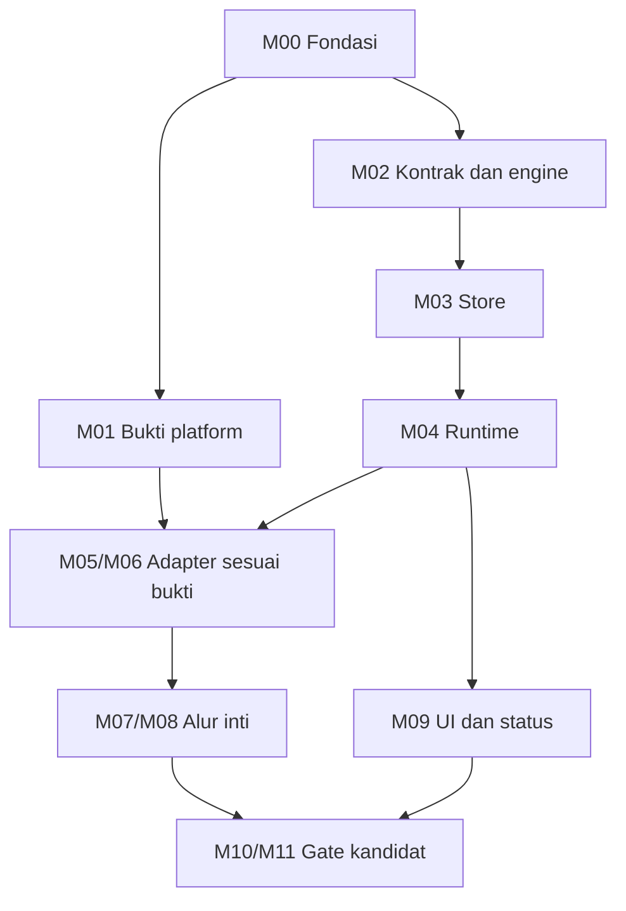

# Krono

## Implementation Plan

| Atribut | Keterangan |
| --- | --- |
| Nama produk | Krono |
| Nama dokumen | `IMPLEMENTATION_PLAN.md` |
| Nomor dalam rangkaian | 8 dari 9 |
| Versi dokumen | 0.1 |
| Tanggal penyusunan | 22 Oktober 2026, Asia/Jakarta |
| Bahasa | Bahasa Indonesia |
| Tahap | Perencanaan pembangunan sebelum implementasi |
| Status keputusan | Usulan v0.1, mengikuti tujuh dokumen sebelumnya |
| Status milestone dan task | **NOT_STARTED: belum dikerjakan sebagai implementasi aplikasi** |
| Status pengujian aplikasi | **NOT_RUN: belum dijalankan melalui tahap ini** |
| Bentuk rencana | 12 milestone dan 60 task utama, dengan dependensi serta syarat selesai |

> Dokumen ini mengubah rancangan Krono menjadi urutan pekerjaan yang dapat dijalankan dan diperiksa. Dokumen ini tidak menyatakan source code, APK, pipeline CI, database produksi, atau kemampuan perangkat sudah dibuat. Menyelesaikan dokumen rencana berbeda dari menyelesaikan milestone implementasi.

## 1. Tujuan dan cara memakai

Rencana ini membantu pengembang mengetahui pekerjaan pertama, komponen yang perlu tersedia sebelum fitur berikutnya, dan bukti yang harus ada sebelum menyebut fitur selesai.

Urutan pembangunan memisahkan ketidakpastian Android dari logika yang dapat diuji tanpa HP. Jalur audio Android 17 dibuktikan awal. Mesin aturan, transaksi, dan tampilan dapat disiapkan tanpa menebak bahwa semua kemampuan perangkat tersedia.

### 1.1 Dasar rencana

| Dokumen | Dipakai untuk |
| --- | --- |
| `PRD.md` | Kebutuhan Must/Should, alur inti, dan kriteria penerimaan produk. |
| `ANDROID_CAPABILITIES.md` | Izin, lifecycle, kemampuan API, serta eksperimen perangkat. |
| `RULE_ENGINE.md` | Arti pemicu, cabang, episode, konflik, deadline, dan hasil. |
| `ARCHITECTURE.md` | Lima modul, arah dependensi, satu runtime, serta batas komponen. |
| `DATABASE.md` | Schema, transaksi TX-01 sampai TX-08, journal, aset, dan history. |
| `DESIGN.md` | Dua tab utama, editor, status, komponen, serta aksesibilitas. |
| `TESTING.md` | KT-01 sampai KT-27, pemetaan 160 kasus sumber, dan gate G-01 sampai G-07. |

Jika implementasi menemukan batas yang mengubah perilaku, catat keputusan dan perbarui dokumen pemilik kontraknya. Rencana pekerjaan tidak boleh diam-diam mengganti arti UNKNOWN, prioritas, atau hasil aksi.

### 1.2 Istilah singkat

| Istilah | Arti praktis |
| --- | --- |
| Milestone | Sekelompok hasil yang dapat diperiksa sebagai satu tahap. |
| Task | Pekerjaan terarah dengan output dan syarat selesai. |
| Dependensi | Pekerjaan atau bukti yang harus tersedia lebih dahulu. |
| Gate | Titik pemeriksaan yang menentukan apakah hasil boleh dipakai pada tahap berikutnya. |
| PoC | Percobaan kecil untuk membuktikan jalur teknis sebelum dijanjikan sebagai fitur. |
| Port / adapter | Port adalah kontrak inti; adapter menghubungkannya ke Room atau Android. |
| Vertical slice | Alur kecil dari UI sampai efek dan history yang sudah tersambung. |
| Definition of Done | Bukti minimum agar task dapat diberi status selesai. |
| Fixture | Data contoh terkontrol untuk memeriksa perilaku. |
| Journal | Catatan fase permintaan efek yang disimpan agar pemulihan tidak mengulang aksi secara buta. |
| Guard | Pemeriksaan sebelum aksi untuk memastikan hak menjalankannya masih berlaku. |
| Capability | Kemampuan aksi berdasarkan akses, lifecycle, sumber, dan aset yang tersedia saat itu. |
| Epoch | Identitas satu masa hidup runtime untuk membedakan pekerjaan lama dari proses baru. |
| Generation | Versi kontrol aturan yang membatasi pekerjaan setelah aktivasi, jeda, atau revisi. |
| CAS | Pembaruan hanya berhasil jika state/versi lama masih cocok, sehingga dua caller tidak sama-sama mengklaim efek. |
| FGS / WIU | Foreground service dan kemampuan while-in-use yang relevan untuk kelayakan audio Android. |

Contoh vertical slice: pengguna memilih TWS, aturan disimpan, koneksi yang sah diterima, volume media diminta melalui jalur yang layak, lalu hasilnya terlihat pada history. Satu tombol yang mengubah volume belum mencakup seluruh alur tersebut.

## 2. Cakupan implementasi yang direncanakan

### 2.1 Inti MVP usulan

1. Menyusun aturan sederhana atau IF/ELSE IF/ELSE satu tingkat.
2. Memakai perubahan area lokasi dan koneksi Bluetooth pilihan.
3. Memasang wallpaper serta mengatur volume media.
4. Menyimpan draf, aturan, dan hasil di HP.
5. Menangani UNKNOWN, kejadian ganda, konflik, jeda, serta perubahan manual.
6. Memisahkan simulasi, pemeriksaan kesiapan, retry aturan, dan uji aksi nyata.
7. Memulihkan pemantauan secara konservatif setelah gangguan.
8. Menampilkan kesiapan serta hasil melalui UI yang dapat diakses.

### 2.2 Must, Should, dan Later

| Kelompok | Perlakuan dalam rencana |
| --- | --- |
| Must, FR-01 sampai FR-22 | Menjadi kebutuhan inti milestone dan gate rilis pada ruang dukungan yang ditetapkan. |
| Should, FR-23 sampai FR-26 | Dipilih secara eksplisit untuk kandidat build; tidak membuat kebutuhan Must tertunda. |
| Kontrol dasar history | Pemisahan proyeksi, watermark, marker, dan batas pertumbuhan disiapkan sebagai fondasi integritas. |
| Pilihan retensi/filter tambahan | Pengalaman tambahan diterapkan bila masuk ruang kandidat; jangan mencampurkannya dengan pengaman kontrol dasar. |
| Later | Wi-Fi, jadwal, baterai, DND, cloud, AND/OR, nested branch, root, Shizuku, serta iOS belum dibangun dalam rencana MVP ini. |

LE Audio mempunyai jalur pembuktian tersendiri. Koneksi TWS Classic yang berhasil tidak membuat LE Audio otomatis didukung.

### 2.3 Dua hasil inti yang harus bisa diperiksa

**Lokasi:** perpindahan valid dari A ke B, termasuk di kawasan besar yang sama, memilih gambar yang benar. Overlap mengikuti urutan cabang. UNKNOWN tidak menjadi alasan menjalankan ELSE.

**TWS:** hanya perangkat pilihan yang relevan. Volume yang dimaksud adalah media. Perubahan manual setelah aksi selesai tidak terus dikembalikan tanpa sebab baru yang sah.

Dukungan dilaporkan per fitur, OS, target SDK, profil, dan perangkat. Fitur yang hanya terbukti saat Activity terlihat tidak dinyatakan sebagai otomasi background yang sudah bekerja.

## 3. Baseline teknologi dan penguncian versi

### 3.1 Snapshot awal

Baseline mengikuti ARCHITECTURE.md dan diperiksa kembali pada sumber resmi tanggal 22 Oktober 2026.

| Komponen | Acuan usulan | Tindakan M00 |
| --- | --- | --- |
| Platform | Android, `minSdk 29` | Konfirmasi cakupan awal dan matriks perangkat. |
| SDK | `compileSdk 37`, `targetSdk 37` | Uji perilaku Android 17, termasuk audio. |
| AGP / Gradle / JDK | 9.4.0 / 9.6.0 / 17 | Gunakan Wrapper dan buktikan build gabungan. [S01] |
| Bahasa | Kotlin | Selaraskan compiler Android dan modul Kotlin/JVM. |
| UI | Compose BOM 2026.09.00, Material 3 | Kunci dependensi UI dan artefak tes yang kompatibel. [S03] |
| Navigasi | Navigation 3 stable 1.2.0 | Jangan menyalin versi alpha hanya karena muncul pada contoh. [S04] |
| Database | Room 3.0.3, namespace `androidx.room3` | KSP, schema export, driver, dan pengujian Room 3 dibuktikan. [S05] |
| Driver / journal | AndroidSQLiteDriver / TRUNCATE | Ikuti Database; WAL bukan pergantian otomatis. |
| Preferensi | DataStore 1.3.0 | Hanya preferensi tampilan, bukan kontrol eksekusi. [S06] |
| Penjadwalan | WorkManager 2.12.0 | Kunci worker testing dan konfigurasi initializer yang sesuai. [S07] |
| DI / asinkron | Hilt, Coroutines, Flow | Versi kompatibel dikunci setelah build, bukan ditebak di dokumen. |
| Sumber/efek | GeofencingClient, API profil Bluetooth, WallpaperManager, AudioManager | Implementasi mengikuti bukti capability dan lifecycle. |

Versi Kotlin, Compose Compiler, KSP, Hilt, Activity, Lifecycle, serta seluruh runner tes belum dianggap terkunci. Tabel ini bukan laporan Gradle Sync berhasil.

### 3.2 Aturan bootstrap

- Pakai version catalog dan Gradle Wrapper yang dapat ditelusuri.
- Hindari versi dinamis seperti `+`.
- AGP 9 sudah menyediakan Kotlin bawaan untuk modul Android. Jangan menambahkan `org.jetbrains.kotlin.android` secara ganda; modul Kotlin/JVM memakai plugin JVM yang kompatibel. [S02]
- Compose BOM tidak mengunci Room, Hilt, Navigation, atau seluruh compiler.
- Gunakan import dan API Room 3 untuk store Krono. Tutorial Room 2 bukan konfigurasi yang langsung dapat disalin.
- Kunci kombinasi yang benar-benar berhasil dibangun, lalu simpan hasil serta alasannya.
- Nilai stable yang lebih baru dapat dievaluasi ketika implementasi dimulai, dengan tes pada batas terdampak.

Jika kombinasi baseline gagal, task bootstrap berstatus BLOCKED atau diperbaiki dengan perubahan yang dicatat. Jangan menurunkan target SDK hanya untuk menghindari batas audio tanpa keputusan produk dan pengujian ulang.

### 3.3 Repository resmi sebagai acuan

| Repository | Bagian yang dipelajari | Yang tidak diasumsikan |
| --- | --- | --- |
| [android/nowinandroid](https://github.com/android/nowinandroid) | Pola Compose, lapisan, DI, dan pengujian. | Krono tidak membutuhkan backend atau seluruh modul contoh tersebut. |
| [android/platform-samples](https://github.com/android/platform-samples) | Contoh penggunaan API Android. | Contoh API bukan bukti seluruh alur otomasi Krono. |
| [androidx/androidx](https://github.com/androidx/androidx) | Sumber Jetpack dan penelusuran perilaku library. | Branch pengembangan tidak sama dengan artefak stable yang dipakai. |
| [Kotlin/kotlinx.coroutines](https://github.com/Kotlin/kotlinx.coroutines) | Coroutine, scheduler, dan test utilities. | Kode di branch terbaru belum tentu cocok dengan versi proyek. |

Repository diperiksa sebagai sumber resmi pada tanggal dokumen. Saat kode/aset/config benar-benar diadopsi, catat tag atau commit serta lisensinya. Belum ada commit repository eksternal yang diadopsi melalui tahap dokumen ini. [S13][S14][S15][S16]

## 4. Prinsip urutan pembangunan

### 4.1 Buktikan risiko sebelum memperluas fitur

Audio background Android 17 menjadi jalur pembuktian awal karena dapat membatasi contoh inti Volume TWS. Pengembangan evaluator dan database tidak perlu menunggu semua eksperimen perangkat selesai.

Namun, produksi tidak boleh mendapat jalur setter sementara yang melewati journal, capability, dan guard. Harness PoC dipisahkan dari jalur aturan pengguna.

### 4.2 Bangun logika kecil, lalu sambungkan batasnya

Urutan standar adalah model serta port, evaluator, store, coordinator, adapter, lalu alur pengguna terintegrasi. Komponen UI dengan fixture boleh dibuat lebih awal, tetapi tidak diberi label fitur selesai sebelum terhubung ke kontrak nyata.

Setiap task menyertakan pemeriksaan yang relevan. Jangan menunda seluruh tes hingga akhir proyek.

### 4.3 Satu jalur efek sejak awal

Composable, ViewModel, receiver, dan worker tidak memanggil setter masing-masing. Semuanya menyerahkan command atau masukan ke runtime yang sama.

Rencana queued tidak langsung mendapat hak mengubah HP. Sebelum setiap aksi, store memeriksa epoch, revisi, generasi, deadline, sumber, capability, prioritas yang berlaku, dan seluruh target rencana.

### 4.4 Pisahkan selesai kode dari terbukti didukung

| Keadaan | Status yang layak |
| --- | --- |
| Kode adapter ditulis, belum diuji | Belum selesai dibuktikan. |
| Fake menghasilkan keputusan benar | Logika pada fixture terbukti; kemampuan Android belum terbukti. |
| Uji aksi foreground berhasil | Aksi pada konteks itu terbukti; pemicu/background belum terbukti. |
| Event asli sampai hasil teramati pada konteks dukungan | Bukti alur terintegrasi pada kombinasi yang dicatat. |
| Penolakan ditampilkan benar | Penanganan hambatan terbukti; fitur otomatis yang terhalang tetap belum tersedia. |

### 4.5 Tidak mengunci tanggal tanpa dasar

Belum ada tenggat, jumlah jam kerja, inventaris perangkat, atau kapasitas tim untuk proyek ini. Rencana memakai dependensi dan gate, bukan tanggal penyelesaian yang dikarang.

Untuk satu pengembang, mulai dari milestone yang siap dan selesaikan irisan bermakna. Bila ada beberapa pengembang, pekerjaan independen dapat dibagi setelah kontrak antarmodul jelas. Rencana ini tidak mewajibkan tim besar atau agen tambahan.

## 5. Peta milestone dan dependensi

### 5.1 Roadmap

Semua milestone pada tabel ini berstatus **NOT_STARTED**.

| Milestone | Hasil utama | Dependensi wajib |
| --- | --- | --- |
| M00 | Fondasi proyek, build, runner, dan inventaris bukti. | Tujuh dokumen acuan. |
| M01 | Laporan PoC efek, audio Android 17, TWS, dan geofence. | Harness minimum dari M00. |
| M02 | Model, evaluator, episode, arbiter, serta port core. | M00. |
| M03 | Store Room, file, constraint, dan transaksi. | Kontrak data/port M02. |
| M04 | Runtime, guard, journal, outbox, serta recovery. | M02 dan M03. |
| M05 | Adapter efek/aset serta capability produksi. | M03, M04, dan hasil PoC relevan M01. |
| M06 | Pemantauan lokasi/Bluetooth dan entry point Android. | M02, M03, M04, dan hasil PoC sumber M01. |
| M07 | Alur Volume TWS tersambung dari UI sampai hasil. | M04, M05, M06; kemampuan TWS/audio yang relevan terbukti. |
| M08 | Alur Wallpaper Lokasi A/B tersambung. | M04, M05, M06; kemampuan lokasi/wallpaper yang relevan terbukti. |
| M09 | Pengalaman UI lengkap, pengaturan, dan aksesibilitas. | Kontrak M02 sampai M06; pengikatan akhir ke alur M07/M08. |
| M10 | Regresi, matriks dukungan, baseline kualitas, dan bug terselesaikan. | Build terintegrasi M07 sampai M09 pada cakupan kandidat. |
| M11 | Kandidat rilis internal dan paket bukti yang sesuai build. | M10 serta gate G-01 sampai G-07. |

M07 dan M08 merupakan dua alur yang memakai fondasi sama. M08 dapat dikerjakan saat jalur TWS tertentu terhalang, tetapi keberhasilan wallpaper tidak menutup kebutuhan Volume TWS yang belum terbukti.

M09 dapat dimulai berupa komponen dengan fixture setelah M00. Penyelesaian fitur tetap memerlukan data, command, serta perilaku nyata yang sesuai.

### 5.2 Hubungan jalur kerja



Diagram menyederhanakan dependensi pada tabel. Bukti platform dapat berisi hasil gagal atau terhalang; hasil itu menentukan kemampuan adapter yang boleh dinyatakan tersedia. Rilis alur inti tetap membutuhkan bukti keberhasilan pada ruang dukungannya.

### 5.3 Status kerja task

| Status | Kapan dipakai |
| --- | --- |
| NOT_STARTED | Belum mulai mengerjakan output task. |
| IN_PROGRESS | Implementasi aktif; hasil belum memenuhi syarat selesai. |
| BLOCKED | Ada dependensi atau bukti yang belum tersedia. |
| READY_FOR_REVIEW | Output serta bukti pemeriksaan tersedia untuk ditinjau. |
| DONE | Syarat selesai, pemeriksaan, dan pembaruan kontrak yang relevan terpenuhi. |

Status task berbeda dari PASS/FAIL tes. Task “mencatat hasil PoC” dapat selesai dengan laporan yang menyatakan kemampuan gagal. Gate fitur yang bergantung pada kemampuan tersebut tetap belum lulus.

## 6. M00: fondasi proyek dan build

**Tujuan:** mendapatkan proyek kosong yang dapat dibangun, batas modul yang benar, serta tempat mencatat bukti. Belum ada aturan pengguna yang boleh menjalankan efek otomatis.

**Masukan:** tujuh dokumen acuan, akses toolchain, serta daftar perangkat yang benar-benar tersedia.

### 6.1 Task M00

| ID | Pekerjaan | Output dan syarat selesai |
| --- | --- | --- |
| IMP-001 | Tetapkan baseline serta inventaris lingkungan. | Version catalog awal, Wrapper, JDK, SDK, OS pengembang, dan perangkat/TWS tersedia dicatat. Kombinasi yang belum dibuktikan tetap diberi status terbuka. |
| IMP-002 | Buat lima modul sesuai Architecture. | `:app`, `:core:engine`, `:core:runtime`, `:data:local`, `:platform:android` dapat dibangun dengan arah dependensi yang benar. |
| IMP-003 | Siapkan build, runner, dan CI minimum. | Build aplikasi awal, pemeriksaan batas modul, dan harness tes berjalan; hasil terikat ke commit/build. Tidak ada tes kosong yang dianggap pembuktian fitur. |
| IMP-004 | Rangkai composition root dan entry point. | Hilt menyusun satu graph, stub facade hanya aman untuk observasi, dan strategi initializer/WorkerFactory dipilih. Belum ada jalur efek otomatis aktif. |
| IMP-005 | Buat backlog serta fixture awal. | 60 task diberi status nyata; sumber kebutuhan dan kasus tes ditautkan; data area/TWS/gambar buatan disiapkan. |

Arah dependensi yang wajib dipertahankan:

- `:app` merangkai core, data, serta platform.
- `:core:runtime` bergantung pada `:core:engine`.
- `:data:local` bergantung pada kontrak `:core:engine`.
- `:platform:android` mengenal core serta facade runtime.
- Dua modul core tidak mengimpor Android, Compose, Room, Hilt, atau WorkManager.

### 6.2 Urutan praktis

1. Kunci konfigurasi build minimum yang bisa diselesaikan.
2. Bentuk modul serta aplikasi kosong.
3. Buktikan build dan runner yang benar-benar dipakai.
4. Siapkan DI dan entry point tanpa setter.
5. Siapkan perangkat/fixture serta pencatatan status.

Untuk konfigurasi WorkManager/Hilt, ikuti dokumentasi resmi dan pilih satu jalur inisialisasi. Jangan menambahkan initializer manual kedua karena worker belum berjalan sesuai harapan. [S10][S11]

### 6.3 Syarat keluar M00

- Build awal dapat diulang pada lingkungan yang dicatat.
- Core mempunyai classpath produksi yang bebas Android.
- Jalur debug/test terpisah dari rilis.
- Aplikasi kosong tidak meminta seluruh izin saat dibuka.
- Ada inventaris bukti untuk M01, bukan daftar perangkat yang diasumsikan tersedia.

**Bukti:** laporan build, dependency graph, konfigurasi versi, dan hasil smoke yang relevan.

**Tes:** awal G-01, ARCH-T01; wiring diperluas lagi pada KT-11 saat runtime tersedia.

## 7. M01: pembuktian kemampuan platform

**Tujuan:** mengetahui jalur yang benar-benar layak sebelum integrasi fitur. PoC adalah eksperimen dengan hasil yang dicatat, termasuk bila hasilnya gagal.

**Dependensi:** M00 menyediakan harness minimum. Pekerjaan core M02 dapat berlanjut ketika eksperimen ini menunggu perangkat.

### 7.1 Task M01

| ID | Pekerjaan | Output dan syarat selesai |
| --- | --- | --- |
| IMP-006 | Uji aksi dasar saat Activity terlihat. | Wallpaper dan volume media diuji terpisah; parameter, hasil API, serta bukti sesudah aksi dicatat. |
| IMP-007 | Buktikan konteks audio Android 17. | Receiver/worker biasa, sesi yang sah, WIU, background, layar terkunci, stop, dan recovery dibandingkan pada target 37. |
| IMP-008 | Buktikan sumber TWS Classic. | Identitas perangkat, profil ganda, putus-sambung, proses tidak hidup, serta perangkat lain diuji. LE Audio dicatat sebagai eksperimen terpisah. |
| IMP-009 | Buktikan geofence A/B. | Akses bertahap, registrasi, perpindahan internal A/B, overlap, UNKNOWN, serta delay sistem dicatat. |
| IMP-010 | Putuskan kelayakan per fitur. | Laporan menyebut lingkungan, PASS/FAIL/BLOCKED tiap kasus, batas bukti, dan pekerjaan lanjutan. Klaim background tidak berasal dari tes foreground. |

### 7.2 Batas harness PoC

Gunakan varian debug/test yang terisolasi dari aturan pengguna. Aksi nyata dilakukan melalui prosedur eksperimen yang eksplisit. Harness negatif untuk mengamati penolakan API tidak menjadi jalur produksi atau bypass capability.

Jangan menambahkan API palsu yang selalu mengembalikan “layak” agar demo terlihat berhasil. Jangan menonaktifkan pembatasan sistem lalu menggunakannya sebagai bukti konfigurasi normal.

Bila harness atau runner membuat Activity terlihat atau mengubah lifecycle UID, catat pengaruhnya. Run background penentu dukungan perlu memakai keadaan pengguna yang benar-benar sesuai, dengan observasi pasif.

### 7.3 Urutan eksperimen

1. Wallpaper foreground dan volume foreground.
2. Audio Android 17, terutama target 37 dan konteks WIU.
3. TWS Classic sampai peristiwa koneksi yang benar.
4. Geofence A/B, termasuk akses dan kualitas data.
5. Gabungan sumber dan aksi pada konteks yang benar-benar layak.

Android 17 membatasi API audio background dan dapat mengabaikan setter tanpa exception. Karena itu, bukti “fungsi kembali tanpa error” tidak cukup. Jenis layanan dan konteks WIU harus sesuai penggunaan yang sah. [S08]

### 7.4 Keputusan setelah PoC

| Hasil | Tindakan berikutnya |
| --- | --- |
| Jalur terbukti layak | Jadikan hasilnya masukan adapter produksi; ulangi melalui runtime lengkap saat integrasi. |
| Aksi hanya berhasil foreground | Sediakan dukungan sesuai bukti; janji otomasi background belum lulus. |
| Jalur teknis gagal | Catat penyebab, cari perbaikan yang sah, dan evaluasi cakupan dukungan yang terdampak. |
| Perangkat tidak tersedia | Tandai BLOCKED; lanjutkan pekerjaan yang tidak bergantung pada bukti itu. |
| LE Audio belum terbukti | Jangan mengiklankan dukungan LE Audio dari hasil Classic. |

**Syarat keluar M01 sebagai kegiatan penelitian:** semua eksperimen utama memiliki hasil atau blocker yang dapat ditindaklanjuti.

**Syarat fitur boleh dianggap didukung:** bukti sukses pada kombinasi yang ditetapkan, kemudian terkonfirmasi pada alur produksi. Menyelesaikan laporan PoC dengan hasil gagal tidak meluluskan gate kemampuan fitur.

**Tes:** KT-15 sampai KT-20; V-01 sampai V-25 menurut fitur/perangkat yang berlaku.

## 8. M02: model domain, evaluator, dan kontrak port

**Tujuan:** membuat inti aturan yang hasilnya dapat dihitung tanpa Android atau database.

**Dependensi:** M00. Bukti platform M01 memengaruhi kemampuan adapter, bukan arti TRUE/FALSE/UNKNOWN.

### 8.1 Task M02

| ID | Pekerjaan | Output dan syarat selesai |
| --- | --- | --- |
| IMP-011 | Implementasikan model serta validator. | Aturan SIMPLE/BRANCHED, satu keluarga pemicu, urutan, revisi, generation, format/semantics version, dan parameter divalidasi. |
| IMP-012 | Implementasikan snapshot dan pemilihan cabang. | Input immutable, clock eksplisit, first match, UNKNOWN, dan NO_MATCH menghasilkan keputusan deterministik. |
| IMP-013 | Implementasikan normalisasi dan episode. | Event/cause dibedakan; callback ganda, laporan lama, gap, initial check, serta episode masuk/koneksi ditangani sesuai kontrak. |
| IMP-014 | Implementasikan arbiter dan aturan hasil. | Preflight sebelum arbitrase, konflik seluruh cabang, union target, urutan aksi, serta agregat hasil mengikuti Rule Engine. |
| IMP-015 | Tetapkan port dan fixture tes core. | Store, capability, source refresh, effect, clock, serta dispatch mempunyai kontrak yang dapat diimplementasikan data/platform tanpa circular dependency. |

### 8.2 Urutan praktis

Mulai dari aturan sederhana dan tabel kebenaran cabang. Setelah itu tambahkan normalisasi sumber, identitas episode, arbiter batch, serta klasifikasi hasil. Tulis fixture dari perilaku yang diharapkan, bukan dari struktur helper produksi.

Core mengenal fakta yang dibawa adapter, bukan membaca Context atau lokasi Android secara langsung. Waktu saat evaluasi menjadi input; fungsi evaluasi tidak mengambil waktu sistem tersembunyi.

Port store yang dipakai runtime berada pada lapisan yang boleh dikenal oleh `:data:local`. Jangan membuat data bergantung pada runtime hanya karena implementasi store memerlukan tipe transaksi.

### 8.3 Bukti yang wajib ada

- A UNKNOWN/B TRUE menunggu dan tidak memilih B/ELSE.
- Dua cabang TRUE memilih yang pertama.
- Aksi cabang terpilih gagal tanpa berpindah ke ELSE.
- Kandidat tinggi terhalang tidak mengambil reservasi.
- Kandidat rendah yang kalah satu target melewati seluruh cabang.
- Kegagalan pemenang tidak mempromosikan pihak kalah.
- A → UNKNOWN → A tidak menciptakan episode masuk baru tanpa dasar.
- NO_CHANGE_NEEDED tidak dianggap perubahan baru ketika menghitung partial.

**Syarat keluar M02:** suite keputusan dan invarian core yang berlaku lulus di JVM; kontrak port cukup jelas untuk M03/M04. Ini belum membuktikan event Android atau setter.

**Tes:** KT-01 sampai KT-04, bagian keputusan KT-07/KT-08/KT-19, serta RE-T01 sampai RE-T40 sesuai lapisan.

## 9. M03: penyimpanan transaksional dan aset dasar

**Tujuan:** menyediakan sumber kebenaran yang tetap konsisten ketika command ganda, commit gagal, atau proses dimulai ulang.

**Dependensi:** model dan kontrak port M02. Implementasi data tidak menambahkan dependensi ke ViewModel atau modul platform.

### 9.1 Task M03

| ID | Pekerjaan | Output dan syarat selesai |
| --- | --- | --- |
| IMP-016 | Implementasikan schema Room dan constraint. | 32 tabel logis Database dipetakan ke schema nyata, indeks/FK/unique tervalidasi, Room 3 serta driver yang dipilih dapat membuka file database. |
| IMP-017 | Implementasikan konfigurasi, draf, dan preferensi. | Revisi immutable, pointer aktif, generation, prioritas global, draf, referensi sumber/aset, dan DataStore tampilan terpisah. |
| IMP-018 | Implementasikan record kontrol runtime. | Session/epoch, fakta, episode, command receipt, inbox, batch/round, opportunity, claim, plan, target, attempt, serta outbox tersedia melalui port. |
| IMP-019 | Implementasikan transaksi dan proyeksi hasil. | TX-01 sampai TX-08, CAS/read-set, watermark/marker history, serta aturan agregat dijalankan atomik tanpa setter dalam transaksi. |
| IMP-020 | Buktikan schema, query, reopen, dan dasar migrasi. | Schema export tersimpan, query/pagination stabil, failure injection lulus, serta kebijakan tanpa destructive fallback diterapkan. |

### 9.2 Pecah schema menjadi kelompok yang dapat diperiksa

| Kelompok | Isi utama | Jumlah tabel logis |
| --- | --- | --- |
| Konfigurasi | Identitas/state/revisi, prioritas, cabang/aksi, sumber, dan draf beserta referensinya. | 10 |
| Aset | Metadata aset serta lease pembacaan. | 2 |
| Masukan dan runtime | Session/meta, monitoring/fakta/episode, command receipt, inbox, dan sumber event. | 8 |
| Keputusan dan sasaran | Batch/round, opportunity/decision/claim, plan, target plan, serta target head. | 8 |
| Efek dan history | Attempt, outbox, execution history, dan action history. | 4 |
| **Total** | Mengikuti DATABASE.md; tidak menyalin ulang seluruh definisi kolom. | **32** |

Kelompok di atas membantu urutan implementasi, bukan lima database atau lima sumber kebenaran terpisah. Constraint antarkelompok tetap dibuktikan.

### 9.3 Perhatian transaksi

- Simpan command receipt bersama mutasi bisnisnya.
- Unique key yang memerlukan deduplikasi tetap benar ketika field lain NULL, termasuk ACTION_TEST.
- TX-05 membekukan keputusan batch beserta prioritas dan klaimnya.
- TX-06 baru memberi izin efek setelah REQUESTING committed.
- TX-07 menyimpan hasil dan proyeksi sesuai watermark.
- TX-08 memfence epoch lama sebelum efek baru boleh diproses.
- Keputusan kalah dan konsumsi episode tidak dihapus hanya karena pemenang gagal.
- Counter serta sequence tidak boleh overflow diam-diam.

Nama aktif, generation, target intent, serta prioritas berada di Room. DataStore tidak menjadi otoritas untuk kelayakan eksekusi.

### 9.4 Batas tahap ini

M03 menyiapkan metadata aset, referensi, serta kontrak lease. Proses pemilih gambar, impor, dan adapter efek lengkap dikerjakan pada M05.

Schema versi pertama masih rancangan sampai diekspor dari kode yang benar-benar dibangun. Selama pengembangan, database fixture boleh dibuat ulang dalam tes yang terisolasi; aplikasi pengguna tidak memperoleh fallback yang menghapus datanya.

Migrasi dari versi produksi lama belum berlaku bila belum ada versi tersebut. Schema export, constraint, reopen, serta recovery versi pertama tetap diuji. Setelah versi lama tersedia, tambah jalur migrasinya tanpa destructive fallback.

**Syarat keluar M03:** constraint dan transaksi penting lulus pada Room/driver nyata, database file dapat dibuka ulang, serta store tidak memberikan izin efek ketika commit klaim gagal.

**Tes:** KT-03, KT-05, KT-09 sampai KT-14 pada lapisan data; DB-T01 sampai DB-T28 sesuai kontrak yang diimplementasikan.

## 10. M04: coordinator, journal, dan recovery

**Tujuan:** memastikan keputusan yang benar hanya menghasilkan efek ketika hak menjalankannya masih sah.

**Dependensi:** M02 dan M03. Pada awal tahap, effect port masih dapat memakai recording fake untuk membuktikan kontrol.

### 10.1 Task M04

| ID | Pekerjaan | Output dan syarat selesai |
| --- | --- | --- |
| IMP-021 | Implementasikan satu runtime dan gerbang startup. | Epoch baru dibuat, recovery selesai sebelum efek diterima, dan seluruh entry point memakai instance coordinator/invoker yang sama. |
| IMP-022 | Implementasikan alur inbox sampai rencana. | Event kanonis, snapshot, batch/round, kesempatan, klaim episode, arbitrase, serta rencana disimpan konsisten melalui TX-04/TX-05. |
| IMP-023 | Implementasikan guard serta protokol journal. | Pemeriksaan semua token dan CAS PREPARED → REQUESTING committed sebelum setter; OBSERVING/FINISHED ditangani sesuai kontrak. |
| IMP-024 | Implementasikan urutan, supersession, dan kelanjutan. | Aksi berurutan, berhenti pada nonsukses, intent terbaru, deadline tetap, serta tiket menunggu yang masih valid dapat diproses tanpa menghidupkan CLOSED. |
| IMP-025 | Implementasikan dispatch dan pemulihan konservatif. | Outbox dikirim ulang secara aman; TX-07/TX-08 menutup hasil, memproyeksikan history, dan menangani pekerjaan epoch lama tanpa setter ulang buta. |

### 10.2 Perilaku coordinator

Coordinator mempunyai satu slot pemanggilan efek, tetapi tidak menahan penyimpanan masukan selama API menunggu. Callback baru tetap dapat memperbarui fakta atau intent target.

Sebelum setiap aksi, pemeriksaan memakai seluruh target plan, bukan hanya target langkah itu. Satu target yang tidak lagi sah dapat menghentikan rencana lama yang belum mulai.

Jika setter sudah diminta, jeda atau intent baru tidak menjamin API bisa dibatalkan. Catat hasil yang tersedia dan hentikan langkah berikutnya ketika haknya sudah tidak sah. Timeout pengamatan juga tidak otomatis membuktikan pemanggilan sudah berakhir.

### 10.3 Kelanjutan dan waktu

Tiket WAITING_DATA/WAITING_CAPABILITY yang masih sah dapat memperoleh round dengan snapshot baru. Cause dan deadline tetap; intent sequence baru diberikan ketika rencana baru yang sah dibuat, bukan memakai nomor batch lama sebagai izin terbaru.

Parameter awal mengikuti Rule Engine dan Testing. Clock monoton dipakai untuk deadline dalam satu runtime; jam kalender hanya untuk presentasi/urutan bukti. CLOSED tidak dibuka kembali oleh callback, perubahan capability, atau worker yang sama.

USER_RETRY mempunyai command baru dan memeriksa keadaan sekarang. Pengiriman ulang command lama menggunakan resi lama.

### 10.4 Bukti yang wajib ada

- Dua worker mencoba effect key sama, hanya satu klaim sah.
- Journal gagal commit, nol setter baru.
- Pause/revisi sebelum klaim menolak pekerjaan lama.
- Input baru tersimpan ketika setter lama ditahan.
- Proses mati setelah REQUESTING menghasilkan perlakuan belum pasti, bukan percobaan efek baru.
- Proses mati saat PREPARED membatalkan pekerjaan runtime lama.
- History dihapus saat proses berjalan, hasil lama tidak muncul kembali.
- Tidak ada promosi otomatis pihak kalah setelah keputusan committed.

**Syarat keluar M04:** suite kontrol efek dan crash/reopen yang berlaku lulus. Jalur produksi tidak mempunyai jalan langsung dari receiver/UI ke setter.

**Tes:** KT-02 sampai KT-12, RE-T13 sampai RE-T40 sesuai skenario, serta ARCH-T03 sampai ARCH-T24 yang relevan.

## 11. M05: adapter efek, impor gambar, dan capability

**Tujuan:** mengganti fake dengan adapter Android yang tetap mempertahankan guard serta kualitas bukti hasil.

**Dependensi:** M03, M04, dan hasil PoC relevan M01.

### 11.1 Task M05

| ID | Pekerjaan | Output dan syarat selesai |
| --- | --- | --- |
| IMP-026 | Implementasikan pipeline aset gambar. | Pemilih sistem, impor privat, metadata READY, thumbnail cache, lease, serta GC berjalan tanpa menghapus aset bersama yang masih dirujuk. |
| IMP-027 | Implementasikan adapter wallpaper. | Dukungan/policy, sasaran system/lock/both, hasil API, dan kegagalan file menghasilkan klasifikasi yang benar. |
| IMP-028 | Implementasikan adapter volume media. | Persentase dipetakan ke index, no change tidak menulis, silent setter tidak dianggap APPLIED, dan batas rute/perangkat dijelaskan. |
| IMP-029 | Implementasikan capability serta sesi audio yang terbukti. | Kesiapan akses/lifecycle/aset/sumber dipisahkan; sesi memiliki start/stop yang sah serta tidak dianggap pulih otomatis setelah gangguan. |
| IMP-030 | Sambungkan efek ke satu invoker. | Otomasi dan USER_TEST_ACTION melalui guard/journal yang sama; tidak ada setter pribadi di UI atau worker. |

### 11.2 Pipeline gambar

Urutan impor adalah menerima pilihan, membaca sumber, menyiapkan file privat final, lalu memberi state READY setelah file layak dibaca. Gambar cloud belum siap hanya karena picker mengembalikan URI.

Jika impor baru gagal, pilihan lama yang masih sah tidak dihilangkan tanpa alasan. File asli tidak disimpan sebagai thumbnail cache semata.

GC mengklaim metadata DELETING secara transaksional setelah memeriksa referensi serta lease. Penghapusan file terjadi di luar transaksi, lalu metadata diselesaikan. Pembaca baru tidak boleh mendapat lease pada aset yang sudah DELETING.

### 11.3 Hasil efek dan batas atribusi

| Keadaan | Perilaku adapter/runtime |
| --- | --- |
| Nilai sudah sesuai sebelum permintaan | NO_CHANGE_NEEDED, tanpa setter baru. |
| Bukti cukup bahwa permintaan diterapkan menurut kontrak adapter | APPLIED dengan rincian bukti, tanpa melebihkan pemeriksaan fisik. |
| Kegagalan diketahui | FAILED atau BLOCKED sesuai penyebab. |
| API kembali tetapi hasil tidak cukup pasti | UNVERIFIED bila sesuai kontrak; tidak membuat sukses palsu. |
| Aksi pertama diterapkan, langkah berikutnya gagal | Sebagian berhasil, tanpa rollback buatan. |

Volume media tidak dianggap tersimpan terpisah khusus untuk satu TWS. Wallpaper lama tidak dibaca menggunakan akses yang dibatasi untuk membuat janji restore otomatis.

### 11.4 Sesi audio

Implementasikan hanya jenis layanan serta lifecycle yang lolos pembuktian. `connectedDevice` tetap kandidat sampai penggunaan serta perilakunya terbukti. Tidak ada layanan pemutaran/mikrofon/alarm palsu untuk melewati pembatasan.

Jika konteks audio belum layak, kemampuan dilaporkan sesuai keadaan. Uji aksi saat foreground dapat tetap diuji pada konteks sah, tetapi tidak mengubah hasil dukungan background.

**Syarat keluar M05:** adapter efek memakai satu invoker, bukti hasil jujur, file bertahan sesuai kebijakan, dan race lease/GC tidak merusak pembacaan.

**Tes:** KT-05, KT-06, KT-10, KT-13, KT-18, KT-19, KT-22; V-06 sampai V-13 dan V-21 sampai V-23 sesuai lingkungan.

## 12. M06: pemantauan sumber dan entry point Android

**Tujuan:** mengirim masukan nyata ke runtime tanpa mengarang fakta atau memberi receiver hak efek yang tidak dimilikinya.

**Dependensi:** M02, M03, M04, dan laporan PoC sumber M01.

### 12.1 Task M06

| ID | Pekerjaan | Output dan syarat selesai |
| --- | --- | --- |
| IMP-031 | Implementasikan rencana registrasi area. | Sumber bersama, versi sumber, kapasitas, desired/observed registration, dan perubahan rule dipetakan tanpa subset diam-diam. |
| IMP-032 | Implementasikan fakta lokasi serta kualitasnya. | Event, waktu sumber, coverage, heuristik ketidakpastian, dan refresh terbatas menghasilkan TRUE/FALSE/UNKNOWN yang konsisten. |
| IMP-033 | Implementasikan adapter profil Bluetooth. | Perangkat dipilih melalui identitas yang sesuai, profil yang didukung dinormalisasi, dan episode diteruskan tanpa efek ganda. |
| IMP-034 | Sambungkan receiver serta worker. | Entry point hanya melakukan kerja terbatas dan menyerahkan referensi/masukan ke runtime; outbox direkonsiliasi tanpa otoritas efek baru. |
| IMP-035 | Implementasikan rekonsiliasi lifecycle. | Boot, update, proses baru, akses berubah, serta pengguna kembali setelah Force Stop memulihkan pemantauan sesuai kemampuan. |

### 12.2 Lokasi

Registrasi menggunakan area yang benar-benar dirujuk aturan aktif. Jika jumlah area melampaui kapasitas, aplikasi memberi alasan yang jelas; tidak menyatakan seluruh aturan siap ketika sebagian area tidak terdaftar.

Geofencing Android memiliki kapasitas registrasi dan kemungkinan pengiriman tertunda. Batas dihitung terhadap area yang diregistrasikan per aplikasi/pengguna, bukan jumlah aturan. [S09]

ENTER/EXIT satu area tidak menyimpulkan seluruh area lain. Kualitas data serta usia sumber dihitung dengan provenance yang benar; waktu penerimaan callback tidak otomatis menyegarkan pengamatan lama.

### 12.3 Bluetooth

Mulai dari perangkat terpasang dan profil yang sudah dibuktikan. Alur TWS saja tidak meminta GPS. Jangan menambah scan terus-menerus tanpa kebutuhan serta model akses yang ditetapkan.

Nama tampilan bukan identitas unik. Hubungan dua earbud, profil panggilan/media, transport Classic/LE, dan rute aktif dinormalisasi hanya sejauh bukti yang tersedia.

### 12.4 Entry point dan pemulihan

Receiver melakukan kerja singkat yang dibatasi. `goAsync` bukan daemon. WorkManager membawa referensi pekerjaan yang telah disimpan dan memeriksa ulang haknya melalui runtime.

Pembaruan aplikasi atau boot dapat memerlukan rekonsiliasi registrasi. Recovery tidak menjalankan semua aturan aktif sebagai replay efek lama dan tidak menganggap sesi audio sebelumnya masih hidup.

Force Stop, kematian proses, dan membuang task adalah kondisi berbeda. Setelah pengguna kembali, aplikasi memeriksa readiness serta registrasi yang relevan.

**Syarat keluar M06:** sumber nyata mempunyai jalur ingress yang dapat ditelusuri, registrasi serta kualitas terlihat, dan semua entry point memakai graph/runtime tunggal.

**Tes:** KT-02, KT-08, KT-11, KT-15 sampai KT-20; ARCH-T17, ARCH-T18, ARCH-T25, ARCH-T26.

## 13. M07: alur Volume TWS dari ujung ke ujung

**Tujuan:** membuktikan satu alur produk dengan komponen produksi yang tersambung, mulai dari konfigurasi sampai hasil.

**Dependensi:** M04, M05, M06, serta bukti kemampuan TWS/audio pada kombinasi sasaran.

### 13.1 Task M07

| ID | Pekerjaan | Output dan syarat selesai |
| --- | --- | --- |
| IMP-036 | Buat formulir minimum Volume TWS. | Nama aturan, perangkat yang tepat, volume media, akses kontekstual, dan draf dapat dipakai tanpa setter saat mengedit. |
| IMP-037 | Hubungkan simpan/aktivasi/jeda. | Command ID, initial check yang dijelaskan, resi pending, generation, serta readiness nyata tersambung. |
| IMP-038 | Jalankan koneksi asli sampai hasil. | Episode, opportunity, guard, journal, setter, bukti hasil, serta history dapat ditelusuri pada perangkat. |
| IMP-039 | Buktikan variasi kegagalan dan kontrol. | Perangkat lain, laporan profil ganda, konteks audio hilang, jeda, worker ulang, serta perubahan manual tidak menghasilkan efek yang salah. |
| IMP-040 | Tutup penerimaan alur TWS. | Bukti foreground/background dipisahkan, dukungan per kombinasi dicatat, dan AC terkait ditinjau terhadap build yang sama. |

### 13.2 Demo penerimaan

1. Buat aturan TWS A dengan volume media 20%.
2. Tinjau lalu simpan sesuai pilihan aktif/dijeda.
3. Uji koneksi perangkat B sebagai kontrol negatif.
4. Buat transisi koneksi A yang sah pada konteks audio yang dicatat.
5. Periksa hasil serta jumlah setter, bukan hanya toast sukses.
6. Ubah volume manual setelah selesai.
7. Buka ulang Krono dan kirim laporan/worker duplikat.
8. Pastikan nilai tidak dipaksa kembali tanpa sebab baru.

### 13.3 Syarat keluar M07

Alur memenuhi kebutuhan inti pada kombinasi yang benar-benar dinyatakan didukung. Bila hanya langkah penanganan hambatan yang lulus, M07 sebagai fitur otomatis masih BLOCKED pada kombinasi itu.

UI minimum boleh memakai komponen awal. Finalisasi tipografi/layout tetap pada M09, tetapi penjelasan efek nyata, active/readiness, dan initial check sudah harus benar pada tahap ini.

**Tes:** AC-01, AC-02, AC-06, AC-07, AC-09 sampai AC-12; KT-03, KT-07, KT-17 sampai KT-23 yang berlaku.

## 14. M08: alur Wallpaper Lokasi A/B

**Tujuan:** membuktikan aturan bercabang dengan area serta gambar yang benar, termasuk keadaan tidak pasti.

**Dependensi:** M04, M05, M06, serta bukti lokasi/wallpaper yang relevan. Keberhasilan M07 tidak menjadi syarat teknis untuk mulai mengerjakan alur ini.

### 14.1 Task M08

| ID | Pekerjaan | Output dan syarat selesai |
| --- | --- | --- |
| IMP-041 | Buat pengalaman memilih area. | Nama, pusat, radius, lokasi sekarang bila diizinkan, dan input lanjutan tersedia. Provider peta diputuskan bila peta disertakan; tidak ada peta palsu. |
| IMP-042 | Hubungkan aturan bercabang serta gambar. | IF A → gambar A dan ELSE IF B → gambar B dapat disusun, urutan terlihat, sasaran layar jelas, serta kedua aset siap. |
| IMP-043 | Buktikan keputusan lokasi terkontrol. | A/B, overlap, A UNKNOWN/B TRUE, EXIT yang tidak lengkap, serta tidak ada match mengikuti engine tanpa asumsi fallback. |
| IMP-044 | Buktikan ketahanan alur. | Reboot, akses dicabut, file tidak tersedia, perubahan manual, dan revisi saat menunggu menghasilkan readiness/hasil yang benar. |
| IMP-045 | Jalankan rute geofence asli dan tutup penerimaan. | Pengiriman event, kualitas, delay, cabang, pemasangan, serta batas dukungan dicatat pada satu build. |

### 14.2 Demo penerimaan

1. Tentukan dua area yang dapat dibedakan dan benar-benar dipantau.
2. Pilih dua gambar fixture serta sasaran wallpaper.
3. Simulasikan A TRUE/B FALSE, lalu A FALSE/B TRUE.
4. Simulasikan A UNKNOWN/B TRUE dan pastikan tidak memilih B.
5. Simpan aktif dengan penjelasan pemeriksaan awal.
6. Jalankan perubahan A → B terkontrol dan rute nyata sebagai dua bukti terpisah.
7. Periksa hasil pemasangan pada sasaran yang didukung.
8. Ubah wallpaper manual dan pastikan pembukaan layar tidak memasang ulang.

### 14.3 Batas pengalaman area

Area A dan B tetap dipantau walaupun berada pada kawasan besar yang sama. Jangan mengganti pemicu internal menjadi hanya “masuk kawasan kampus”.

Ketika sumber area dipakai beberapa aturan, perubahan bersama harus dijelaskan dan opsi salinan tersedia sesuai Design. Draf tidak memperbarui aturan aktif lain secara diam-diam.

Radius awal 150m adalah usulan konfigurasi produk, bukan jaminan akurasi. Hasil run lapangan tidak dinilai dengan janji pergantian seketika ketika melewati garis area.

**Syarat keluar M08:** aturan A/B terintegrasi memenuhi first match, UNKNOWN, kemampuan aset/efek, serta penerimaan geofence nyata pada cakupan yang diumumkan.

**Tes:** AC-03 sampai AC-05, AC-08 sampai AC-13 yang berlaku; KT-01, KT-04, KT-07, KT-13, KT-15, KT-16, KT-19, KT-20, KT-22.

## 15. M09: UI lengkap, pengaturan, dan aksesibilitas

**Tujuan:** menyatukan alur inti dengan pengalaman yang konsisten dan dapat dipahami pengguna.

**Dependensi:** kontrak M02 sampai M06. Komponen dengan fixture boleh dimulai lebih awal; penyelesaian alur dinilai bersama M07/M08 sesuai cakupan kandidat.

### 15.1 Task M09

| ID | Pekerjaan | Output dan syarat selesai |
| --- | --- | --- |
| IMP-046 | Implementasikan theme, navigasi, dan proyeksi status. | Token Design, dua tab Aturan/Riwayat, akses Settings, insets, serta empat dimensi status tampil konsisten. |
| IMP-047 | Lengkapi editor dan pengelolaan aturan. | CRUD, draf, IF/ELSE IF/ELSE, urutan aksi, prioritas global, validasi, dan tinjau tersambung ke command. Contoh/duplikasi hanya jika dipilih. |
| IMP-048 | Lengkapi simulasi dan tindakan pengujian. | Simulasi, Periksa kesiapan, Coba aturan sekarang, dan Uji aksi memiliki makna, command, peringatan, serta hasil yang berbeda sesuai kontrak. |
| IMP-049 | Lengkapi history, detail, Settings, dan bantuan. | Kategori hasil, snapshot, state berjalan, hapus history, batas retensi dasar, bantuan akses, serta pilihan retensi/filter yang disertakan sesuai data nyata. |
| IMP-050 | Buktikan aksesibilitas, layout, dan keterpahaman. | Semantics, TalkBack, keyboard, reorder, font besar, jendela, screenshot terpilih, serta sesi pengguna awal diperiksa. |

### 15.2 Paket layar dalam satu modul aplikasi

Pertahankan `:app` sebagai pemilik UI. Paket Rules, Editor, Pickers, History, Readiness, Settings, serta navigation boleh dipisah tanpa membuat modul Gradle per layar.

Dua belas konteks layar pada Design tetap tercakup. Pemilih atau pengaturan aksi dapat berupa sheet/tujuan yang sesuai, bukan harus Activity baru untuk setiap konteks.

### 15.3 Model status yang wajib terlihat

| Dimensi | Contoh |
| --- | --- |
| Keinginan pengguna | Diaktifkan / dijeda. |
| Kesiapan | Siap / perlu izin / gambar belum tersedia / konteks audio belum layak. |
| Pekerjaan | Menunggu / diproses / tidak ada pekerjaan aktif. |
| Hasil terakhir | Berhasil / sebagian / gagal / terhalang / belum terverifikasi / dilewati. |

Switch aktif tidak berubah menjadi indikator “semua pasti bekerja”. Pengguna tetap dapat melihat niat aktif ketika akses dicabut.

Komponen UI tidak memanggil setter saat slider digeser, picker dibuka, layar di-refresh, atau Flow dikoleksi ulang. Ketukan ganda dan rotasi mempertahankan identitas command pending.

### 15.4 Aksesibilitas serta uji keterpahaman

Periksa target sentuh minimal 48 × 48dp, font 100/150/200%, fokus setelah sheet, label switch, input angka sebagai alternatif slider, dan tindakan reorder yang dapat diakses.

Tes otomatis semantics dilengkapi uji TalkBack/keyboard secara manual. Panduan Compose menempatkan verifikasi manual sebagai bagian penting pemeriksaan pengalaman layanan aksesibilitas. [S12]

Minta calon pengguna menjelaskan apa yang terjadi ketika aturan diaktifkan, kondisi UNKNOWN, aksi gagal, dan volume diubah manual. Catat salah paham untuk memperbaiki bahasa atau alur. Jumlah peserta serta batas kesimpulannya dicatat.

**Syarat keluar M09:** alur UI inti tersambung, makna command tidak menyesatkan, layout terpilih dapat dipakai, dan hambatan aksesibilitas utama terselesaikan.

**Tes:** KT-21 sampai KT-25; DES-T01 sampai DES-T28; FR-22 serta Should yang benar-benar disertakan.

## 16. M10: hardening, matriks dukungan, dan kualitas

**Tujuan:** memperluas bukti dari alur yang sudah terintegrasi ke gangguan, variasi perangkat, dan batas sumber daya.

**Dependensi:** kandidat terintegrasi dari M07 sampai M09. Perubahan baru tetap dapat mengembalikan task sebelumnya ke status yang memerlukan pemeriksaan.

### 16.1 Task M10

| ID | Pekerjaan | Output dan syarat selesai |
| --- | --- | --- |
| IMP-051 | Jalankan regresi kontrol lintas alur. | Crash pada batas journal, race klaim/intent, jeda/revisi/prioritas, deadline, serta kelanjutan diuji pada integrasi nyata. |
| IMP-052 | Jalankan gangguan data dan pemeliharaan. | GC/lease, aset hilang, storage gagal, retensi/watermark, compaction, backup/restore yang berlaku, dan schema diperiksa. |
| IMP-053 | Isi matriks perangkat serta OS. | API 29 sampai 37, vendor terpilih, Classic/LE sesuai dukungan, Doze, layar terkunci, notifikasi, Force Stop, boot/update dicatat per run. |
| IMP-054 | Ukur performa dan tetapkan anggaran. | Dataset, build pengukuran, startup/scroll/evaluasi/SQL/memori/daya diukur; batas produk ditetapkan dari baseline yang memadai. |
| IMP-055 | Tutup bug dan sinkronkan bukti. | Critical/High yang relevan terselesaikan, regresi diperiksa, hasil sesuai build, serta dokumen dukungan tidak melebihkan bukti. |

### 16.2 Matriks tidak boleh berisi hasil asumsi

Gunakan kebutuhan lingkungan pada TESTING.md. Catat model HP, build OS, target, profil TWS, akses, sesi layanan, serta kondisi daya/jaringan.

API yang belum diuji tidak menjadi PASS karena versi di bawah dan di atasnya berhasil. Jika perangkat tertentu tidak tersedia, tulis blocker dan dampaknya terhadap ruang dukungan.

Classic dan LE Audio dicatat terpisah. Receiver menerima event dan audio dapat diubah juga dicatat sebagai dua kemampuan yang berbeda.

### 16.3 Performa dan daya

Gunakan dataset ringan, sekitar 100 aturan dengan sumber bersama yang tetap dalam kapasitas, history sampai 10.000, gambar menantang, serta burst event yang beralasan.

Ukur waktu pemrosesan Krono terpisah dari waktu sistem mengirim geofence. Hindari angka “selalu instan” atau “hemat baterai” tanpa data.

Target waktu, memori, batas gambar, dan daya belum ditetapkan. IMP-054 menutup keputusan tersebut melalui baseline serta anggaran yang dicatat. Sebelum itu, tidak ada target numerik performa yang boleh dianggap sudah lulus.

### 16.4 Pemilihan pengujian ulang

Tes yang sudah lulus tidak diulang seluruhnya tanpa alasan. Jalankan kasus yang terkena perubahan, kasus kegagalan sebelumnya, serta batas yang terdampak.

Menjelang kandidat rilis, jalankan suite wajib dan matriks dukungan yang diumumkan. Kasus P0 yang dikarantina karena kadang gagal tetap merupakan celah kelulusan.

**Syarat keluar M10:** bukti kualitas cukup untuk menilai gate, tidak ada Critical/High terbuka pada cakupan kandidat, dan seluruh celah dukungan mempunyai status yang jujur.

**Tes:** KT-01 sampai KT-27 sesuai lapisan/perubahan; seluruh kasus sumber yang berlaku pada kandidat.

## 17. M11: kandidat rilis internal dan serah terima

**Tujuan:** menghasilkan kandidat yang dapat dipasang serta ditinjau dengan bukti yang cocok dengan artefaknya.

**Dependensi:** M10 dan penilaian seluruh gate G-01 sampai G-07. Distribusi publik belum menjadi keputusan produk pada rancangan ini.

### 17.1 Task M11

| ID | Pekerjaan | Output dan syarat selesai |
| --- | --- | --- |
| IMP-056 | Bekukan identitas kandidat build. | Commit, versi aplikasi, schema, dependensi, parameter semantik, varian, dan konfigurasi penandatanganan internal yang dipakai tercatat. |
| IMP-057 | Nilai gate serta cakupan penerimaan. | G-01 sampai G-07 dan 160 kasus sumber yang berlaku ditelusuri; NOT_RUN/BLOCKED tidak dihitung PASS. |
| IMP-058 | Siapkan paket kandidat. | APK internal, checksum, catatan perubahan, matriks dukungan, batas fitur, dan petunjuk pengujian sesuai build tersedia. |
| IMP-059 | Uji artefak yang benar-benar dibagikan. | Instalasi serta alur smoke pada APK kandidat lulus; upgrade dari versi terdahulu diuji bila ada versi yang harus dipertahankan. |
| IMP-060 | Selesaikan serah terima dan status proyek. | README proyek, hasil tes, isu tersisa, prosedur pemulihan pengguna, dan status milestone mencerminkan implementasi sebenarnya. |

### 17.2 Isi paket kandidat usulan

- Identitas APK yang dapat dicocokkan dengan build.
- Cara memasang dan konfigurasi akses yang benar-benar diperlukan.
- Fitur serta kombinasi perangkat/OS yang terbukti.
- Batas TWS, audio background, geofence, dan wallpaper.
- Ringkasan hasil pengujian dan isu yang belum selesai.
- Cara menjeda aturan, mengakhiri sesi bila tersedia, dan memeriksa kesiapan.
- Catatan upgrade/migrasi jika sudah ada versi pengguna sebelumnya.

Paket internal tidak otomatis berarti siap dipublikasikan ke toko aplikasi. Kanal distribusi serta persyaratan yang berlaku ditetapkan dan diperiksa ketika jalur publik benar-benar dipilih.

### 17.3 Syarat keluar M11

Kandidat memenuhi gate sesuai ruang dukungan yang dinyatakan. Kebutuhan inti yang terhalang tidak ditutup dengan microcopy atau demo foreground yang lebih sempit dari janji produk.

Rilis pertama belum memerlukan bukti migrasi dari versi produksi yang tidak pernah ada. Pembuatan database, reopen, recovery, serta instalasi kandidat tetap wajib. Begitu ada versi lama yang didukung, jalur upgrade-nya menjadi bagian gate.

**Tes:** AC-01 sampai AC-13, G-01 sampai G-07, serta kasus P0/P1 yang berlaku. Bukti harus mengacu pada kandidat yang sama.

## 18. Cara mengerjakan dan meninjau perubahan

### 18.1 Satu task, satu hasil yang jelas

Mulai dari kontrak dan contoh hasil yang diharapkan. Implementasikan irisan yang dapat diuji, lalu sambungkan ke pemilik tanggung jawabnya.

Task utama dapat dipecah menjadi subtask bila terlalu besar, misalnya IMP-016.1 untuk konfigurasi dan IMP-016.2 untuk kontrol runtime. ID induk tetap dipertahankan agar traceability tidak putus.

Tidak harus satu task sama dengan satu commit. Satu task juga tidak boleh disebut DONE hanya karena sebagian helper sudah ditulis.

### 18.2 Urutan kerja pada task

1. Baca bagian kontrak serta kasus sumber yang ditautkan.
2. Pastikan dependensi yang benar-benar diperlukan tersedia.
3. Tentukan input/output dan failure case yang perlu dibuktikan.
4. Kerjakan perubahan pada modul pemiliknya.
5. Jalankan pemeriksaan yang relevan.
6. Simpan bukti dan perbarui status.
7. Tinjau dampak terhadap dokumen serta task berikutnya.

Untuk perubahan logika/SQL yang memengaruhi efek, sertakan kasus kegagalan dan concurrency yang relevan. Perubahan teks atau dekorasi kecil cukup diperiksa sesuai dampaknya.

### 18.3 Batas antarbagian

| Bagian | Tanggung jawab | Jalur yang dicegah |
| --- | --- | --- |
| UI/ViewModel | Input, command, dan presentasi state. | Setter Android langsung dari composable atau slider draf. |
| Engine | Keputusan murni serta kontrak. | Membaca OS/DB/waktu tersembunyi saat evaluasi. |
| Runtime | Koordinasi command, guard, rencana, serta recovery. | Memakai status tampilan sebagai hak eksekusi. |
| Data | Transaksi, file, dan sumber kebenaran. | Menjalankan setter dalam transaksi atau menghapus kontrol bersama history. |
| Platform | Adaptasi API, akses, sumber, dan efek. | Menganggap receiver/worker otomatis memiliki hak lifecycle. |

### 18.4 Aturan review

Perubahan dianggap siap ditinjau ketika masalah yang diselesaikan, perilaku hasil, tes, serta batas yang tersisa dapat dijelaskan singkat.

Reviewer memeriksa ketepatan kontrak, arah dependensi, atomicity, peluang efek ganda, hasil yang tidak pasti, dan pembaruan UI yang dapat memicu command. Review tidak berhenti pada kerapian kode.

Perubahan dependensi mengunci versi baru yang dibangun. Perubahan schema menyertakan export dan migrasi yang berlaku. Perubahan dukungan platform menyertakan bukti perangkat.

### 18.5 Ketika task terhalang

Catat dependensi yang hilang dan task lain yang masih bisa berjalan. Contoh:

- Perangkat Android 17 belum tersedia: IMP-007 BLOCKED; evaluator dan store tetap dapat dikerjakan.
- Jalur audio belum sah: adapter menampilkan capability yang benar; Volume TWS background belum dinyatakan selesai.
- Provider peta belum dipilih: model area serta input yang sudah disepakati dapat disiapkan; peta tidak dibuat seolah berfungsi.
- Migrasi belum punya versi produksi lama: kasus migrasi historis belum berlaku; schema export/reopen tetap dikerjakan.

Jangan menutup blocker dengan data palsu, menurunkan hasil yang diharapkan, atau menandai seluruh fitur PASS dari unit test.

## 19. Format backlog dan perencanaan sesi kerja

### 19.1 Contoh kartu task

Kartu berikut adalah contoh rencana, bukan pekerjaan yang sudah dikerjakan. Daftar dependensi task boleh dibuat lebih rinci ketika implementasi mulai.

```yaml
task_id: IMP-038
milestone: M07
title: Hubungkan koneksi TWS asli sampai hasil volume
status: NOT_STARTED
requirements:
  - FR-07
  - FR-09
  - FR-16
depends_on:
  - M04
  - M05
  - M06
  - IMP-007
  - IMP-008
scope:
  - Koneksi perangkat terpilih
  - Guard dan journal produksi
  - Setter serta bukti hasil
  - History berlabel asal yang benar
acceptance:
  - Perangkat lain tidak memicu aturan ini
  - Konteks Android dinilai sesuai keadaan nyata
  - Tidak ada efek ganda untuk episode yang sama
  - Tidak ada klaim berhasil tanpa bukti yang cukup
tests:
  - KT-17
  - KT-18
  - KT-19
evidence: []
blockers: []
```

Ketika task dikerjakan, tambahkan build, hasil aktual, serta bukti. Jangan mengganti `status` menjadi DONE hanya dengan menambahkan nama file source.

### 19.2 Menentukan ukuran kerja

Task utama adalah batas penelusuran. Task yang memuat beberapa kelompok schema, beberapa API, atau beberapa variasi perangkat dapat dipecah menjadi subtask dengan ID induk tetap.

Sebelum menaksir tanggal, lakukan bootstrap serta PoC awal. Catat waktu kerja aktual, waktu menunggu perangkat, perubahan kontrak, dan jumlah regresi yang perlu diperbaiki.

Gunakan hasil pekerjaan sejenis untuk memperkirakan task berikutnya. Waktu menunggu perangkat atau hasil eksperimen dipisahkan dari waktu menulis kode.

### 19.3 Sesi awal yang disarankan

1. Kerjakan IMP-001 dan IMP-002 untuk memperoleh fondasi serta modul.
2. Selesaikan IMP-003/IMP-004 agar build, runner, graph, dan harness minimum tersedia.
3. Siapkan IMP-005 dengan fixture serta inventaris.
4. Mulai IMP-006 lalu IMP-007 untuk menguji efek dasar dan risiko audio.
5. Jika perangkat menunggu, lanjutkan IMP-011/IMP-012 pada core.
6. Setelah port dan keputusan inti cukup jelas, mulai kelompok store M03.
7. Sambungkan runtime sebelum mengizinkan jalur aturan produksi melakukan setter.
8. Gunakan dua vertical slice untuk membuktikan integrasi sebelum memperluas UI.

Urutan ini tidak mengharuskan semua 60 task dibuka sekaligus. Pilih pekerjaan yang dependensinya siap dan outputnya dapat diperiksa.

### 19.4 Indikator kemajuan

| Indikator | Arti | Batas interpretasi |
| --- | --- | --- |
| Task memenuhi Definition of Done | Output serta pemeriksaan task tersedia. | Task dokumentasi/riset selesai tidak otomatis membuat fitur layak. |
| Vertical slice diterima | Alur terintegrasi memenuhi penerimaan pada lingkungan tertentu. | Tidak otomatis mencakup OS/perangkat lain. |
| Kasus tes lulus | Expected dan actual cocok pada build/lingkungan yang dicatat. | Bukan ukuran tunggal kelengkapan produk. |
| Gate terpenuhi | Bukti kategori rilis yang relevan sudah cukup. | Dinilai lagi jika perubahan merusak dasar buktinya. |
| Blocker berkurang | Ketidakpastian atau dependensi telah diselesaikan. | Keputusan mengurangi dukungan harus tercermin pada produk. |

Tidak ada persentase progres implementasi yang diisi pada dokumen ini. Bukti pelaksanaan belum tersedia melalui tahap penyusunan.

## 20. Traceability rencana ke kebutuhan dan tes

### 20.1 Kebutuhan fungsional

| Kebutuhan | Pemilik tahap utama | Output yang diperiksa |
| --- | --- | --- |
| FR-01, FR-02 | M03, M04, M07, M09 | CRUD, revisi/generasi, persistensi, jeda/aktif, serta pemulihan UI. |
| FR-03, FR-04, FR-05 | M02, M08, M09 | SIMPLE, percabangan terurut, first match, dan editor yang sesuai. |
| FR-06 | M01, M06, M08 | Area A/B dipantau serta menghasilkan keputusan dan wallpaper yang benar. |
| FR-07 | M01, M06, M07 | Identitas perangkat, event/profil, episode, dan alur TWS. |
| FR-08 | M01, M05, M08 | Impor gambar, sasaran wallpaper, serta bukti hasil. |
| FR-09 | M01, M05, M07 | Volume media, pemetaan index, konteks Android, dan hasil. |
| FR-10 | M02, M04, M05 | Aksi berurutan, penghentian, serta partial yang benar. |
| FR-11, FR-12, FR-13 | M02, M03, M05, M06, M09 | Validasi, draf, readiness, serta UNKNOWN. |
| FR-14, FR-15 | M02, M04, M05, M09 | Isolasi simulasi dan uji aksi nyata dengan command/guard. |
| FR-16 | M03, M04, M09 | Snapshot, hasil per aksi, asal, dan riwayat final. |
| FR-17, FR-18 | M02, M03, M04 | Deduplikasi, klaim episode, prioritas batch, dan konflik seluruh cabang. |
| FR-19, FR-20 | M04, M06, M07, M08, M10 | Perubahan manual, pemantauan pulih, serta tidak ada replay buta. |
| FR-21, FR-22 | M03, M04, M09 | Hapus history tanpa menghapus kontrol/aturan, Settings, dan bantuan akses. |
| FR-23 | M09 bila disertakan | Contoh/duplikasi menjadi draf atau salinan tidak aktif, dapat diedit sebelum aktivasi. |
| FR-24 | M09 bila disertakan | Filter/pencarian membaca proyeksi yang benar tanpa command efek. |
| FR-25 | M03, M09, M10 | Fondasi batas history; pilihan retensi tambahan sesuai ruang kandidat. |
| FR-26 | M06, M08, M09 bila disertakan | Dwell hanya ketika dukungan, parameter, alur, dan tes sudah ditambahkan. |

### 20.2 Kebutuhan kualitas

| Kebutuhan | Tahap utama | Bukti |
| --- | --- | --- |
| NFR-01 | M07, M08, M09 | Ringkasan serta sesi keterpahaman pengguna. |
| NFR-02 | M09, M10 | Semantics, TalkBack/keyboard, font, kontras, dan layout. |
| NFR-03, NFR-04 | M03, M05, M10 | Data privat/lokal, penghapusan, dan batas ketergantungan platform. |
| NFR-05 | M06, M10 | Pemantauan terbatas serta pengukuran daya. |
| NFR-06 | M02, M03, M04 | Determinisme, alasan keputusan, serta jejak bukti. |
| NFR-07 | M03, M04, M06, M10 | Crash, restart, akses/file hilang, dan pemulihan konservatif. |
| NFR-08 | M04, M09, M10 | Ingress tidak tertutup setter dan UI responsif dengan state jelas. |
| NFR-09, NFR-10 | M01, M07, M08, M10, M11 | Dukungan per kombinasi serta batas delay yang tidak dilebihkan. |

### 20.3 Seluruh rute KT dari Testing

Setiap ID pada rentang tetap merupakan rute tersendiri. Tabel ini menentukan pemilik implementasi dan tempat bukti akhirnya dikumpulkan.

| Rute tes | Tahap utama | Fokus |
| --- | --- | --- |
| KT-01 | M02, M08, M09 | Cabang, UNKNOWN, dan konfigurasi. |
| KT-02 | M02, M04, M06, M07, M08 | Event, episode, serta sumber terkait. |
| KT-03 | M03, M04, M07, M09 | Command idempotent serta ACTION_TEST. |
| KT-04 | M02, M03, M04, M08 | Konflik seluruh cabang dan prioritas batch. |
| KT-05 sampai KT-06 | M03, M04, M05 | Klaim, guard, intent terbaru, dan invoker sibuk. |
| KT-07 sampai KT-08 | M04, M07, M08 | Kontrol pengguna, deadline, dan kelanjutan. |
| KT-09 | M03, M04 | Transaksi serta constraint. |
| KT-10 sampai KT-11 | M04, M06, M10 | Crash journal, outbox, worker, dan graph runtime. |
| KT-12 | M03, M04, M09, M10 | History, watermark, retensi, tombstone. |
| KT-13 sampai KT-14 | M03, M05, M10 | Aset, GC, schema, migrasi, serta SQLite. |
| KT-15 sampai KT-16 | M01, M06, M08, M10 | Akses/registrasi serta area A/B. |
| KT-17 sampai KT-19 | M01, M05, M06, M07, M08, M10 | TWS, audio Android 17, serta hasil setter. |
| KT-20 | M06, M07, M08, M10 | Reboot, Force Stop, daya, dan pemulihan. |
| KT-21 sampai KT-23 | M07, M08, M09 | Layar, jenis tindakan, dan lifecycle command UI. |
| KT-24 sampai KT-25 | M09, M10 | Aksesibilitas serta layout/screenshot. |
| KT-26 sampai KT-27 | M10 | Performa, data lokal, backup, dan pemisahan build tes. |

### 20.4 Kasus sumber yang tetap berlaku

| Keluarga | Jumlah ID | Tempat pengendalian |
| --- | --- | --- |
| AC-01 sampai AC-13 | 13 | Penerimaan produk pada M07/M08 dan penilaian akhir M11. |
| V-01 sampai V-25 | 25 | PoC M01, adapter M05/M06, dan matriks M10. |
| RE-T01 sampai RE-T40 | 40 | Core/runtime M02 sampai M04 serta regresi M10. |
| ARCH-T01 sampai ARCH-T26 | 26 | Batas modul, store, runtime, dan wiring sepanjang M00 sampai M10. |
| DB-T01 sampai DB-T28 | 28 | Data/runtime M03/M04, aset M05, serta hardening M10. |
| DES-T01 sampai DES-T28 | 28 | UI M07 sampai M09 serta verifikasi M10. |
| **Total** | **160** | Pemetaan rinci dan hasil dikelola menurut TESTING.md. |

Tidak ada kasus yang dinyatakan PASS oleh pemetaan ini. FR/NFR adalah kebutuhan yang ditautkan, bukan tambahan angka kelulusan.

### 20.5 Kepemilikan gate rilis

| Gate Testing | Mulai dibangun pada | Penilaian final |
| --- | --- | --- |
| G-01: build | M00 | M11, pada kandidat yang identitasnya dibekukan. |
| G-02: logika | M02 dan M04 | M10/M11 dengan regresi terdampak. |
| G-03: data | M03 sampai M05 | M10/M11, termasuk migrasi yang berlaku. |
| G-04: kemampuan | M01, M05 sampai M08 | M10/M11 pada matriks dukungan nyata. |
| G-05: pengalaman | M07 sampai M09 | M10/M11 setelah aksesibilitas serta alur inti. |
| G-06: kualitas | M10 | M11 setelah anggaran serta bug penghalang dinilai. |
| G-07: pelaporan | Sejak M00 | M11, ketika hasil cocok dengan artefak kandidat. |

Syarat selesai milestone bukan pengganti gate. Contohnya, penelitian M01 selesai dengan temuan kegagalan tetap meninggalkan G-04 belum terpenuhi untuk fitur terdampak.

## 21. Risiko pelaksanaan dan keputusan terbuka

### 21.1 Risiko utama

| Risiko | Dampak | Respons yang direncanakan |
| --- | --- | --- |
| Audio Android 17 belum mempunyai jalur sesi yang sah | Contoh inti TWS background tidak dapat dijanjikan. | IMP-007 dikerjakan awal; IMP-029 hanya menerapkan jalur yang terbukti; gate kemampuan tetap terbuka bila gagal. |
| Event profil TWS ganda atau identitas rancu | Efek ganda atau aturan untuk perangkat salah. | Normalisasi M02/M06, uji nama sama/profil/episode, dan klaim transaksi. |
| Data lokasi tidak lengkap atau terlambat | Cabang/ELSE dipilih secara keliru. | UNKNOWN, coverage, waktu sumber, refresh terbatas, serta run geofence nyata. |
| Journal/target claim tidak atomik | Efek berjalan tanpa hak atau diulang saat recovery. | TX-05/TX-06, CAS, satu invoker, dan crash injection M03/M04. |
| History dipakai sebagai satu-satunya dedup | Hapus/retensi memunculkan efek lama. | Kontrol terpisah, watermark/marker, tombstone, serta KT-12. |
| GC berlomba dengan pembacaan aset | File yang masih dibutuhkan hilang. | Referensi/lease dan state DELETING, dibuktikan pada KT-13. |
| UI terlihat selesai tetapi command belum benar | Ketukan/rotasi mengaktifkan atau menguji dua kali. | Command receipt, state pending, serta KT-21 sampai KT-23. |
| Cakupan bertambah sebelum fondasi terbukti | Pekerjaan inti tertunda dan regresi sulit ditelusuri. | Prioritaskan Must dan dua vertical slice; tambahan masuk backlog setelah dampaknya jelas. |
| Perangkat atau waktu kerja tidak tersedia | Bukti dukungan belum lengkap. | Catat BLOCKED, lanjutkan pekerjaan independen, dan batasi klaim pada hasil nyata. |

### 21.2 Register penutupan keputusan

| ID | Keputusan | Penutup utama | Bukti yang diperlukan |
| --- | --- | --- | --- |
| PLAN-OPEN-01 | Kombinasi compiler, KSP, Hilt, runner, dan plugin. | IMP-001, IMP-003 | Build gabungan, versi terkunci, serta suite awal. |
| PLAN-OPEN-02 | Perangkat, OS, vendor, dan TWS untuk dukungan awal. | IMP-005, IMP-053 | Inventaris nyata dan hasil per kombinasi. |
| PLAN-OPEN-03 | Jenis FGS, WIU, start/stop, serta recovery sesi audio. | IMP-007, IMP-029 | PoC dan integrasi background yang sah. |
| PLAN-OPEN-04 | Batas Classic, LE Audio, dua earbud, dan rute. | IMP-008, IMP-033 | Hasil profil/transport, bukan hanya nama produk. |
| PLAN-OPEN-05 | Provider peta serta perangkat tanpa Play services. | IMP-009, IMP-041 | Keputusan editor dan bukti provider yang disertakan; jalur alternatif tidak diasumsikan ada. |
| PLAN-OPEN-06 | Batas gambar, waktu, memori, daya, serta parameter usulan. | IMP-026, IMP-054 | Baseline, anggaran, dan perubahan kontrak bila diperlukan. |
| PLAN-OPEN-07 | Fitur Should dan pilihan UI retensi. | IMP-047, IMP-049 | Ruang kandidat dan penerimaan fitur yang dipilih. |
| PLAN-OPEN-08 | Schema pertama serta dukungan upgrade. | IMP-016, IMP-020 | Export schema nyata, fixture, serta migrasi ketika ada versi terdahulu. |
| PLAN-OPEN-09 | Kekuatan bukti hasil adapter dan perubahan manual. | IMP-006, IMP-028, IMP-039 | Readback/observasi yang tersedia dan batas atribusi. |
| PLAN-OPEN-10 | Kanal distribusi serta identitas kandidat internal. | IMP-056, IMP-058 | Konfigurasi artefak dan bukti instalasi kandidat. |

Register ini menyatukan pekerjaan lanjutan dari dokumen sebelumnya. Ia tidak otomatis menutup OPEN/ARC-OPEN/UX-OPEN/TEST-OPEN hanya karena ada nomor task.

Pemilik produk menentukan cakupan serta prioritas produk. Pengembang membuktikan implementasi dan mengusulkan perubahan teknis dengan alasan. Pemeriksa tes menilai bukti sesuai build. Pada proyek satu orang, peran tersebut dapat dijalankan orang yang sama dengan pencatatan yang tetap jelas.

## 22. Definition of Done dan serah terima dokumen

### 22.1 Definition of Done task

Task baru dapat DONE ketika:

1. Output yang dinyatakan tersedia pada modul pemiliknya.
2. Perilaku sesuai kontrak dan failure case yang relevan.
3. Pemeriksaan yang tepat telah dijalankan dengan hasil dicatat.
4. Tidak ada jalur efek sementara yang melewati kontrol produksi.
5. Perubahan schema/versi/dukungan mempunyai pembaruan acuan yang diperlukan.
6. Batas serta blocker tersisa dinyatakan jujur.
7. Hasil dapat ditinjau dari build/commit dan bukti yang tersedia.

Untuk task riset, output berupa hasil eksperimen yang dapat ditindaklanjuti. Jika eksperimen gagal, task pencatatan dapat selesai, sedangkan fitur dan gate yang memerlukan keberhasilan tetap belum selesai.

### 22.2 Definition of Done milestone

Milestone selesai ketika seluruh task wajibnya memenuhi syarat, ketergantungan lintas modul dapat dipakai, dan output memenuhi tujuan tahap.

Task lanjutan yang tidak diperlukan untuk ruang kandidat boleh tetap berada di backlog. Kebutuhan Must yang belum tercapai tidak dipindahkan menjadi Later hanya untuk menaikkan progres.

### 22.3 Definition of Done MVP usulan

- Kebutuhan inti yang dipilih benar-benar tersedia pada ruang dukungan yang diumumkan.
- AC-01 sampai AC-13 serta kasus P0/P1 yang berlaku lulus.
- G-01 sampai G-07 dinilai terhadap kandidat yang sama.
- Tidak ada Critical/High terbuka pada cakupan kandidat.
- Dukungan Android/TWS/lokasi/wallpaper ditulis sesuai bukti.
- Pengguna dapat menjeda aturan, memahami kesiapan, dan memeriksa hasil.
- Data, dedup, journal, serta pemulihan tidak bergantung pada halaman UI yang sedang terbuka.
- APK internal serta petunjuk penggunaan cocok dengan bukti yang diserahkan.

### 22.4 Status pada tahap penyusunan ini

| Bagian | Status |
| --- | --- |
| Dokumen implementasi nomor 8 | Selesai disusun sebagai rencana v0.1. |
| M00 sampai M11 | NOT_STARTED sebagai pelaksanaan rencana. |
| IMP-001 sampai IMP-060 | NOT_STARTED. |
| Build/CI/APK Krono | Belum ada hasil implementasi yang diserahkan melalui dokumen ini. |
| PoC serta tes aplikasi/perangkat | NOT_RUN. |
| Dukungan platform | Menunggu bukti sesuai matriks. |
| Estimasi tanggal selesai | Belum ditetapkan dari kapasitas serta pengukuran nyata. |

Pemeriksaan struktur dokumen tidak mengubah status implementasi atau hasil pengujian aplikasi.

### 22.5 Masukan untuk dokumen nomor 9

Dokumen berikutnya adalah **README.md**, sebagai pintu masuk rangkaian Krono. Isinya perlu merangkum produk, urutan membaca delapan dokumen, baseline usulan, status implementasi, serta langkah awal M00.

Sebelum aplikasi dibangun, README tidak menampilkan instruksi run seolah source code/Gradle task sudah tersedia. Setelah implementasi ada, README proyek diperbarui dengan perintah, dukungan, APK, dan hasil nyata.

Tahap nomor 8 hanya menghasilkan IMPLEMENTATION_PLAN.md. README.md serta source code aplikasi tidak dianggap sudah dibuat melalui tahap ini.

## 23. Dasar dan referensi resmi

### 23.1 Dasar proyek

PRD, Android Capabilities, Rule Engine, Architecture, Database, Design, dan Testing Krono v0.1 menjadi dasar isi serta batas rencana ini.

Pembagian 12 milestone, 60 task, urutan pekerjaan, serta register penutupan merupakan usulan pelaksanaan. Ketentuan mesin, data, visual, dan pengujian mengikuti dokumen pemilik kontrak.

### 23.2 Referensi eksternal

Diperiksa pada **22 Oktober 2026**. Sumber resmi digunakan untuk memeriksa baseline serta jalur platform. Belum ada build Krono yang dibuktikan melalui referensi eksternal.

| ID | Referensi | Pemakaian |
| --- | --- | --- |
| S01 | [AGP 9.4.0 release notes](https://developer.android.com/build/releases/agp-9-4-0-release-notes) | Pasangan AGP, Gradle, dan JDK untuk bootstrap. |
| S02 | [Migrate to built-in Kotlin](https://developer.android.com/build/migrate-to-built-in-kotlin) | Konfigurasi Kotlin pada AGP 9 dan pemisahan modul JVM. |
| S03 | [Use a Bill of Materials](https://developer.android.com/develop/ui/compose/bom) | Acuan BOM Compose 2026.09.00 dan batas penguncian dependensi. |
| S04 | [Navigation 3 release notes](https://developer.android.com/jetpack/androidx/releases/navigation3) | Stable 1.2.0 dibanding contoh alpha. |
| S05 | [Room 3 release notes](https://developer.android.com/jetpack/androidx/releases/room3) | Stable 3.0.3, namespace, compiler, driver, serta schema export. |
| S06 | [DataStore release notes](https://developer.android.com/jetpack/androidx/releases/datastore) | Acuan versi preferensi. |
| S07 | [WorkManager release notes](https://developer.android.com/jetpack/androidx/releases/work) | Acuan penjadwalan dan dependensi yang perlu dikunci. |
| S08 | [Android 17 background audio hardening](https://developer.android.com/about/versions/17/changes/bg-audio) | Risiko lifecycle audio, WIU, serta silent failure. |
| S09 | [Create and monitor geofences](https://developer.android.com/develop/sensors-and-location/location/geofencing) | Kapasitas, registrasi, serta delay sumber. |
| S10 | [Use Hilt with Jetpack libraries](https://developer.android.com/training/dependency-injection/hilt-jetpack) | Wiring ViewModel/worker serta composition root. |
| S11 | [Custom WorkManager configuration](https://developer.android.com/develop/background-work/background-tasks/persistent/configuration/custom-configuration) | Pemilihan satu strategi initializer dan konfigurasi. |
| S12 | [Compose accessibility testing](https://developer.android.com/develop/ui/compose/accessibility/testing) | Pengujian otomatis serta manual dengan layanan aksesibilitas. |
| S13 | [android/nowinandroid](https://github.com/android/nowinandroid) | Acuan resmi pola aplikasi Compose. |
| S14 | [android/platform-samples](https://github.com/android/platform-samples) | Acuan contoh API platform. |
| S15 | [androidx/androidx](https://github.com/androidx/androidx) | Acuan sumber Jetpack. |
| S16 | [Kotlin/kotlinx.coroutines](https://github.com/Kotlin/kotlinx.coroutines) | Acuan coroutine serta test scheduler. |

Kebijakan sumber mengikuti permintaan referensi terbaru: periksa rilis resmi serta repository yang sesuai saat mulai mengadopsi implementasi. Tidak semua kode di branch terbaru menjadi pilihan stable proyek.

## 24. Riwayat dokumen

| Versi | Tanggal | Perubahan |
| --- | --- | --- |
| 0.1 | 22 Oktober 2026 | Rencana awal 12 milestone/60 task, dependensi, PoC awal, dua alur terintegrasi, traceability kebutuhan/tes, risiko, serta syarat serah terima. |


