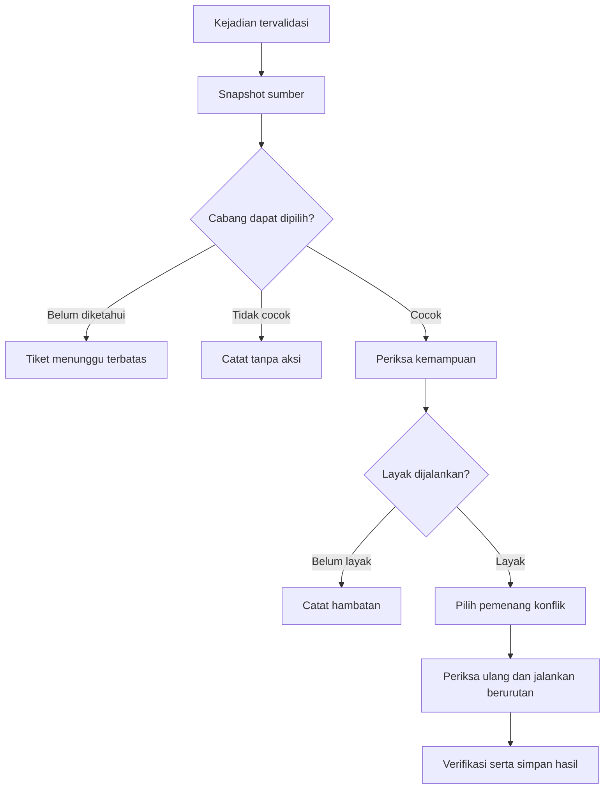

# Krono

## Rule Engine

| Atribut | Keterangan |
| --- | --- |
| Dokumen | `RULE_ENGINE.md` |
| Versi | 0.1 |
| Tanggal | 22 Oktober 2026, Asia/Jakarta |
| Acuan | PRD v0.1 dan Android Capabilities v0.1 |
| Tahap | Spesifikasi perilaku mesin aturan sebelum implementasi |
| Status keputusan | Usulan rancangan v0.1 yang merinci kebutuhan sebelumnya |
| Status implementasi | Belum ada implementasi aplikasi atau pengujian perangkat dari tahap ini |
| Cakupan | Pemilihan cabang, pengolahan kejadian, antrean, konflik, aksi, dan pemulihan |

> Mesin aturan menentukan tindakan dari masukan yang diketahui. Akses Android dan hasil operasi perangkat tetap diperiksa melalui komponen platform. Keputusan menjalankan aksi tidak sama dengan bukti bahwa aksi tersebut berhasil.

## 1. Tujuan dan batas dokumen

Dokumen ini menetapkan arti WHEN, IF, ELSE IF, ELSE, dan THEN dalam Krono serta perilaku saat masukan terlambat, tidak lengkap, berulang, atau berubah ketika aksi sedang berjalan.

Spesifikasi digunakan sebagai acuan implementasi dan pengujian. Pilihan framework, struktur modul, skema tabel, serta komponen Android final ditetapkan pada dokumen berikutnya. Semua keputusan baru pada dokumen ini berstatus usulan v0.1; kebutuhan pemilik produk pada PRD tetap menjadi dasar.

Ruang lingkup MVP mengikuti dua keluarga pemicu, yaitu lokasi dan koneksi Bluetooth, dengan aksi wallpaper serta volume media. Kondisi majemuk AND/OR dijelaskan sebagai kontrak perluasan, tetapi belum diaktifkan dalam konfigurasi MVP.

### 1.1 Bahasa ketentuan

- **Wajib** berarti aturan perilaku yang harus dipenuhi oleh implementasi spesifikasi ini.
- **Usulan parameter awal** berarti nilai teknis yang dapat diubah setelah pengukuran; bukan jaminan performa Android.
- **Perlu PoC** berarti jalur platform belum terbukti bekerja pada Krono dan perangkat sasaran.
- **UNKNOWN** berarti belum diketahui secara memadai; nilainya berbeda dari FALSE.

## 2. Prinsip yang wajib dipertahankan

| ID | Prinsip | Dampak |
| --- | --- | --- |
| INV-01 | Masukan dan versi aturan yang sama menghasilkan keputusan yang sama. | Evaluator tidak membaca waktu atau perangkat secara tersembunyi di tengah keputusan. |
| INV-02 | UNKNOWN tidak diperlakukan sebagai FALSE. | ELSE tidak dipilih karena akses atau data hilang. |
| INV-03 | Satu evaluasi memilih paling banyak satu cabang per aturan. | IF dan ELSE IF tidak berjalan bersamaan. |
| INV-04 | Urutan cabang dan aksi mengikuti urutan yang ditampilkan. | Tidak mengurutkan ulang berdasarkan waktu callback atau nama. |
| INV-05 | Prioritas digunakan untuk konflik pada satu batch yang jelas. | Tidak mengunci pengaturan sepanjang kondisi bertahan. |
| INV-06 | Perubahan manual tidak memicu pemaksaan ulang nilai aturan. | Tidak ada loop menjaga volume atau wallpaper. |
| INV-07 | Pengiriman ulang pekerjaan tidak otomatis mengulang efek perangkat. | Keputusan pengulangan memakai catatan aksi yang tersimpan. |
| INV-08 | Jeda, penghapusan, dan revisi aturan membatalkan pekerjaan lama yang belum dimulai. | Pekerjaan membawa versi dan generasi aktivasi. |
| INV-09 | Kemampuan diperiksa sebelum efek perangkat dicoba. | Worker atau receiver tidak dianggap otomatis memiliki seluruh akses. |
| INV-10 | Efek yang sudah terjadi tidak dianggap ikut dibatalkan ketika langkah berikutnya gagal. | Tidak ada klaim rollback seluruh cabang. |
| INV-11 | Efek yang tidak diketahui hasilnya tidak dicoba ulang secara buta. | Pemulihan mendahulukan kejujuran hasil dan perubahan pengguna. |
| INV-12 | Simulasi tidak menghasilkan efek perangkat atau mengaktifkan pemantauan. | Evaluator dapat diuji dengan masukan buatan. |

## 3. Model konsep

| Konsep | Fungsi |
| --- | --- |
| RuleDefinition | Konfigurasi nama, pemicu, cabang, dan aksi yang disimpan pengguna. |
| RuleRevision | Versi konfigurasi yang berubah ketika isi aturan disimpan ulang. |
| ActivationGeneration | Generasi yang berubah ketika aktivasi atau pembatalan perlu membuat pekerjaan sebelumnya tidak berlaku. |
| SourceObservation | Pengamatan sumber beserta nilai, waktu, asal, dan kualitasnya. |
| NormalizedEvent | Kejadian yang sudah divalidasi dan diterjemahkan ke arti yang dipakai Krono. |
| EvaluationSnapshot | Salinan keadaan yang konsisten untuk satu keputusan evaluasi. |
| EvaluationBatch | Satu kejadian logis dan semua aturan yang relevan terhadap kejadian tersebut. |
| ExecutionPlan | Cabang terpilih, urutan aksi, sasaran, alasan, serta batas validitas untuk satu aturan. |
| ActionAttempt | Satu upaya meminta perubahan perangkat, dengan catatan sebelum dan sesudah pemanggilan. |
| CapabilitySnapshot | Hasil pemeriksaan akses, sumber, aset, dan kelayakan konteks eksekusi. |
| EffectJournal | Catatan tersimpan untuk mencegah pengulangan efek tanpa mengetahui hasil sebelumnya. |

Nama di atas merupakan kontrak konsep, bukan kewajiban memakai nama kelas atau tabel yang sama. Data konfigurasi dan data eksekusi perlu dibedakan; menyimpan aturan tidak berarti sebuah aksi sudah dilakukan.

### 3.1 Identitas dan versi

Setiap aturan, cabang, aksi, area, serta perangkat pilihan mempunyai ID stabil. Nama tampilan boleh sama dan boleh diubah. Menggandakan aturan menghasilkan identitas baru agar catatan eksekusi tidak bercampur.

`ruleRevision` meningkat ketika perubahan konfigurasi disimpan. `activationGeneration` berubah ketika aturan diaktifkan kembali, dijeda, dihapus, atau direvisi untuk mengakhiri pekerjaan lama. Command pengguna memiliki `commandId` agar pengiriman ulang satu perintah tidak menghasilkan beberapa aktivasi.

Prioritas berasal dari posisi aturan pada daftar urutan prioritas yang unik. `priorityRevision` berubah ketika urutan itu disimpan ulang. Rencana yang belum dimulai harus memakai urutan yang masih berlaku.

## 4. Bentuk aturan MVP

### 4.1 Mode sederhana

Mode SIMPLE mempunyai satu pemicu dan satu daftar aksi. Secara internal dapat diwakili satu cabang `ALWAYS`, tetapi cabang ini hanya dapat dipilih setelah pemicu yang sesuai dinyatakan sah.

Contoh: Ketika TWS pilihan terhubung → Atur volume media 20%. `ALWAYS` tidak berarti aturan boleh berjalan saat perangkat tersebut tidak terhubung.

### 4.2 Mode bercabang

Mode BRANCHED mempunyai satu keluarga pemicu, daftar IF/ELSE IF berurutan, dan paling banyak satu ELSE opsional. Setiap cabang MVP menggunakan satu predikat. Percabangan bertingkat dan kelompok AND/OR belum termasuk konfigurasi yang diterima MVP.

ELSE disimpan sebagai cabang cadangan khusus. Jangan mengubahnya menjadi predikat ALWAYS yang dapat melewati pemeriksaan cabang sebelumnya.

### 4.3 Contoh data lokasi

Contoh ini memperlihatkan kontrak logika, bukan skema database final. ID aset dan area mengacu ke data contoh.

```json
{
  "schemaVersion": 1,
  "ruleId": "example-location",
  "ruleRevision": 1,
  "mode": "BRANCHED",
  "trigger": {
    "kind": "GEOFENCE_MEMBERSHIP_CHANGED",
    "areaIds": ["area-a", "area-b"]
  },
  "branches": [
    {
      "branchId": "branch-a",
      "condition": {"kind": "LOCATION_IN_AREA", "areaId": "area-a"},
      "actions": [
        {"actionId": "set-image-a", "kind": "SET_WALLPAPER", "assetId": "image-a", "screens": ["SYSTEM"]}
      ]
    },
    {
      "branchId": "branch-b",
      "condition": {"kind": "LOCATION_IN_AREA", "areaId": "area-b"},
      "actions": [
        {"actionId": "set-image-b", "kind": "SET_WALLPAPER", "assetId": "image-b", "screens": ["SYSTEM"]}
      ]
    }
  ],
  "elseBranch": null
}
```

Ketika seluruh area diketahui tidak cocok dan tidak ada ELSE, hasilnya NO_MATCH. Wallpaper dipertahankan. Tidak ada aksi pemulihan tersembunyi.

### 4.4 Contoh data TWS

```json
{
  "schemaVersion": 1,
  "ruleId": "example-tws",
  "ruleRevision": 1,
  "mode": "SIMPLE",
  "trigger": {"kind": "BLUETOOTH_CONNECTED", "deviceId": "device-selected"},
  "branches": [
    {
      "branchId": "default",
      "condition": {"kind": "ALWAYS"},
      "actions": [
        {"actionId": "set-media-volume", "kind": "SET_MEDIA_VOLUME", "percent": 20}
      ]
    }
  ],
  "elseBranch": null
}
```

Keinginan aktif, generasi aktivasi, prioritas, serta catatan episode merupakan data runtime yang terkait dengan konfigurasi. Data tersebut tidak disimpulkan dari contoh JSON ini.

### 4.5 Validasi sebelum aktivasi

Konfigurasi wajib memiliki pemicu yang dikenali, referensi sumber yang valid, dan sedikitnya satu aksi pada setiap cabang yang dapat dipilih. Persentase volume berada pada rentang 0–100. Sasaran wallpaper harus dikenali dan aset harus dapat disiapkan.

ID cabang serta aksi tidak boleh ganda dalam satu aturan. Mode SIMPLE tidak boleh mempunyai beberapa cabang. ELSE tidak boleh mempunyai kondisi sendiri. Kondisi majemuk atau jenis aksi yang belum didukung ditandai sebagai konfigurasi tidak didukung, bukan diam-diam diabaikan.

Draf yang belum lengkap boleh disimpan sesuai PRD. Aktivasi konfigurasi tidak valid ditolak dengan alasan yang dapat diperbaiki pengguna.

## 5. Pemicu, pengamatan, dan command

### 5.1 Jenis pemicu pengguna

| Pemicu | Kejadian yang relevan | Pemeriksaan sebelum aksi |
| --- | --- | --- |
| `GEOFENCE_MEMBERSHIP_CHANGED` | Perubahan keadaan area yang dipantau aturan. | Keadaan area yang diperlukan untuk memilih cabang dapat dinilai. |
| `BLUETOOTH_CONNECTED` | Perangkat terpilih masuk episode koneksi yang sah. | Perangkat masih terhubung dan aksi masih relevan. |
| `BLUETOOTH_DISCONNECTED` | Perangkat terpilih benar-benar terputus. | Keadaan terputus dapat dibuktikan. |
| `BLUETOOTH_STATE_CHANGED` | Keadaan stabil perangkat terpilih berubah. | Cabang yang sesuai dipilih dari keadaan saat ini. |

Kejadian perangkat atau area lain tidak membuat aturan yang tidak terkait ikut berjalan. Untuk MVP, kondisi aturan memakai keluarga sumber yang sesuai pemicunya. Penggabungan beberapa keluarga pemicu merupakan perluasan yang harus ditetapkan tersendiri.

### 5.2 Kejadian internal

| Asal | Dampak |
| --- | --- |
| `RULE_ACTIVATED` | Membuat satu pemeriksaan awal untuk generasi aktivasi baru. |
| `RULE_UPDATED` | Mengakhiri rencana lama dan membuat pemeriksaan awal revisi baru bila aturan tetap aktif. |
| `SOURCE_REFRESHED` | Memperbarui pengamatan; dapat melengkapi pemeriksaan yang masih menunggu. Tidak selalu berarti pemicu baru. |
| `CAPABILITY_CHANGED` | Memperbarui kesiapan; tidak otomatis mengulang aksi yang selesai. |
| `USER_RETRY` atau `USER_RESUME` | Permintaan baru dari pengguna untuk memeriksa keadaan sekarang. |
| `USER_TEST_ACTION` | Menguji aksi yang dipilih secara eksplisit dengan batas kemampuan yang tetap berlaku. |
| `RECOVERY` | Memulihkan catatan dan pemantauan; tidak mengulang seluruh aksi lama. |
| `WORKER_WAKEUP` | Melanjutkan pemeriksaan pekerjaan tersimpan; bukan sebab bisnis baru. |

Membuka layar, menggulir daftar, refresh UI, serta menerima callback perubahan volume hasil aksi sendiri tidak menjadi pemicu otomasi baru.

### 5.3 Masukan kejadian

Envelope kejadian memuat `receiptId`, `logicalEventKey` jika sudah diketahui, keluarga sumber, ID sumber, asal, urutan penerimaan, waktu penerimaan, waktu pengamatan bila tersedia, dan kualitas pengamatan.

`receiptId` mengidentifikasi penerimaan, bukan membuktikan sebuah kejadian fisik baru. Android atau beberapa profil dapat melaporkan satu perubahan lebih dari sekali. Jika tidak ada identitas kejadian dari sumber, normalisasi menggunakan keadaan dan episode yang disimpan, bukan membuat ID baru lalu menganggap semua laporan berbeda.

## 6. Keadaan sumber dan waktu

### 6.1 Tiga nilai kondisi

Setiap predikat menghasilkan TRUE, FALSE, atau UNKNOWN disertai alasan. Contoh: izin hilang, sumber belum siap, data kedaluwarsa, atau sumber tidak cukup andal.

| Predikat | TRUE | FALSE | UNKNOWN |
| --- | --- | --- | --- |
| `LOCATION_IN_AREA` | Pengamatan yang layak menempatkan pengguna di area. | Pengamatan yang layak menempatkan pengguna di luar area. | Tidak ada penilaian lokasi yang layak. |
| `BLUETOOTH_IS_CONNECTED` | Keadaan stabil terhubung diketahui. | Keadaan stabil terputus diketahui. | Transisi atau keadaan belum dapat dipastikan. |
| `BLUETOOTH_IS_DISCONNECTED` | Keadaan stabil terputus diketahui. | Keadaan stabil terhubung diketahui. | Transisi atau keadaan belum dapat dipastikan. |
| `ALWAYS` | Gate pemicu untuk evaluasi tersebut sudah sah. | Gate pemicu tidak cocok, sehingga evaluasi tidak melanjutkan ke cabang. | Gate pemicu belum dapat dipastikan. |

Kegagalan mengambil proxy profil Bluetooth tidak sama dengan bukti bahwa perangkat terputus. Berhentinya layanan lokasi juga tidak sama dengan bukti bahwa pengguna keluar area.

### 6.2 Pengamatan yang konsisten

Satu keputusan membaca `EvaluationSnapshot` yang tidak berubah selama pemilihan cabang. Snapshot mencatat versi sumber dan cakupan data yang digunakan.

Untuk lokasi A/B, penilaian sebaiknya berasal dari pengamatan bersama yang cukup layak atau penilaian area yang dapat dipertanggungjawabkan dalam satu snapshot. Laporan EXIT dari A tidak boleh langsung mengisi semua area lain sebagai FALSE. Jika adapter hanya mengetahui sebagian keadaan, sisanya tetap UNKNOWN.

Adapter platform bertanggung jawab menilai umur, ketepatan, dan ketersediaan pengamatan. Bila laporan geofence membawa lokasi pemicu yang memadai, laporan itu dapat dipakai; bila tidak, pembaruan sumber dilakukan secara terbatas sesuai kemampuan platform. Detail klasifikasi posisi berada pada rancangan adapter di `ARCHITECTURE.md`, bukan asumsi bahwa satu koordinat selalu tepat.

Keadaan Bluetooth yang stabil tidak otomatis kedaluwarsa setiap beberapa detik hanya karena tidak ada kejadian baru. Keadaan tersebut menjadi tidak dapat dipercaya ketika akses hilang, terjadi jeda cakupan yang relevan, atau pemeriksaan terbaru gagal. Pemeriksaan menjelang aksi tetap dapat meminta pengamatan baru.

### 6.3 Penggunaan waktu

Waktu kalender dipakai untuk tampilan. Perhitungan jeda dan batas pekerjaan memakai jam monoton dalam epoch runtime yang sama. Penggantian zona waktu atau penyesuaian jam kalender tidak memperpanjang kesempatan sebuah pekerjaan lama.

Setelah proses dipulihkan dan epoch pengamatan tidak dapat dipastikan sama, jangan membandingkan nilai monoton lama sebagai waktu yang masih berlaku. Pekerjaan lama dibatalkan atau ditandai perlu rekonsiliasi sesuai bagian 18.

## 7. Pemilihan cabang

Cabang diperiksa dari atas ke bawah. FALSE melanjutkan pemeriksaan. TRUE memilih cabang tersebut dan menghentikan pencarian. UNKNOWN menghentikan pencarian sementara karena cabang tersebut mungkin seharusnya mempunyai prioritas lebih tinggi.

ELSE dipilih hanya jika semua cabang sebelumnya diketahui FALSE. Jika tidak ada ELSE, hasil seluruh kondisi FALSE adalah NO_MATCH.

| IF A | ELSE IF B | Ada ELSE | Hasil |
| --- | --- | --- | --- |
| TRUE | Apa pun | Ya atau tidak | Cabang A. B tidak perlu diperiksa. |
| FALSE | TRUE | Ya atau tidak | Cabang B. |
| FALSE | FALSE | Ya | ELSE. |
| FALSE | FALSE | Tidak | NO_MATCH; tidak ada aksi. |
| UNKNOWN | TRUE | Ya atau tidak | WAITING_DATA; B belum dipilih. |
| UNKNOWN | FALSE | Ya | WAITING_DATA; ELSE belum dipilih. |
| FALSE | UNKNOWN | Ya | WAITING_DATA; ELSE belum dipilih. |
| TRUE | UNKNOWN | Ya | Cabang A; nilai B tidak menentukan hasil. |

```text
selectBranch(rule, snapshot):
    for branch in rule.branches, sesuai urutan:
        value = evaluate(branch.condition, snapshot)
        if value == UNKNOWN: return WAITING_DATA(value.reason)
        if value == TRUE: return MATCH(branch)
    if rule.elseBranch tersedia: return MATCH(rule.elseBranch)
    return NO_MATCH
```

Kegagalan aksi pada cabang A tidak menyebabkan engine mencoba cabang B atau ELSE. Cabang dipilih berdasarkan kondisi, bukan berdasarkan aksi mana yang paling mudah dijalankan.

### 7.1 Kontrak AND/OR untuk perluasan

Kelompok AND/OR belum diterima dalam konfigurasi MVP. Jika ditambahkan, gunakan logika tiga nilai berikut, bukan konversi UNKNOWN menjadi FALSE.

| A | B | A AND B | A OR B |
| --- | --- | --- | --- |
| TRUE | TRUE | TRUE | TRUE |
| TRUE | FALSE | FALSE | TRUE |
| TRUE | UNKNOWN | UNKNOWN | TRUE |
| FALSE | TRUE | FALSE | TRUE |
| FALSE | FALSE | FALSE | FALSE |
| FALSE | UNKNOWN | FALSE | UNKNOWN |
| UNKNOWN | TRUE | UNKNOWN | TRUE |
| UNKNOWN | FALSE | FALSE | UNKNOWN |
| UNKNOWN | UNKNOWN | UNKNOWN | UNKNOWN |

Penambahan operator harus menaikkan kemampuan skema dan mempunyai pengujian tersendiri. Tabel ini tidak memperluas cakupan MVP secara diam-diam.

## 8. Kapan cabang dijalankan lagi

### 8.1 Episode koneksi

Satu episode dimulai ketika perangkat masuk keadaan terhubung yang sah dan berakhir ketika keadaan terputus yang sah diketahui. Beberapa laporan A2DP atau profil terkait pada episode yang sama tidak menghasilkan beberapa aksi.

CONNECTING dan DISCONNECTING diperlakukan sebagai keadaan transisi. UNKNOWN atau hilangnya pengamatan sementara tidak dianggap sebagai pemutusan koneksi yang membuka episode baru. Perubahan Classic/LE Audio hanya digabungkan jika pemetaan perangkat dan dukungan profil telah dibuktikan.

### 8.2 Episode cabang lokasi

Saat cabang terpilih berubah dari A ke B, engine mempunyai kesempatan baru menjalankan B. Jika laporan berikutnya masih memilih A pada episode A yang sama, engine tidak memasang ulang gambar A hanya karena ada laporan tambahan.

Keadaan NO_MATCH yang sah dapat menutup episode cabang sebelumnya. UNKNOWN menahan kesimpulan: A → UNKNOWN → A tidak otomatis dihitung sebagai keluar dan masuk lagi. Bila cakupan pengamatan hilang, pembaruan keadaan setelahnya tidak boleh mengarang kejadian perpindahan yang tidak pernah diketahui.

Ini mempertahankan perubahan manual saat pengguna masih di area yang sama. Keluar dan masuk kembali yang terbukti, aktivasi baru, revisi yang disimpan, atau permintaan pengguna yang baru dapat menjadi sebab evaluasi baru.

### 8.3 Pemeriksaan awal

Aktivasi yang disengaja membuat satu kesempatan pemeriksaan awal. Jika data valid sudah tersedia dan gate pemicu cocok, pilih cabang saat ini. Jika data belum tersedia, simpan satu tiket menunggu sampai batas waktunya.

Data pertama dan event pertama yang sama-sama memenuhi pemeriksaan awal tidak boleh membuat dua efek identik. Normalisasi mengaitkannya dengan kesempatan aktivasi yang sama. Pemeriksaan awal yang selesai tidak diulang hanya karena aplikasi dibuka ulang.

Untuk `USER_RETRY` dan `USER_RESUME`, baca keadaan sekarang. TWS yang sudah terputus tidak dianggap masih memenuhi pemicu CONNECTED hanya karena kejadian lama pernah ada.

### 8.4 Status kesempatan dan arti dikonsumsi

Satu kesempatan mempunyai kunci unik `ruleId + ruleRevision + activationGeneration + causeKey`. Pengiriman ulang kunci tersebut mengacu ke kesempatan yang sama. Keadaan kesempatan adalah sebagai berikut.

| Keadaan | Makna dan perpindahan |
| --- | --- |
| `OPEN` | Kesempatan diterima dan belum mempunyai keputusan selesai. |
| `WAITING_DATA` | Menunggu data yang menentukan kondisi; dibatasi deadline yang sama. |
| `WAITING_CAPABILITY` | Menunggu hambatan yang mungkin dipulihkan, seperti akses atau konteks; tidak ada efek yang sudah dimulai. |
| `PLANNED` | Keputusan cabang dan konflik sudah tersimpan, menunggu eksekusi. |
| `EXECUTING` | Ada langkah yang sedang diperiksa atau diminta melalui executor. |
| `CLOSED` | Kesempatan selesai beserta hasil dan alasannya; tidak dibuka ulang oleh pengiriman worker atau pembaruan kesiapan. |

OPEN dapat menuju keadaan menunggu, PLANNED, atau CLOSED. Keadaan menunggu dapat kembali dievaluasi menggunakan data yang valid sebelum deadline. PLANNED dapat menuju EXECUTING atau CLOSED jika tidak berlaku lagi. EXECUTING akhirnya menjadi CLOSED dengan hasil pada bagian 15.

Selain kunci kesempatan, simpan penanda episode yang sudah diambil oleh aturan: `ruleId + ruleRevision + activationGeneration + branchId + episodeId`. Penanda ini menghubungkan pemeriksaan awal dengan laporan sumber untuk episode yang sama, meskipun cause key keduanya berbeda. Reservasi dibuat saat keputusan rencana disimpan; rencana yang kalah konflik atau selesai juga tidak membuka kesempatan baru dari laporan episode yang sama. NO_CHANGE_NEEDED turut menyelesaikan kesempatan tersebut.

Kejadian di dalam episode yang sama tidak membentuk aksi baru ketika kesempatan masih menunggu atau sudah selesai. Command Coba lagi yang baru boleh membuat kesempatan baru secara eksplisit, tetap dengan pembacaan keadaan sekarang. Kesempatan CLOSED dengan alasan NO_MATCH tidak melarang cabang lain berjalan ketika ada perubahan keadaan sah berikutnya.

Hambatan yang diketahui tidak didukung ditutup dengan alasan yang sesuai. Hambatan yang mungkin dipulihkan dapat memakai WAITING_CAPABILITY selama masih di dalam deadline. Menunggu tidak menciptakan pengulangan setter dan tidak memperpanjang deadline.

## 9. Normalisasi dan pencegahan duplikasi

Urutan penerimaan lokal tidak membuktikan urutan kejadian fisik. Laporan lama bisa datang setelah laporan yang lebih baru. Adapter wajib memakai waktu atau versi sumber bila tersedia dan melakukan rekonsiliasi ketika urutannya tidak cukup jelas.

Tahapan masuk:

1. Validasi action, jenis sumber, ID yang dipantau, dan asal masukan yang diizinkan.
2. Cocokkan laporan dengan keadaan sumber yang diketahui.
3. Abaikan laporan yang terbukti lebih lama daripada keadaan yang sudah diterima.
4. Jika terjadi ketidakjelasan, perbarui pengamatan secara terbatas tanpa langsung menciptakan pemicu baru.
5. Bentuk perubahan logis dan episode sumber yang relevan.
6. Simpan kejadian logis sebelum menyerahkannya ke antrean evaluasi.

Kunci duplikasi paling sedikit mengikat identitas sumber, episode/perubahan logis yang diketahui, dan jenis transisinya. Jangan menyamakan semua kejadian dari perangkat yang sama dalam jendela waktu tetap; disconnect lalu reconnect yang nyata tetap merupakan episode baru.

Penyaringan berdasarkan waktu singkat saja tidak menjadi jaminan duplikasi terselesaikan. Penyaringan juga tidak boleh menghilangkan perubahan sah A → B atau koneksi baru.

## 10. Aliran evaluasi



Satu batch memakai satu kejadian logis yang diterima dan snapshot konsisten, lalu mengumpulkan semua aturan aktif yang relevan. Beberapa area yang dilaporkan bersama dapat berada dalam satu kejadian logis. Laporan lain yang hanya berdekatan waktunya tidak otomatis digabungkan sebagai satu sebab.

Setiap batch mempunyai urutan penerimaan lokal yang tersimpan. Aturan dievaluasi dengan urutan prioritas yang sama untuk snapshot itu. Eksekusi menunggu rencana dan keputusan konflik tersimpan, bukan langsung berjalan ketika sebuah kondisi pertama kali terlihat TRUE.

## 11. Prioritas dan konflik sasaran

### 11.1 Identitas sasaran

| Aksi | Kunci sasaran logis |
| --- | --- |
| Volume media | `audio.media` |
| Wallpaper layar utama | `wallpaper.system` |
| Wallpaper layar kunci | `wallpaper.lock` |
| Wallpaper kedua layar | Memakai kedua kunci wallpaper tersebut. |

Kunci berlaku dalam konteks pengguna/profil Android yang dilayani aplikasi. Volume media tidak diberi kunci berbeda hanya berdasarkan nama TWS karena aksi MVP tidak menjanjikan kontrol volume independen tiap perangkat.

### 11.2 Algoritma pemilihan pemenang

Hanya kandidat yang telah memilih cabang dan lolos pemeriksaan kemampuan awal yang ikut berebut sasaran. Kandidat yang menunggu data atau terhalang akses tidak mengambil reservasi sasaran.

1. Urutkan kandidat berdasarkan urutan prioritas yang terlihat.
2. Untuk setiap kandidat, hitung gabungan seluruh sasaran cabang terpilih.
3. Jika tidak bertabrakan dengan kandidat yang sudah menang, terima seluruh rencana cabang dan reservasi sasarannya.
4. Jika ada benturan, tandai seluruh rencana cabang sebagai CONFLICT_LOST.
5. Jangan membuang sebagian aksi dari cabang yang kalah lalu menjalankan sisanya secara tersembunyi.

Usulan ini mempertahankan urutan cabang sebagai satu rencana. Contoh: aturan prioritas tinggi memakai wallpaper; aturan lain memuat volume lalu wallpaper. Jika rencana kedua kalah pada wallpaper, kedua aksinya dilewati dan alasannya terlihat.

Reservasi di atas adalah keputusan perencanaan untuk batch tersebut. Reservasi tidak menjamin seluruh aksi akan berhasil atau membuat efek beberapa aksi menjadi transaksi sistem yang dapat dibatalkan.

### 11.3 Kegagalan pemenang dan batch berikutnya

Jika pemenang gagal ketika dieksekusi, kandidat yang kalah pada batch yang sama tidak otomatis dipromosikan. Hasilnya tetap dapat dijelaskan dari keputusan konflik yang tersimpan. Kesempatan berikutnya memerlukan kejadian atau command baru yang sah.

Batch baru yang datang kemudian dapat menghasilkan perubahan baru. Prioritas tidak membuat aturan lama terus memaksakan pengaturan setelah pengguna mengubahnya.

## 12. Antrean dan rencana yang menjadi lama

Usulan MVP menggunakan satu koordinator logis dan satu jalur pemanggilan efek perangkat dalam proses aplikasi utama. Penerimaan kejadian tetap dapat diperbarui ketika sebuah aksi menunggu hasil.

Koordinator menyimpan urutan batch, versi aturan, dan urutan niat terbaru untuk setiap sasaran. Rencana baru yang sah dapat membuat pekerjaan lama pada sasaran yang sama tidak berlaku. Worker yang bangun lebih lambat tidak boleh menulis hasil lama setelah ada rencana lebih baru yang berlaku.

Sebelum setiap aksi, periksa kembali token sasaran milik rencana. Jika sudah digantikan, tandai aksi yang belum dimulai sebagai SUPERSEDED. Jika sebuah rencana memiliki beberapa sasaran dan kehilangan salah satunya sebelum mulai, batalkan seluruh rencana yang belum berjalan.

Panggilan yang sudah diberikan kepada Android mungkin tidak dapat dihentikan seketika. Jika peristiwa baru datang saat itu, akhiri pencatatan aksi lama sejujurnya, hentikan langkah berikutnya yang tidak berlaku, kemudian proses rencana baru. Serialisasi panggilan Krono tidak memberi isolasi mutlak terhadap perubahan pengguna atau aplikasi lain.

## 13. Pemeriksaan kemampuan dan eksekusi

### 13.1 Pemeriksaan cabang

Sebelum rencana ikut konflik, periksa akses, sumber, aset, sasaran layar, dan kelayakan aksi yang dibutuhkan cabang tersebut. Jangan mewajibkan izin lokasi untuk cabang TWS yang tidak menggunakannya.

Jika salah satu aksi cabang diketahui tidak dapat dimulai, tahan seluruh cabang sebelum ada efek. Cabang tidak diganti dengan ELSE. Aturan lain yang layak tetap dapat menjadi kandidat sesuai prioritas.

Pemeriksaan awal mengurangi kegagalan yang sudah diketahui, tetapi keadaan dapat berubah setelahnya. Karena itu, hasil Sebagian berhasil tetap mungkin terjadi.

### 13.2 Pemeriksaan menjelang setiap aksi

Pastikan aturan masih aktif, revisi dan generasi masih berlaku, rencana belum kedaluwarsa, serta token sasaran belum digantikan. Periksa keadaan sumber terkini dan pastikan pemilihan cabangnya masih sama.

Pembaruan pengamatan yang tetap mempertahankan cabang dan episode yang sama tidak harus menggagalkan rencana. Namun, TRUE yang berubah menjadi FALSE/UNKNOWN atau cabang prioritas lebih tinggi yang sekarang cocok membuat langkah yang belum dimulai tidak berlaku. Keputusan baru menggunakan snapshot baru, bukan mengubah snapshot lama.

### 13.3 Urutan aksi

Aksi berjalan sesuai urutan daftar. Jangan menjalankan beberapa aksi dalam cabang secara paralel. Jika suatu aksi gagal, terhalang, dibatalkan, atau hasilnya belum diketahui, hentikan aksi berikutnya.

Aksi yang berhasil tidak otomatis dibatalkan. Bila dua aksi sengaja menulis sasaran yang sama dalam cabang yang sama, urutan eksplisit pengguna tetap berlaku. Tidak ada delay, loop, atau pengulangan tersirat di antara keduanya.

### 13.4 Android 17 dan audio

Adapter volume harus memperhitungkan lifecycle audio. Dokumentasi Android 17 menjelaskan bahwa API volume dapat diabaikan tanpa exception pada konteks yang tidak memenuhi syarat. Keberadaan receiver atau worker saja tidak menjadi bukti kelayakan. [E1]

Mesin inti menerima keputusan READY, BLOCKED, atau UNKNOWN beserta alasannya dari pemeriksaan kemampuan. READY merupakan penilaian awal, bukan bukti hasil akhir. Jangan membuat flag WIU buatan yang otomatis bernilai benar hanya karena FGS pernah berjalan.

Jalur sesi audio dan pemulihannya tetap memerlukan PoC sebagaimana dicatat dalam Android Capabilities. Mesin tidak mengubah izin atau memakai akses lain yang tidak diperlukan untuk mengatasi hambatan tersebut.

## 14. Batas menunggu dan umur data

Nilai berikut merupakan **usulan parameter awal untuk eksperimen**, bukan batas Android atau janji waktu respons kepada pengguna. Semua nilai harus dapat dikonfigurasi secara terpusat dan diuji dengan jam buatan.

| Parameter | Usulan awal | Makna |
| --- | --- | --- |
| `bluetoothEventWaitMs` | 30.000 ms | Waktu maksimal kesempatan kejadian TWS menunggu setelah diterima Krono. |
| `locationEventWaitMs` | 120.000 ms | Waktu maksimal kesempatan kejadian lokasi menunggu setelah diterima Krono. |
| `initialCheckWaitMs` | 60.000 ms | Waktu menunggu data untuk pemeriksaan awal aktivasi. |
| `userCommandWaitMs` | 15.000 ms | Waktu menunggu permintaan pemeriksaan atau uji yang dipicu pengguna. |
| `locationObservationMaxAgeMs` | 120.000 ms | Acuan awal umur pengamatan posisi; mutu dan konteks tetap dinilai adapter. |
| `bluetoothPreActionProbeMaxAgeMs` | 5.000 ms | Acuan umur pemeriksaan tambahan sebelum aksi tertunda, bukan umur seluruh episode koneksi. |
| `maxAutomaticSourceRefreshPerTicket` | 1 | Membatasi permintaan pembaruan otomatis untuk satu tiket. |
| `maxAutomaticEffectRetry` | 0 | Tidak mengulang efek otomatis setelah satu upaya pemanggilan pada spesifikasi awal. |

Umur kejadian sejak diterima berbeda dari umur pengamatan sumber. Geofence yang terlambat diberitahukan tidak menjadi pengamatan posisi baru hanya karena baru diterima. Jika pengamatan tidak layak, gunakan pembaruan terbatas atau hasil UNKNOWN.

Pada batas waktu tepat `now >= deadline`, pekerjaan kedaluwarsa. Perpanjangan deadline membutuhkan command pengguna atau kejadian baru yang sah. Callback tambahan dan worker retry tidak memperpanjang deadline lama.

Satu tiket menunggu menyimpan alasan dan deadline. Hilangnya akses atau konteks audio tidak memicu loop permintaan izin, pembaruan lokasi, atau percobaan setter. Jika tiket sudah kedaluwarsa, selesainya pemberian izin hanya memperbarui kesiapan; aksi lama tidak otomatis dihidupkan kembali.

## 15. Hasil aksi dan hasil aturan

### 15.1 Hasil aksi

| Hasil | Arti |
| --- | --- |
| `APPLIED` | Ada bukti yang memadai menurut kontrak adapter bahwa permintaan berhasil diterapkan. |
| `NO_CHANGE_NEEDED` | Keadaan yang layak diperiksa sudah sama dengan target sebelum efek baru diminta. |
| `FAILED` | Diketahui gagal atau hasil pengamatan yang memadai tidak sesuai target. |
| `BLOCKED` | Efek tidak dimulai karena kebutuhan akses atau konteks tidak terpenuhi. |
| `UNVERIFIED` | Pemanggilan telah atau mungkin dilakukan, tetapi hasil belum dapat dipastikan. |
| `SKIPPED` | Aksi tidak dimulai karena konflik, langkah sebelumnya berhenti, atau sebab lain yang dicatat. |
| `CANCELLED` | Aksi belum dimulai dan tidak berlaku lagi karena perubahan aturan atau pilihan pengguna. |
| `EXPIRED` | Kesempatan aksi melewati deadline. |
| `SUPERSEDED` | Aksi belum dimulai dan rencananya telah digantikan niat yang lebih baru pada sasaran terkait. |

`APPLIED` tidak selalu berarti hasil visual atau akustik telah diperiksa manusia. Bukti adapter harus dicatat: misalnya respons pemasangan wallpaper atau pembacaan tingkat volume yang tersedia. Bukti yang lebih terbatas tidak boleh ditulis sebagai pemeriksaan fisik yang lebih kuat.

### 15.2 Ringkasan aturan

| Keadaan keseluruhan | Ringkasan |
| --- | --- |
| Semua aksi selesai sebagai APPLIED atau NO_CHANGE_NEEDED | Berhasil; rincian tetap membedakan perubahan dan keadaan yang sudah sesuai. |
| Ada aksi APPLIED, tetapi ada langkah berikutnya yang gagal atau tidak selesai | Sebagian berhasil; tampilkan apakah sisanya gagal, dibatalkan, atau belum terverifikasi. |
| Tidak ada APPLIED dan ada hasil UNVERIFIED | Belum terverifikasi; jangan menyimpulkan tidak ada perubahan. |
| Tidak ada APPLIED dan ada kegagalan yang diketahui | Gagal, dengan rincian keadaan yang sudah sesuai bila ada. |
| Tidak ada efek dimulai karena akses/konteks | Terhalang; jelaskan kebutuhan yang belum terpenuhi. |
| Tidak ada kondisi cocok, konflik kalah, atau seluruh pekerjaan dibatalkan/kedaluwarsa | Dilewati dengan alasan khusus. |

Hasil NO_CHANGE_NEEDED sebelum langkah lain gagal tidak membuktikan sebagian perubahan baru berhasil. Prioritas ringkasan: bukti efek yang sudah diterapkan ditampilkan lebih dahulu, lalu ketidakpastian, lalu kegagalan atau sebab tidak dijalankan. Tidak ada ringkasan Berhasil untuk rencana yang masih mempunyai langkah belum terselesaikan.

Ringkasan final baru dihitung setelah kesempatan CLOSED. Gunakan urutan penilaian berikut agar kondisi yang bertumpang tindih tetap menghasilkan keputusan yang sama.

```text
Jika tidak ada cabang/aksi dipilih: Dilewati dengan alasannya.
Jika semua aksi APPLIED atau NO_CHANGE_NEEDED: Berhasil.
Jika ada APPLIED dan hasil lain belum sukses: Sebagian berhasil.
Jika tidak ada APPLIED tetapi ada UNVERIFIED: Belum terverifikasi.
Jika ada FAILED tanpa APPLIED/UNVERIFIED: Gagal.
Jika sisanya mempunyai BLOCKED: Terhalang.
Selain itu: Dilewati, dengan alasan pembatalan, konflik, atau kedaluwarsa.
```

## 16. Perubahan manual, revisi, dan jeda

### 16.1 Perubahan manual

Engine tidak mendengarkan perubahan volume untuk otomatis mengembalikannya ke target. Setelah satu kesempatan selesai, nilai pengguna dipertahankan sampai sebab baru yang sah terjadi.

Jika perubahan manual dapat diamati ketika aksi masih mengantre, batalkan kesempatan lama pada sasaran tersebut. Uji aksi yang disengaja pengguna juga membuat token niat baru agar rencana otomatis yang lebih lama tidak langsung menimpanya.

Tidak semua perubahan dari luar dapat diatribusikan secara sempurna. Karena itu, penanganan pemulihan tidak bergantung pada dugaan bahwa setiap nilai yang berbeda pasti kegagalan Krono. Ada celah singkat antara pemeriksaan dan pemanggilan API yang perlu dinyatakan sebagai batas integrasi perangkat.

### 16.2 Menyimpan revisi dan mengubah prioritas

Menyimpan revisi membatalkan rencana lama yang belum berjalan. Jika satu efek sudah dimulai, catat hasilnya dan hentikan langkah selanjutnya dari revisi lama. Pemeriksaan awal revisi baru mengikuti kontrak aktivasi, menggunakan keadaan saat ini.

Usulan awal untuk perubahan prioritas adalah mengakhiri rencana terkait yang belum dimulai dengan alasan PRIORITY_CHANGED. Urutan baru berlaku pada batch berikutnya. Perubahan prioritas tidak menjalankan ulang seluruh aturan atau membuka kesempatan yang sudah CLOSED. Jika perubahan terdeteksi ketika evaluasi belum sempat menyimpan keputusan konflik, keputusan yang belum di-commit dapat dihitung ulang sebelum ada efek.

### 16.3 Jeda dan penghapusan

Jeda atau penghapusan menaikkan generasi pembatalan dan mengakhiri tiket menunggu. Worker lama wajib memeriksa generasi sebelum setiap efek.

Hasil yang sudah diterapkan dipertahankan. Tidak ada pengembalian volume atau wallpaper lama secara tersirat. Catatan historis memakai nama serta versi aturan ketika kesempatan dibuat.

## 17. Pengulangan pekerjaan dan percobaan ulang

MVP mengusulkan tidak ada pengulangan otomatis efek setelah pemanggilan pertamanya. Kebijakan ini dapat diperluas setelah kontrak tiap adapter dan dampak terhadap perubahan manual dibuktikan.

Pekerjaan pengiriman, registrasi sumber, serta pembaruan data boleh memiliki mekanisme penjadwalan tersendiri. Pengulangan worker tetap membaca catatan kesempatan yang sama dan tidak menciptakan efek baru.

WorkManager menyediakan unique work untuk membantu menghindari penjadwalan pekerjaan dengan nama sama. Fasilitas tersebut tidak menggantikan identitas kesempatan, catatan efek, atau penyelesaian konflik bisnis Krono. [E2]

Permintaan Coba lagi dari pengguna adalah command baru. Engine membaca ulang sumber, memeriksa cabang dan kemampuan sekarang, lalu membentuk kesempatan baru. Permintaan itu tidak memutar ulang byte rencana lama dengan kondisi yang mungkin sudah berbeda.

## 18. Catatan efek dan pemulihan setelah proses mati

### 18.1 Identitas efek

Usulan kunci efek memuat `ruleId`, `ruleRevision`, `activationGeneration`, `causeKey`, `branchId`, dan `actionId`. Nilai `causeKey` berasal dari episode/perubahan logis atau command yang sah.

`ActionAttempt` menyimpan sasaran, target nilai, fase pemanggilan, konteks yang diperiksa, serta hasil yang tersedia. Pengiriman ulang kunci yang sama membaca hasil yang tersimpan, bukan langsung memanggil API lagi.

### 18.2 Urutan pencatatan

```text
PREPARED
    rencana sah sudah tersimpan; belum ada izin melakukan efek
REQUESTING
    catatan ditulis sebelum memanggil API perangkat
OBSERVING
    permintaan sudah kembali; bukti hasil sedang diperiksa
FINISHED
    hasil akhir dan alasan sudah tersimpan
```

Pencatatan REQUESTING wajib mendahului pemanggilan API. Hal ini mencegah proses baru menganggap efek yang mungkin sudah dilakukan sebagai aksi yang pasti belum pernah dimulai.

Database dan perubahan pengaturan Android tidak membentuk satu transaksi bersama. Proses bisa mati setelah efek terjadi tetapi sebelum hasil dicatat. Karena itu, engine tidak menjanjikan efek tepat satu kali secara mutlak pada seluruh gangguan.

### 18.3 Kebijakan pemulihan awal

| Keadaan saat ditemukan kembali | Respons usulan |
| --- | --- |
| FINISHED | Pertahankan hasil; tidak diulang. |
| REQUESTING atau OBSERVING tanpa hasil akhir | Tandai hasil belum diketahui; pemeriksaan baca saja boleh membantu, tetapi tidak memicu pemanggilan ulang otomatis. |
| PREPARED dari runtime yang sudah berakhir | Batalkan kesempatan lama dan tampilkan alasan pemulihan; tunggu sebab baru yang sah. |
| Tiket menunggu dari runtime yang sudah berakhir | Akhiri tiket lama; pulihkan kesiapan dan pemantauan. |
| Aturan aktif yang masih tersimpan | Registrasi atau pemantauannya direkonsiliasi; tidak semua aksi dianggap perlu dijalankan ulang. |

Nilai perangkat yang sekarang sama dengan target dapat dicatat sebagai cocok saat pemeriksaan pemulihan. Nilai tersebut tidak membuktikan bahwa pemanggilan sebelum proses mati pasti berhasil. Jika nilainya berbeda, jangan langsung menimpanya karena pengguna mungkin sudah mengubahnya.

Pemeriksaan awal yang belum selesai sebelum proses mati juga tidak diputar ulang secara buta. UI dapat menyediakan permintaan pemeriksaan baru. Kejadian sumber yang benar-benar baru tetap dapat menjalankan aturan seperti biasa.

### 18.4 Satu pemanggil efek

Implementasi perlu satu jalur otoritatif pemanggilan efek dalam proses aplikasi utama. Beberapa worker yang menerima pekerjaan sama harus melewati pemeriksaan kunci efek yang tersimpan. Mutex di layar atau variabel proses saja tidak menjadi sumber kebenaran deduplikasi.

Jika kelak memakai beberapa proses, spesifikasi koordinasi harus diperluas. Token pada database tidak dapat memaksa API Android membatalkan efek lama yang telanjur dipanggil. Jangan mengiklankan isolasi atau efek tepat satu kali yang tidak dapat ditegakkan.

## 19. Simulasi dan uji aksi

### 19.1 Simulasi

Simulasi memakai evaluator, pemilihan cabang, serta algoritma konflik yang sama. Sumber, waktu, kemampuan, dan executor diganti dengan masukan buatan atau adapter pencatat tanpa efek.

Pengguna melihat kondisi yang diketahui, alasan UNKNOWN, cabang terpilih, kandidat konflik, serta aksi yang direncanakan. Bila hanya satu aturan disimulasikan, UI menyebut bahwa konflik dengan aturan lain belum ikut diperiksa. Mode beberapa aturan memakai kumpulan aturan dan prioritas yang dipilih sebagai fixture simulasi.

Simulasi tidak mendaftarkan geofence, mengaktifkan layanan, menulis pengaturan HP, atau mengubah generasi aktivasi aturan nyata. Hasilnya diberi asal SIMULATION dan terpisah dari riwayat eksekusi perangkat.

### 19.2 Uji aksi

Uji aksi menguji satu aksi yang dipilih pengguna. Kondisi cabang tidak perlu dipalsukan menjadi TRUE; catatan menjelaskan bahwa pengguna menguji aksi secara langsung. Pemeriksaan akses dan kelayakan platform tetap wajib.

Uji aksi memerlukan commandId tersendiri. Penekanan tombol yang dikirim ulang dengan ID sama tidak menciptakan beberapa pemanggilan. Pengujian ini tidak membuktikan bahwa pemicu background sudah bekerja.

## 20. Pseudocode koordinasi

Pseudocode berikut menetapkan urutan tanggung jawab, bukan kode siap kompilasi atau pilihan library final.

```text
onLogicalEvent(event):
    validate event
    if event sudah ditangani sebagai kejadian logis yang sama:
        return hasil tersimpan

    simpan event dan pembaruan pengamatan secara konsisten
    snapshot = salinan keadaan yang relevan
    rules = aturan aktif yang pemicunya relevan, sesuai prioritas
    candidates = []

    for rule in rules:
        periksa konfigurasi, generasi, gate pemicu, dan deadline
        selection = selectBranch(rule, snapshot)
        if selection == WAITING_DATA:
            simpan satu tiket menunggu yang terbatas
            continue
        if selection == NO_MATCH:
            catat tanpa aksi
            continue
        if event bukan command eksplisit dan episode cabang sudah dikonsumsi:
            catat duplikasi tanpa efek
            continue
        if ada aksi cabang yang belum lolos kemampuan awal:
            simpan WAITING_CAPABILITY jika hambatan mungkin pulih sebelum deadline
            jika tidak: tutup kesempatan dengan alasan hambatan
            jangan memilih cabang lain
            continue
        candidates.add(rencana dengan versi, generasi, episode, dan sasaran)

    winners = pilih rencana utuh menurut prioritas dan konflik sasaran
    simpan keputusan konflik dan token sasaran secara konsisten
    for plan in winners, sesuai urutan:
        serahkan plan ke satu jalur eksekusi
```

```text
executePlan(plan):
    for action in plan.actions, sesuai urutan:
        if aturan/generasi/deadline/token tidak berlaku:
            akhiri langkah yang belum dimulai beserta alasannya
            break
        if cabang dan episode sekarang berbeda atau belum diketahui:
            akhiri langkah yang belum dimulai
            break
        if kemampuan sekarang tidak READY:
            catat BLOCKED atau alasan UNKNOWN
            break
        if kunci efek mempunyai hasil selesai atau pemanggilan yang belum pasti:
            gunakan catatan tersebut; jangan panggil ulang secara buta
            hentikan jika rangkaian tidak dapat dilanjutkan dengan kepastian
        else:
            periksa keadaan target sebelum pemanggilan
            jika sudah sesuai: simpan NO_CHANGE_NEEDED
            jika perlu perubahan:
                simpan REQUESTING sebelum memanggil adapter perangkat
                panggil satu kali dan amati bukti hasil secara terbatas
                simpan APPLIED, FAILED, atau UNVERIFIED
        if hasil action bukan APPLIED atau NO_CHANGE_NEEDED:
            akhiri langkah berikutnya
            break
    hitung ringkasan dari hasil per aksi, lalu simpan
```

Penulisan keputusan dan klaim kesempatan membutuhkan transaksi atau pemeriksaan versi yang setara. Jika konfigurasi atau input sudah berubah sebelum commit rencana, keputusan dihitung ulang sebelum ada efek. Rincian transaksi diturunkan ke arsitektur dan penyimpanan.

Kelanjutan tiket memakai fungsi terpisah dari penerimaan ulang kejadian. Ketika data atau kemampuan berubah, cari tiket terkait yang masih WAITING_DATA atau WAITING_CAPABILITY, periksa deadline dan generasinya, lalu evaluasi ulang kesempatan yang sama memakai snapshot baru. Jangan mengganti cause key atau memperpanjang deadline. Kesempatan CLOSED cukup mengembalikan hasil tersimpan. Jika pembaruan juga membuktikan kejadian sumber baru, normalisasi serta penanda episode mencegah dua rencana untuk episode yang sama.

## 21. Contoh urutan kejadian

### 21.1 Wallpaper A dan B

| Langkah | Keadaan yang layak diketahui | Keputusan |
| --- | --- | --- |
| 1 | Aturan diaktifkan; A TRUE, B FALSE. | Pemeriksaan awal memilih A dan memasang gambar A bila layak. |
| 2 | Laporan tambahan masih memilih A pada episode sama. | Tidak memasang ulang A. |
| 3 | Pengguna mengganti wallpaper manual. | Tidak ada pemaksaan ulang dari callback wallpaper. |
| 4 | Perubahan sah: A FALSE, B TRUE. | Episode cabang berubah; pilih B. |
| 5 | A FALSE, B UNKNOWN. | Tunggu data; tidak memilih ELSE. |
| 6 | A FALSE, B FALSE, tidak ada ELSE. | NO_MATCH; pertahankan hasil terakhir. |

### 21.2 TWS dan pengiriman berulang

| Langkah | Kejadian | Keputusan |
| --- | --- | --- |
| 1 | Perangkat terpilih masuk episode koneksi baru. | Bentuk satu kesempatan aksi volume. |
| 2 | Profil lain melaporkan episode koneksi yang sama. | Normalisasi sebagai laporan tambahan. |
| 3 | Adapter memenuhi kebutuhan audio; target belum sesuai. | Minta perubahan dan periksa hasil. |
| 4 | Worker mengirim ulang pekerjaan yang sama. | Baca kunci efek; tidak memanggil setter lagi. |
| 5 | Pengguna mengubah volume manual. | Nilai pengguna dipertahankan. |
| 6 | Putus lalu tersambung kembali secara sah. | Episode baru dapat membentuk kesempatan baru. |

### 21.3 Data berubah ketika pekerjaan tertunda

Rencana volume untuk TWS A masih menunggu. Sebelum dipanggil, keadaan A berubah menjadi terputus. Worker lama bangun kemudian. Pemeriksaan sebelum aksi menemukan gate tidak lagi cocok dan rencana diakhiri tanpa perubahan volume. Membuka kembali mode audio tidak memutar ulang rencana tersebut.

### 21.4 Konflik dan kegagalan

Aturan R1 berprioritas lebih tinggi mengatur wallpaper. Aturan R2 mengatur volume lalu wallpaper pada batch sama. R1 lolos kemampuan dan menang; seluruh rencana R2 dicatat kalah konflik.

Jika aksi R1 kemudian gagal, R2 tidak otomatis dijalankan. Jika sejak pemeriksaan awal R1 terhalang sehingga tidak ikut reservasi sasaran, R2 yang layak dapat menang. Kedua keadaan itu dibedakan dalam riwayat.

## 22. Skenario penerimaan mesin

Daftar berikut merupakan spesifikasi pengujian, bukan laporan uji aplikasi. Implementasi perlu fixture sumber, jam buatan, serta executor pencatat untuk memeriksa logika. Pengujian Android dan perangkat tetap mengikuti dokumen kemampuan.

| ID | Masukan / keadaan | Hasil yang wajib diperiksa |
| --- | --- | --- |
| RE-T01 | IF A TRUE, B TRUE. | Hanya A dipilih. |
| RE-T02 | A FALSE, B TRUE. | B dipilih. |
| RE-T03 | A dan B FALSE dengan ELSE. | ELSE dipilih. |
| RE-T04 | A dan B FALSE tanpa ELSE. | NO_MATCH tanpa efek. |
| RE-T05 | A UNKNOWN, B TRUE. | WAITING_DATA; B tidak dipilih. |
| RE-T06 | A FALSE, B UNKNOWN, ada ELSE. | WAITING_DATA; ELSE tidak dipilih. |
| RE-T07 | A TRUE, B UNKNOWN. | A dipilih tanpa membutuhkan B. |
| RE-T08 | Pemicu perangkat lain diterima. | Aturan TWS yang tidak terkait tidak dijalankan. |
| RE-T09 | Satu episode koneksi dilaporkan beberapa profil. | Satu kesempatan logis, tanpa efek ganda. |
| RE-T10 | TWS putus lalu terhubung lagi secara sah. | Episode baru dibedakan dari duplikasi. |
| RE-T11 | Laporan koneksi lama datang setelah keadaan terputus. | Tidak menimpa keadaan baru dengan asumsi koneksi baru. |
| RE-T12 | Lokasi A → UNKNOWN → A tanpa keluar yang diketahui. | Tidak membuat episode masuk baru secara otomatis. |
| RE-T13 | Command aktivasi yang sama dikirim dua kali. | Satu generasi dan satu kesempatan pemeriksaan awal. |
| RE-T14 | Pemeriksaan awal menunggu lalu data pertama dan event pertama tiba bersamaan. | Tidak ada dua efek untuk kesempatan aktivasi yang sama. |
| RE-T15 | Tiket selesai tepat pada deadline. | Diperlakukan kedaluwarsa menurut aturan batas waktu. |
| RE-T16 | Izin baru diberikan setelah tiket kedaluwarsa. | Kesiapan berubah tanpa menghidupkan efek lama. |
| RE-T17 | Dua kandidat layak memakai `audio.media`. | Prioritas yang terlihat menentukan pemenang batch. |
| RE-T18 | Kandidat lebih rendah mempunyai volume dan wallpaper; wallpaper bertabrakan. | Seluruh rencana lebih rendah dilewati, bukan dipotong sebagian. |
| RE-T19 | Kandidat tertinggi terhalang sebelum arbitrase. | Kandidat itu tidak mengambil reservasi sasaran. |
| RE-T20 | Pemenang gagal setelah arbitrase. | Kandidat yang kalah tidak dipromosikan pada batch sama. |
| RE-T21 | Batch lebih baru menggantikan target sebelum worker lama menulis. | Rencana lama menjadi SUPERSEDED tanpa efek baru. |
| RE-T22 | Cabang berubah atau menjadi UNKNOWN sebelum aksi kedua. | Aksi kedua tidak dipanggil; hasil aksi pertama tetap dicatat. |
| RE-T23 | Aturan dijeda, dihapus, atau direvisi ketika menunggu. | Versi/generasi lama gagal pada pemeriksaan menjelang efek. |
| RE-T24 | Urutan prioritas berubah sebelum rencana dimulai. | Rencana lama diakhiri; urutan baru berlaku pada batch berikutnya tanpa memicu semua aturan. |
| RE-T25 | Setter volume diabaikan tanpa exception. | Tidak otomatis menghasilkan APPLIED. |
| RE-T26 | Target sudah sesuai sebelum aksi. | NO_CHANGE_NEEDED tanpa permintaan efek baru. |
| RE-T27 | Pengguna mengubah volume setelah kesempatan selesai. | Tidak ada loop pemaksaan nilai lama. |
| RE-T28 | Proses mati setelah REQUESTING, hasil belum tersimpan. | Tidak ada pengulangan efek buta saat pemulihan. |
| RE-T29 | Worker yang sama bangun kembali setelah hasil selesai. | Membaca hasil tersimpan, bukan mengulang API. |
| RE-T30 | Aksi pertama APPLIED, aksi kedua FAILED. | Sebagian berhasil; aksi berikutnya dilewati. |
| RE-T31 | Tidak ada APPLIED, ada UNVERIFIED. | Ringkasan belum terverifikasi, bukan klaim tidak ada perubahan. |
| RE-T32 | Simulasi memakai aturan dan konflik yang sama. | Keputusan cocok dengan fixture, tanpa efek perangkat atau perubahan aturan aktif. |
| RE-T33 | Uji aksi dikirim ulang dengan commandId sama. | Satu upaya uji dengan batas kemampuan tetap berlaku. |
| RE-T34 | Konfigurasi memakai AND/OR atau jenis aksi yang belum didukung MVP. | Aktivasi ditolak secara jelas; semantik tidak diubah diam-diam. |
| RE-T35 | Jam kalender berubah ketika rencana menunggu. | Deadline monoton tidak diperpanjang oleh perubahan kalender. |
| RE-T36 | Aturan dibuka ulang tanpa pemicu atau command baru. | Tidak ada kesempatan efek baru. |
| RE-T37 | Kesempatan CLOSED menerima ulang laporan atau worker yang sama. | Hasil lama digunakan tanpa membuka kesempatan baru. |
| RE-T38 | Pemicu sumber dan pemeriksaan awal mempunyai cause key berbeda untuk episode sama. | Penanda episode mencegah dua rencana efek. |
| RE-T39 | Hambatan pulih saat tiket WAITING_CAPABILITY masih valid dan belum ada efek. | Evaluasi ulang memakai keadaan sekarang dan deadline lama. |
| RE-T40 | Rencana berakhir karena konflik lalu pemenangnya gagal. | Laporan episode yang sama tidak menghidupkan kembali rencana yang kalah. |

## 23. Keterkaitan dengan PRD dan kemampuan Android

| Kebutuhan | Bagian spesifikasi yang menjawab |
| --- | --- |
| FR-03, FR-04, FR-05 | Mode aturan serta pemilihan cabang pada bagian 4 dan 7. |
| FR-06, FR-07 | Pengamatan, episode, dan normalisasi pada bagian 5, 6, 8, dan 9. |
| FR-08, FR-09, FR-10 | Sasaran aksi dan eksekusi pada bagian 11 sampai 15. |
| FR-11, FR-12, FR-13 | Validasi, kemampuan, dan UNKNOWN pada bagian 4, 6, 7, dan 13. |
| FR-14, FR-15 | Simulasi dan uji aksi pada bagian 19. |
| FR-16 | Hasil per aksi, ringkasan, dan riwayat pada bagian 15 serta 24. |
| FR-17, FR-18 | Normalisasi, konflik, antrean, serta catatan efek pada bagian 9 sampai 12 dan 18. |
| FR-19, FR-20 | Perubahan manual dan pemulihan pada bagian 16 sampai 18. |
| CAP-05, CAP-07 | Dukungan LE Audio dan audio background tetap mengikuti hasil PoC; engine tidak menganggap semuanya READY. |

PRD dan Android Capabilities tidak diubah pada tahap ini. Kebijakan baru seperti rencana cabang utuh saat konflik, batas waktu awal, serta pengulangan efek otomatis nol perlu tetap dikenali sebagai keputusan usulan v0.1.

## 24. Informasi riwayat yang diperlukan

Satu catatan evaluasi memuat asal, rule ID dan nama saat itu, revisi, generasi, cause key, urutan batch, cabang terpilih, kondisi penentu, keputusan kemampuan, serta alasan konflik atau pembatalan.

Catatan aksi memuat action ID, sasaran, nilai yang diminta, fase pemanggilan, hasil yang diamati, dan tingkat bukti. Jangan menampilkan sekadar Berhasil jika satu-satunya bukti adalah metode dipanggil.

Catatan normal memakai nama area dan perangkat yang dipilih. Detail sumber sensitif, isi gambar, atau seluruh koordinat tidak dibutuhkan untuk menjelaskan setiap eksekusi. Retensi dan bentuk penyimpanan ditetapkan pada `DATABASE.md`.

Ringkasan UI memisahkan keinginan aktif, kesiapan, pekerjaan berjalan, dan hasil terakhir. Rincian algoritma seperti token atau cause key dapat disimpan untuk diagnosis, tanpa harus menjadi istilah pada alur pengguna.

## 25. Masukan untuk arsitektur dan keputusan terbuka

| ID | Keputusan / pekerjaan lanjutan | Posisi saat ini |
| --- | --- | --- |
| OPEN-01 | Adapter pengamatan lokasi dan ukuran kualitas data | Harus mempertahankan UNKNOWN dan tidak mengarang keadaan area lain. |
| OPEN-02 | Normalisasi perangkat Classic/LE Audio | Pemetaan profil serta kedua earbud menunggu PoC. |
| OPEN-03 | Sesi eksekusi volume Android 17 | Pemeriksaan kemampuan dan jalur yang diizinkan harus dibuktikan. |
| OPEN-04 | Nilai deadline dan umur pengamatan | Tabel bagian 14 merupakan usulan eksperimen, belum hasil pengukuran. |
| OPEN-05 | Penyimpanan transaksi dan catatan efek | Perlu menjamin pemeriksaan versi serta kunci kesempatan lintas pengiriman worker. |
| OPEN-06 | Bukti adapter untuk APPLIED/UNVERIFIED | Harus spesifik per aksi dan tidak bergantung hanya pada tidak adanya exception. |
| OPEN-07 | Pengamatan perubahan manual yang tersedia | Dapat memperkuat pembatalan antrean, tanpa mengklaim atribusi sempurna. |
| OPEN-08 | Tampilan rencana yang kalah konflik dan hasil tidak pasti | Harus mudah dipahami; detail final berada pada desain. |

`ARCHITECTURE.md` menjadi tahap berikutnya. Arsitektur perlu memisahkan evaluator murni, penyimpanan konfigurasi serta jurnal, adapter sumber, pemeriksaan kemampuan, dan executor efek. Evaluator menerima snapshot dan jam yang dapat dikendalikan agar perilakunya dapat diuji tanpa menjalankan Android.

Repository Now in Android dapat menjadi referensi struktur aplikasi, tetapi tidak menjadi definisi semantik mesin aturan Krono. [E3]

## 26. Dasar dokumen dan referensi

### 26.1 Dokumen proyek yang dibaca

- PRD Krono v0.1, bertanggal 22 Oktober 2026. Nama dokumen di dalam berkas adalah `PRD.md`; salinan yang tersedia bernama `PRD(1).md`.
- `ANDROID_CAPABILITIES.md` v0.1, bertanggal 22 Oktober 2026.
- Kebutuhan pemilik produk mengenai IF/ELSE, contoh lokasi/wallpaper, koneksi TWS/volume, serta urutan penyusunan dokumentasi.

Algoritma, kebijakan konflik, model episode, parameter awal, dan kontrak pemulihan pada dokumen ini adalah rancangan Krono. Referensi eksternal dipakai untuk batas integrasi, bukan untuk mengklaim algoritma tersebut merupakan kewajiban Android.

### 26.2 Referensi resmi eksternal

Referensi diperiksa pada 22 Oktober 2026. Penelitian kemampuan Android yang lebih luas tetap berada pada dokumen nomor 2.

| ID | Referensi | Penggunaan |
| --- | --- | --- |
| [E1] | Android 17: Background audio hardening | Batas lifecycle dan kemungkinan API volume diabaikan tanpa exception. |
| [E2] | WorkManager: Managing work | Unique work membantu penjadwalan, sementara semantik kesempatan tetap milik engine. |
| [E3] | Repository resmi android/nowinandroid | Acuan kandidat struktur aplikasi, bukan mesin aturan siap pakai. |

[E1]: https://developer.android.com/about/versions/17/changes/bg-audio
[E2]: https://developer.android.com/develop/background-work/background-tasks/persistent/how-to/manage-work
[E3]: https://github.com/android/nowinandroid

## 27. Riwayat dokumen

| Versi | Tanggal | Perubahan |
| --- | --- | --- |
| 0.1 | 22 Oktober 2026 | Spesifikasi awal mesin aturan Krono, berdasarkan PRD dan hasil penelitian kemampuan Android. |

